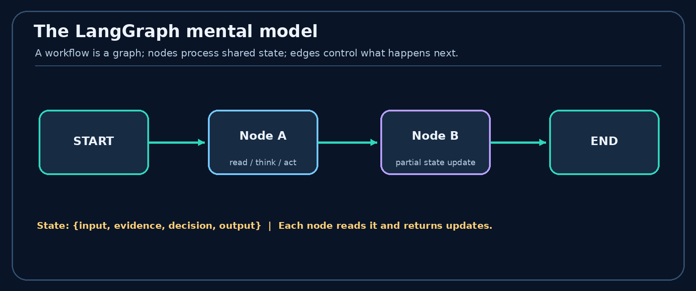
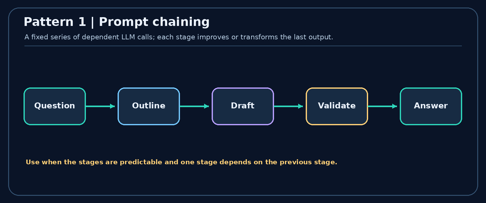
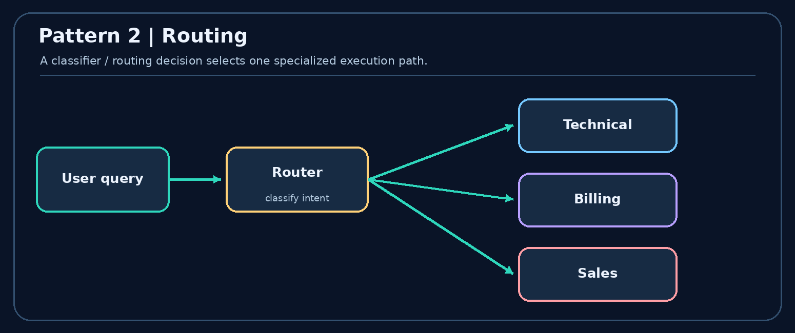
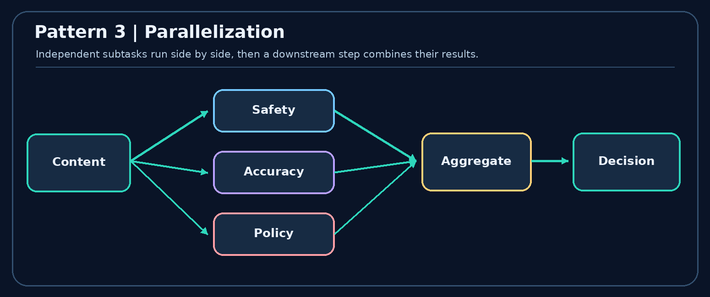
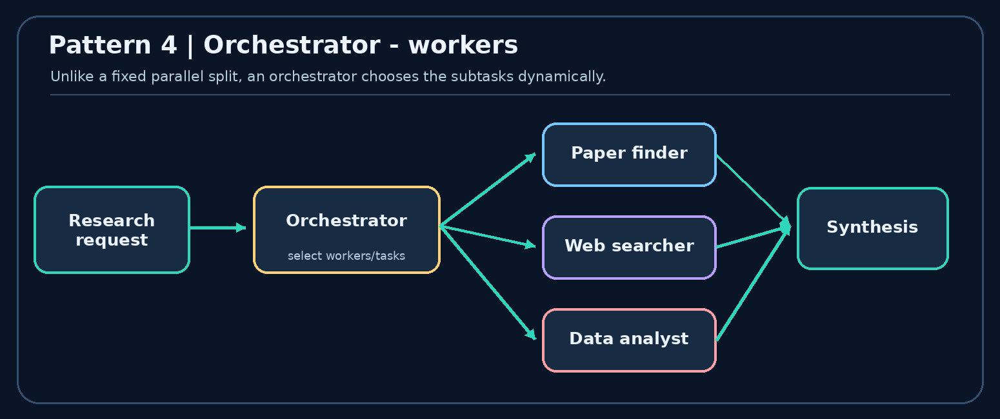
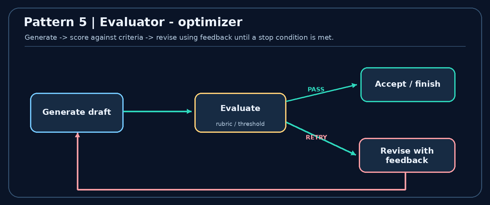
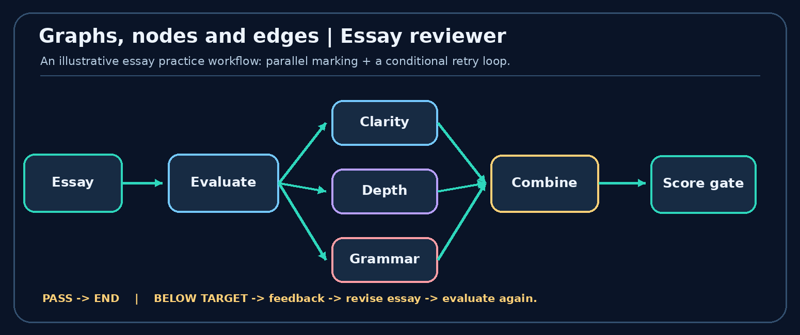
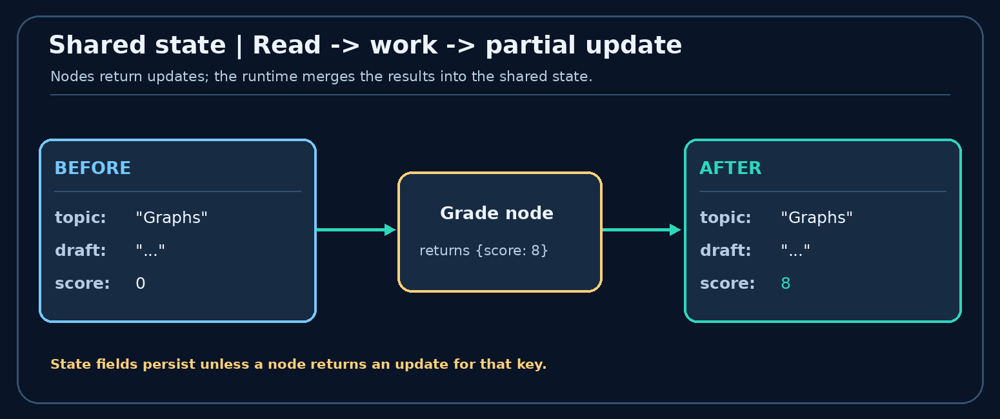
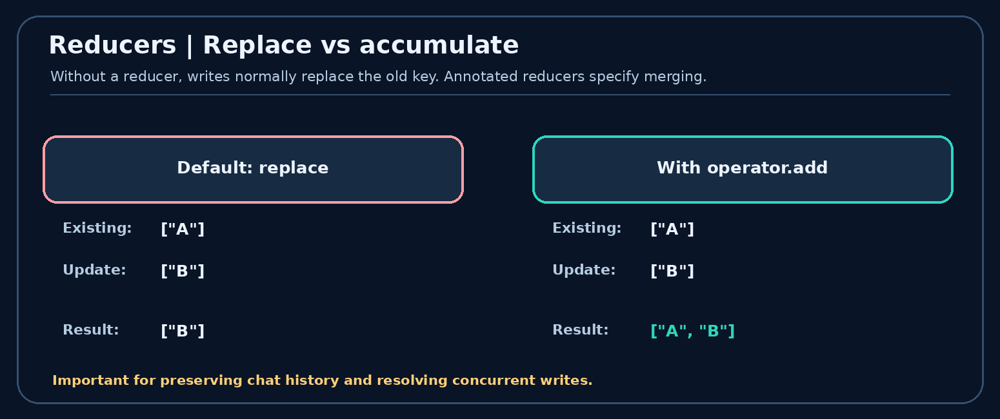
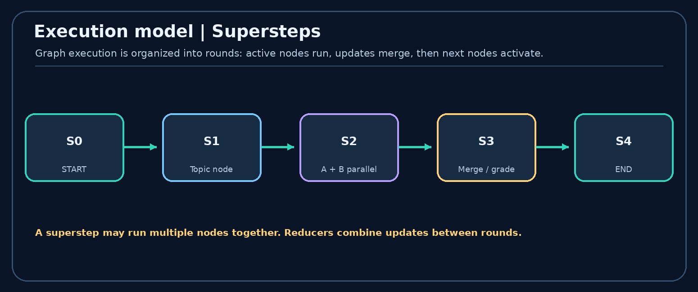

# LangGraph Core Concepts

**Course:** CampusX - Agentic AI using LangGraph  
**Lesson:** Video 4 - LangGraph Core Concepts  
**Duration:** 51 minutes 52 seconds  
**Watch:** [https://www.youtube.com/watch?v=D5KhiCDM9XQ](https://www.youtube.com/watch?v=D5KhiCDM9XQ)

## At a glance: what you will learn

LangGraph lets you represent multi-step AI behavior as a directed graph. **Nodes** perform tasks; **edges** decide what runs next; a shared **state** holds data; **reducers** control how updates combine; the runtime executes the graph in **supersteps**. The lesson first introduces five useful LLM workflow patterns, then explains the underlying graph architecture.

{ width=6.6in }

### Beginner's analogy: a team passing a shared notebook

Imagine an essay-review team. One person writes a draft, several people grade it, and another decides whether it is good enough. **Nodes** are team members; **edges** are instructions for who works next; **state** is the shared notebook; a **reducer** describes how to merge several reviewers' notes; and the **runtime** coordinates the handoffs.

This model is useful because it separates three concerns: **work** (a node), **control** (an edge), and **data** (state). In a graph, those concerns are visible and testable.

### Learning goals

After these notes, you should be able to draw the five core workflow patterns, explain a reducer with a real state update, build a conditional router, and describe what happens in one parallel execution round.

## Video chapter bookmarks

**00:00** - Introduction

**01:14** - What is LangGraph?

**05:43** - LLM workflows

**09:07** - Prompt chaining

**11:17** - Routing

**13:14** - Parallelization

**16:11** - Orchestrator-workers

**19:48** - Evaluator-optimizer

**23:00** - Graphs, nodes and edges

**30:53** - State

**36:07** - Reducers

**44:38** - Execution model

## 1. What is LangGraph? [01:14](https://www.youtube.com/watch?v=D5KhiCDM9XQ&t=74s)

**LangGraph** is a framework for orchestrating stateful, multi-step applications and agents. Instead of one giant function or prompt, describe a process as connected tasks with explicit transitions. A node can call an LLM, retrieve a document, run ordinary Python, consult a tool or evaluate a result; not every node needs an LLM.

**Why use a graph?** Linear chains are convenient for fixed steps, but realistic applications also need routing, parallel work, retry loops, state tracking, inspection, and sometimes pausing and resuming. The graph model makes those execution paths explicit.

**Remember:** LangGraph does not make the model intelligent by itself. It gives your application a controllable way to organize steps, data, and decisions.

## 2. What is an LLM workflow? [05:43](https://www.youtube.com/watch?v=D5KhiCDM9XQ&t=343s)

A **workflow** is an organized set of tasks aimed at a result. An **LLM workflow** includes one or more tasks involving language models, often mixed with deterministic code and tools. A research assistant might classify a question, retrieve evidence, summarize it, score the summary, and either return or revise the answer.

- **Sequential:** A -> B -> C (outline, draft, polish).
- **Conditional:** A selects B or C (a billing issue reaches the billing specialist).
- **Parallel:** A fans out to B and C (several independent checks).
- **Iterative:** A and B repeat (generate, critique, improve).

### Five patterns covered in the lesson

The following patterns are **ways to organize work**. They can be combined within one application.

### Workflow vs agent (important distinction)

A **workflow** usually follows designed code paths: the developer determines the overall sequence, branches and stop rules. An **agent** dynamically chooses actions, tools or subtasks within allowed boundaries. The same application may have deterministic workflow nodes *and* agentic nodes.

**Example:** A document processor always runs `extract → classify → validate` (workflow). If validation fails, a model may choose which specialist tool to use to repair the document (agentic behavior). LangGraph can represent both.

**Design question:** If you can specify exactly which steps are needed, prefer a predictable workflow. Give an agent more freedom only where that flexibility adds value.

## 3. Prompt chaining [09:07](https://www.youtube.com/watch?v=D5KhiCDM9XQ&t=547s)

**Idea:** Split a task into smaller fixed stages. Output from one stage becomes input to the next. For example: user request -> create outline -> write draft -> validate -> final answer.

{ width=6.6in }

**When useful:** the subtasks and their order are predictable; you want validation checkpoints; a single huge prompt performs poorly. **Trade-off:** serial calls add latency and errors can propagate through later steps. A simple sequential graph is enough; an advanced agent is not required.

**Step-by-step example - preparing a blog article:**

1. **Planner** receives `topic="Vector databases"` and returns an outline.
2. **Writer** receives that outline and returns a draft with headings and explanations.
3. **Editor** receives the draft and returns a polished article.
4. A deterministic **quality gate** checks required sections; failures may be reported instead of silently passing.

Each step has a narrower responsibility, making errors easier to locate. But a failed outline can affect every downstream step; gates and structured outputs reduce this risk.

**When to avoid:** if the task is trivial, three LLM calls may increase latency and cost without a meaningful quality benefit.

## 4. Routing [11:17](https://www.youtube.com/watch?v=D5KhiCDM9XQ&t=677s)

**Idea:** Inspect an input and send it to the right handler. A customer support assistant can route *refund* questions to billing, *error reports* to technical support, and *pricing* to sales. The decision may come from a deterministic rule or an LLM classifier.

{ width=6.6in }

**Difference from chaining:** chaining normally runs the same known steps each time; routing selects **which path** to run. Real applications often route first, then run a smaller chain within the chosen path.

**Worked router:** input `"My card was charged twice"` → classifier predicts `billing` → billing-specific node runs → its reply is returned. If the router predicts `technical`, only the technical branch runs. The next step is selected by **control flow**, not by copying an entire graph for every request.

**Router design rules:** make categories mutually understandable, provide a fallback for uncertain classifications, and test ambiguous inputs such as `"Billing page is broken"`. A model classifier can be wrong, so sensitive actions should still have validation.

In code, a `StateGraph` typically uses `add_conditional_edges(...)` to map route labels to destination node names.

## 5. Parallelization [13:14](https://www.youtube.com/watch?v=D5KhiCDM9XQ&t=794s)

**Idea:** Run independent checks at the same time, then aggregate the results. For content moderation, one worker checks safety, another checks factual claims, and another checks policy compliance. A merge step combines their findings into a publish-or-review decision.

{ width=6.6in }

**When useful:** independent tasks can run concurrently and you want lower wall-clock latency. **Important:** concurrency does not eliminate costs; individual LLM calls still consume tokens. If parallel branches update the **same state key**, you need a deliberate merge strategy (see reducers).

### Fan-out, then fan-in

Suppose a report requires an accuracy review and a formatting review. Both can receive the draft at the same time. Their outputs can then be merged before the final approval node runs. The branches are independent, but the **join must know what information each produced**.

| Parallel reviewer | State update | Why it can run independently |
|---|---|---|
| Accuracy | `accuracy_score=8` | Reads the draft, not formatting feedback |
| Style | `style_score=9` | Reads the draft, not the accuracy score |
| Finalizer | `final_score=8.5` | Runs after both scores are available |

If both workers write different keys, the results can coexist. If they both write `notes` in the same round, define a reducer such as list concatenation to avoid a conflicting concurrent write.

## 6. Orchestrator-workers [16:11](https://www.youtube.com/watch?v=D5KhiCDM9XQ&t=971s)

**Idea:** An orchestrator **decides the subtask decomposition at runtime** and delegates work to specialist workers. In a research task, it may choose literature retrieval, web reporting, and numerical analysis depending on the question, then synthesize the findings.

{ width=6.6in }

**Parallelization vs orchestrator-workers:** in a simple parallel workflow, the set of branches is often predefined; with an orchestrator, the required tasks/workers can change from one request to another. Workers may execute concurrently, but the defining feature is **dynamic delegation**, not parallelism itself.

### Fixed workers vs dynamically planned workers

**Fixed parallelism:** every report always runs exactly two checks - facts and style. **Orchestrator-workers:** for a market study, an orchestrator may create *three competitor-analysis subtasks*, while for a scientific review it may create *five paper-analysis subtasks*. The number and purpose of workers depend on the input.

**Typical flow:** `Request → Planner/orchestrator → Worker tasks → Aggregate outputs → Final answer`. In advanced LangGraph designs, `Send` can dispatch dynamically chosen units of work with their own task-specific state.

**Guardrails:** impose worker limits, timeouts and a total cost budget; require a common output format so the synthesis step can combine results reliably.

## 7. Evaluator-optimizer [19:48](https://www.youtube.com/watch?v=D5KhiCDM9XQ&t=1188s)

**Idea:** Separate **generation** from **evaluation**. A generator produces a draft, an evaluator checks it against a rubric, and the generator improves it using feedback. The loop ends when quality conditions are met or another explicit stop rule is reached.

{ width=6.6in }

**Example:** generate a short essay -> score for clarity, reasoning and grammar -> if below threshold, provide specific feedback -> regenerate. **Production tip:** enforce a maximum number of iterations or a time/token budget so the system cannot retry indefinitely.

### Understanding one evaluator loop

| Round | Draft quality | Evaluator result | Next action |
|---|---|---|---|
| 1 | Missing examples | `score=5/10`, feedback asks for examples | Revise |
| 2 | Examples added | `score=7/10`, reasoning still weak | Revise |
| 3 | Clear explanation | `score=9/10` | Finish |

A conditional edge can route to `revise` while the score is below a threshold, or to `END` once accepted. **Always include a stopping rule**, such as `score >= 8` **or** `attempts >= 3`, because feedback loops need not converge automatically.

**Pitfall:** using the same LLM to generate and evaluate can create blind spots. For important tasks, supplement the evaluator with deterministic checks, a second model or human review.

## 8. Graphs, nodes, and edges [23:00](https://www.youtube.com/watch?v=D5KhiCDM9XQ&t=1380s)

A **graph** is a set of vertices (nodes) connected by edges. In LangGraph:

- **Node:** a Python function/callable that reads current state, does one task, and returns state updates.
- **Edge:** a transition controlling which node(s) run next.
- **START / END:** special markers representing graph entry and termination.
- **Conditional edge:** a route chosen from a function's output.
- **Loop:** an edge that returns to an earlier task when another attempt is needed.

### Teaching example: essay practice

A learner receives a topic and submits an essay. Independent evaluators score **clarity, depth, grammar**; a combine step produces an overall score. A threshold gate either ends with a success message or returns feedback for another attempt. This one example combines sequential, parallel, conditional, and iterative execution.

{ width=6.6in }

**A useful distinction:** the graph is the *control-flow structure*; state is the *data that moves through the running process*. Avoid confusing a connection arrow with a manually passed data object.

### Node/edge exercise: follow an essay submission

Assume the essay graph is `START → Draft → [Clarity, Grammar, Depth] → Aggregate → Decision`. The bracketed nodes run in parallel, each returning a different score. The decision edge chooses either `END` or `Revise → [Clarity, Grammar, Depth]` for another round.

**Trace:** 

```text
State before scoring: {essay: "...", attempt: 1}
Clarity node returns: {clarity_score: 7}
Grammar node returns: {grammar_score: 9}
Depth node returns:   {depth_score: 6}
State after merge:   {essay: "...", attempt: 1,
                      clarity_score: 7, grammar_score: 9, depth_score: 6}
Aggregate returns:   {overall_score: 7.33}
```

Only the updated fields need to be returned; each node need not rebuild and return the whole dictionary. A decision node should inspect the finished scores, not assume parallel results are available before the join.

## 9. Shared state [30:53](https://www.youtube.com/watch?v=D5KhiCDM9XQ&t=1853s)

**State** is the evolving collection of values used by your workflow. In Python, a `TypedDict` is a common schema. For an essay evaluator, state might contain `topic`, `essay`, `clarity_score`, `grammar_score`, and `overall_score`.

Nodes **read** state and usually **return partial updates**. The runtime combines the updates into the state according to each key's merge rule. State is a logical shared structure; it need not mean arbitrary Python global mutable memory.

{ width=6.6in }

**Illustrative state schema:**

```python
from typing import TypedDict

class EssayState(TypedDict):
    topic: str
    essay: str
    score: float

def grade_essay(state: EssayState) -> dict:
    # A toy score for illustration, not a real evaluation model.
    new_score = 8.0 if len(state["essay"].split()) > 100 else 4.0
    return {"score": new_score}  # partial state update
```

**Good practice:** keep values that later nodes need; avoid storing unnecessary duplicated data. For real systems, separate raw inputs/outputs from transient prompt formatting.

### A state-update example you can reason through

Initial state:

```python
{"topic": "AI engineering", "essay": "first draft", "score": 0}
```

The grading node receives that state and returns only `{"score": 8}`. The runtime applies the update, so the new state is:

```python
{"topic": "AI engineering", "essay": "first draft", "score": 8}
```

**Why use a schema?** It documents expected keys and types and helps organize node contracts. A Python `TypedDict` provides static typing guidance; it does **not** by itself validate every runtime value like a full validation model would.

**Design tip:** store stable business facts and references (`candidate_id`, `essay`, `scores`) rather than duplicating prompt-formatted strings. Prompts can be rebuilt by the node when needed.

## 10. Reducers [36:07](https://www.youtube.com/watch?v=D5KhiCDM9XQ&t=2167s)

A **reducer** says *how to combine a new write with an existing state value*. By default, a state key is generally **replaced** by the newest update. Sometimes replacement is exactly right (for a scalar final score). At other times you want to **accumulate** data (chat history, essay revision history, parallel evidence).

{ width=6.6in }

**Reducer example (supplement):**

```python
from typing import Annotated, TypedDict
import operator

class NotesState(TypedDict):
    events: Annotated[list[str], operator.add]

# If the old events list is ["start"] and a node returns
# {"events": ["outline ready"]}, operator.add produces:
# ["start", "outline ready"]
```

A list accumulator and a chat-message reducer are not identical. For production message history, LangGraph provides message-aware helpers (for example `add_messages`) that can also handle message IDs and replacement semantics. **Parallel writes to the same key require a reducer or another valid coordination strategy**, rather than assuming two branches can silently overwrite each other.

### Reducer mechanics: replace vs accumulate

Suppose `history=["draft 1"]` already exists.

- **Default replacement:** node returns `{"history": ["review 1"]}` → new history becomes `["review 1"]`.
- **List reducer (`operator.add`):** the same update → new history becomes `["draft 1", "review 1"]`.
- **Parallel reviewers:** two nodes return `["grammar ok"]` and `["clarity weak"]`. A reducer lets the framework combine both updates into a list. Because parallel completion order need not define a meaningful order, do not depend on a particular order of entries in such a list.

**Choosing a reducer:** scores that should reflect the newest calculation often use replacement; history that should grow over time often uses accumulation. A chat message state may use `add_messages`, which handles message IDs and replacement semantics rather than blind list concatenation.

**Easy mental test:** ask, “When this field is written again, should old data be discarded or retained?” The answer guides your reducer.

### Why reducers matter

1. **Conversation continuity:** preserve prior messages instead of losing them with each turn.
2. **Revision history:** retain each iteration of a document if needed.
3. **Parallel branches:** safely combine writes made in the same execution round.

## 11. LangGraph execution model [44:38](https://www.youtube.com/watch?v=D5KhiCDM9XQ&t=2678s)

The graph engine is inspired by **Pregel**, a graph-processing model associated with Google. The lesson presents execution in three broad phases:

**1. Define:** specify your state schema, node functions, and edges.  
**2. Compile:** build an executable graph and validate supported structural constraints.  
**3. Invoke:** provide an initial state, execute activated nodes, apply state updates, and activate downstream nodes.

Execution progresses in **supersteps** (rounds). A superstep can contain multiple independent nodes running concurrently. Their writes are gathered and reconciled for the next round. The process terminates when it reaches an end condition and no further tasks are scheduled.

{ width=6.6in }

**Important nuance:** graph compilation checks the framework-level structure but cannot prove that every business decision or LLM result will be correct. Also, reliable pause/resume across sessions requires suitable checkpointing/persistence configuration; it does not happen simply because you drew a graph.

### Pregel execution: why the graph runs in rounds

Each **superstep** determines which nodes are active, executes the activated work, and applies updates for the next round. Independent branches can run in the same round; downstream nodes see their combined updates in a later round.

```text
Superstep 0: START schedules a draft node
Superstep 1: Draft writes essay, schedules reviewers
Superstep 2: Clarity + Grammar + Depth run in parallel
Superstep 3: Aggregate reads scores and writes overall_score
Superstep 4: Decision routes to END or Revise
```

This is a conceptual schedule: actual scheduling details vary by graph shape. The key insight is **parallel tasks are synchronized through graph execution steps and merge rules**.

**What `compile()` does and does not do:** it constructs an executable graph and validates certain graph constraints. It does not verify factual correctness, guarantee convergence, persist state without a configured checkpointer, or make external side effects safe by itself.

**Persistence versus state:** state is the working data of the graph. A checkpointer saves thread snapshots for recovery and resumption; a store can hold data reused across threads. These are separate features.

## 12. A tiny executable graph

The following uses deterministic nodes so you can understand graph structure *without an API key*. Use it to practice graph structure before adding model calls.

```python
# pip install -U langgraph
from typing import TypedDict
from langgraph.graph import StateGraph, START, END

class StudyState(TypedDict):
    topic: str
    outline: str
    answer: str

def outline_node(state: StudyState) -> dict:
    return {"outline": f"Definition + example + pitfalls for {state['topic']}"}

def answer_node(state: StudyState) -> dict:
    return {"answer": f"Study notes: {state['outline']}"}

builder = StateGraph(StudyState)
builder.add_node("outline", outline_node)
builder.add_node("answer", answer_node)
builder.add_edge(START, "outline")
builder.add_edge("outline", "answer")
builder.add_edge("answer", END)

app = builder.compile()
result = app.invoke({"topic": "LangGraph", "outline": "", "answer": ""})
print(result["answer"])
```

**Try changing the graph:** add a `check_node` between `outline` and `answer`; add a second branch; or use a reducer on a list key. These are natural next exercises after this conceptual lecture.

### Extend the example with real routing (still no API key)

This second example is intentionally deterministic. It makes **conditional edges** visible without involving model output.

```python
from typing import TypedDict
from langgraph.graph import StateGraph, START, END

class ReviewState(TypedDict):
    essay: str
    result: str
    word_count: int

def count_words(state: ReviewState):
    return {"word_count": len(state["essay"].split())}

def decide(state: ReviewState):
    return "pass" if state["word_count"] >= 15 else "revise"

def passed(state: ReviewState):
    return {"result": "Minimum length achieved"}

def revise(state: ReviewState):
    return {"result": "Add more explanation and examples"}

builder = StateGraph(ReviewState)
for name, node in [("count", count_words), ("pass", passed), ("revise", revise)]:
    builder.add_node(name, node)
builder.add_edge(START, "count")
builder.add_conditional_edges("count", decide, {"pass": "pass", "revise": "revise"})
builder.add_edge("pass", END)
builder.add_edge("revise", END)
app = builder.compile()
print(app.invoke({"essay": "This is short", "result": "", "word_count": 0})["result"])
```

**Exercise:** change the rule from 15 words to 25 and invoke again. Then add a node that appends helpful feedback, using a reducer rather than replacing a feedback list. For durable work, learn `InMemorySaver` for local experiments, then a database-backed checkpointer.

## 13. One-page comparison and exam revision

- **Workflow:** end-to-end task decomposition. *What goal are the steps achieving?*
- **Prompt chain:** a fixed dependent series. *Is the order known?*
- **Routing:** choose a path. *Which handler fits this input?*
- **Parallelization:** concurrent independent jobs. *Can these tasks run together?*
- **Orchestrator-workers:** dynamic delegation. *Must subtasks be planned at runtime?*
- **Evaluator-optimizer:** generate, judge, improve. *When does the loop stop?*
- **Node:** a task implementation. *What does the function read and write?*
- **Edge:** a next-step transition. *What runs after this task?*
- **State:** evolving shared values. *Which fields are needed later?*
- **Reducer:** a state-update merge rule. *Replace, append or combine?*
- **Superstep:** an execution round. *Which nodes run together?*

### A build-from-scratch learning path

1. **Sketch the graph on paper** before writing code. Mark every branch and possible loop.
2. **Define the state schema** (`TypedDict`) with fields other nodes need.
3. **Write one node per responsibility**; return partial dictionaries rather than mutating an unrelated global variable.
4. **Connect edges**, including `START`, `END`, and any decision paths.
5. **Compile and invoke** with simple deterministic test inputs first.
6. **Add persistence/interrupts** only when your use case requires stopping and resuming.
7. **Inspect runs and test failure cases**: wrong route, empty input, conflicting writes, too many loop iterations, and retry of an external action.

**Suggested project:** build an essay coach that generates a revision checklist, scores three dimensions, routes to feedback if the score is low, and records each revision attempt. Use dummy scoring functions first, then swap in model calls.

### Quick self-test

- [ ] Explain **node vs edge vs state** in one sentence each.
- [ ] Draw all **five workflow patterns** from memory.
- [ ] Explain **fixed parallel workers vs dynamic orchestrator workers**.
- [ ] Explain why concurrent state updates sometimes need a **reducer**.
- [ ] Draw a **feedback loop** and name its stopping condition.
- [ ] Explain how **supersteps** relate to parallel execution.
- [ ] Build the three-node `START -> outline -> answer -> END` graph yourself.

### Common mistakes to avoid

**Mistake 1:** "Every LangGraph node needs an LLM." Not true - a node may be any supported computation.  
**Mistake 2:** "State means durable long-term memory automatically." State holds working data; durability is a separate checkpointing concern.  
**Mistake 3:** "Parallel worker branches can freely overwrite the same key." Merge behavior must be defined.  
**Mistake 4:** "A router and an orchestrator are the same." Routing chooses a path; orchestration may decompose a job into a dynamic set of tasks.  
**Mistake 5:** "An evaluator loop is guaranteed to converge." Always impose stop conditions and budgets.

## Further reading

- [CampusX lesson - LangGraph Core Concepts](https://www.youtube.com/watch?v=D5KhiCDM9XQ)
- [LangGraph Graph API overview](https://docs.langchain.com/oss/python/langgraph/graph-api)
- [Workflow and agent patterns](https://docs.langchain.com/oss/python/langgraph/workflows-agents)
- [Persistence: checkpoints versus stores](https://docs.langchain.com/oss/python/langgraph/persistence)
- [Interrupts and resuming a thread](https://docs.langchain.com/oss/python/langgraph/interrupts)
- [Thinking in LangGraph](https://docs.langchain.com/oss/python/langgraph/thinking-in-langgraph)
