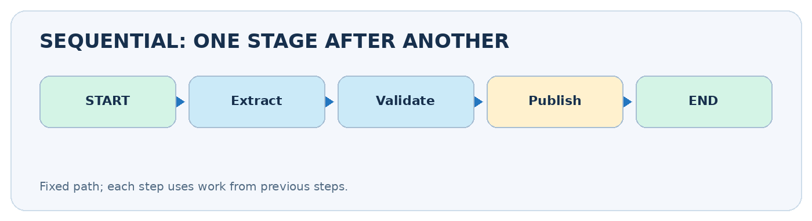
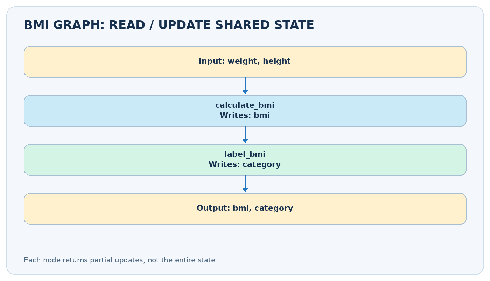
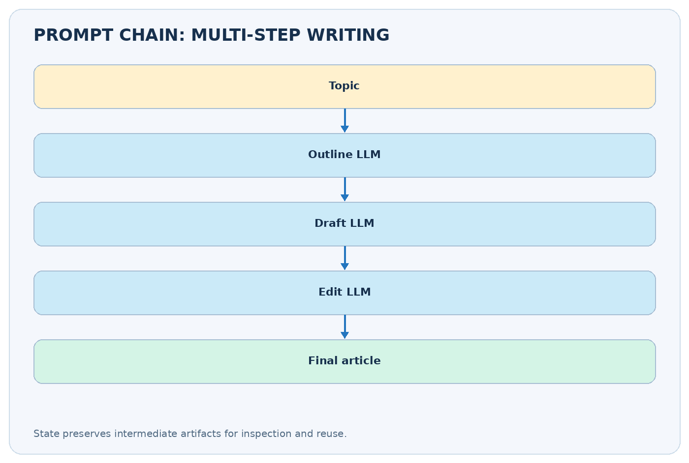

# Sequential Workflows in LangGraph

**CampusX • Agentic AI using LangGraph • Video 5**  
**Duration:** 49:13  
**Video:** https://www.youtube.com/watch?v=bAWujyAl1Kk  
**Practice repository:** https://github.com/campusx-official/langgraph-tutorials

## Learning outcomes

By the end, you should be able to create a `StateGraph`, explain the difference between state and a node's partial update, build a deterministic pipeline, use model calls inside nodes, and recognize when prompt chaining is useful.



## Video chapter bookmarks

- [00:00 — Introduction](https://www.youtube.com/watch?v=bAWujyAl1Kk&t=0s)
- [02:43 — Installation](https://www.youtube.com/watch?v=bAWujyAl1Kk&t=163s)
- [07:17 — First workflow](https://www.youtube.com/watch?v=bAWujyAl1Kk&t=437s)
- [26:11 — LLM workflow](https://www.youtube.com/watch?v=bAWujyAl1Kk&t=1571s)
- [36:55 — Prompt chaining](https://www.youtube.com/watch?v=bAWujyAl1Kk&t=2215s)
- [49:03 — Outro](https://www.youtube.com/watch?v=bAWujyAl1Kk&t=2943s)

## 1. What is a sequential workflow?

A **sequential workflow** is an ordered set of tasks where the next task starts after the previous one produces its result. Think `START -> A -> B -> C -> END`. For example, a blog-writing assistant might *choose a topic -> create an outline -> write a draft -> proofread*. The overall route is predetermined even if individual steps call an LLM.

- **Predictable control flow:** all runs normally follow the same node order.
- **Shared state:** earlier results are available to later nodes, rather than having to pass a long string between functions.
- **Small, testable nodes:** when output is wrong, inspect the node that introduced the error.
- **Trade-off:** dependent calls add latency; three sequential LLM calls often take longer than one call.

A sequential workflow is not necessarily an autonomous agent. It follows paths explicitly defined by the developer.

### An everyday analogy

Imagine three people preparing a report. The researcher gathers facts; the writer makes a draft using those facts; the editor checks the draft. The next person waits for the previous person's work. Their shared notebook is **graph state**.

## 2. Five core building blocks

| Concept | Role | Example |
|---|---|---|
| `TypedDict` state | Describes keys shared by nodes | `title`, `outline`, `article` |
| Node function | Does work and returns updates | `return {"outline": "..."}` |
| `START` and `END` | Entry and exit markers | `START -> outline -> END` |
| `add_edge()` | Connects fixed transitions | `add_edge("outline", "write")` |
| `compile()` / `invoke()` | Builds and runs the graph | `graph.invoke({"title": "AI"})` |

**Important distinction:** a state schema names possible fields; it does **not** require every output field to exist in the input dictionary. Prefer `NotRequired` where keys are intentionally created later. A node should usually return **only changed keys**, not copy and re-return everything.

## 3. Install and prepare an environment

```bash
python -m venv .venv
# Ubuntu / macOS:
source .venv/bin/activate
# Windows PowerShell:
# .\.venv\Scripts\Activate.ps1
python -m pip install -U langgraph langchain langchain-openai python-dotenv
```

Install `ipykernel` if working in Jupyter. The first practical example below uses **no API key**, so you can practice the graph mechanics without paying for model calls.

## 4. First practical workflow: calculate and label BMI

This exercise is intentionally ordinary Python. It isolates graph behavior from model behavior. Node 1 computes BMI, node 2 labels it, and both share the same `BMIState`.



```python
from typing import TypedDict, NotRequired
from langgraph.graph import StateGraph, START, END

class BMIState(TypedDict):
    weight_kg: float
    height_m: float
    bmi: NotRequired[float]
    category: NotRequired[str]

def calculate_bmi(state: BMIState) -> dict:
    height = state["height_m"]
    if height <= 0:
        raise ValueError("Height must be positive")
    return {"bmi": round(state["weight_kg"] / height**2, 2)}

def label_bmi(state: BMIState) -> dict:
    bmi = state["bmi"]
    if bmi < 18.5:
        label = "Underweight"
    elif bmi < 25:
        label = "Normal"
    elif bmi < 30:
        label = "Overweight"
    else:
        label = "Obesity"
    return {"category": label}

builder = StateGraph(BMIState)
builder.add_node("calculate_bmi", calculate_bmi)
builder.add_node("label_bmi", label_bmi)
builder.add_edge(START, "calculate_bmi")
builder.add_edge("calculate_bmi", "label_bmi")
builder.add_edge("label_bmi", END)
app = builder.compile()

result = app.invoke({"weight_kg": 80.0, "height_m": 1.73})
print(result)  # bmi approximately 26.73; category = 'Overweight'
```

*The labels here demonstrate control flow, not individualized health advice.*

### Follow the state by hand

| Moment | Keys known after the step |
|---|---|
| Input | `weight_kg=80`, `height_m=1.73` |
| After `calculate_bmi` | inputs preserved; `bmi=26.73` added |
| After `label_bmi` | earlier keys preserved; `category='Overweight'` added |

**Why partial returns?** If `calculate_bmi` returns `{"bmi": 26.73}`, the runtime merges that into the state. It is not necessary to return `weight_kg` or `height_m` again. This matters especially when you later learn parallel graphs, where two nodes writing the same unprotected key in one step can conflict.

## 5. Move from pure Python to an LLM node

LangGraph manages **when** nodes run; a model wrapper such as `ChatOpenAI` provides **what** an LLM node computes. Keep credentials out of source code. With an `OPENAI_API_KEY` set in your environment, a basic question-answering node could look like this:

```python
from langchain_openai import ChatOpenAI
model = ChatOpenAI(model="gpt-4o-mini", temperature=0)

class QAState(TypedDict):
    question: str
    answer: NotRequired[str]

def answer_question(state: QAState) -> dict:
    reply = model.invoke(f"Answer briefly: {state['question']}")
    return {"answer": reply.content}
```

You would register `answer_question` exactly as you registered `calculate_bmi`. The graph does not care whether a node performs math, queries a database, invokes a tool, or calls a model. **Do not call `model.invoke` unless your model and credentials are configured.**

## 6. Prompt chaining: outline -> draft -> review

**Prompt chaining** means breaking one complex request into narrower, ordered model tasks. In a blog generator, the writer depends on the planner's outline, and the editor depends on the draft.



```python
class BlogState(TypedDict):
    topic: str
    outline: NotRequired[str]
    draft: NotRequired[str]
    final: NotRequired[str]

def plan(state: BlogState) -> dict:
    response = model.invoke(f"Create a concise outline for: {state['topic']}")
    return {"outline": response.content}

def write(state: BlogState) -> dict:
    response = model.invoke(
        f"Write a clear article on {state['topic']} using:\n{state['outline']}"
    )
    return {"draft": response.content}

def edit(state: BlogState) -> dict:
    response = model.invoke(
        f"Improve clarity and remove repetition:\n{state['draft']}"
    )
    return {"final": response.content}

blog = StateGraph(BlogState)
blog.add_node("plan", plan)
blog.add_node("write", write)
blog.add_node("edit", edit)
blog.add_edge(START, "plan")
blog.add_edge("plan", "write")
blog.add_edge("write", "edit")
blog.add_edge("edit", END)
blog_app = blog.compile()
# blog_app.invoke({"topic": "Vector databases"})
```

The benefit is not automatic output quality; it is **task decomposition and observability**. The editor can still miss factual errors. Add validation or human review when correctness matters.

## 7. Common mistakes and how to debug

| Symptom | Likely cause | Fix |
|---|---|---|
| `KeyError: 'outline'` | Writer ran without an outline | Verify edge order; add input checks |
| Graph returns too early | Missing edge to a later node | Connect every stage to the next |
| Repeated or lost data | A node reassigns unrelated state | Return partial updates |
| LLM request fails | Missing API key / unavailable model | Verify environment and model access |
| Can't see intermediate results | Only final `invoke()` output examined | Stream updates from the graph |

To inspect which node changed what, use:

```python
for event in app.stream({"weight_kg": 80, "height_m": 1.73}, stream_mode="updates"):
    print(event)
```

## 8. When to choose this pattern

Choose sequential execution when later steps truly depend on earlier outputs: **extract -> normalize -> validate**, **research -> summarize -> edit**, or **generate -> review -> publish**. Avoid it when tasks are independent and could run concurrently: e.g., independently evaluating spelling, tone, and factuality. That is the topic of Video 6.

### Quick self-check

1. What would change if `label_bmi` ran before `calculate_bmi`?
2. Why does the `calculate_bmi` node return only the `bmi` key?
3. Which data should a blog writer read from shared state?
4. What makes this workflow deterministic even when an LLM is called?

### Practice task

Build an **order-price calculator**: `subtotal -> apply_discount -> add_tax -> produce_receipt`. Start without an LLM. Then add a text-generation node that explains the invoice. Check that the numeric result is calculated by Python, not guessed by the model.

## 9. Revision sheet

- [ ] I can explain `START`, `END`, nodes, and edges.
- [ ] I can build and compile a sequential `StateGraph`.
- [ ] I know a node returns a partial state update.
- [ ] I can trace values through three steps.
- [ ] I can place an LLM call inside one node.
- [ ] I can explain the costs and benefits of prompt chaining.

**Next lesson:** Parallel Workflows — independent tasks run concurrently and state updates must be merged safely.

### Further reading

- Official LangGraph Graph API: https://docs.langchain.com/oss/python/langgraph/graph-api
- Official LangGraph introduction: https://docs.langchain.com/oss/python/langgraph/overview
