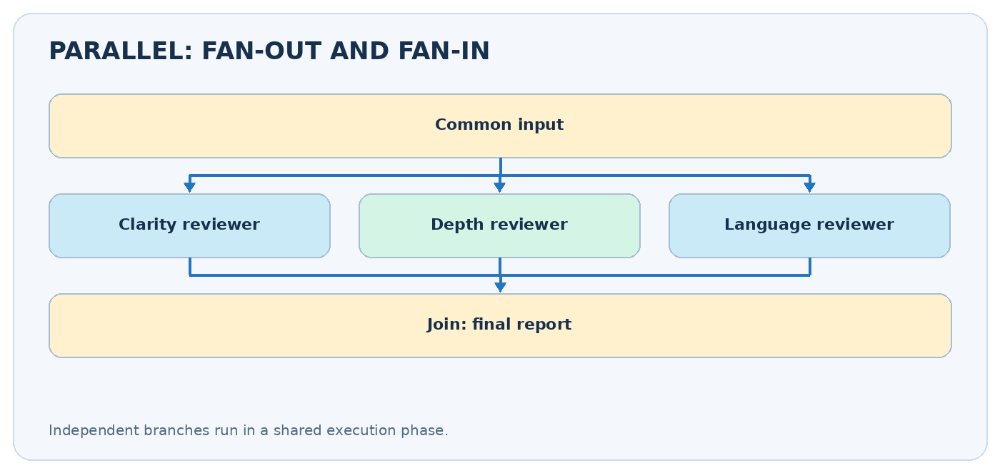
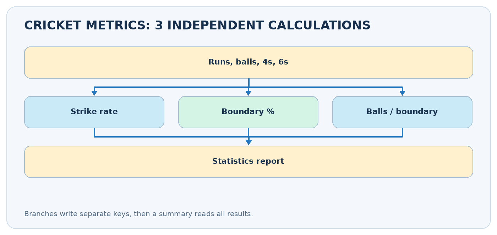
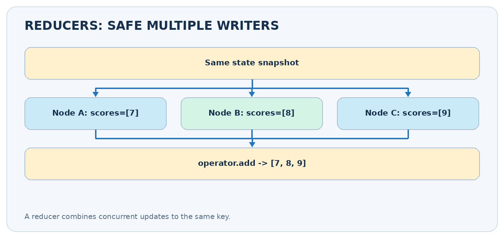

# Parallel Workflows in LangGraph

**CampusX • Agentic AI using LangGraph • Video 6**  
**Duration:** 59:29  
**Video:** https://www.youtube.com/watch?v=O6ryuSpqdOw  
**Practice repository:** https://github.com/campusx-official/langgraph-tutorials

## Learning outcomes

Learn **fan-out / fan-in execution**, how parallel nodes update a shared state without collisions, when to use `Annotated[..., operator.add]`, how to join parallel results, and why structured model output helps when several reviewers evaluate the same input.



## Video chapters — clickable timestamps

- [00:00 — Introduction](https://www.youtube.com/watch?v=O6ryuSpqdOw&t=0s)
- [02:43 — Setup](https://www.youtube.com/watch?v=O6ryuSpqdOw&t=163s)
- [07:15 — First workflow](https://www.youtube.com/watch?v=O6ryuSpqdOw&t=435s)
- [26:11 — LLM workflow](https://www.youtube.com/watch?v=O6ryuSpqdOw&t=1571s)
- [36:55 — Additional workflow discussion](https://www.youtube.com/watch?v=O6ryuSpqdOw&t=2215s)

## Example jump links

- [Watch the cricket-statistics example from the first-workflow chapter](https://www.youtube.com/watch?v=O6ryuSpqdOw&t=435s).
- [Watch the LLM-based discussion](https://www.youtube.com/watch?v=O6ryuSpqdOw&t=1571s).

## 1. Parallelism vs sequencing

In a sequential graph, B waits for A and C waits for B. In a **parallel** graph, independent nodes B, C, and D can start from one common state snapshot, then a downstream node combines their results. Example: analyze an essay's **clarity**, **depth**, and **language** at the same time, then calculate an overall report.

**Remember:** parallel is not the same as conditional. Parallel means *several branches run*. Conditional means *choose a branch*. Parallel branches can reduce wall-clock time for independent slow operations, but speed is limited by the slowest branch and the overhead of execution. It does not reduce the number of LLM calls or tokens consumed.

### A simple analogy

Three cricket analysts calculate strike rate, boundary percentage, and balls per boundary from the same scorecard. All three can work independently. A fourth analyst creates the summary when their results are ready.

## 2. How LangGraph coordinates parallel nodes

LangGraph executes enabled nodes in logical **supersteps**. Nodes in the same superstep can receive the same *pre-step* state; their updates are then applied according to each state key's reducer. A downstream join runs only once the relevant incoming branches have completed when the graph is wired as a join.

| Term | Meaning |
|---|---|
| Fan-out | One upstream step starts several independent branches |
| Fan-in / join | A downstream node combines branch results |
| Partial update | A branch returns only keys it owns |
| Reducer | Function that merges multiple updates to one key |
| Default update | Replaces a key's previous value when there is no reducer |

A common design is `START -> split -> [A, B, C] -> summarize -> END`. The summarizer should read data after all three branches have supplied their outputs.

## 3. Example: cricket performance metrics

For a batsman with 80 runs, 50 balls, 8 fours and 3 sixes:

- **Strike rate** = `runs / balls * 100` = **160.0**.
- **Boundary runs** = `4*fours + 6*sixes` = **50**.
- **Boundary percentage** = `boundary_runs / runs * 100` = **62.5%**.
- **Balls per boundary** = `balls / (fours + sixes)` = approximately **4.55**.

The three metrics are independent. None needs the other metric's result.



```python
from typing import TypedDict, NotRequired
from langgraph.graph import StateGraph, START, END

class CricketState(TypedDict):
    runs: int
    balls: int
    fours: int
    sixes: int
    strike_rate: NotRequired[float]
    boundary_pct: NotRequired[float]
    balls_per_boundary: NotRequired[float]
    report: NotRequired[str]

def strike_rate(state: CricketState) -> dict:
    return {"strike_rate": round(100 * state["runs"] / state["balls"], 2)}

def boundary_pct(state: CricketState) -> dict:
    boundary_runs = 4 * state["fours"] + 6 * state["sixes"]
    return {"boundary_pct": round(100 * boundary_runs / state["runs"], 2)}

def balls_per_boundary(state: CricketState) -> dict:
    boundaries = state["fours"] + state["sixes"]
    return {"balls_per_boundary": round(state["balls"] / boundaries, 2)}

def summarize(state: CricketState) -> dict:
    return {"report": (
        f"SR={state['strike_rate']}; boundaries={state['boundary_pct']}%; "
        f"balls/boundary={state['balls_per_boundary']}"
    )}

builder = StateGraph(CricketState)
builder.add_node("strike_rate", strike_rate)
builder.add_node("boundary_pct", boundary_pct)
builder.add_node("balls_per_boundary", balls_per_boundary)
builder.add_node("summarize", summarize)
for branch in ("strike_rate", "boundary_pct", "balls_per_boundary"):
    builder.add_edge(START, branch)
# A list of sources defines an explicit join before summarize.
builder.add_edge(["strike_rate", "boundary_pct", "balls_per_boundary"], "summarize")
builder.add_edge("summarize", END)
app = builder.compile()

print(app.invoke({"runs": 80, "balls": 50, "fours": 8, "sixes": 3})["report"])
```

**Safety of arithmetic:** if `balls=0`, `runs=0`, or `fours+sixes=0`, these divisions fail. Validate inputs at the start in a production app. Doing numeric checks in Python is more reliable than asking an LLM to guess statistics.

## 4. Why partial state updates are essential

Imagine three branches receive the same state. If each returns a full copied dictionary, they may all write the same keys such as `runs`, `balls`, or `status` during one superstep. With the default last-value update channel, **multiple writes to one key in one superstep can raise** `InvalidUpdateError`.

```python
# Good: each branch owns its own result key.
def metric_a(state):
    return {"metric_a": 10}

def metric_b(state):
    return {"metric_b": 20}

# Bad design for a parallel fan-out: both branches write 'shared_result'
# without a reducer.
def branch_a(state):
    return {"shared_result": "A"}

def branch_b(state):
    return {"shared_result": "B"}
```

Keep a simple rule: **one branch, one owned key**, unless you have deliberately defined merge semantics with a reducer.

## 5. Reducers: merging multiple updates into one list

Sometimes several branches should contribute to the same **collection**. Example: three essay graders each return a score and short feedback. Define a reducer for shared list keys.



```python
from typing import Annotated, TypedDict
import operator

class ReviewState(TypedDict):
    essay: str
    scores: Annotated[list[int], operator.add]
    feedback: Annotated[list[str], operator.add]

def clarity(state: ReviewState) -> dict:
    return {"scores": [8], "feedback": ["Clear structure"]}

def depth(state: ReviewState) -> dict:
    return {"scores": [7], "feedback": ["Needs more evidence"]}

def language(state: ReviewState) -> dict:
    return {"scores": [9], "feedback": ["Good grammar"]}
```

If the existing scores are `[8]` and a new update is `[7]`, `operator.add` combines them into `[8, 7]`. **Always return a list** to a list reducer (`[8]`, not `8`). For parallel work, do not depend on list order matching node order: attach a reviewer name to each item, or use separate keys.

## 6. LLM-based application: evaluate a UPSC essay

A richer parallel workflow can ask three models, or the same model with three different prompts, to evaluate:

1. **Clarity:** Is the argument easy to follow?
2. **Depth:** Does it use relevant evidence and counterarguments?
3. **Language:** Is expression precise and grammatical?

Each reviewer should return `score` and `feedback`. Instead of asking the model to write arbitrary text, define a **Pydantic structured output** schema:

```python
from pydantic import BaseModel, Field

class Grade(BaseModel):
    score: int = Field(ge=0, le=10)
    feedback: str = Field(min_length=1)

# With a configured compatible ChatOpenAI model:
# grade_model = model.with_structured_output(Grade)
# grade: Grade = grade_model.invoke("Evaluate clarity of: ...")
```

The aggregation node can calculate the average from the three numeric scores and combine feedback into one report. **Structured output helps parsing, but it does not guarantee the scores are fair or objective.** Evaluate graders on representative examples and use human checks for consequential assessments.

## 7. Explicit joins and synchronization

A common mistake is wiring each branch directly to the same summarizer without considering whether it should wait for all required results. For a fixed set of parallel paths, express the join directly:

```python
builder.add_edge(["clarity", "depth", "language"], "final_report")
```

This means the final report depends on completion of those branches. If different paths execute conditionally or have different lengths, plan how you will synchronize them; do not assume the first arriving result means the whole job is finished.

## 8. Cost, performance, and debugging

- **Latency:** roughly bounded by the slowest parallel branch (plus other overhead); measure it rather than assuming a 3x speedup.
- **Token usage:** three independent LLM calls still consume tokens three times. Parallelism optimizes waiting time, not necessarily cost.
- **Rate limits:** concurrent model calls may hit provider concurrency limits.
- **Side effects:** two branches should not update the same external file or record without an explicit coordination strategy.
- **Observability:** stream updates to see branch outputs without waiting for the final summary.

```python
for update in app.stream(
    {"runs": 80, "balls": 50, "fours": 8, "sixes": 3},
    stream_mode="updates",
):
    print(update)
```

## 9. Sequential vs parallel vs conditional

| Question | Sequential | Parallel | Conditional |
|---|---|---|---|
| How many branches? | One ordered path | Several independent paths | Usually one chosen path |
| When do steps run? | After prior step | Together in one phase | According to a decision |
| Main risk | High latency | Conflicting state updates | Wrong route |
| Typical use | Draft -> edit | Three independent reviewers | Refund vs tech support |

## 10. Practice and revision

**Exercise:** extend the cricket graph with a fourth branch computing **dot-ball percentage**, then add a final warning if denominators are zero. Next, modify the essay review graph to keep named score records instead of relying on arbitrary append order.

- [ ] I can draw fan-out and fan-in.
- [ ] I know why parallel branches must return partial updates.
- [ ] I can explain `Annotated[list[int], operator.add]`.
- [ ] I can write an explicit multi-node join.
- [ ] I know how structured outputs support multi-reviewer pipelines.
- [ ] I understand latency improvements do not imply lower API cost.

**Next lesson:** Conditional Workflows — choose a path based on the current state.

### Further reading

- LangGraph Graph API / reducers: https://docs.langchain.com/oss/python/langgraph/graph-api
- CampusX tutorial code: https://github.com/campusx-official/langgraph-tutorials
