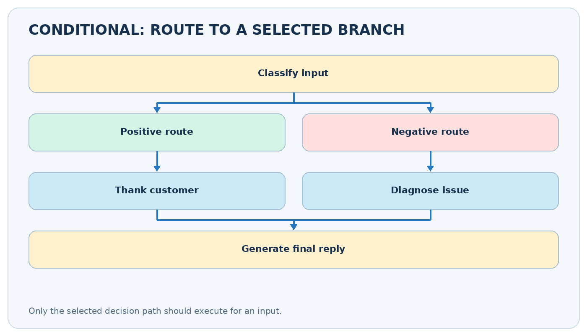
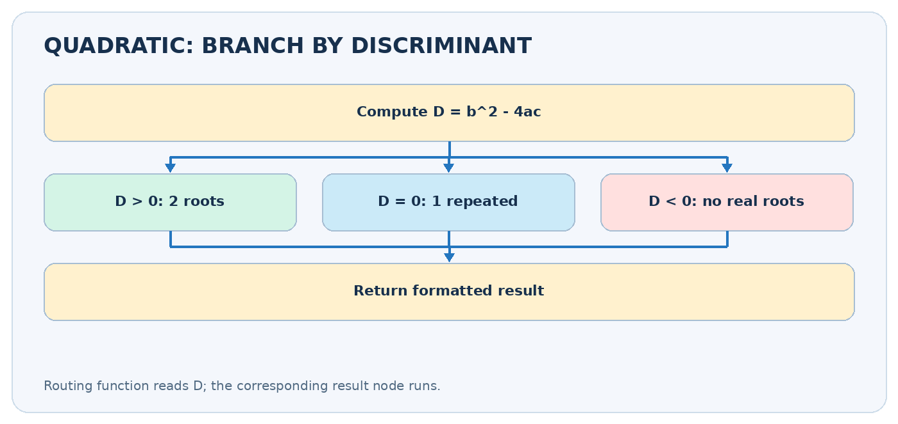
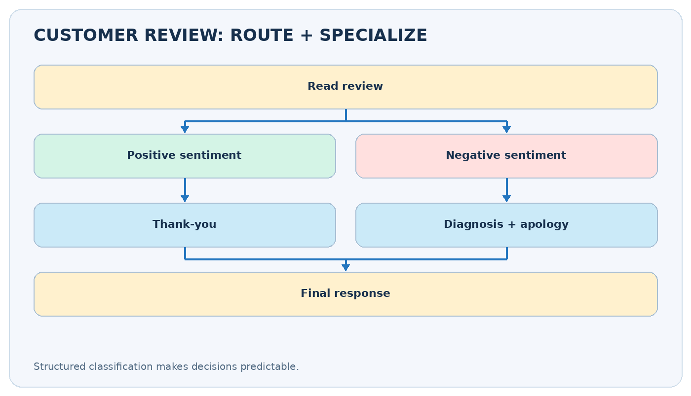

# Conditional Workflows in LangGraph

**CampusX | Agentic AI using LangGraph | Video 7**  
**Duration:** 47:38  
**Watch:** https://www.youtube.com/watch?v=I-dvZqTz-Wc  
**Official notebooks:** https://github.com/campusx-official/langgraph-tutorials

> **Core idea:** A decision function reads the current graph state, then chooses which node executes next. Think of a graph-shaped `if / elif / else`.



## Video chapters — clickable timestamps

- [00:00 — Recap: earlier workflow types](https://www.youtube.com/watch?v=I-dvZqTz-Wc&t=0s)
- [04:38 — Conditional workflow / quadratic equation example](https://www.youtube.com/watch?v=I-dvZqTz-Wc&t=278s)
- [24:20 — LLM review handling example](https://www.youtube.com/watch?v=I-dvZqTz-Wc&t=1460s)

These are chapter start times, so an explanation may continue until the next chapter.

## Learning outcomes

- Distinguish sequential, parallel and conditional execution.
- Write state schemas, calculation nodes and a routing function.
- Use `add_conditional_edges` and an explicit path map.
- Understand structured LLM classifications for customer-review routing.
- Handle missing inputs and edge cases without allowing an undefined route.

## 1. What is conditional execution?

In a **sequential** workflow, every run follows the same ordered steps. In **parallel**, several independent tasks are scheduled together. In a **conditional** graph, the value of a field determines **which successor** executes. An example is `START → classify_review → [thank_you OR diagnose_issue] → END`.

Imagine customer support: a payment problem goes to billing, an account problem to access support, and a compliment to the thank-you responder. You would not invoke all three responses for one review.

**Two concepts that are easy to confuse:** A *router function* makes a decision from state (`"positive"`, `"negative"`, `"unknown"`); a *conditional edge* uses that decision to activate its target. The router should ideally be cheap, deterministic and free of side effects.

## 2. Minimal graph vocabulary

| Building block | What it does | Example |
|---|---|---|
| State (`TypedDict`) | Defines input and intermediate fields | review text, sentiment, response |
| Worker node | Computes/produces partial updates | `return {"sentiment": "positive"}` |
| Router function | Reads state, returns a route label | `return state["sentiment"]` |
| `add_conditional_edges` | Maps labels to next nodes | positive → thank; negative → diagnose |
| `END` | Completes selected path | no more work is scheduled |

An ordinary `add_edge("A", "B")` makes a fixed transition. For a decision after `A`, use `add_conditional_edges("A", router, paths)`.

## 3. Example 1: quadratic-equation solver

**[Watch at 04:38](https://www.youtube.com/watch?v=I-dvZqTz-Wc&t=278s)**

For `a*x² + b*x + c = 0`, first calculate the **discriminant** `D = b² - 4ac`. Then route according to the value:

| Test | Meaning | Correct computation |
|---|---|---|
| `D > 0` | Two distinct real roots | `(-b ± sqrt(D)) / (2a)` |
| `D == 0` | One repeated real root | `-b / (2a)` |
| `D < 0` | No real roots | Explain that roots are complex |

If `a == 0`, it is not a quadratic equation. Validate the input before calculating roots.



### Complete runnable graph (no API key)

```python
from typing import TypedDict, NotRequired
from math import sqrt
from langgraph.graph import StateGraph, START, END

class QuadState(TypedDict):
    a: float
    b: float
    c: float
    discriminant: NotRequired[float]
    result: NotRequired[str]

def discriminant(state: QuadState) -> dict:
    if state["a"] == 0:
        return {"discriminant": float("nan")}
    return {"discriminant": state["b"] ** 2 - 4 * state["a"] * state["c"]}

def route(state: QuadState) -> str:
    if state["a"] == 0:
        return "invalid"
    d = state["discriminant"]
    return "two" if d > 0 else "one" if d == 0 else "complex"

def two_roots(state: QuadState) -> dict:
    a, b, d = state["a"], state["b"], state["discriminant"]
    r1, r2 = (-b + sqrt(d)) / (2*a), (-b - sqrt(d)) / (2*a)
    return {"result": f"Two real roots: {r1:.3g}, {r2:.3g}"}

def one_root(state: QuadState) -> dict:
    return {"result": f"Repeated root: {-state['b']/(2*state['a']):.3g}"}

def complex_roots(state: QuadState) -> dict:
    return {"result": "No real roots; discriminant is negative."}

def invalid(state: QuadState) -> dict:
    return {"result": "a must not be zero for a quadratic equation."}

builder = StateGraph(QuadState)
builder.add_node("compute", discriminant)
builder.add_node("two", two_roots)
builder.add_node("one", one_root)
builder.add_node("complex", complex_roots)
builder.add_node("invalid", invalid)
builder.add_edge(START, "compute")
builder.add_conditional_edges(
    "compute", route,
    {"two":"two", "one":"one", "complex":"complex", "invalid":"invalid"},
)
for node in ("two", "one", "complex", "invalid"):
    builder.add_edge(node, END)
app = builder.compile()
for coeffs in [(1, -3, 2), (1, 2, 1), (1, 0, 1), (0, 2, 1)]:
    print(coeffs, app.invoke(dict(zip(("a", "b", "c"), coeffs)))["result"])
```

**How the route works:** with `(a,b,c)=(1,-3,2)`, `D=9-8=1`, so the `two` node runs and returns roots `2` and `1`. With `(1,2,1)`, `D=0`, so only `one` executes. This is **selection**, not parallelism.

## 4. Example 2: customer-review response using an LLM

**[Watch at 24:20](https://www.youtube.com/watch?v=I-dvZqTz-Wc&t=1460s)**

A review arrives, e.g., *"Great interface!"* or *"The checkout crashes and I need urgent help."* A classification model chooses `positive` or `negative`. In the negative branch, a diagnosis step extracts `issue_type`, `urgency`, and `tone`; a response writer uses that diagnosis to respond appropriately.



### Pydantic structured-output concept

```python
from typing import Literal
from pydantic import BaseModel, Field

class Sentiment(BaseModel):
    label: Literal["positive", "negative"]

class Diagnosis(BaseModel):
    issue_type: Literal["bug", "ux", "performance", "support", "other"]
    urgency: Literal["low", "medium", "high"]
    tone: str = Field(description="How the customer sounds")

# With an initialized compatible chat model:
# classifier = model.with_structured_output(Sentiment)
# outcome = classifier.invoke("Classify the review: ...")
# node returns {"sentiment": outcome.label}
```

An LLM's free-form answer can be hard to route; a **structured, validated label** makes it easier. Still, handle classification errors, unexpected labels, model timeouts and ambiguous feedback. For severe complaints, include escalation to a human rather than inventing a resolution.

### Routes as business rules

| Review | Classifier output | Action |
|---|---|---|
| "Great support team" | positive | Generate short thanks |
| "App crashes every login" | negative | Diagnose bug / prioritize |
| "I love the features but billing failed" | ambiguous | Define policy; possibly add mixed/triage route |

**Design tip:** if there are more than two possible classes, introduce a `Literal["positive", "negative", "mixed"]` and a third path rather than forcing a misleading binary decision.

## 5. Conditional edges vs several normal edges

If you add both `A -> B` and `A -> C` as ordinary outgoing edges, both B and C can be scheduled. That is **not** equivalent to an `if/else` decision. Use conditional routing to select one path.

```python
def decide(state) -> str:
    return "refund" if state["intent"] == "refund" else "support"

builder.add_conditional_edges(
    "classify", decide,
    {"refund": "refund_handler", "support": "support_handler"},
)
```

When several routes reconverge at a shared finishing node, make sure every selected route reaches it, or explicitly goes to `END`.

## 6. Debugging checklist

| Symptom | Likely cause | Remedy |
|---|---|---|
| Route label has no target | Output not in path mapping | Add mapping/default or validate label |
| Every branch executes | Used ordinary edges for branching | Replace with conditional edges |
| `KeyError` in router | State key not set | Ensure classifier updates key before routing |
| Unexpected LLM route | No constrained output | Use `Literal` / schema and validation |
| Wrong math branch | Equality / floating-point issue | For approximate computations, use tolerance |

**Production caution:** route labels should be treated like untrusted data if derived from an LLM; validate before using them to authorize money transfers, data deletion or account changes.

## 7. Exercises

1. Extend the quadratic workflow to calculate complex roots using `cmath.sqrt`.
2. Add a `mixed` review route and a `human_escalation` route.
3. Add a node that logs the chosen route and timestamps each decision.
4. Test all possible paths separately; a successful happy-path test does not prove the entire graph is correct.

### Quick revision

- [ ] I can distinguish branching from parallel fan-out.
- [ ] I can write a route function that reads graph state.
- [ ] I can explain why `add_conditional_edges` is different from `add_edge`.
- [ ] I can run the no-key quadratic solver.
- [ ] I can explain why structured classification helps with LLM routing.
- [ ] I can describe what happens when a route label is unexpected.

**Related source code:** [Quadratic equation notebook](https://github.com/campusx-official/langgraph-tutorials/blob/main/6_quadratic_equation_workflow.ipynb) and [review reply notebook](https://github.com/campusx-official/langgraph-tutorials/blob/main/7_review_reply_workflow.ipynb).

**Further reading:** [Official LangGraph Graph API](https://docs.langchain.com/oss/python/langgraph/graph-api).
