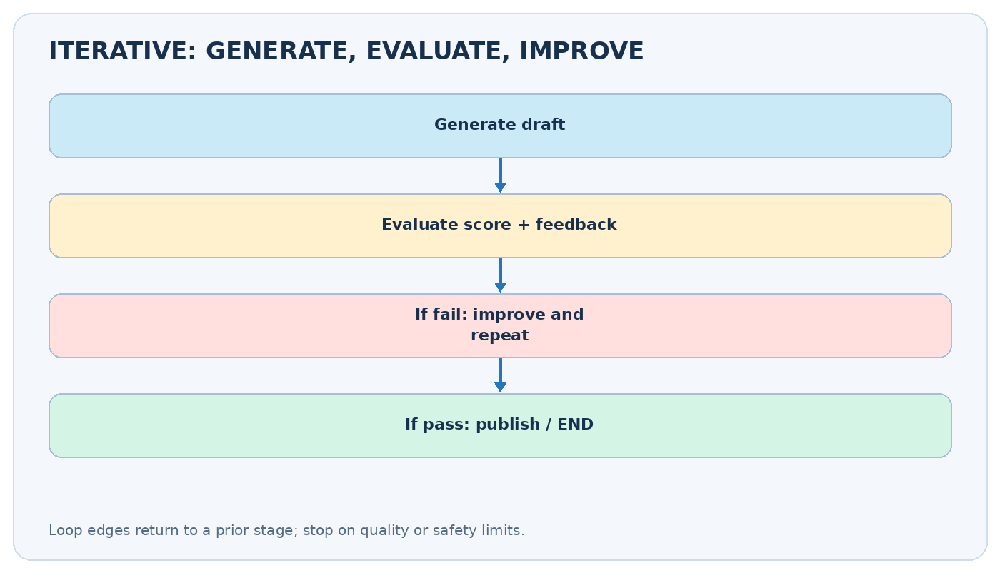
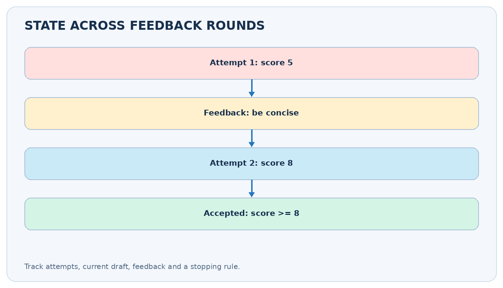
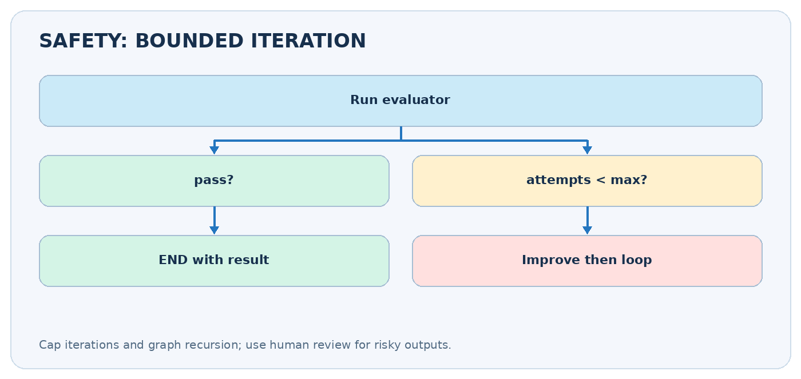

# Iterative Workflows in LangGraph

**CampusX | Agentic AI using LangGraph | Video 8**  
**Duration:** 37:14  
**Video:** https://www.youtube.com/watch?v=7CbSqrovcsE  
**Practice code:** https://github.com/campusx-official/langgraph-tutorials/blob/main/8_X_post_generator.ipynb

> **Core idea:** When a first draft is not good enough, generate → evaluate → improve → re-evaluate, then stop when the answer passes or you hit a limit.



## Video chapters — clickable timestamps

- [00:00 — Recap of workflow patterns](https://www.youtube.com/watch?v=7CbSqrovcsE&t=0s)
- [01:51 — Plan of action](https://www.youtube.com/watch?v=7CbSqrovcsE&t=111s)
- [08:15 — Building the workflow](https://www.youtube.com/watch?v=7CbSqrovcsE&t=495s)
- [29:45 — Testing](https://www.youtube.com/watch?v=7CbSqrovcsE&t=1785s)

## Learning outcomes

- Explain why a graph needs an explicit loop edge and stopping condition.
- Build generator, evaluator and optimizer nodes.
- Store drafts, feedback, scores and iteration count in state.
- Route evaluation outcomes to an optimizer or `END`.
- Bound looping to avoid runaway API calls.
- Apply the workflow to short social-post generation and other real tasks.

## 1. What is an iterative workflow?

A **sequential** graph has a predetermined order: `A → B → C → END`. An **iterative** graph deliberately revisits nodes: `generate → evaluate → (approved? END : improve → evaluate ...)`. The back edge is the defining feature.

A simple example is a post-writing assistant. It writes a short post about "learning LangGraph," a reviewer checks clarity and length, and the post is revised if it fails. The loop ends when the post meets the rule, or when the maximum number of improvements has been attempted.

This is sometimes called **evaluator–optimizer**, **feedback loop**, or **reflection** workflow. The evaluator might be a Python function, an LLM, a test suite or a human.

## 2. Nodes, state, and control flow

| Element | Function | Example state field |
|---|---|---|
| Generator | Makes initial draft | `draft` |
| Evaluator | Measures quality | `score`, `feedback`, `approved` |
| Optimizer | Revises the draft | updates `draft` |
| Router | Decides retry vs stop | reads `approved`, `attempts` |
| Stopping rule | Prevents endless work | `max_attempts` |

A graph is not automatically iterative just because a Python `for` loop exists within a node. In a LangGraph **control-flow loop**, the *edges* revisit another node, exposing each step to graph-level tracing and state management.

## 3. Video project: short X/Twitter post generator

**[Watch at 01:51](https://www.youtube.com/watch?v=7CbSqrovcsE&t=111s)** and **[workflow build at 08:15](https://www.youtube.com/watch?v=7CbSqrovcsE&t=495s)**

The tutorial's companion notebook is named `8_X_post_generator.ipynb`. The broad pattern is: ask a generator to create a social post about a topic, assess quality, and revise with the evaluator's feedback if necessary.



Example state trace (illustrative):

| Moment | Draft / decision | State change |
|---|---|---|
| Start | Topic: "Learn LangGraph" | `topic` set |
| Draft 1 | Long and vague post | `draft`, `attempts=1` |
| Evaluation 1 | Score 5/10; too wordy | `feedback`, `approved=False` |
| Improvement | Shorter post with one point | `draft`, `attempts=2` |
| Evaluation 2 | Score 8/10 | `approved=True` |
| End | Return improved post | stop looping |

The evaluator needs **criteria**, not just "is this good?" Useful criteria are factuality, clarity, format, word/character limit, tone and absence of unsafe promises. Higher scores are not automatically proof of factual accuracy.

## 4. Complete runnable no-API-key workflow

The following deterministic example demonstrates real LangGraph loops. It improves a simple post by removing filler words until the post is below a chosen character limit, or until the retry budget is exhausted.

```python
from typing import TypedDict, NotRequired
from langgraph.graph import StateGraph, START, END

class PostState(TypedDict):
    topic: str
    draft: NotRequired[str]
    feedback: NotRequired[str]
    approved: NotRequired[bool]
    attempts: NotRequired[int]
    max_attempts: NotRequired[int]

def generate(state: PostState) -> dict:
    text = (f"Today I am very excited to share a really interesting "
            f"and useful learning tip about {state['topic']}. "
            "Start with a tiny project and improve it through practice.")
    return {"draft": text, "attempts": 1, "max_attempts": 4}

def evaluate(state: PostState) -> dict:
    max_chars = 95
    okay = len(state["draft"]) <= max_chars
    return {
        "approved": okay,
        "feedback": "Approved" if okay else f"Reduce to <= {max_chars} chars",
    }

def improve(state: PostState) -> dict:
    text = state["draft"]
    for phrase in ("Today I am very excited to share ",
                   "a really interesting and useful ",
                   "learning tip about "):
        text = text.replace(phrase, "")
    if len(text) > 95:
        text = f"{state['topic']}: start small, build, test, and improve."
    return {"draft": text, "attempts": state["attempts"] + 1}

def decide(state: PostState) -> str:
    if state["approved"] or state["attempts"] >= state["max_attempts"]:
        return "done"
    return "retry"

builder = StateGraph(PostState)
builder.add_node("generate", generate)
builder.add_node("evaluate", evaluate)
builder.add_node("improve", improve)
builder.add_edge(START, "generate")
builder.add_edge("generate", "evaluate")
builder.add_conditional_edges("evaluate", decide,
                              {"done": END, "retry": "improve"})
builder.add_edge("improve", "evaluate")
app = builder.compile()
result = app.invoke({"topic": "LangGraph workflows"},
                    config={"recursion_limit": 20})
print(result["draft"], result["approved"], result["attempts"])
```

**What to notice:** The optimizer's **normal edge returns to the evaluator**. The evaluator's **conditional edge** either ends or sends the graph to the optimizer again. You can add a second generator branch if your use case benefits from producing a completely fresh draft instead of editing the current one.

## 5. Converting this into an LLM evaluator–optimizer

**[Watch at 08:15](https://www.youtube.com/watch?v=7CbSqrovcsE&t=495s)**

Three separate model invocations are typical: `generate` gets the topic, `evaluate` judges the draft against a rubric, and `improve` takes both draft and feedback. Use **structured output** for evaluation instead of trying to parse arbitrary natural language.

```python
from typing import Literal
from pydantic import BaseModel, Field

class Critique(BaseModel):
    verdict: Literal["approved", "improve"]
    feedback: str = Field(description="Actionable suggestion if not approved")
    score: int = Field(ge=0, le=10)

# With a configured ChatOpenAI model:
# critique_model = llm.with_structured_output(Critique)
# result = critique_model.invoke(
#   f"Check factuality, clarity, and <= 280 characters: {draft}"
# )
# return {"approved": result.verdict == "approved",
#         "feedback": result.feedback, "score": result.score}
```

One good improvement rule is **carry forward the evaluator's concrete feedback**, not just a numeric score. For example "remove redundant intro and include one actionable point" is better than "score 6/10".

## 6. Safety limits and failure modes



### Always have a stop condition

A safe loop commonly terminates if **quality passed OR attempts >= maximum**. Also configure LangGraph's `recursion_limit` for an additional guard. A recursion limit prevents excessive graph steps; it is **not** a substitute for an application-level stopping rule.

| Failure | Why it happens | Improvement |
|---|---|---|
| Infinite cycle | Route never returns END | Add `max_attempts` and test termination |
| Repeated identical drafts | Feedback ignored | Supply previous draft + specific critique |
| Scores fluctuate | Unstable evaluator | Use rubric + deterministic checks + human review |
| Output becomes worse | Over-optimization | Preserve best-so-far candidate and compare |
| API costs explode | Every loop calls models | Limit iterations; track tokens and latency |
| False acceptance | Evaluator is too lenient | Add objective validators where possible |

**Important nuance:** if the final state is not approved but the maximum attempt count is reached, communicate that explicitly in a real application. Do not silently present an unapproved result as validated.

## 7. How to test iterative workflows

**[Watch testing section at 29:45](https://www.youtube.com/watch?v=7CbSqrovcsE&t=1785s)**

Test at least four cases: (1) first draft passes immediately, (2) one retry fixes the issue, (3) all retries fail and the graph stops safely, and (4) the evaluator raises an error or returns an invalid decision. Inspect state updates, not just final text.

```python
for step in app.stream({"topic": "LangGraph"},
                       stream_mode="updates"):
    print(step)
```

For real LLM tests, replace paid calls with fixed test doubles to make routing and stop conditions deterministic. Score qualitative output separately with a human-reviewed evaluation dataset.

## 8. Comparison with other patterns

| Pattern | Control flow | Example |
|---|---|---|
| Sequential | One fixed chain | Extract → normalize → save |
| Parallel | Independent branches | Grade clarity + accuracy + tone |
| Conditional | Choose based on state | Refund vs billing support |
| Iterative | Revisit previous work | Draft → evaluate → revise |

These patterns can be **combined**: parallel reviewers can evaluate one draft, the router can decide whether to iterate, and a sequential publishing step can run after approval.

## 9. Practice and revision checklist

1. Add a `history` list to record feedback per attempt using `Annotated[list[str], operator.add]`. Return a **single-item list** from each node that contributes history.
2. Keep the highest-scoring draft in `best_draft` even if a later iteration is worse.
3. Add deterministic validators for character count and forbidden words before calling the LLM evaluator.
4. Make `max_attempts` an input parameter rather than hard-coding it in the generator.

- [ ] I can explain a loop edge in a compiled graph.
- [ ] I know which node produces feedback and which consumes it.
- [ ] I can route between retry and END.
- [ ] I can explain why a max-iteration guard is important.
- [ ] I can run the no-key demo and print intermediate updates.
- [ ] I know that an LLM judge does not guarantee correctness.

**Official CampusX notebook:** [8_X_post_generator.ipynb](https://github.com/campusx-official/langgraph-tutorials/blob/main/8_X_post_generator.ipynb).  
**Further reading:** [LangGraph workflows and agents](https://docs.langchain.com/oss/python/langgraph/workflows-agents), [Graph API](https://docs.langchain.com/oss/python/langgraph/graph-api).
