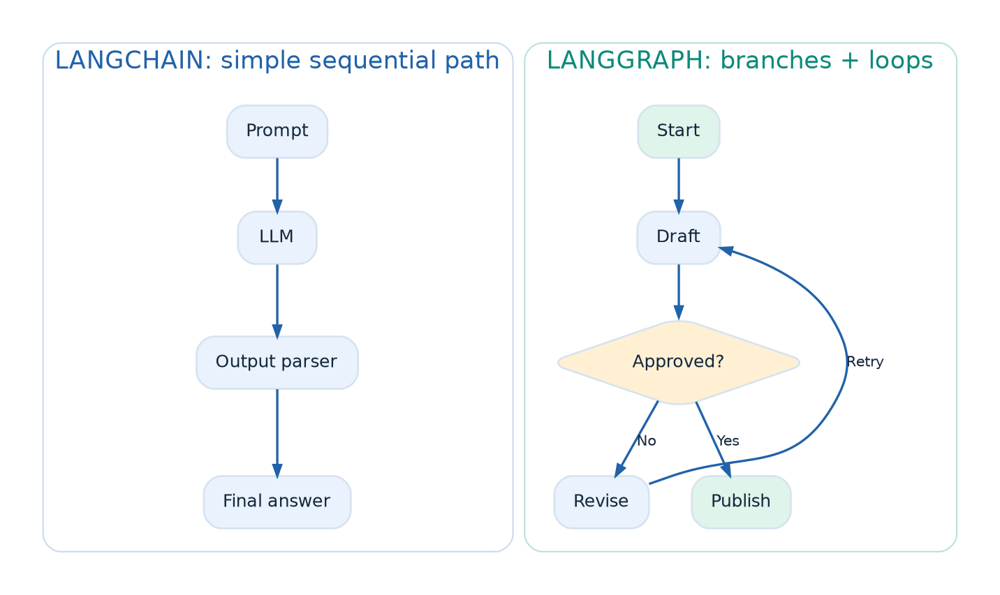
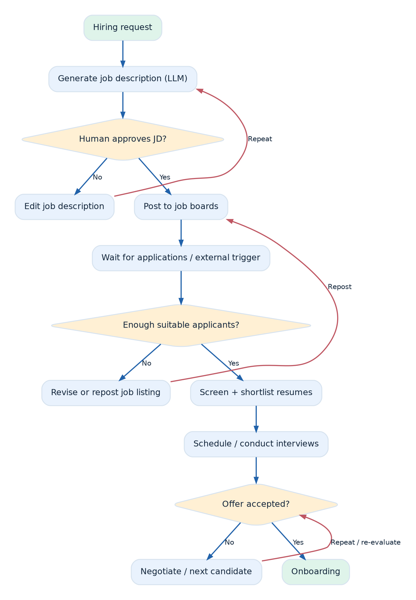
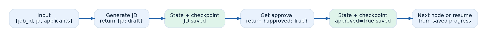
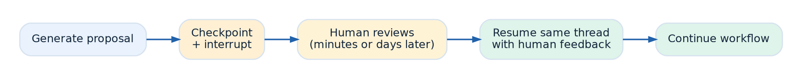

# LangChain vs LangGraph — Detailed Study Notes

**CampusX • Agentic AI using LangGraph • Video 3 • 1 h 27 min 29 sec**  
Original video: https://www.youtube.com/watch?v=31qyMKNB2RA

> **Source and visual accuracy:** These are original study notes based on the video's published chapter timestamps and an independently available detailed summary, cross-checked with LangGraph documentation. I could not directly play the YouTube video or capture its frames in this environment. **The diagrams below are original explanatory diagrams, not screenshots from the video.** Timestamp links jump to relevant parts of the lesson.

## At a glance

**Main idea:** LangChain gives you convenient building blocks for LLM-powered applications. LangGraph lets you **orchestrate complex, stateful, non-linear and potentially long-running workflows** using nodes, edges, persistent state and checkpoints. In practice, you can use both together.



### Video chapter guide

| Time | Topic | Why it matters |
|---|---|---|
| [00:00](https://www.youtube.com/watch?v=31qyMKNB2RA&t=0s)–[02:30](https://www.youtube.com/watch?v=31qyMKNB2RA&t=150s) | Introduction and goal | Why compare the two frameworks? |
| [05:20](https://www.youtube.com/watch?v=31qyMKNB2RA&t=320s) | What is LangChain? | Building blocks for LLM apps |
| [10:15](https://www.youtube.com/watch?v=31qyMKNB2RA&t=615s) | LangChain use cases | Where simple chains are enough |
| [15:40](https://www.youtube.com/watch?v=31qyMKNB2RA&t=940s) | Automated workflow | Hiring example motivates the need for orchestration |
| [27:36](https://www.youtube.com/watch?v=31qyMKNB2RA&t=1656s) | Control-flow complexity | Branches, loops and routes |
| [39:16](https://www.youtube.com/watch?v=31qyMKNB2RA&t=2356s) | Handling state | Keeping application data across steps |
| [49:50](https://www.youtube.com/watch?v=31qyMKNB2RA&t=2990s) | Event-driven execution | Pauses and external events |
| [55:55](https://www.youtube.com/watch?v=31qyMKNB2RA&t=3355s) | Fault tolerance | Resume after interruptions or failures |
| [1:02:26](https://www.youtube.com/watch?v=31qyMKNB2RA&t=3746s) | Human-in-the-loop | Approval and feedback |
| [1:08:54](https://www.youtube.com/watch?v=31qyMKNB2RA&t=4134s) | Nested workflows | Subgraphs and reuse |
| [1:15:53](https://www.youtube.com/watch?v=31qyMKNB2RA&t=4553s) | Observability | Trace, debug and inspect execution |
| [1:22:38](https://www.youtube.com/watch?v=31qyMKNB2RA&t=4958s) | Revision | When to choose which framework |

---

## 1. What is LangChain? — [05:20](https://www.youtube.com/watch?v=31qyMKNB2RA&t=320s)

**Definition:** LangChain is a library for composing applications around language models. Instead of writing every provider/API integration yourself, you use reusable components.

- **Models:** Standardized interfaces to chat models and other model providers.
- **Prompt templates:** Build structured, reusable model inputs.
- **Retrievers and vector stores:** Retrieve relevant documents for RAG.
- **Tools:** Let a model interact with APIs or Python functions.
- **Chains / runnables:** Connect operations, e.g., `prompt → LLM → parser`.

**When it shines:** Small chatbots, document Q&A, summarization, classification, simple RAG, or a predictable sequence of calls.

**Important distinction:** The lesson contrasts simple *chains* with advanced graph orchestration. That does **not** mean every LangChain app is incapable of branching, tool use, or memory. More recent LangChain agents themselves use LangGraph internally.

## 2. The worked example: automate hiring — [15:40](https://www.youtube.com/watch?v=31qyMKNB2RA&t=940s)

The video uses an **automated recruitment process** to show why a real application is more complicated than `Input → LLM → Output`.

1. A hiring manager requests a new position.
2. An LLM generates a **job description (JD)**.
3. A human reviews the JD; if rejected, **revise and loop**.
4. The approved JD is posted to job platforms.
5. The process waits for applications (possibly for days).
6. Evaluate applications; if response is too low, modify/repost the JD and repeat.
7. Parse resumes and rank candidates.
8. Schedule interviews via calendars and messages.
9. Collect decisions, make offers, and negotiate or revisit candidates as required.
10. Begin onboarding when the offer is accepted.

**What makes it agentic/workflow-like?** Conditional decisions, loops, a shared record of candidates and decisions, external APIs, long pauses, human approvals, failures, and nested subprocesses.

**Mapping the example to the seven features:**

| Recruiting step | What the system needs |
|---|---|
| Draft, then revise JD until approved | Conditional edges and loops |
| Store latest JD, applicants and feedback | Shared typed state |
| Wait for applications or responses | Event-driven, resumable execution |
| Retry a failing posting or calendar API | Checkpoints, retries and safe recovery |
| Ask recruiter to approve or modify JD | Human-in-the-loop interrupt |
| Run resume-screening and interview modules | Reusable subgraphs |
| Find why a candidate was rejected | Tracing and observability |



**Ask while studying:** If a process is waiting for a recruiter for three days, how will it remember the JD, applicants and the exact step to resume?

## 3. Seven comparisons explained

### 3.1 Control-flow complexity — [27:36](https://www.youtube.com/watch?v=31qyMKNB2RA&t=1656s)

A **linear chain** has a mostly fixed next step. Real workflows need `if/else` branches, retries, feedback loops and decisions that revisit earlier steps. You can implement these with Python around LangChain components, but extensive custom orchestration becomes harder to read, test and debug.

**LangGraph approach:** Represent actions as **nodes**, routes as **edges**, and choices as **conditional edges**. Loops are normal graph paths.

- Example: `Draft JD → Check approval → (reject → Revise → Check again) OR (approve → Publish)`.
- **Takeaway:** Prefer a graph when the control path itself is a central part of the application.

### 3.2 State management — [39:16](https://www.youtube.com/watch?v=31qyMKNB2RA&t=2356s)

**State** is the evolving information a workflow needs: job description, hiring status, applicant list, approval decision, interview results and so on. When dozens of steps depend on it, manually passing values and updating global dictionaries becomes fragile.

**LangGraph approach:** Define a typed **state schema** (commonly `TypedDict`), then have each node **return updates** for the relevant state keys. The graph carries state between nodes. For keys updated by multiple nodes, reducers can determine how updates combine.

Example state (conceptual):

```python
class HiringState(TypedDict):
    job_description: str
    approved: bool
    applicants: list[str]
    selected_candidate: str | None
```



**Remember:** State is the current working data. A **checkpoint** is a saved snapshot of that state at an execution boundary, so a thread can later be inspected or resumed.

### 3.3 Event-driven and long-running execution — [49:50](https://www.youtube.com/watch?v=31qyMKNB2RA&t=2990s)

A business workflow can wait for a form submission, email reply, approval, a webhook or a scheduled date. Keeping one Python process blocked for days is generally not a sound approach.

**LangGraph approach:** Use **durable state and resumable execution** so the process can stop and later continue when an external trigger arrives. Use an external scheduler, queue, webhook or application service to determine *when* to resume; LangGraph is not by itself a calendar/scheduling service.

- Example: Publish the JD now; resume candidate evaluation after applications arrive.
- **Takeaway:** Separate execution progress from the lifetime of a single process.

### 3.4 Fault tolerance — [55:55](https://www.youtube.com/watch?v=31qyMKNB2RA&t=3355s)

If the interview-scheduling API fails after resumes are screened, you do not want to restart the entire hiring process blindly.

**LangGraph approach:** A configured **checkpointer** records execution state; an interrupted workflow can use saved progress. Retry policies can address transient failures, and application design still needs safe/idempotent external operations.

- **Checkpoint:** Saved state at a boundary.
- **Retry:** Attempt a failing operation again according to policy.
- **Recovery:** Resume appropriately after an error or interruption.

**Production caveat:** In-memory persistence does not survive process restarts. A durable checkpointer is needed for real crash recovery.

### 3.5 Human-in-the-loop (HITL) — [1:02:26](https://www.youtube.com/watch?v=31qyMKNB2RA&t=3746s)

Certain decisions should be reviewed by a person: approve a JD, reject a candidate, confirm a compensation offer or authorize an action.

**LangGraph approach:** A node can **interrupt** execution, save progress, present the required input and then resume that same thread with a human response.



**Key idea:** `Generate → PAUSE → Human decision → RESUME → Continue`. The human can respond much later without requiring the same synchronous request to remain open.

### 3.6 Nested workflows / subgraphs — [1:08:54](https://www.youtube.com/watch?v=31qyMKNB2RA&t=4134s)

Instead of one enormous hiring graph, encapsulate activities as smaller reusable graphs.

- **JD subgraph:** Generate → Review → Revise.
- **Resume screening subgraph:** Parse → Score → Shortlist.
- **Interview subgraph:** Schedule → Collect feedback → Decide.

A parent workflow can compose these subgraphs. This improves modularity, reuse and maintainability, and can help structure multi-agent systems.

### 3.7 Observability — [1:15:53](https://www.youtube.com/watch?v=31qyMKNB2RA&t=4553s)

**Observability** means being able to explain *what happened* during a run and *why*. You may want to inspect model inputs/outputs, node execution order, durations, errors, state changes and human decisions.

**LangSmith** is a tracing/monitoring product in the LangChain ecosystem. LangGraph's graph structure makes the orchestration path explicit and can be traced, helping debug complex runs. Ordinary Python or external actions still need proper instrumentation to be fully visible.

**Practical question:** When a candidate was rejected, can you identify the decision node, model/tool inputs, state at that point and error history?

## 4. Side-by-side decision table

| Aspect | Simple LangChain-style pipeline | LangGraph |
|---|---|---|
| Main strength | Reusable LLM building blocks; straightforward steps | Flexible workflow orchestration |
| Typical flow | Mostly sequential | Sequential, branching and cyclic |
| State between nodes | Often passed/managed by application | Explicit shared state schema |
| Pause/resume | Usually requires custom orchestration | Supported with persistence + interrupts |
| Human approval | Application-managed | First-class interrupt/resume pattern |
| Fault recovery | Often application-managed | Checkpoints and retry capabilities |
| Reuse | Reusable runnables/functions | Subgraphs as reusable workflows |
| Debugging | LangSmith plus app logs | Graph/path/state visibility with tracing |
| Good examples | Basic RAG; summarizer; extraction | Hiring workflow; research agent; multi-stage approvals |

> **Do not treat this as “LangChain vs LangGraph: choose only one.”** LangChain provides models, tools, retrievers and integrations; LangGraph orchestrates them. In today's ecosystem, higher-level LangChain agents can already leverage LangGraph under the hood.

## 5. LangGraph vocabulary worth memorizing

- **Node:** A unit of work, typically a Python function that reads state and returns updates.
- **Edge:** The transition from one node to another.
- **Conditional edge:** Routes execution based on a decision or state.
- **State:** A typed record of the workflow's current data.
- **Reducer:** A rule for combining updates to a state field, useful with parallel updates.
- **Checkpointer:** Stores execution state by thread so it can be inspected and resumed.
- **Thread ID:** Identifier used to retrieve the correct conversation/workflow state.
- **Interrupt + resume:** Pause until external/human input becomes available.
- **Subgraph:** A graph used as part of a larger graph.
- **LangSmith:** Observability, tracing, and evaluation platform.

## 6. Simple illustrative pseudocode (added for learning; not a transcript)

```python
# Workflow idea, not exact video code
state = {"jd": "", "approved": False}

while not state["approved"]:
    state["jd"] = generate_or_revise_jd(state["jd"])
    state["approved"] = request_human_approval(state["jd"])

post_job(state["jd"])
# A production graph can checkpoint and pause here.
# An external event/scheduler later resumes processing.
```

The Python loop expresses the idea, but LangGraph gives you explicit nodes and edges, persistent thread state, and workflow controls so you do not have to hand-build the entire orchestration layer.

## 7. Revision checklist

- [ ] Explain **LangChain's main building blocks** with one example each.
- [ ] Draw the **hiring workflow**, marking each branch, loop and pause.
- [ ] Explain the difference between **state** and a **checkpoint**.
- [ ] Give an example of **event-driven resume**.
- [ ] Explain why **fault recovery** requires durable storage in production.
- [ ] Describe **human-in-the-loop** interrupt and resume.
- [ ] Explain **subgraphs** and **LangSmith observability**.
- [ ] Know when to use **LangChain, LangGraph, or both**.

## 8. Timestamp-linked frames to capture from the original video

I could not capture genuine screenshots from this stream. These are **recommended moments for taking your own screenshots**, not claims that a particular slide is visible at that exact second:

1. [15:40](https://www.youtube.com/watch?v=31qyMKNB2RA&t=940s) — overall automated hiring process.
2. [27:36](https://www.youtube.com/watch?v=31qyMKNB2RA&t=1656s) — branches / control flow.
3. [39:16](https://www.youtube.com/watch?v=31qyMKNB2RA&t=2356s) — state management.
4. [49:50](https://www.youtube.com/watch?v=31qyMKNB2RA&t=2990s) — event-driven execution.
5. [55:55](https://www.youtube.com/watch?v=31qyMKNB2RA&t=3355s) — fault tolerance.
6. [1:02:26](https://www.youtube.com/watch?v=31qyMKNB2RA&t=3746s) — human-in-the-loop.
7. [1:08:54](https://www.youtube.com/watch?v=31qyMKNB2RA&t=4134s) — nested workflows.
8. [1:15:53](https://www.youtube.com/watch?v=31qyMKNB2RA&t=4553s) — observability.

**Tip:** Open any timestamp link, pause at the clearest slide/diagram, and use your system's screenshot tool. The original diagrams above are included so the notes remain visual even without video frames.

## Sources and verification

1. [CampusX video](https://www.youtube.com/watch?v=31qyMKNB2RA) — title, video description and chapter times (published July 4, 2025).
2. [Independent video summary](https://youtubesummary.com/summary/31qyMKNB2RA) — conceptual detail and automated-hiring illustration (secondary source; may omit nuances).
3. [LangGraph official overview](https://langchain-ai.github.io/langgraph/) — stateful orchestration, persistence, HITL and observability.
4. [LangGraph interrupts documentation](https://langchain-ai.github.io/langgraph/concepts/breakpoints/) — interrupt/resume semantics.
5. [LangGraph reference](https://langchain-ai.github.io/langgraph/reference/) — relationship of LangChain agents to LangGraph.

*These notes paraphrase the concepts for study rather than reproduce the video's spoken transcript.*
