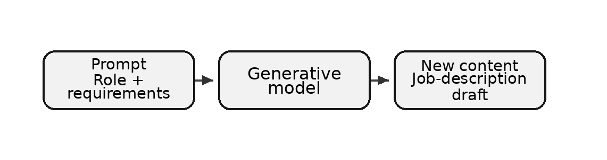
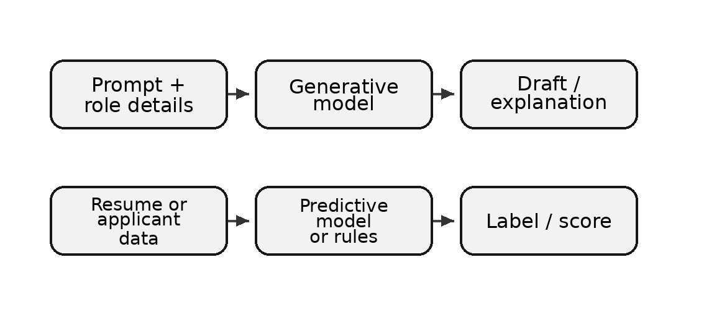
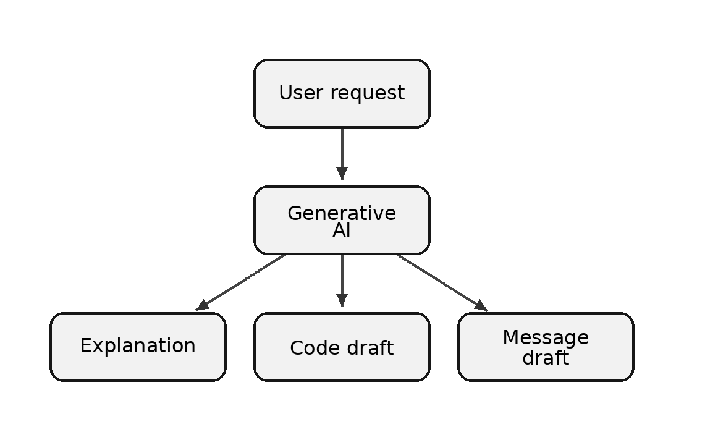
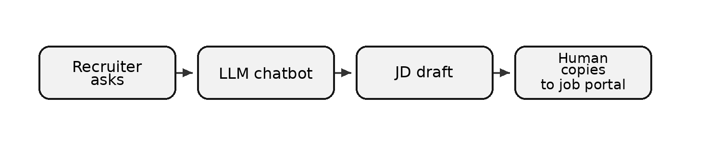
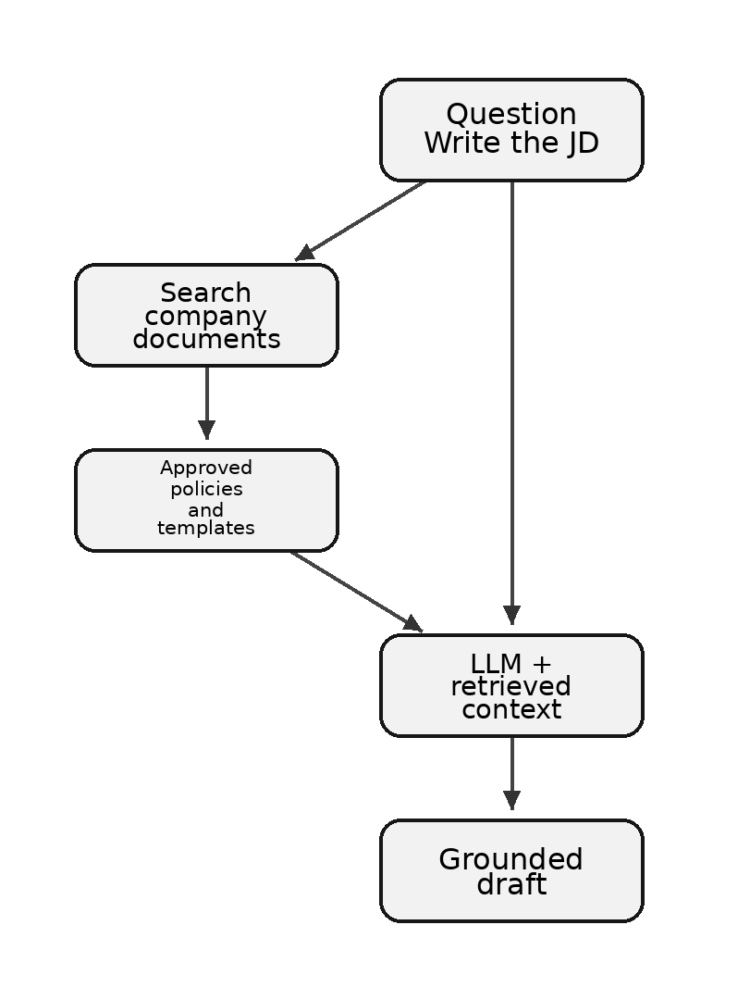
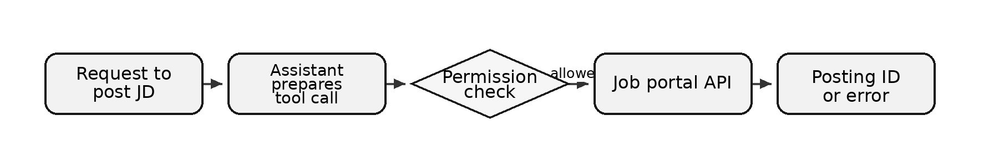
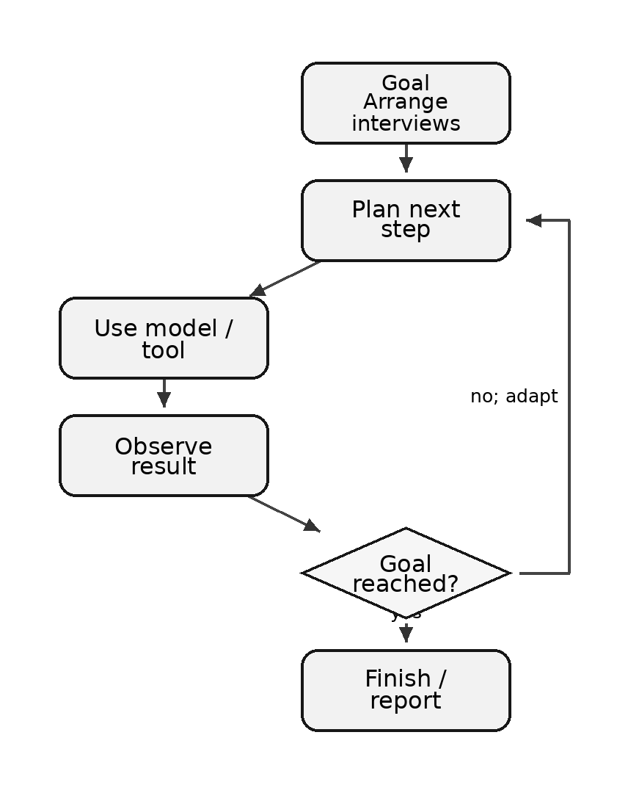
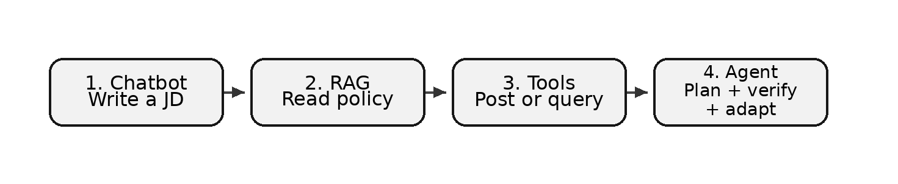
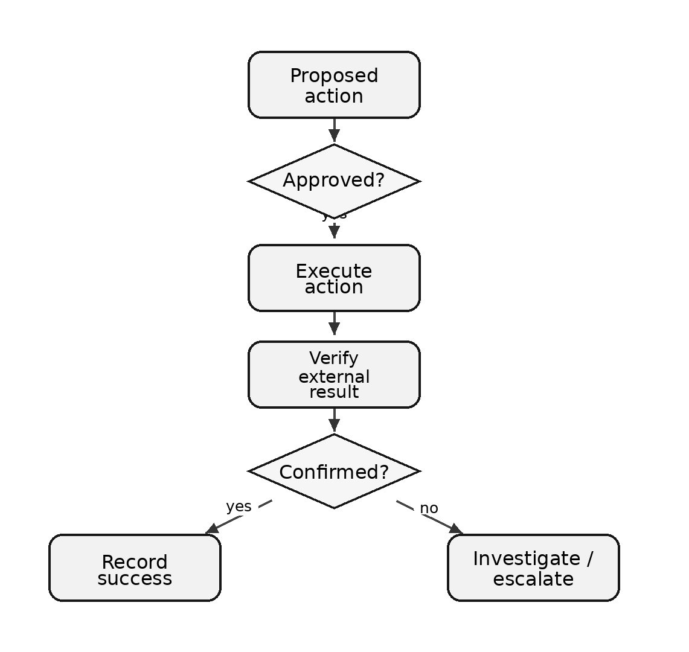

# Generative AI vs Agentic AI

*Agentic AI using LangGraph · CampusX · Video 1*

**Lesson link:** https://www.youtube.com/watch?v=xdA0pGDiUPE

> **The main idea:** Imagine a recruiter asks an AI assistant to fill a vacant software-engineer position. Writing a job description is useful, but completing the hiring process needs information, tools, decisions, and approvals. This chapter follows that single example from a basic content generator to a goal-directed agent.

## 1. Learning goals

Understand the difference between generating useful content and completing a real-world task, and know when retrieval, tools, and agents are needed.

## 2. Video chapters and timestamps

| Time | Topic |
|---|---|
| [00:00](https://www.youtube.com/watch?v=xdA0pGDiUPE&t=0s) | Intro |
| [02:18](https://www.youtube.com/watch?v=xdA0pGDiUPE&t=138s) | What is GEN AI |
| [07:03](https://www.youtube.com/watch?v=xdA0pGDiUPE&t=423s) | GEN AI vs Traditional AI |
| [12:17](https://www.youtube.com/watch?v=xdA0pGDiUPE&t=737s) | Applications of GEN AI |
| [20:08](https://www.youtube.com/watch?v=xdA0pGDiUPE&t=1208s) | Chatbot 1 |
| [28:50](https://www.youtube.com/watch?v=xdA0pGDiUPE&t=1730s) | Problems |
| [31:47](https://www.youtube.com/watch?v=xdA0pGDiUPE&t=1907s) | Chatbot 2 [RAG Based] |
| [38:57](https://www.youtube.com/watch?v=xdA0pGDiUPE&t=2337s) | Problems |
| [40:13](https://www.youtube.com/watch?v=xdA0pGDiUPE&t=2413s) | Chatbot 3 [Tool Augmented] |
| [48:31](https://www.youtube.com/watch?v=xdA0pGDiUPE&t=2911s) | Problems |
| [50:28](https://www.youtube.com/watch?v=xdA0pGDiUPE&t=3028s) | Chatbot 4 [Agentic AI] |
| [57:25](https://www.youtube.com/watch?v=xdA0pGDiUPE&t=3445s) | Problems |
| [58:41](https://www.youtube.com/watch?v=xdA0pGDiUPE&t=3521s) | Conclusion |

## 3. Prerequisites and basic terms

A **prompt** is an instruction or question sent to an AI model. An **LLM** is a language model that can understand and generate text. An **API** lets one software service request information or actions from another.

### Useful terminology

| Word | Simple meaning |
|---|---|
| **LLM** | A language model that reads and generates text. |
| **Prompt** | The instruction and context given to a model. |
| **RAG** | Retrieving relevant knowledge before generating an answer. |
| **Tool** | A permitted function or API an application can call. |
| **Agent** | A goal-directed system that can choose actions and check results. |

## 4. Concepts explained

The concepts are explained with definitions, practical examples, and diagrams. Follow each example from input to result, then use the revision questions to check your understanding.

### 4.1. Generative AI: creating new content

[Watch 02:18](https://www.youtube.com/watch?v=xdA0pGDiUPE&t=138s)

Generative AI is artificial intelligence that produces new content, such as text, code, images, or summaries, from an instruction and context.

It saves time when the main job is to create or transform content. The output is a *proposal* that may still need checking.

**Example.** A recruiter asks: “Write a backend developer job description requiring Python, REST APIs, and SQL.” The model creates an editable draft, but the vacancy has not been posted anywhere.


A generative model learns patterns from large training data and uses those patterns to predict a suitable continuation or representation of the prompt. The important practical result is **content**, not a verified change in the outside world. If you ask for a job advertisement, the model can write it; it cannot assume that an advertisement has been published or that the text follows your organization's current policy.

For a recruiter, a good first prompt specifies the role, required skills, location, seniority, and tone. The first output is then reviewed for missing requirements and unsupported claims. This distinction between **generating a useful draft** and **completing an outcome** becomes the foundation for understanding agents.

<p align="center"></p>

**Diagram walkthrough.** Read the boxes from left to right: the prompt tells the model what to generate; the output is a document, not a completed outside action.

**Important.** A fluent response is not automatically true or approved. Review factual claims and business policy before publishing.


---

### 4.2. Traditional AI vs generative AI

[Watch 07:03](https://www.youtube.com/watch?v=xdA0pGDiUPE&t=423s)

Traditional predictive AI commonly predicts a label or number from data; generative AI produces content. Both approaches can be combined.

Use the simplest suitable method: deterministic validation for eligibility rules, prediction for a scoring problem, and generation for a personalized email.

**Example.** For resumes, a classifier might label an application as “meets basic requirements”; a generative model then drafts a courteous next-step message.


Predictive models and generative models solve different kinds of questions. A predictive model may estimate the chance that a resume meets a predefined screening criterion. A generative model can explain the screening result in natural language or draft follow-up questions. Even though both use machine learning, their typical outputs and validation methods are different.

A classification score can be checked against labeled examples and metrics such as precision and recall. A generated email needs checks for factual correctness, tone, and whether it invents candidate details. A real hiring application might use both approaches plus fixed eligibility rules. Do not assume that every traditional AI system is predictive or that every generative system has no classification capability; this is a practical comparison of common uses.

<p align="center"></p>

**Diagram walkthrough.** The upper path produces a decision or score. The lower path produces content. Neither is automatically a full end-to-end hiring system.

**Remember.** Prediction answers **which class or value?** Generation answers **what useful content should I produce?**


---

### 4.3. Where generative AI is useful

[Watch 12:17](https://www.youtube.com/watch?v=xdA0pGDiUPE&t=737s)

Generative AI is useful wherever language, code, images, or other artifacts must be drafted, explained, transformed, or summarized.

It turns repetitive first drafts into quick starting points while leaving validation and decisions under appropriate control.

**Example.** A study assistant explains a concept, a coding assistant proposes a function, and a support assistant drafts a customer reply. In each case, a person or system checks the result.


Content generation is useful for first drafts, summarization, translation, explaining code, and creating outlines. What unites these cases is that the requested output is information presented in a new form. It does not usually require the model to modify a database or make an irreversible decision.

A useful way to design such a feature is: **request → generate → verify → use**. Verification may mean checking a code sample with tests, reviewing a summary against the source document, or checking that a job description does not promise benefits the company never approved. The model can speed up preparation, but the product still owns accuracy and permissions.

<p align="center"></p>

**Diagram walkthrough.** Three different input requests pass through a generator and lead to different content artifacts. The model’s job is creation, not permission-sensitive execution.

**Important.** Choosing an LLM to enforce strict business rules may be less reliable than using ordinary validation code.


---

### 4.4. Stage 1: a basic chatbot

[Watch 20:08](https://www.youtube.com/watch?v=xdA0pGDiUPE&t=1208s)

A basic chatbot answers messages one at a time. It can explain or draft something but does not automatically use private company data or perform outside actions.

This is enough for many question-answering and drafting tasks, but not for a process with several dependent stages.

**Example.** “Write a job description” returns text. Someone must then open the job portal, paste the text, and post the vacancy.


A basic chatbot commonly receives a user message and a small amount of conversation context, then generates an answer. That can feel interactive, but the system may still be limited to describing the next action instead of carrying it out. For example, “I will schedule the interview” in a generated response is only text unless scheduling code actually runs.

Think through the recruiter case: the user asks for a role description; the model writes one; the user copies it into the hiring portal. The chatbot did the drafting, while the human performed the operational step. This is a perfectly useful application when content is the main objective, and it has a smaller failure surface than an agent with access to many tools.

<p align="center"></p>

**Diagram walkthrough.** The model returns content to the user. The last step of the business process still belongs to the human.

**Important.** Do not say “the job was posted” just because the model generated text saying it would post it.


---

### 4.5. Stage 2: RAG adds knowledge

[Watch 31:47](https://www.youtube.com/watch?v=xdA0pGDiUPE&t=1907s)

Retrieval-Augmented Generation (RAG) means finding relevant external information and giving it to the model as context before producing an answer.

An LLM may not know your current company policies, role templates, or internal FAQs. Retrieval provides information that was not in the prompt.

**Example.** Before writing a job description, a hiring assistant searches the company handbook and the approved JD template, then drafts a role description using those documents.


Retrieval-augmented generation, or **RAG**, improves the information available to the model before it answers. The application takes the user's question, searches a trusted knowledge source, selects useful passages, and includes those passages as context for generation. In a hiring team, the source might be internal job-level guidelines or approved policies.

The important boundary is that retrieval is **reading** information, not executing changes. A RAG chatbot can answer “What is our interview policy?” more accurately when the relevant policy is retrieved, but that alone does not create the interview event. Also, RAG is not guaranteed to be correct: poor retrieval, outdated documents, or ignored evidence can still produce a bad answer. Good systems show references and evaluate retrieval quality.

<p align="center"></p>

**Diagram walkthrough.** The question triggers search; selected documents travel into the model’s context; the answer can be grounded in retrieved material.

**Remember.** **RAG helps the assistant know. It does not automatically help the assistant act.**

**Important.** Retrieved information can be outdated. Search quality and document permissions matter.


---

### 4.6. Stage 3: tools add actions

[Watch 40:13](https://www.youtube.com/watch?v=xdA0pGDiUPE&t=2413s)

A tool is a function or API the AI application can call to read data or perform a permitted action in another system.

Tools close the gap between describing an action and performing it. They also introduce the need to validate inputs and permissions.

**Example.** After an approved JD is ready, a posting tool submits it to the recruitment portal and returns a real posting ID, such as JOB-104.


Tools give an application a controlled way to interact with outside systems. A tool might search a database, read a calendar, retrieve a candidate profile, or create a draft interview invitation. The model may choose tool arguments, but the application must validate permissions and actually execute the call.

A useful mental split is **model selects or proposes → tool executes → application checks result**. If the calendar API returns “permission denied,” the system should report that failure, not claim the meeting was scheduled. A tool-augmented chatbot is not necessarily a fully autonomous agent: it might make one tool call in response to one explicit user request, with no ongoing plan or recovery loop.

<p align="center"></p>

**Diagram walkthrough.** The assistant proposes a tool call; the application checks permission; the tool executes; its result returns as evidence of the outcome.

**Important.** Treat a tool’s error message or unverified success string as an observation to inspect, not as guaranteed success.


---

### 4.7. Stage 4: an agent completes multi-step work

[Watch 50:28](https://www.youtube.com/watch?v=xdA0pGDiUPE&t=3028s)

Agentic AI is a system that uses AI to choose and carry out multiple steps toward a goal, observes results, and adjusts what it does next within defined limits.

A complex task needs more than one reply: results from one stage affect the next stage. An agent can coordinate those stages rather than wait for a new human prompt each time.

**Example.** Given “Prepare an approved job posting and arrange interviews,” the system drafts the JD, gets approval, posts it, reads the posting result, finds suitable time slots, and sends proposed invitations for confirmation.


An agent extends the tool-augmented idea by tracking a goal over multiple steps and deciding what to do after each observation. For a hiring request, it might identify missing details, draft the role, request approval, submit an approved posting, and then confirm that the portal returned a posting ID. If the portal fails, the agent can retry safely or ask a human for help.

Autonomy should be **bounded**. The agent may prepare interview slots automatically but should not send invitations to candidates or reject applicants without the permissions and review process the organization requires. A reliable agent works through **plan → action → observation → next decision**, rather than generating a paragraph that merely narrates a supposed workflow.

<p align="center"></p>

**Diagram walkthrough.** Each action is followed by a check. The system decides whether to continue, retry, request approval, or stop.

**Important.** Autonomy should be bounded: posting, emailing, and candidate decisions may require explicit approval.


---

### 4.8. Recruiting assistant: the full progression

[Watch 50:28](https://www.youtube.com/watch?v=xdA0pGDiUPE&t=3028s)

A useful way to remember the four stages is: **generate → retrieve → use tools → manage a goal**. The stages add capabilities; they do not replace every earlier feature.

Understanding the progression helps you select the minimum architecture for the job.

**Example.** A JD writer needs generation. A policy-aware JD writer needs RAG. A job poster needs a connected tool. A hiring coordinator needs controlled planning and monitoring across those tools.


Compare four ways of answering “Help me hire a Python developer.” A plain chatbot writes a job description. A RAG system can use the company's approved job-level policy to draft a compliant description. A tool-enabled assistant can create a job-posting draft through a hiring portal API. An agent can organize a multi-step process, request approvals, react to tool results, and track progress toward the final hiring task.

These are **design capabilities**, not guaranteed chronological product generations. A single practical application can combine retrieval, tools, and agent-style planning. The question to ask is not “Which sounds most advanced?” but “Which capabilities are actually necessary for the user outcome?”

<p align="center"></p>

**Diagram walkthrough.** Each stage adds one missing capability on top of the earlier one. A mature application may combine all four.

**Remember.** Complexity is not a goal. Choose the smallest system that can *reliably complete* the requested task.


---

### 4.9. Verify outcomes and control risk

[Watch 50:28](https://www.youtube.com/watch?v=xdA0pGDiUPE&t=3028s)

An AI system should judge success from verified results, not from a confident text response. Sensitive actions also need permission gates.

A system that accidentally emails a candidate twice can create a real business problem, even if its language is perfect.

**Example.** The tool returns a posting ID after success. If the API times out, the assistant checks whether the posting already exists before retrying, preventing duplicates.


Agents can take real actions, so the correctness requirement becomes stricter than for a chat answer. Before any important action, verify the inputs, check user permissions, consider whether the action is reversible, and record the result returned by the external system.

For example, posting the wrong vacancy can expose internal salary data, and sending an invitation to the wrong address may disclose personal information. A safer design uses approval gates before external actions, minimum tool permissions, deduplication keys for retries, and clear error states. A completed task means **the system observed evidence of success**, not simply that the model wrote “done.”

<p align="center"></p>

**Diagram walkthrough.** The process separates proposed actions from approvals and recorded outcomes. Errors lead to investigation or a safe fallback.

**Important.** Never treat an unverified claim such as “Done!” as proof of a transaction.


---

## 5. Worked example: putting the concepts together

Use this example to connect the ideas. Follow one step at a time, and notice which facts must be verified before continuing.

| Step | What happens |
|---|---|
| **1. Recruiter sets goal** | Post a backend role and organize three approved interviews. |
| **2. Retrieve policy** | Load the approved job description template and interview rules. |
| **3. Draft JD** | Create a draft based on role requirements and retrieved policy. |
| **4. Approval gate** | Recruiter reviews the role and authorizes publication. |
| **5. Post vacancy** | Call the posting API; record verified job ID JOB-104. |
| **6. Schedule** | Find permitted interview slots; send invitations only when authorized. |
| **7. Finish** | Report completed actions, pending approvals, and tool failures separately. |

**Big picture:** A successful workflow is not merely a sequence of nice sentences. It produces observable results, keeps enough state for later steps, and stops when the stated goal or a safe stopping rule is reached.

## 6. Important comparisons

| Capability | Basic chatbot | RAG assistant | Tool assistant | Agentic workflow |
|---|---|---|---|---|
| Create text | Yes | Yes | Yes | Yes |
| Read private/current knowledge | Not by default | Via retrieval | Possible | Possible |
| Act in other systems | No | No | Via authorized tools | Via tools + decisions |
| Choose multiple next steps | Usually user-led | Usually user-led | Often request-led | Goal-directed within limits |

## 7. Python examples and practice

These short examples help turn the diagrams into working code. You can understand the concepts without running them.

### 7.1. A tiny verified-action controller (pure Python; no model key)

```python
# The important idea is: suggest an action, run it, VERIFY it.
def post_job(approved: bool) -> dict:
    if not approved:
        return {"status": "pending_approval", "job_id": None}

    # Simulated response from an external job portal:
    api_response = {"ok": True, "job_id": "JOB-104"}
    if api_response["ok"] and api_response["job_id"]:
        return {"status": "posted", "job_id": api_response["job_id"]}
    return {"status": "needs_review", "job_id": None}

print(post_job(False))  # pending_approval
print(post_job(True))   # posted, with verified job ID
```

**What happens:** Focus on the **status and evidence**, not the model wording. In a real application, the external API would replace the simulated response.

## 8. Common mistakes and better habits

Read each statement as a mini interview trap:
1. A well-written answer is not proof that an outside action happened.
2. RAG retrieves information; it does not automatically grant access to systems.
3. An agent is not the same as an LLM: orchestration and permissions are application-level responsibilities.
4. More autonomy is not always better: sensitive actions require explicit policy.

## 9. Key takeaways

1. Generative AI is artificial intelligence that produces new content, such as text, code, images, or summaries, from an instruction and context.
2. Traditional predictive AI commonly predicts a label or number from data; generative AI produces content.
3. Generative AI is useful wherever language, code, images, or other artifacts must be drafted, explained, transformed, or summarized.
4. A basic chatbot answers messages one at a time.
5. Retrieval-Augmented Generation (RAG) means finding relevant external information and giving it to the model as context before producing an answer.
6. A tool is a function or API the AI application can call to read data or perform a permitted action in another system.
7. Agentic AI is a system that uses AI to choose and carry out multiple steps toward a goal, observes results, and adjusts what it does next within defined limits.
8. A useful way to remember the four stages is: **generate → retrieve → use tools → manage a goal**.
9. An AI system should judge success from verified results, not from a confident text response.

## 10. Revision checklist

- [ ] Define generative AI in one sentence.
- [ ] Distinguish predictive AI and generative AI.
- [ ] Explain the basic chatbot and its limitations.
- [ ] Draw a five-box RAG pipeline.
- [ ] Explain what a tool is and what it returns.
- [ ] Describe the plan–act–observe–decide loop.
- [ ] Compare all four recruiting assistant stages.
- [ ] Explain why tool outcomes need verification.
- [ ] Name one action that should require human approval.

## 11. Practice questions and mini exercises

1. Draw the architecture for an assistant that reads company policy and drafts leave replies. Does it require RAG, a tool, or both?
2. A chatbot says “Your interview is booked” but has no calendar access. Explain what is wrong.
3. A posting API times out after submission. Propose a safe recovery procedure.
4. Explain the 4-stage recruiting progression to a friend in under one minute.
5. Design a rule for when a recruiter must approve an agent action.

## 12. Interview questions — short answers you can say aloud

**Q1. What is generative AI?**

AI that generates new content from an instruction and context.

**Q2. What is the difference between predictive AI and generative AI?**

Predictive AI typically outputs a score or label; generative AI produces content such as text or code.

**Q3. What is RAG?**

A method that retrieves relevant external information and adds it to the model’s context before generation.

**Q4. Does RAG allow an assistant to take actions?**

No. RAG supplies knowledge; separate tools or application code perform actions.

**Q5. What is tool calling?**

The application lets a model request a named function or API with arguments, then validates and executes the call.

**Q6. What is Agentic AI?**

A goal-directed system that selects actions, uses tools, checks results, and adjusts its next steps within constraints.

**Q7. Why can an agent fail?**

Bad plans, incorrect data, tool errors, missing permissions, unreliable evaluation, or unbounded retries.

**Q8. Why is human approval important?**

It reduces risk for consequential actions such as publishing, sending messages, or making decisions about people.

## 13. Further reading

- [LangChain overview](https://docs.langchain.com/oss/python/langchain/overview)
- [Workflow and agent patterns](https://docs.langchain.com/oss/python/langgraph/workflows-agents)

---

**One-line memory hook:** Understand the difference between generating useful content and completing a real-world task, and know when retrieval, tools, and agents are needed.
