# What Is Agentic AI?

*Agentic AI using LangGraph · CampusX · Video 2*

**Lesson link:** https://www.youtube.com/watch?v=GWnSsjT4V68

> **The main idea:** An AI agent is easiest to understand as a responsible assistant with a task list. It knows the goal, chooses permitted actions, checks whether those actions worked, and changes plans when the situation changes. A hiring coordinator is a useful running example.

## 1. Learning goals

Explain the six key characteristics of an agent, identify its main components, and trace how a controlled agent completes a task without unlimited autonomy.

## 2. Video chapters and timestamps

| Time | Topic |
|---|---|
| [00:00](https://www.youtube.com/watch?v=GWnSsjT4V68&t=0s) | Intro |
| [01:31](https://www.youtube.com/watch?v=GWnSsjT4V68&t=91s) | What is Agentic AI? |
| [06:15](https://www.youtube.com/watch?v=GWnSsjT4V68&t=375s) | Example of Agentic AI |
| [15:26](https://www.youtube.com/watch?v=GWnSsjT4V68&t=926s) | Key Characteristics |
| [16:50](https://www.youtube.com/watch?v=GWnSsjT4V68&t=1010s) | Autonomy |
| [24:32](https://www.youtube.com/watch?v=GWnSsjT4V68&t=1472s) | Goal Oriented |
| [29:05](https://www.youtube.com/watch?v=GWnSsjT4V68&t=1745s) | Planning |
| [35:45](https://www.youtube.com/watch?v=GWnSsjT4V68&t=2145s) | Reasoning |
| [41:46](https://www.youtube.com/watch?v=GWnSsjT4V68&t=2506s) | Adaptability |
| [45:56](https://www.youtube.com/watch?v=GWnSsjT4V68&t=2756s) | Context Awareness |
| [51:53](https://www.youtube.com/watch?v=GWnSsjT4V68&t=3113s) | Components of Agentic AI |
| [52:40](https://www.youtube.com/watch?v=GWnSsjT4V68&t=3160s) | Brain |
| [54:05](https://www.youtube.com/watch?v=GWnSsjT4V68&t=3245s) | Orchestrator |
| [55:58](https://www.youtube.com/watch?v=GWnSsjT4V68&t=3358s) | Tools |
| [56:55](https://www.youtube.com/watch?v=GWnSsjT4V68&t=3415s) | Memory |
| [57:35](https://www.youtube.com/watch?v=GWnSsjT4V68&t=3455s) | Supervisor |

## 3. Prerequisites and basic terms

A **goal** describes the result you want. A **tool** is a software function that can read or modify an external system. **State** stores information gathered while the task runs.

### Useful terminology

| Word | Simple meaning |
|---|---|
| **Goal** | The outcome to achieve. |
| **Plan** | The steps and order proposed to reach the goal. |
| **Observation** | What a tool or environment actually returned. |
| **State** | Task information that is tracked as work progresses. |
| **Guardrail** | A rule or permission limit controlling an action. |

## 4. Concepts explained

The concepts are explained with definitions, practical examples, and diagrams. Follow each example from input to result, then use the revision questions to check your understanding.

### 4.1. Agentic AI in one simple definition

[Watch 01:31](https://www.youtube.com/watch?v=GWnSsjT4V68&t=91s)

Agentic AI is an AI-based system that works toward a goal by choosing steps, using tools, observing results, and adapting when needed.

A traditional chatbot usually responds to the current message. An agent can coordinate several connected steps needed to finish an outcome.

**Example.** “Arrange interviews for three shortlisted candidates” involves checking eligibility, reading calendars, proposing time slots, getting approvals, and recording confirmations.


Agentic AI describes applications that pursue a defined goal through a series of context-dependent decisions. Rather than always performing the same fixed script, an agent can choose the next permitted action based on what has already happened. It may use an LLM for planning or interpretation, software tools for actions, and stored state for continuity.

The simple rule to remember is: **goal + ability to act + observation + adaptation**. A model that only drafts answers is not automatically an autonomous agent. The surrounding software must give it appropriate actions, rules, and a way to observe whether those actions succeeded.

<p align="center">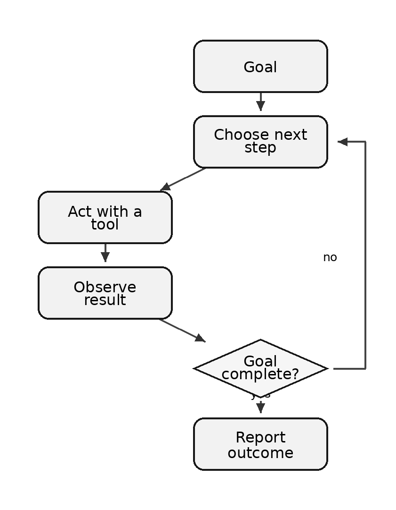</p>

**Diagram walkthrough.** The goal begins the process. An action produces an observation. The observation decides the next action or the stopping point.


---

### 4.2. Hiring workflow: a realistic agent task

[Watch 06:15](https://www.youtube.com/watch?v=GWnSsjT4V68&t=375s)

A workflow is a connected sequence of tasks that must happen in a useful order. An agent may coordinate these tasks and handle exceptions.

Real tasks include dependencies: an interview cannot be confirmed before calendars and participant details are checked.

**Example.** For a vacancy, the process is: draft requirements → approve JD → publish → review applications → prepare interviews → confirm times.


Consider an assistant coordinating interviews. Its end goal is not “write a friendly email”; it is “find a mutually available slot and prepare a confirmed invitation.” It needs access to candidate availability, interviewer calendars, and company policies. It might first collect candidates' windows, then compare them with interviewers' availability, reserve a slot, and finally generate an invitation for approval.

A fixed workflow can handle predictable cases. Agentic behavior becomes useful when unexpected events occur—an interviewer declines, a calendar returns no slots, or required information is missing. The system should observe the new situation and decide on a safe next step rather than starting over blindly.

<p align="center">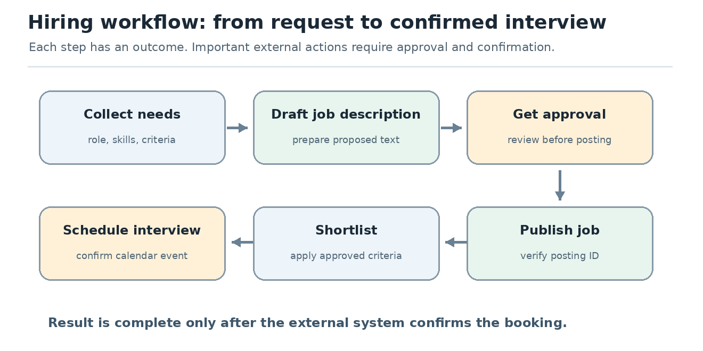</p>

**Diagram walkthrough.** The nodes represent work. Approval is a separate gate. A rejected draft returns for changes instead of continuing blindly.

**Important.** Hiring decisions are high-impact; automated filters and evaluations need appropriate human oversight and fairness checks.


---

### 4.3. Autonomy: deciding small steps safely

[Watch 16:50](https://www.youtube.com/watch?v=GWnSsjT4V68&t=1010s)

Autonomy means making some decisions and taking allowed actions without needing a user instruction at every step.

It helps reduce manual work. But the useful form is *bounded autonomy*: permissions, budgets, and approval conditions limit what the agent can do.

**Example.** The agent may automatically read public job requirements and compare interview slots, but must ask before sending rejection notices.


**Autonomy** means making some decisions without asking a human for every minor step. It is not the same as unlimited control. You can grant an assistant permission to search available calendar slots while reserving actual scheduling or candidate rejection for human approval.

A helpful design technique is to classify actions into **read**, **draft**, and **commit**. Read actions collect data; draft actions prepare proposed content or changes; commit actions modify the outside world. Autonomy can be generous for safe reads, tighter for drafts, and carefully supervised for irreversible or sensitive commits.

<p align="center">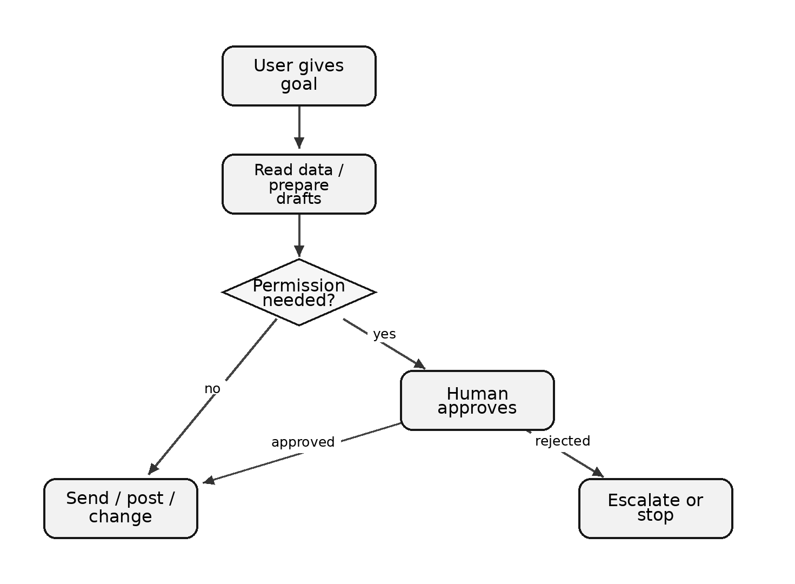</p>

**Diagram walkthrough.** Read-only and reversible actions may be automatic; high-impact actions go through a permission gate.

**Important.** “Autonomous” never means permission to ignore security rules or user preferences.


---

### 4.4. Goal orientation: knowing what success means

[Watch 24:32](https://www.youtube.com/watch?v=GWnSsjT4V68&t=1472s)

A goal-oriented system chooses actions by asking whether they move it closer to a clear result.

Without an end condition, the system cannot tell the difference between “I tried” and “I finished.”

**Example.** Goal: “Book three interviews by Friday.” Success: three verified calendar events with candidate confirmations, not three drafted emails.


A goal tells an agent what success should look like. A poor goal such as “handle hiring” is hard to measure. A clearer one is “produce a reviewed shortlist of candidates meeting the stated minimum requirements and schedule interviews for those approved.”

This goal can be split into measurable milestones: role requirements collected, shortlist generated, review completed, slots identified, invitations confirmed. Without success criteria, an agent may perform many actions that look productive but never deliver a useful result. Designing the goal and its acceptance conditions is as important as writing the prompting logic.

<p align="center">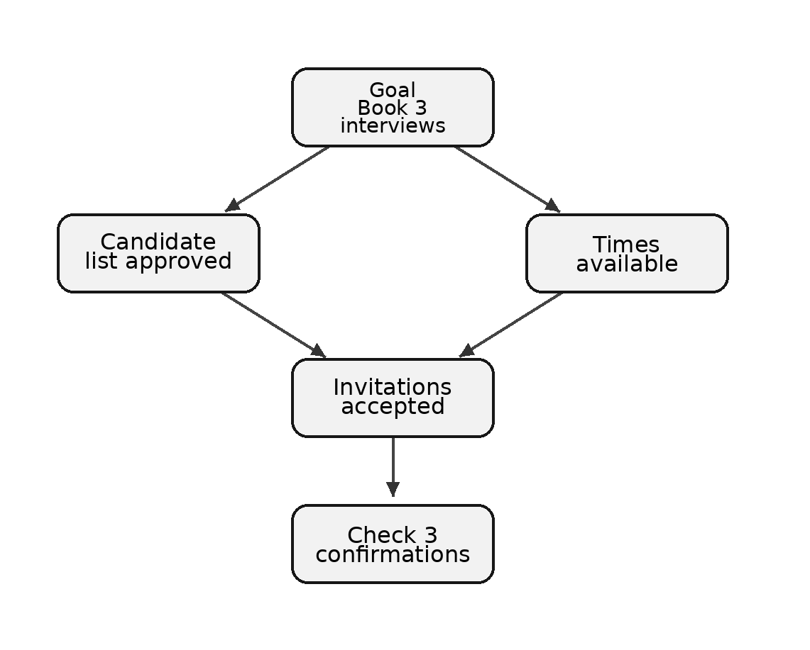</p>

**Diagram walkthrough.** The desired result is broken into checkable subgoals and a final completion check.

**Important.** Make goals measurable and achievable; avoid vague instructions like “hire the best person” without human decision criteria.


---

### 4.5. Planning: deciding the order of work

[Watch 29:05](https://www.youtube.com/watch?v=GWnSsjT4V68&t=1745s)

Planning means choosing the steps, their order, and any dependencies needed to reach the goal.

Large tasks fail when we skip prerequisites or try to do everything in one response.

**Example.** Before offering an interview slot, check the shortlist and interviewer availability. Two availability lookups can happen independently before proposing a common time.


**Planning** is selecting subtasks and their dependencies. An interview coordinator cannot meaningfully book meetings before it knows candidate availability. It can, however, gather role requirements and interviewer preferences in parallel when those tasks are independent.

Planning may be generated by a model or encoded as a known process. For structured business procedures, deterministic steps are often safer. For variable tasks, a model can propose a plan, but the application should check missing steps, policy constraints, and whether a proposed tool call is authorized. A good plan is useful because it can be checked against reality after each step.

<p align="center">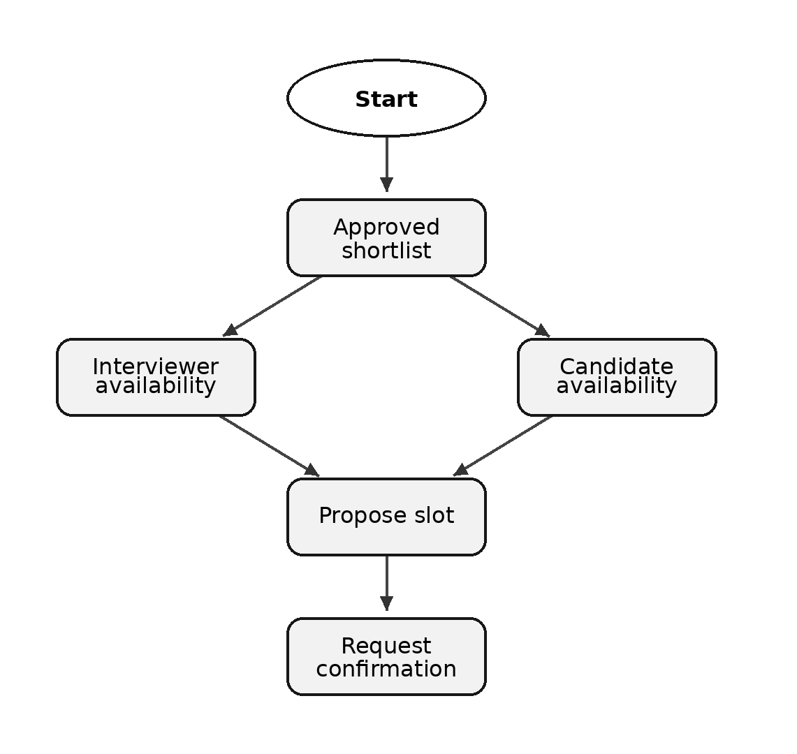</p>

**Diagram walkthrough.** The plan separates required first steps from work that can happen in parallel.

**Remember.** A plan is a route to try, not a promise that the real world will cooperate.


---

### 4.6. Reasoning: choosing a suitable action

[Watch 35:45](https://www.youtube.com/watch?v=GWnSsjT4V68&t=2145s)

Reasoning is the decision process that selects what to do next using the goal, current information, and constraints.

A fixed script cannot anticipate every situation. Some decisions need rule checks; others require interpreting a user request or document.

**Example.** If a candidate has not provided a required qualification, the assistant should ask for clarification or send the case to a recruiter—not invent the qualification.


**Reasoning** is choosing an action by considering the goal, known facts, and available options. For example, if no common 30-minute interview slot exists, the agent might search the next week, ask for wider availability, or suggest a shorter initial screening call.

Reasoning is different from guaranteed correctness. A language model can confidently choose a poor action or misunderstand a tool result. For important decisions, give it structured data, use deterministic rules where possible, and validate outcomes. A trustworthy agent explains its intended action in terms of observable inputs rather than inventing missing evidence.

<p align="center">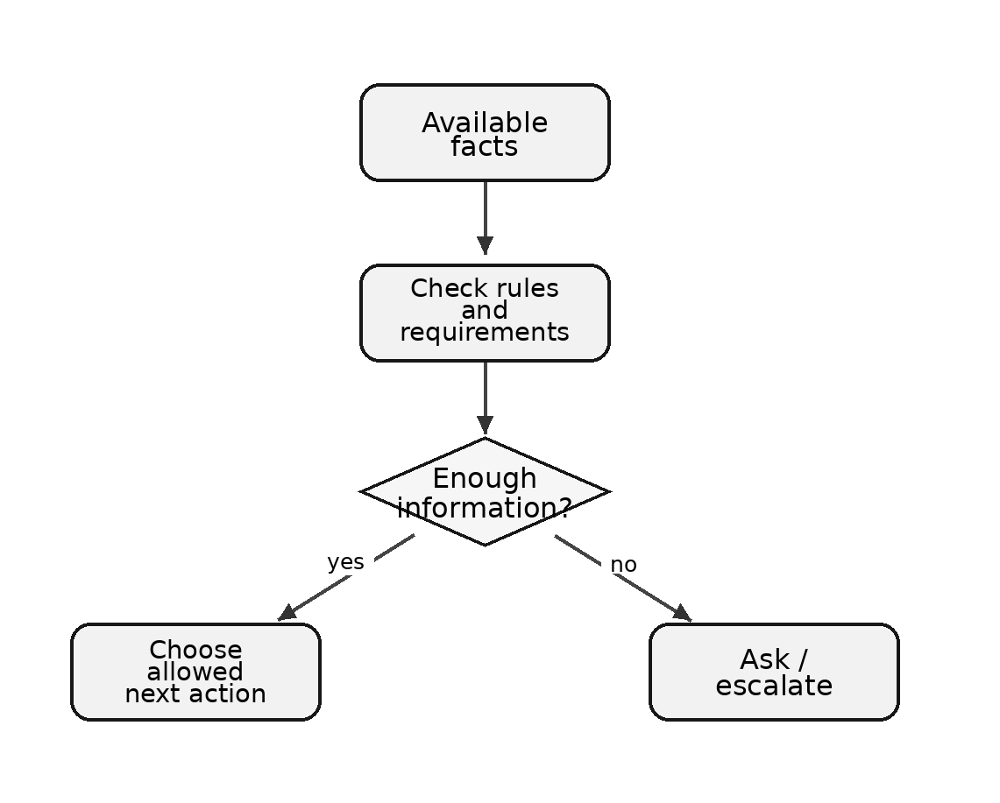</p>

**Diagram walkthrough.** The decision uses known evidence and policy, then chooses a route. Unknown facts should stay unknown.

**Important.** An impressive-looking explanation does not guarantee a correct decision; verify critical facts.


---

### 4.7. Adaptability: responding to change

[Watch 41:46](https://www.youtube.com/watch?v=GWnSsjT4V68&t=2506s)

Adaptability means changing the next action when new results show that the original plan will not work.

Tools fail, schedules change, and a user may add a new requirement. Reliable systems need retries, fallbacks, and escalation.

**Example.** An interviewer cancels. The agent checks another approved slot and asks the recruiter to confirm, rather than pretending the booking is still valid.


**Adaptability** is what happens when the environment changes. An interview slot that appeared available at planning time might be taken by another event before reservation. A fragile workflow might proceed as if the booking succeeded; a robust one notices the conflict, updates its state, and searches again.

This behavior requires an **observation after action**. The system reads the tool response, interprets the failure reason, and selects a recovery step. Recovery must still have limits: endless rescheduling attempts can waste time or create duplicate invitations. Stop and escalate when uncertainty or failure exceeds a defined threshold.

<p align="center">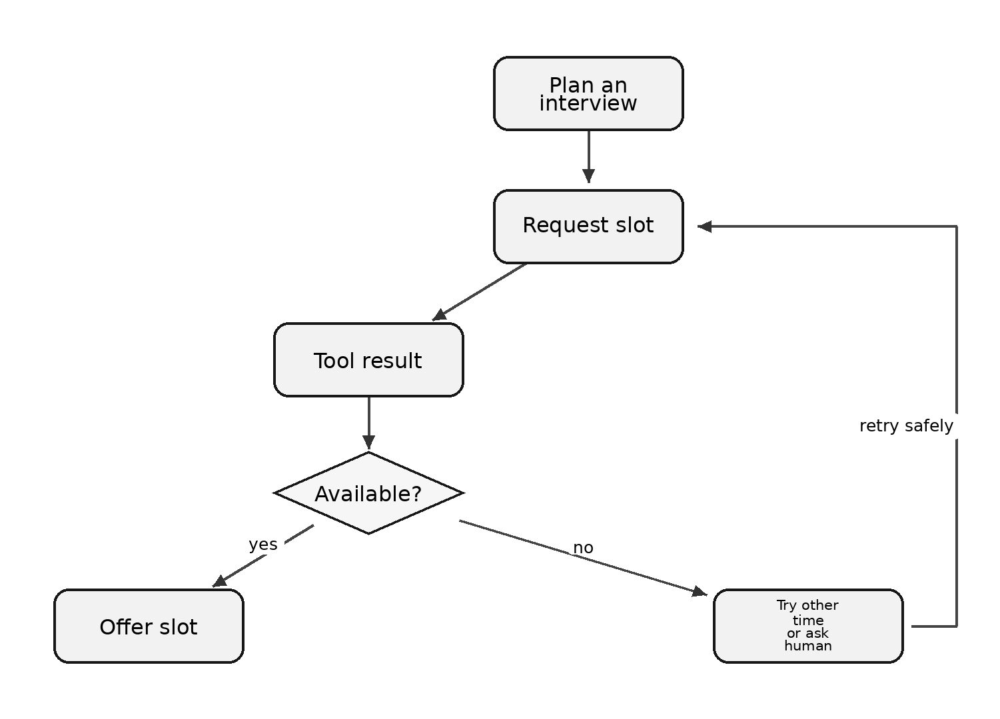</p>

**Diagram walkthrough.** The failed observation returns to the decision point. A safe alternative is selected or the task is escalated.

**Important.** Do not retry a non-idempotent action blindly; first check whether the operation already succeeded.


---

### 4.8. Context awareness: remembering the relevant facts

[Watch 45:56](https://www.youtube.com/watch?v=GWnSsjT4V68&t=2756s)

Context awareness means using information about the goal, progress, user requirements, and external situation when choosing the next step.

Without context, the agent repeats work or contradicts earlier results. Too much retained information can create cost and privacy problems.

**Example.** The agent remembers the selected candidate IDs, approved job ID, and currently proposed slot. It does not need every unrelated chat message.


**Context awareness** means using relevant information from the current task and interaction history. If the user already specified “only mornings,” that preference should shape later slot searches. If a candidate declined an earlier time, the agent should not repeatedly propose it.

Context can be stored in the working state, conversation messages, or a longer-term database. Those are different storage scopes. Passing the right information matters more than storing everything: too much stale context can confuse decisions, while too little context makes the agent repeat questions or ignore user constraints.

<p align="center">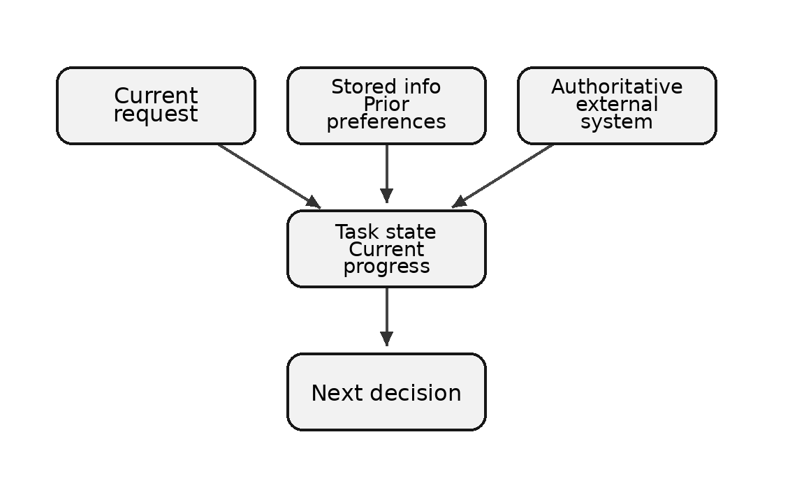</p>

**Diagram walkthrough.** Short-term task state keeps current progress; durable memory or a business database provides relevant information across separate runs.

**Remember.** A model’s memory of what was said is not the same as a verified calendar or database record.


---

### 4.9. The agent architecture: five components

[Watch 51:53](https://www.youtube.com/watch?v=GWnSsjT4V68&t=3113s)

A practical agent has a **model or brain**, **orchestration logic**, **tools**, **memory/state**, and **supervision or guardrails**.

Separating these components makes the system easier to test and safer to operate.

**Example.** The model interprets “book interviews.” The orchestrator tracks steps. Calendar tools check slots. State remembers results. A supervisor requires approval before notifying candidates.


An agentic application can be pictured as five cooperating parts. The **brain** interprets information or drafts plans; the **orchestrator** decides which step to run and when; **tools** read or act on external systems; **memory/state** stores relevant facts and outcomes; the **supervisor** enforces policy, reviews risky actions, or supports correction.

These names describe responsibilities, not five mandatory independent services. A small Python application can implement orchestration and guardrails directly, while a model is only used for tasks needing language understanding. For a calendar assistant, keep the logic for “no double booking” in deterministic software rather than trusting a model's textual reassurance.

<p align="center">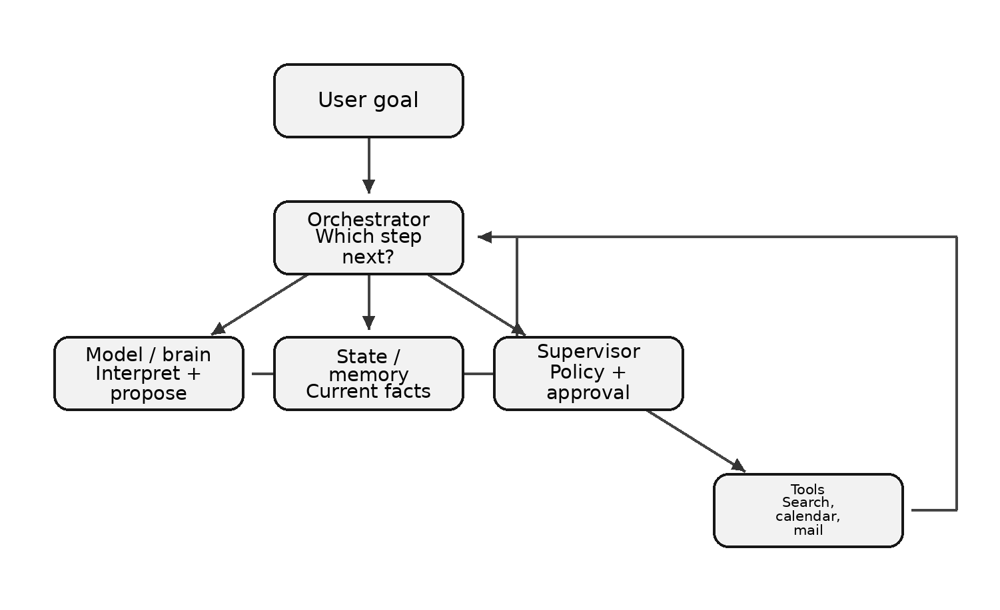</p>

**Diagram walkthrough.** The orchestrator coordinates the model and tools, reads state, and passes sensitive operations through policy checks.

**Important.** The LLM alone is not the complete agent: runtime state, tools, and safety rules matter just as much.


---

### 4.10. Supervisor and human approval

[Watch 57:35](https://www.youtube.com/watch?v=GWnSsjT4V68&t=3455s)

Supervision is a safety and quality layer that checks whether a proposed action is permitted and whether a person must approve it.

An agent may prepare content without risk, but external or high-impact changes can affect people and systems.

**Example.** Generating candidate summaries can be automatic. Sending rejection emails or changing applicant status should follow the organization’s approval policy.


Human approval is useful at decision points with a high cost of error. For example, an agent may shortlist candidates and propose times, but a hiring manager should review a rejection decision or approve an invitation to an executive candidate. A supervisor may also be an automated policy checker for routine steps.

A good approval gate presents the planned action, the relevant evidence, and clear choices: approve, edit, or reject. After approval, the actual tool must execute the action and the result must be recorded. Approval of a proposed email does not imply the email was delivered; delivery is a separate checked event.

<p align="center">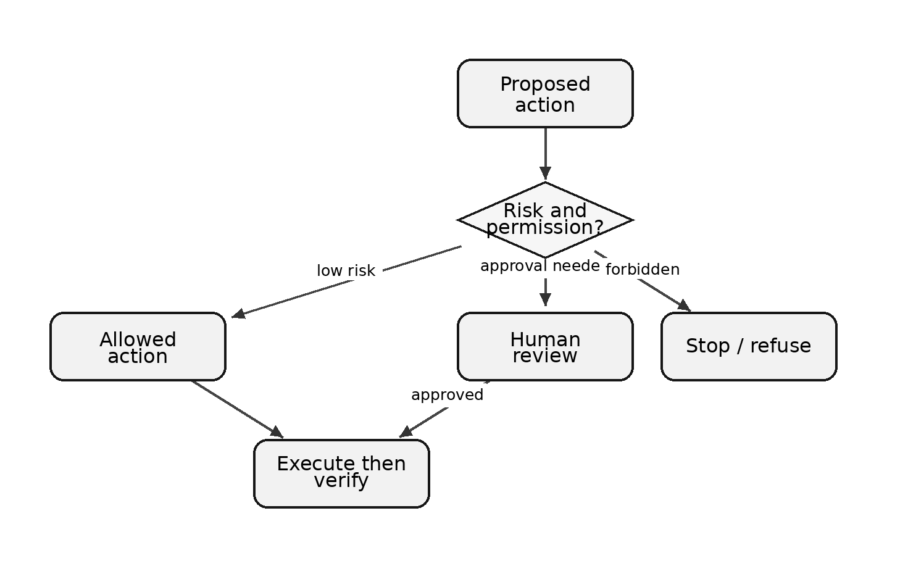</p>

**Diagram walkthrough.** The gate distinguishes low-risk work, approved high-risk actions, and forbidden actions.

**Important.** Never let the model self-approve actions that require independent authorization.


---

### 4.11. Putting it all together: the agent loop

[Watch 57:35](https://www.youtube.com/watch?v=GWnSsjT4V68&t=3455s)

The simplest useful mental model is **goal → plan → act → observe → decide → finish or adapt**.

This loop connects the characteristics: goals give direction, planning orders steps, autonomy permits limited actions, and context makes decisions relevant.

**Example.** Check calendars, discover a conflict, try a different slot, obtain approval, confirm the event, and report the real booking result.


The full agent loop starts with a goal and available context. The agent chooses an action, calls a permitted tool, reads the result, updates its working state, and decides whether the goal is complete. If not, it either performs a new action, requests missing information, or stops with a reported limitation.

For interview scheduling: **search slots → choose candidate slot → request approval → create event → confirm event ID**. If creation fails, the agent should not mark the task completed. Use a maximum number of retries, clear permissions, and logs so users can understand how the outcome was reached.

<p align="center">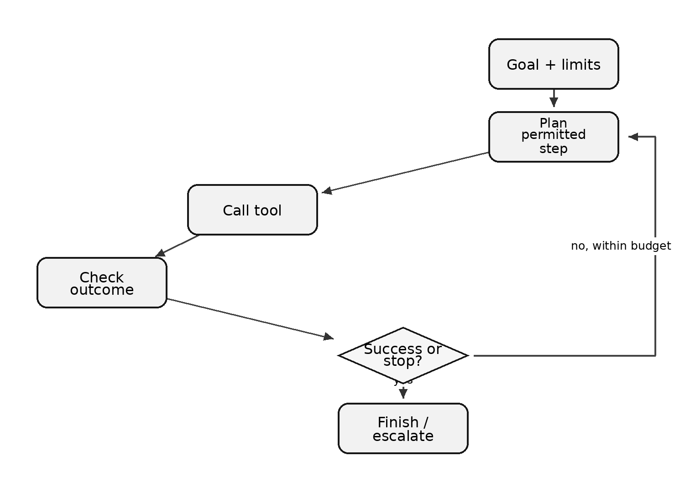</p>

**Diagram walkthrough.** The loop ends when a verified success condition is met or a safe stopping rule triggers.

**Remember.** An agent is not required to be fully independent. An agent that asks for approval can still be agentic.


---

## 5. Worked example: putting the concepts together

Use this example to connect the ideas. Follow one step at a time, and notice which facts must be verified before continuing.

| Step | What happens |
|---|---|
| **Goal** | Schedule an interview for candidate C17 with two panelists. |
| **Plan** | Read calendar availability from both panelists. |
| **Act** | Query both calendars using authorized read-only tools. |
| **Observe** | First choice is unavailable. |
| **Adapt** | Propose the next common slot and request approval. |
| **Verify** | Create the booking once approved and record event ID. |
| **Finish** | Report the confirmed time and any remaining follow-ups. |

**Big picture:** A successful workflow is not merely a sequence of nice sentences. It produces observable results, keeps enough state for later steps, and stops when the stated goal or a safe stopping rule is reached.

## 6. Important comparisons

| Term | Easy meaning | Recruiting example |
|---|---|---|
| Autonomy | Allowed to choose small steps | Compare available interview slots |
| Goal orientation | Works toward a measurable result | Three confirmed interviews |
| Planning | Orders tasks and dependencies | Shortlist before scheduling |
| Reasoning | Chooses based on evidence | Ask when required data is missing |
| Adaptability | Changes route after new results | Try a different slot |
| Context awareness | Uses relevant task information | Remember job ID and approvals |

## 7. Python examples and practice

These short examples help turn the diagrams into working code. You can understand the concepts without running them.

### 7.1. A bounded agent loop (pure Python; no AI API required)

```python
# Example: choose another meeting slot when one is unavailable.
slots = {"10:00": False, "11:00": False, "14:00": True}
goal = "find one free interview slot"
chosen = None

for time in ("10:00", "11:00", "14:00"):
    print("Observe:", time, "available?", slots[time])
    if slots[time]:
        chosen = time
        break

print("Proposed slot:", chosen or "ask a human")
# Proposed slot: 14:00
```

**What happens:** The loop checks observations and adapts the next action. A production agent would also respect permissions and obtain approval before booking.

## 8. Common mistakes and better habits

Read each statement as a mini interview trap:
1. An agent is not just a chatbot with a longer prompt.
2. Autonomy without tool permissions and limits is risky.
3. A plan must change if observations disagree with it.
4. Context is not an unlimited copy of every previous interaction.
5. Model reasoning should never replace verified facts or business rules.

## 9. Key takeaways

1. Agentic AI is an AI-based system that works toward a goal by choosing steps, using tools, observing results, and adapting when needed.
2. A workflow is a connected sequence of tasks that must happen in a useful order.
3. Autonomy means making some decisions and taking allowed actions without needing a user instruction at every step.
4. A goal-oriented system chooses actions by asking whether they move it closer to a clear result.
5. Planning means choosing the steps, their order, and any dependencies needed to reach the goal.
6. Reasoning is the decision process that selects what to do next using the goal, current information, and constraints.
7. Adaptability means changing the next action when new results show that the original plan will not work.
8. Context awareness means using information about the goal, progress, user requirements, and external situation when choosing the next step.
9. A practical agent has a **model or brain**, **orchestration logic**, **tools**, **memory/state**, and **supervision or guardrails**.
10. Supervision is a safety and quality layer that checks whether a proposed action is permitted and whether a person must approve it.
11. The simplest useful mental model is **goal → plan → act → observe → decide → finish or adapt**.

## 10. Revision checklist

- [ ] Give a one-sentence definition of agentic AI.
- [ ] Draw the plan–act–observe loop.
- [ ] Explain all six agent characteristics.
- [ ] Distinguish a goal from a task.
- [ ] Define bounded autonomy.
- [ ] Name five agent components and their roles.
- [ ] Give an example of safe fallback after a tool failure.
- [ ] Explain why state and memory are not exactly the same.
- [ ] Identify actions requiring human approval.

## 11. Practice questions and mini exercises

1. Draw an interview-scheduling agent with one approval gate.
2. A calendar tool fails. Write two safe next actions and one unsafe next action.
3. Define a measurable success condition for “plan a team meeting.”
4. Explain why an agent should not invent missing resume facts.
5. Sketch the difference between task state and long-term preferences.

## 12. Interview questions — short answers you can say aloud

**Q1. What is agentic AI?**

An AI system that pursues a goal by choosing and carrying out steps, checking results, and adapting under constraints.

**Q2. What is autonomy?**

The ability to select permitted actions without a user directing every step.

**Q3. Why is goal orientation important?**

It gives the system a clear outcome and success condition.

**Q4. What is planning?**

Choosing and ordering dependent steps to reach a goal.

**Q5. What is adaptability?**

Changing the next action when observations or circumstances change.

**Q6. What is context awareness?**

Using relevant current and stored information to make consistent decisions.

**Q7. What are the main agent components?**

A model, orchestrator, tools, state or memory, and a supervisor or policy layer.

**Q8. Can an agent have human approval steps?**

Yes. Human-in-the-loop approval is compatible with agentic behavior and is important for sensitive actions.

**Q9. How do you know an agent finished its job?**

Check a predefined success condition using reliable tool results or other verified evidence.

## 13. Further reading

- [Workflow and agent patterns](https://docs.langchain.com/oss/python/langgraph/workflows-agents)
- [Designing with graphs](https://docs.langchain.com/oss/python/langgraph/thinking-in-graph-api)
- [Human review and interrupts](https://docs.langchain.com/oss/python/langgraph/interrupts)

---

**One-line memory hook:** Explain the six key characteristics of an agent, identify its main components, and trace how a controlled agent completes a task without unlimited autonomy.
