# LangChain vs LangGraph

*Agentic AI using LangGraph · CampusX · Video 3*

**Lesson link:** https://www.youtube.com/watch?v=31qyMKNB2RA

> **The main idea:** LangChain and LangGraph solve related but different problems. LangChain helps connect AI models to tools and data and offers ready-to-use agent building blocks. LangGraph gives you more direct control over multi-step workflows: decisions, shared state, pauses, retries, loops, and handoffs.

## 1. Learning goals

Know which framework to choose for a given application and explain control flow, state, recovery, human review, subgraphs, and observability with simple diagrams.

## 2. Video chapters and timestamps

| Time | Topic |
|---|---|
| [02:30](https://www.youtube.com/watch?v=31qyMKNB2RA&t=150s) | Goal |
| [05:20](https://www.youtube.com/watch?v=31qyMKNB2RA&t=320s) | What is LangChain |
| [10:15](https://www.youtube.com/watch?v=31qyMKNB2RA&t=615s) | LangChain Use |
| [15:40](https://www.youtube.com/watch?v=31qyMKNB2RA&t=940s) | Understanding Automated Workflow |
| [27:36](https://www.youtube.com/watch?v=31qyMKNB2RA&t=1656s) | Control Flow Complexity |
| [39:16](https://www.youtube.com/watch?v=31qyMKNB2RA&t=2356s) | Handling State |
| [49:50](https://www.youtube.com/watch?v=31qyMKNB2RA&t=2990s) | Event Driven Execution |
| [55:55](https://www.youtube.com/watch?v=31qyMKNB2RA&t=3355s) | Fault Tolerance |
| [01:02:26](https://www.youtube.com/watch?v=31qyMKNB2RA&t=3746s) | Human in the loop |
| [01:08:54](https://www.youtube.com/watch?v=31qyMKNB2RA&t=4134s) | Nested Workflows |
| [01:15:53](https://www.youtube.com/watch?v=31qyMKNB2RA&t=4553s) | Observability |
| [01:22:38](https://www.youtube.com/watch?v=31qyMKNB2RA&t=4958s) | Conclusion/Revision |

## 3. Prerequisites and basic terms

A **chain** is a sequence of processing steps. A **graph** is a set of nodes connected by paths. **State** is the information a workflow keeps while running.

### Useful terminology

| Word | Simple meaning |
|---|---|
| **Chain** | A mostly ordered series of processing steps. |
| **Graph** | A connected set of steps with explicit paths. |
| **Checkpoint** | A saved snapshot of workflow state. |
| **Subgraph** | A small workflow used inside a larger workflow. |
| **Trace** | A record of what happened during execution. |

## 4. Concepts explained

The concepts are explained with definitions, practical examples, and diagrams. Follow each example from input to result, then use the revision questions to check your understanding.

### 4.1. What is LangChain?

[Watch 05:20](https://www.youtube.com/watch?v=31qyMKNB2RA&t=320s)

LangChain is a framework for building applications with language models, prompts, tools, data sources, and agent components.

Without a framework, developers repeatedly write code to connect models and tool calls. LangChain provides reusable building blocks.

**Example.** A support assistant reads a question, searches product documentation, and generates an answer using a chat model and retrieval component.


LangChain provides reusable integrations and abstractions for language-model applications: message models, prompts, retrieval, tools, and agent-related components. Its purpose is to reduce the glue code needed to connect those pieces. You can use it to build a document question-answering assistant without writing every provider integration from scratch.

A key nuance: modern LangChain is not limited to one-way “chains.” Its agents can support tool use and complex behavior. The useful comparison is therefore about **which level of control your application needs**, not a claim that one library can do everything and the other cannot.

<p align="center">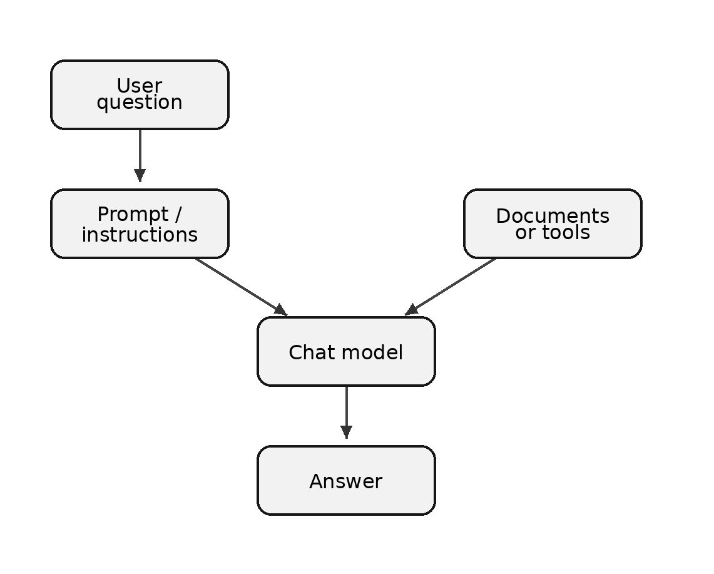</p>

**Diagram walkthrough.** Input passes through model and data/tool components to produce an answer. The components can also be used inside more complicated graphs.

**Important.** LangChain is not limited to simple linear chains; it also has agent features. Avoid outdated “LangChain only supports chains” claims.


---

### 4.2. What is LangGraph?

[Watch 10:15](https://www.youtube.com/watch?v=31qyMKNB2RA&t=615s)

LangGraph is a lower-level orchestration framework for building stateful workflows and agents using nodes, edges, shared state, and runtime control.

Complex workflows can branch, loop, pause, and merge results. Representing those actions as a graph makes their behavior easier to understand and manage.

**Example.** A refund-support agent classifies an issue, reads account details, drafts a response, requests approval for a refund, and either completes or escalates.


LangGraph gives developers lower-level control over the graph that runs a stateful workflow. You define processing nodes, the state they share, and the edges or routing decisions that activate the next work. It is especially useful when an application must revisit earlier steps, wait for approval, or coordinate parallel activities.

A support assistant might classify a refund request, retrieve purchase data, check eligibility, request approval, and then issue a permitted refund. The graph shape makes those decision points visible. LangGraph orchestrates the work; it does not supply refund authority or make the underlying model's factual conclusions automatically correct.

<p align="center">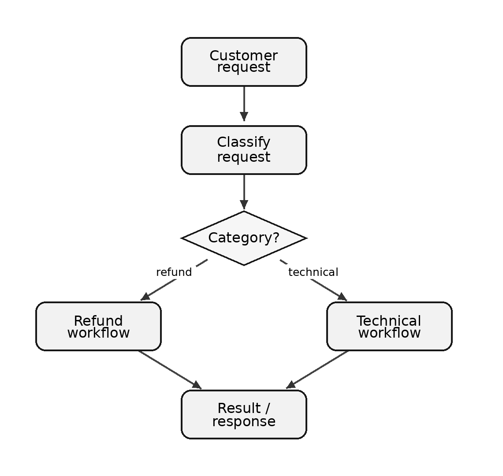</p>

**Diagram walkthrough.** The workflow can branch at runtime and route a failed attempt back to an earlier step.


---

### 4.3. Simple chain vs graph: choosing a shape

[Watch 15:40](https://www.youtube.com/watch?v=31qyMKNB2RA&t=940s)

A sequence works well when each step follows the previous step. A graph is more useful when the next step depends on current results.

A simple one-way pipeline is easier to build and maintain. Graphs add useful control, but they also add design responsibility.

**Example.** Summarize text → translate summary is a chain. Classify a customer issue → choose a specialist → possibly request approval is a graph.


A linear chain is a natural fit when the steps are always the same: summarize an article, then translate the summary. The translated result requires the summary, so a sequence represents the dependency clearly.

A graph becomes more useful when the flow can change. In customer support, a billing request should follow a different branch from a login error. A failed check may retry, while a high-value refund may pause for approval. Both designs can use the same model and retrieval integrations. Choose the simplest implementation that captures the actual business decisions.

<p align="center">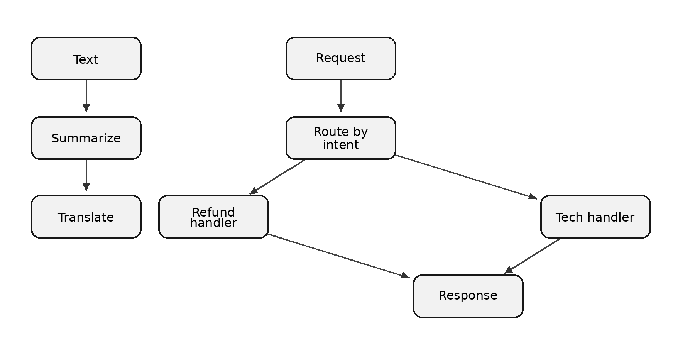</p>

**Diagram walkthrough.** The first row always moves forward. The second includes a decision, two possible routes, and a shared finish.

**Remember.** Choose complexity based on the workflow, not because one library is automatically better.


---

### 4.4. Control-flow complexity: branches and loops

[Watch 27:36](https://www.youtube.com/watch?v=31qyMKNB2RA&t=1656s)

Control flow means the rules deciding which step runs next. A graph can make those rules explicit through fixed edges and conditional decisions.

In real applications, the next action often depends on tool outcomes, user choices, or quality checks.

**Example.** A complaint is routed to technical help; if troubleshooting fails twice, the case is escalated rather than repeating forever.


**Control flow** is the rulebook for which operation happens next. A fixed edge means one successor is already chosen at design time. A conditional edge waits until runtime, reads some state, and chooses between alternatives. A loop sends execution back to an earlier node so a result can be improved or a tool retried.

Think of troubleshooting a login issue. The application checks credentials, decides whether a reset is needed, and either guides the user through a reset or escalates after repeated failures. Without an explicit stopping rule, a retry loop might continue indefinitely. Branches and loops are useful, but they require safe limits and fallback paths.

<p align="center">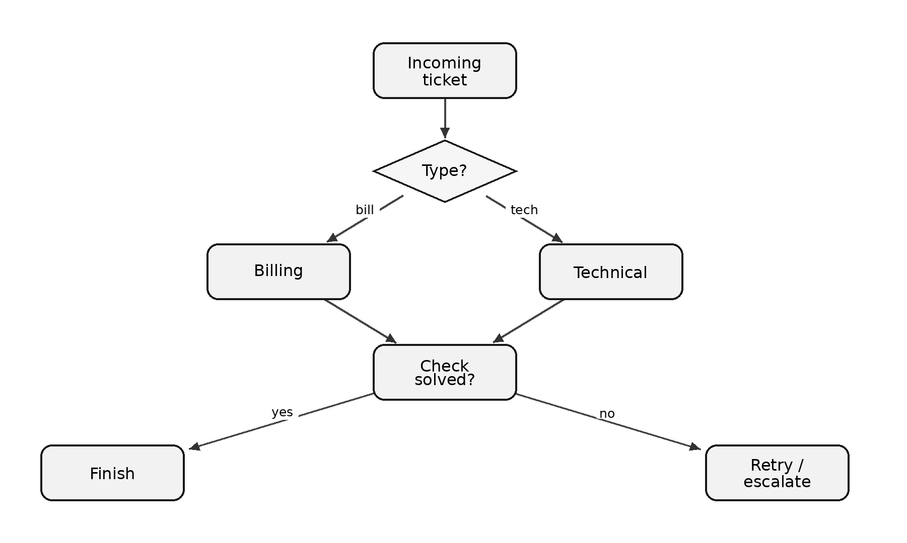</p>

**Diagram walkthrough.** A decision node selects a handler. Its result may complete the task or follow a bounded retry path.

**Important.** Loops need an end condition, retry limit, and error path.


---

### 4.5. State: one shared view of progress

[Watch 39:16](https://www.youtube.com/watch?v=31qyMKNB2RA&t=2356s)

State is the current set of data a workflow uses and updates, such as request type, retrieved information, result, and retry count.

A later step needs earlier results, and a complex graph may have many branches. Shared state gives each step a consistent place to read important values.

**Example.** A support graph stores `issue_type="refund"`, `order_id="A17"`, and `approved=False`. A review step later changes only `approved`.


In a simple Python script, data is passed in local variables. In a stateful graph, relevant pieces of information are represented as named state fields that nodes can read and update. The graph runtime is responsible for combining the updates at the right point in execution.

For a support case, state might include the original request, classified intent, account lookup result, draft reply, and approval status. A node normally returns only the field it changes. Keeping state explicit makes it easier to trace “what did the system know when it made this decision?” It is not the same as unlimited persistent memory across separate sessions.

<p align="center">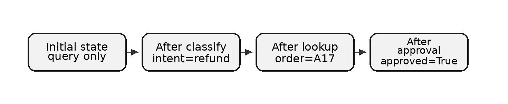</p>

**Diagram walkthrough.** The state starts small and gains values as nodes return partial updates. New values are combined according to the state schema.

**Important.** Do not confuse shared graph state with a permanent memory store; persistence requires additional configuration.


---

### 4.6. Event-driven steps: react to what happened

[Watch 49:50](https://www.youtube.com/watch?v=31qyMKNB2RA&t=2990s)

Event-driven execution means downstream work becomes ready after earlier work produces results or a relevant event occurs.

The system should not run a final response step before required tool outputs or approvals are ready.

**Example.** After an API returns “payment found,” the response can continue. When an approval step pauses for a person, the workflow should wait for that input.


Event-driven execution means that the next stage responds to an outcome: a classification result, a tool response, or a human's decision. For example, after an account lookup returns “customer not found,” the workflow should not blindly continue to a refund step. It can request a corrected account identifier instead.

A graph helps express this dependence on events and results. It still runs within a real software runtime, and any external API can be slow or unavailable. The point is that the workflow has a clear place to interpret those results and choose what happens next.

<p align="center">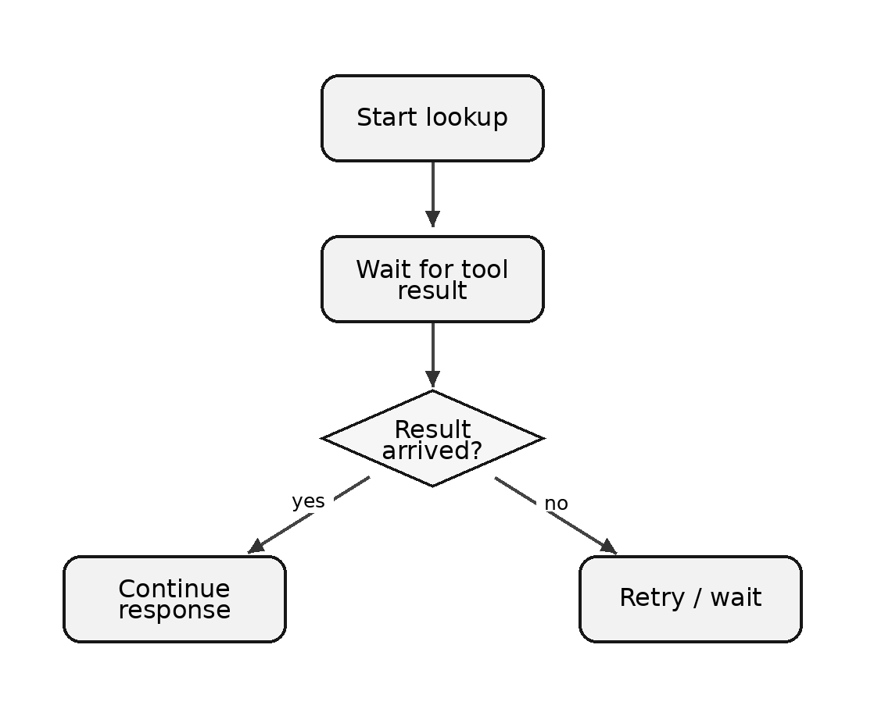</p>

**Diagram walkthrough.** The graph moves forward when an expected result becomes available; otherwise it may wait or route to a recovery path.

**Important.** A graph’s runtime manages scheduling, but it does not magically fix failed external services.


---

### 4.7. Fault tolerance: recover from failures

[Watch 55:55](https://www.youtube.com/watch?v=31qyMKNB2RA&t=3355s)

Fault tolerance is the ability to handle interruptions or errors without unnecessarily losing all progress.

Long-running agents call APIs and models that may fail. Checkpoints and retry strategies help resume or recover responsibly.

**Example.** A document-analysis graph has finished retrieval and classification when the model times out. With suitable checkpointing, previously completed work can be retained when the graph resumes.


**Fault tolerance** is the ability to handle failures without losing track of the entire task or silently delivering a false success. Graph-based designs can isolate tasks, use appropriate retry policies, and—when configured with persistence—resume work from saved state.

A payment or refund action demands particular care. Retrying a write action without an idempotency key could perform it twice. Durable execution is valuable only when external actions are designed to be safely retried. In production, separate transient network failures from invalid data and from actions requiring human intervention.

<p align="center">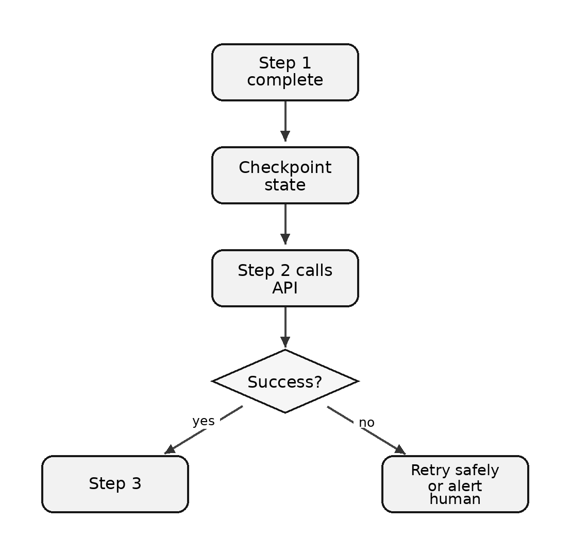</p>

**Diagram walkthrough.** Successful steps write progress; a failure follows a retry or error path. Persistence can store the current state.

**Important.** Retries of external side effects must be idempotent or protected against duplicates.


---

### 4.8. Human-in-the-loop: pause for approval

[Watch 01:02:26](https://www.youtube.com/watch?v=31qyMKNB2RA&t=3746s)

Human-in-the-loop means a person can review, edit, or approve an AI-generated action before it continues.

Some actions, such as refunds, account changes, or sending legal communications, should not happen automatically.

**Example.** The agent drafts a refund recommendation but pauses. An authorized support specialist either approves it, changes the amount, or rejects it.


Human-in-the-loop behavior means that a workflow can pause and let a person inspect or change an important decision before execution continues. Imagine a refund draft above a monetary threshold: a person reviews the amount and recipient, then approves or rejects it.

In LangGraph, properly resumable pauses typically rely on `interrupt()` and a configured checkpointer with a thread identifier. Without persistence, do not assume a process can safely wait for days and then pick up where it left off. Also understand that code before an interrupt may run again when resuming a node, so side effects must be designed carefully.

<p align="center">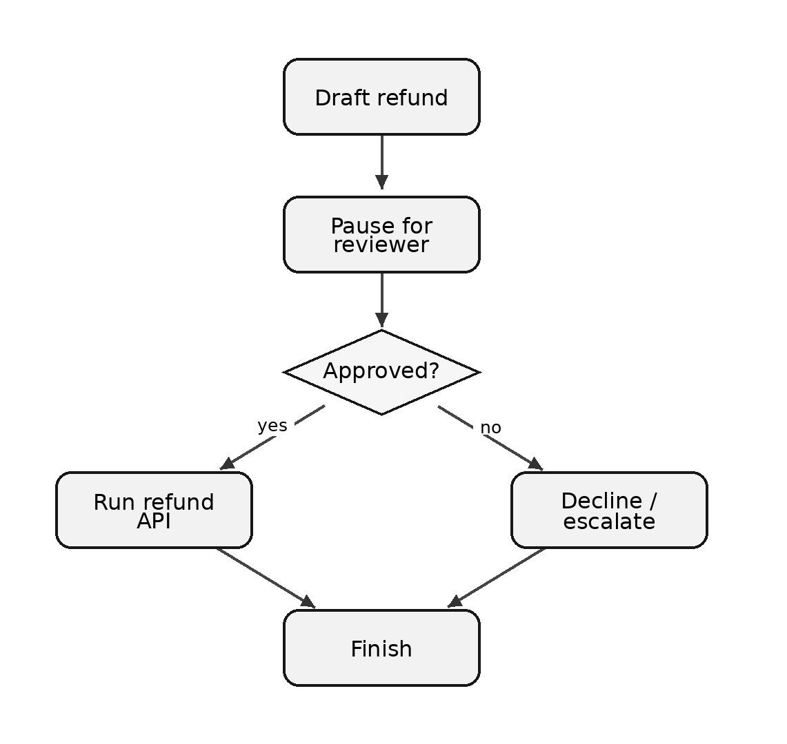</p>

**Diagram walkthrough.** A graph moves from draft to human review, then takes the approved or rejected route. In LangGraph, interrupts and checkpointing support pause and resume.

**Important.** Do not assume an interrupt can resume without a configured persistence strategy and thread identification.


---

### 4.9. Nested workflows: use subgraphs

[Watch 01:08:54](https://www.youtube.com/watch?v=31qyMKNB2RA&t=4134s)

A subgraph is a smaller workflow that is used as part of a larger one.

Breaking a large system into smaller pieces helps keep it understandable, reusable, and testable.

**Example.** The main customer-support graph calls a “billing” subgraph. That subgraph checks payments, validates eligibility, and prepares a recommendation.


A subgraph is a smaller graph used inside a larger graph. It lets developers put related work behind one understandable boundary: for example, a “resolve technical ticket” subgraph with its own retrieval, troubleshooting, and escalation steps.

Nested workflows reduce clutter in a large system. The outer graph can focus on broad business routes while each subgraph implements details for one department. Keep the input/output state contracts clear so the surrounding workflow knows what each subgraph produces. A subgraph should not hide unexpected changes to unrelated shared fields.

<p align="center">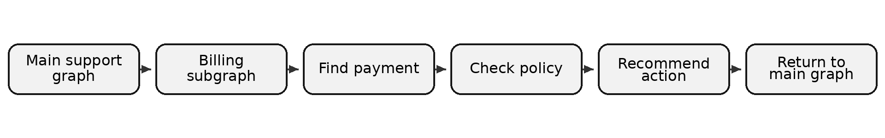</p>

**Diagram walkthrough.** The main process delegates one region of work to the subgraph, which has its own internal sequence and decisions.


---

### 4.10. Observability: understand what happened

[Watch 01:15:53](https://www.youtube.com/watch?v=31qyMKNB2RA&t=4553s)

Observability means being able to inspect which steps ran, how long they took, what updates they produced, and where an error occurred.

Without visibility, a multi-step agent may fail or give a wrong answer and the developer will not know which step caused it.

**Example.** A trace shows the request was correctly classified but the payment tool returned an empty result. You can fix retrieval instead of changing every prompt.


**Observability** means understanding what happened during execution. For an agent application, useful evidence includes which nodes ran, what state changed, which tools were called, how long calls took, and why a branch was selected. Logs and traces help explain and debug behavior that would otherwise look mysterious.

For example, if a refund workflow sends a case to manual review, you should be able to see whether that decision came from a policy threshold, missing purchase data, or a failed model classification. Tools such as LangSmith can provide tracing, but good naming and small node responsibilities make traces easier to interpret regardless of your monitoring platform.

<p align="center">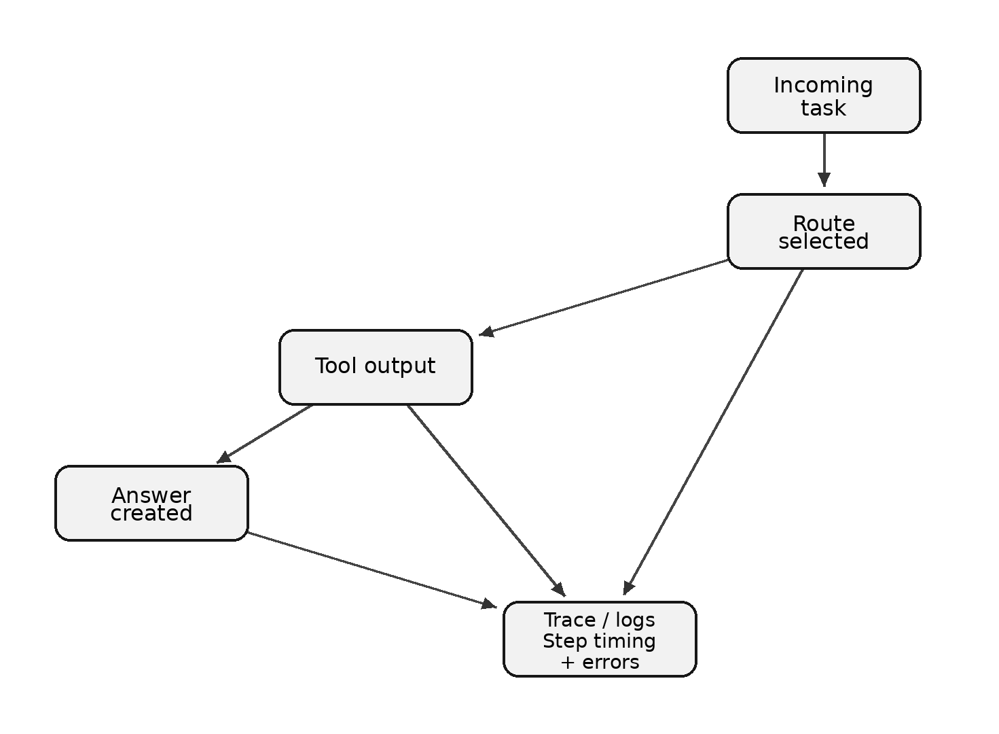</p>

**Diagram walkthrough.** Each execution step produces events and logs. Together, these form an understandable path through the workflow.

**Important.** Do not log secrets or unnecessary personal information when capturing traces.


---

### 4.11. Using LangChain and LangGraph together

[Watch 01:15:53](https://www.youtube.com/watch?v=31qyMKNB2RA&t=4553s)

LangChain and LangGraph are complementary: LangChain offers convenient model/tool and agent abstractions; LangGraph offers fine-grained workflow orchestration.

There is usually no need to “replace” one with the other. Choose the abstractions that match the level of control you need.

**Example.** A LangGraph node may call a LangChain chat model or a LangChain-created tool, while LangGraph manages the surrounding approval, retry, and branching.


LangChain and LangGraph are complementary. Use LangChain components inside LangGraph nodes to call models, retrieve context, and work with tools. Let LangGraph determine the larger control flow: which node runs, what happens after a result, and when to finish or ask for approval.

A useful architecture for support is: LangGraph owns the request state and branching; a LangChain retriever supplies policy passages; a model generates the draft reply; deterministic code validates permissions; and a human approval step protects high-impact actions. You do not need both libraries for every tiny application, but they work naturally together when the problem justifies it.

<p align="center">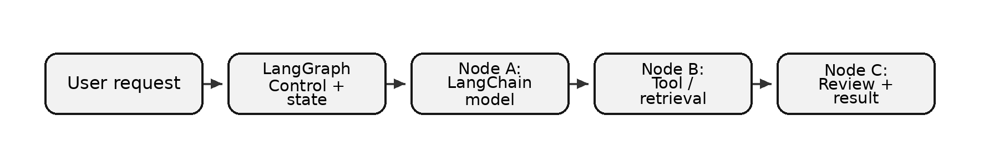</p>

**Diagram walkthrough.** LangGraph provides the outer process; model and tool components do focused work inside each node.

**Remember.** LangChain now includes agent abstractions built with LangGraph primitives; do not describe it as incapable of loops or state.


---

## 5. Worked example: putting the concepts together

Use this example to connect the ideas. Follow one step at a time, and notice which facts must be verified before continuing.

| Step | What happens |
|---|---|
| **Customer request** | “I was charged twice; please refund the extra charge.” |
| **Classification** | Identify issue as billing; store the category in state. |
| **Lookup** | Call the payment tool to find both charges. |
| **Policy check** | Read refund rules and decide if review is required. |
| **Human gate** | Pause if approval is necessary. |
| **Action** | Call the refund tool only after authorization. |
| **Verification** | Read the real refund status and report it accurately. |

**Big picture:** A successful workflow is not merely a sequence of nice sentences. It produces observable results, keeps enough state for later steps, and stops when the stated goal or a safe stopping rule is reached.

## 6. Important comparisons

| Dimension | LangChain | LangGraph |
|---|---|---|
| Main focus | Model/tool integrations and agent building blocks | Explicit orchestration of stateful workflows |
| Typical starting point | Simple apps or configurable ready-made agents | Custom paths, loops, state, approvals |
| Models and tools | First-class integrations | Can call the same components inside nodes |
| Execution control | High-level agent abstractions | Direct graph-level control |
| Human review | Available through agent/runtime patterns | Explicit pause/resume and graph design |
| Relationship | Agent implementations use LangGraph primitives | Can be used directly or under LangChain |

## 7. Python examples and practice

These short examples help turn the diagrams into working code. You can understand the concepts without running them.

For LangGraph examples, install the open-source package with `python -m pip install langgraph`. No paid LLM key is needed for these examples.

### 7.1. A small routing graph (install: pip install langgraph)

```python
from typing_extensions import TypedDict
from langgraph.graph import StateGraph, START, END

class Ticket(TypedDict):
    query: str
    category: str
    reply: str

def classify(state: Ticket) -> dict:
    q = state["query"].lower()
    return {"category": "billing" if "charged" in q else "technical"}

def choose(state: Ticket) -> str:
    return state["category"]

def billing(state: Ticket) -> dict:
    return {"reply": "Let's check your payment."}

def technical(state: Ticket) -> dict:
    return {"reply": "Let's troubleshoot the issue."}

builder = StateGraph(Ticket)
builder.add_node("classify", classify)
builder.add_node("billing", billing)
builder.add_node("technical", technical)
builder.add_edge(START, "classify")
builder.add_conditional_edges("classify", choose,
    {"billing": "billing", "technical": "technical"})
builder.add_edge("billing", END)
builder.add_edge("technical", END)
app = builder.compile()

result = app.invoke({"query": "I was charged twice",
                     "category": "", "reply": ""})
print(result["reply"])  # Let's check your payment.
```

**What happens:** Trace it as **classify → choose one path → reply**. This example is rule-based so you can learn the graph without needing an LLM account.

## 8. Common mistakes and better habits

Read each statement as a mini interview trap:
1. “LangChain is only linear” is an outdated simplification.
2. Checkpoints do not make every external action safely repeatable.
3. Graph state does not automatically mean permanent storage across sessions.
4. A human approval gate requires properly configured persistence to resume.
5. Observability is not optional when workflows make consequential decisions.

## 9. Key takeaways

1. LangChain is a framework for building applications with language models, prompts, tools, data sources, and agent components.
2. LangGraph is a lower-level orchestration framework for building stateful workflows and agents using nodes, edges, shared state, and runtime control.
3. A sequence works well when each step follows the previous step.
4. Control flow means the rules deciding which step runs next.
5. State is the current set of data a workflow uses and updates, such as request type, retrieved information, result, and retry count.
6. Event-driven execution means downstream work becomes ready after earlier work produces results or a relevant event occurs.
7. Fault tolerance is the ability to handle interruptions or errors without unnecessarily losing all progress.
8. Human-in-the-loop means a person can review, edit, or approve an AI-generated action before it continues.
9. A subgraph is a smaller workflow that is used as part of a larger one.
10. Observability means being able to inspect which steps ran, how long they took, what updates they produced, and where an error occurred.
11. LangChain and LangGraph are complementary: LangChain offers convenient model/tool and agent abstractions; LangGraph offers fine-grained workflow orchestration.

## 10. Revision checklist

- [ ] Define LangChain in one sentence.
- [ ] Define LangGraph in one sentence.
- [ ] Draw a simple chain and a branched graph.
- [ ] Explain conditional control flow.
- [ ] Explain shared state and partial updates.
- [ ] Describe checkpoints and their limitations.
- [ ] Draw a human approval path.
- [ ] Explain subgraphs and a practical use case.
- [ ] Describe what a trace helps you debug.
- [ ] Explain how both frameworks can work together.

## 11. Practice questions and mini exercises

1. Sketch a product-support assistant with routing to billing and technical support.
2. A model call fails after retrieval. Identify which work should be repeated or restored.
3. Add an approval gate to a refund workflow.
4. Explain where you would put a LangChain retriever inside a LangGraph application.
5. Describe the minimum trace data you need to find a broken node without leaking secrets.

## 12. Interview questions — short answers you can say aloud

**Q1. What is LangChain?**

A framework with reusable components for LLM applications, tools, data connections, and agents.

**Q2. What is LangGraph?**

A low-level framework for orchestrating stateful graph-based workflows and agents.

**Q3. How are they different?**

LangChain is convenient for model/tool and agent abstractions; LangGraph gives finer control over workflow execution and state.

**Q4. Can LangChain agents use LangGraph?**

Yes. Modern LangChain agent implementations use LangGraph primitives.

**Q5. Why use state?**

To preserve the information that later workflow steps need.

**Q6. What is a checkpoint?**

A stored snapshot of workflow state that can support recovery and resumption.

**Q7. What is human-in-the-loop?**

Pausing or routing work for a person to review or approve before continuing.

**Q8. What is a subgraph?**

A smaller workflow embedded in a larger one.

**Q9. What is observability?**

Visibility into execution steps, results, timing, and errors for monitoring and debugging.

**Q10. When should I start with LangGraph?**

When the application needs custom branching, loops, shared state, pause/resume, or precise orchestration.

## 13. Further reading

- [LangChain overview](https://docs.langchain.com/oss/python/langchain/overview)
- [LangGraph: Graph API](https://docs.langchain.com/oss/python/langgraph/graph-api)
- [Designing with graphs](https://docs.langchain.com/oss/python/langgraph/thinking-in-graph-api)
- [Human review and interrupts](https://docs.langchain.com/oss/python/langgraph/interrupts)
- [Persistence and checkpoints](https://docs.langchain.com/oss/python/langgraph/persistence)
- [Streaming graph runs](https://docs.langchain.com/oss/python/langgraph/streaming)

---

**One-line memory hook:** Know which framework to choose for a given application and explain control flow, state, recovery, human review, subgraphs, and observability with simple diagrams.
