# LangGraph Core Concepts

*Agentic AI using LangGraph · CampusX · Video 4*

**Lesson link:** https://www.youtube.com/watch?v=D5KhiCDM9XQ

> **The main idea:** LangGraph becomes much easier when you picture a set of workers sharing one notebook. **Nodes do the work, edges decide the route, state stores the facts, and reducers decide how updates are combined.** This chapter uses a UPSC essay-practice app to connect every concept.

## 1. Learning goals

Explain the five workflow patterns, design nodes/edges/state, understand reducers and super-steps, and confidently explain the runtime in a technical interview.

## 2. Video chapters and timestamps

| Time | Topic |
|---|---|
| [00:00](https://www.youtube.com/watch?v=D5KhiCDM9XQ&t=0s) | Intro |
| [01:14](https://www.youtube.com/watch?v=D5KhiCDM9XQ&t=74s) | What is LangGraph? |
| [05:43](https://www.youtube.com/watch?v=D5KhiCDM9XQ&t=343s) | LLM WorkFlows |
| [09:07](https://www.youtube.com/watch?v=D5KhiCDM9XQ&t=547s) | Prompt Chaining |
| [11:17](https://www.youtube.com/watch?v=D5KhiCDM9XQ&t=677s) | Routing |
| [13:14](https://www.youtube.com/watch?v=D5KhiCDM9XQ&t=794s) | Parallelization |
| [16:11](https://www.youtube.com/watch?v=D5KhiCDM9XQ&t=971s) | Orchestrator Workers |
| [19:48](https://www.youtube.com/watch?v=D5KhiCDM9XQ&t=1188s) | Evaluator Optimizer |
| [23:00](https://www.youtube.com/watch?v=D5KhiCDM9XQ&t=1380s) | Graphs Nodes and Edges |
| [30:53](https://www.youtube.com/watch?v=D5KhiCDM9XQ&t=1853s) | State |
| [36:07](https://www.youtube.com/watch?v=D5KhiCDM9XQ&t=2167s) | Reducers |
| [44:38](https://www.youtube.com/watch?v=D5KhiCDM9XQ&t=2678s) | LangGraph Execution Model |

## 3. Prerequisites and basic terms

A **graph** has nodes and connections. A **function** receives input and returns output. A **dictionary** is a collection of named values, for example `{"essay": "...", "score": 4}`. No prior LangGraph programming is needed.

### Useful terminology

| Word | Simple meaning |
|---|---|
| **Node** | A named task/function that does work. |
| **Edge** | A connection that controls what runs next. |
| **State** | The shared information nodes read and update. |
| **Reducer** | A rule for combining updates to one state field. |
| **Super-step** | A round of graph execution. |

## 4. Concepts explained

The concepts are explained with definitions, practical examples, and diagrams. Follow each example from input to result, then use the revision questions to check your understanding.

### 4.1. What is LangGraph?

[Watch 01:14](https://www.youtube.com/watch?v=D5KhiCDM9XQ&t=74s)

LangGraph is a framework for building and running stateful workflows and AI agents as graphs of connected tasks.

It makes multi-step processes easier to manage when they require decisions, parallel work, repeat attempts, or human approval.

**Example.** An essay-practice app asks a student to write, has separate graders evaluate the essay, combines their scores, then decides whether to accept or suggest a rewrite.


A `StateGraph` begins with a state schema and node functions. Its shape is a set of tasks connected by transitions. At runtime the graph activates appropriate tasks and combines their state updates. That model works for a plain calculator, a document pipeline, or a more flexible agent.

For UPSC essay practice, one path generates a topic, receives an essay, grades several qualities, and decides whether revision would help. The graph is useful because grading can happen in parallel, the outcome can take one of several paths, and a later revision can repeat earlier work.

<p align="center">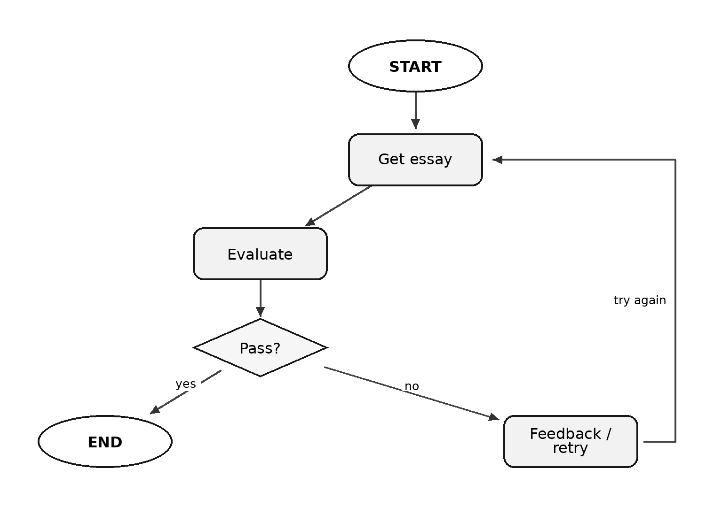</p>

**Diagram walkthrough.** START activates a task. Each node reads shared information and returns updates. Edges decide what happens next until END.

**Important.** LangGraph does not make models correct by itself; it organizes how components execute.


---

### 4.2. What is an LLM workflow?

[Watch 05:43](https://www.youtube.com/watch?v=D5KhiCDM9XQ&t=343s)

An LLM workflow is a planned set of steps where one or more tasks use a language model, often alongside ordinary code, tools, and human input.

Breaking a big task into smaller steps makes it easier to inspect intermediate outputs and handle errors.

**Example.** A hiring process includes drafting a job description, publishing, reviewing candidates, and scheduling interviews. Only some stages need an LLM.


An LLM workflow is a business or application process in which some steps use language models. A model may generate text, classify a request, or review a draft; other steps may be ordinary validation code, database reads, or human decisions.

For a hiring process, drafting a job description may use an LLM, but checking minimum eligibility can use deterministic rules and conducting an interview remains a human activity. The practical design task is deciding **which stages need reasoning or generation** and which do not.

<p align="center">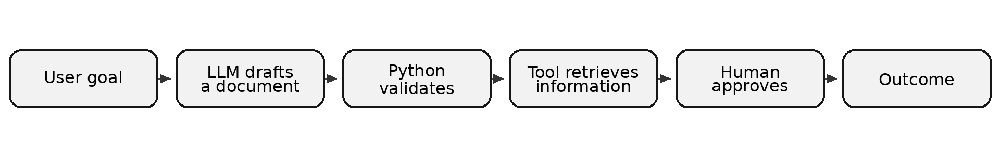</p>

**Diagram walkthrough.** A workflow can contain model work, rule checks, database lookups, and approval gates. Each stage has a clear responsibility.

**Remember.** Not every workflow requires an LLM, and not every LLM workflow is a fully autonomous agent.


---

### 4.3. Pattern 1 — Prompt chaining

[Watch 09:07](https://www.youtube.com/watch?v=D5KhiCDM9XQ&t=547s)

Prompt chaining sends the result of one LLM call into the next LLM call. The steps run in a known order.

It helps when one big request is easier to solve as a sequence of smaller, verifiable tasks.

**Example.** Report creation: generate an outline for “Renewable energy in India,” check it, write the report using that outline, then validate the final word count.


Prompt chaining is useful when a later piece of writing needs a more structured earlier result. A report writer can first produce an outline, validate its coverage, and then expand each heading into paragraphs. The first call produces an intermediate artifact, not the final answer.

The intermediate outline is valuable because you can inspect it before spending time on a long report. However, if the outline omits an important theme, the report step may amplify that omission. Validation between steps is often the deciding benefit of a chain.

<p align="center">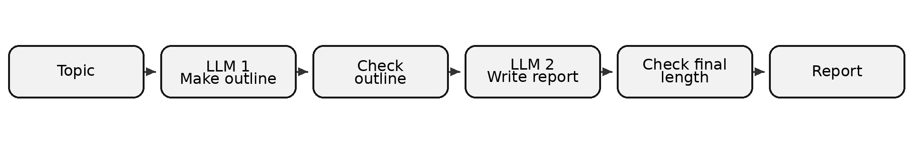</p>

**Diagram walkthrough.** The first step produces an outline; the next depends on it. A validator can reject the result before publication.

**Important.** A later step inherits errors from an earlier step; verify important intermediate outputs.


---

### 4.4. Pattern 2 — Routing

[Watch 11:17](https://www.youtube.com/watch?v=D5KhiCDM9XQ&t=677s)

Routing selects one appropriate path based on the request or current state.

Different problems often require different specialists instead of one generic prompt.

**Example.** A support bot chooses between refund, technical, and sales handlers. “I was charged twice” is routed to the refund path.


Routing is the workflow equivalent of choosing the correct counter at a service center. A classifier looks at the request and produces a small label such as `refund`, `technical`, or `sales`. A conditional edge then activates the matching handler.

This is different from running all handlers. If someone reports a failed login, executing the sales and refund paths wastes work and may create confusing outputs. A router should also handle uncertain input; use an `unknown` or human-review path rather than forcing an unsafe guess.

<p align="center">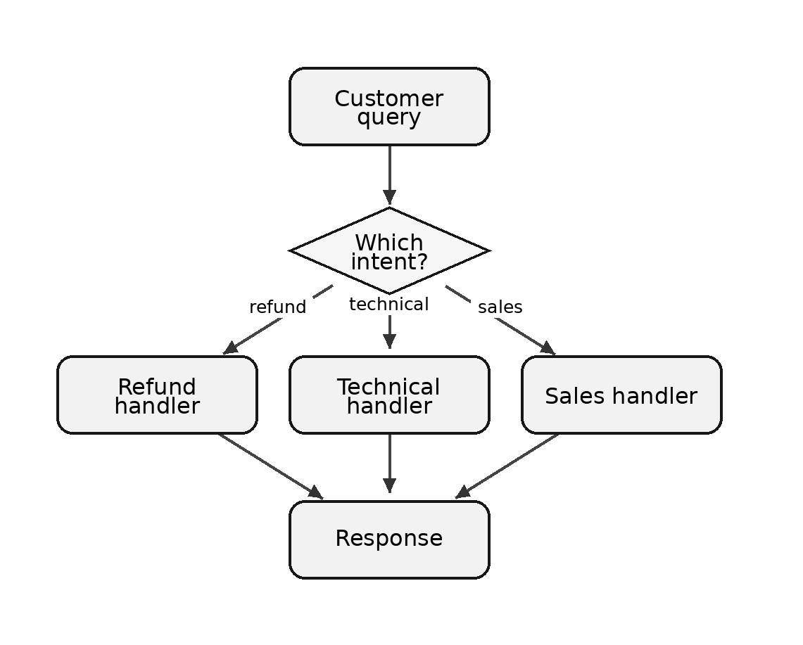</p>

**Diagram walkthrough.** The router chooses a branch; only the selected specialist handles the request. The branches are alternatives, not all executed together.

**Important.** Provide an unknown or fallback route for inputs that do not fit an expected category.


---

### 4.5. Pattern 3 — Parallelization

[Watch 13:14](https://www.youtube.com/watch?v=D5KhiCDM9XQ&t=794s)

Parallelization runs independent tasks at the same time and later combines their results.

It can reduce total waiting time when separate checks do not depend on one another.

**Example.** Moderating a video: one check examines community guidelines, one checks misinformation, and one checks sexual content. A final step combines the findings.


Parallelization means scheduling independent tasks so neither has to wait for the other to finish. A moderation system may examine policy violations, misinformation, and sensitive content separately using the same source material. Each branch returns its own result, and a later stage combines those results.

Parallelism can reduce elapsed time, but it does not make calls free or eliminate errors. If three checks all write to the same un-reduced state key, the graph may raise a concurrent-update error. Give each branch a distinct field or define a suitable reducer.

<p align="center">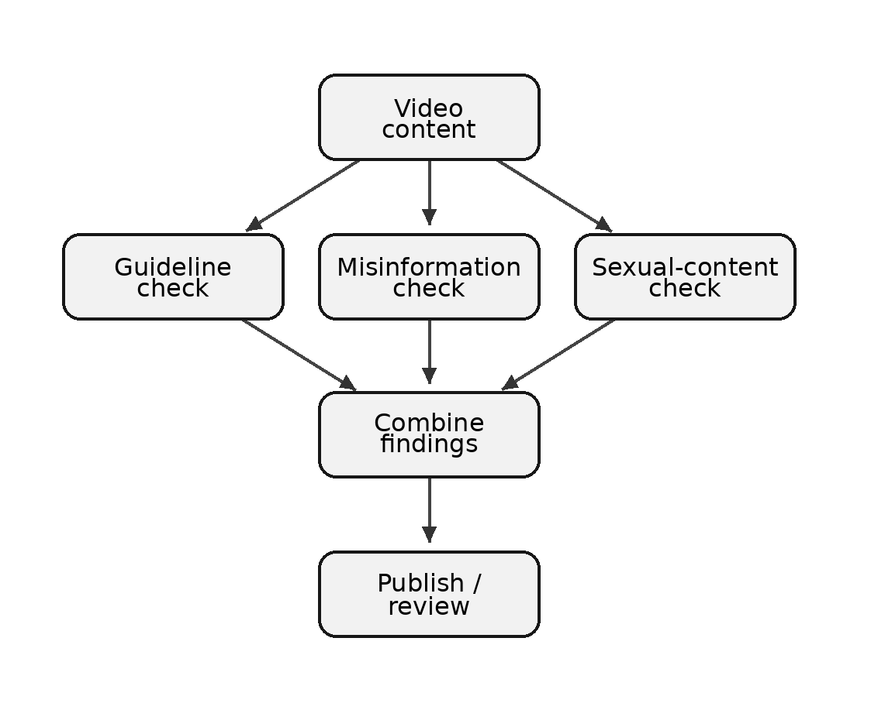</p>

**Diagram walkthrough.** Three branches receive the same input. A join waits for their results before making a final decision.

**Important.** Shared state keys may need reducers when parallel nodes write updates to the same field.


---

### 4.6. Pattern 4 — Orchestrator and workers

[Watch 16:11](https://www.youtube.com/watch?v=D5KhiCDM9XQ&t=971s)

The orchestrator–workers pattern uses a planner to decide which subtasks are needed for a particular input, then assigns them to worker tasks.

Unlike fixed parallelization, the number or kind of tasks can change based on the question.

**Example.** A research assistant may search academic papers for a scientific question but choose news and policy sources for a current public issue.


The orchestrator-worker pattern adds **dynamic planning**. A planner examines the current request and decides which subtasks to delegate. A scientific research question may require academic papers, whereas a policy controversy may require primary documents and news coverage.

Unlike fixed parallel work, the number or kind of subtasks is not always known in advance. Worker results still need careful synthesis: duplicate findings should be merged, contradictory claims identified, and sources checked. Dynamic task generation is useful for open-ended tasks but adds complexity and cost.

<p align="center">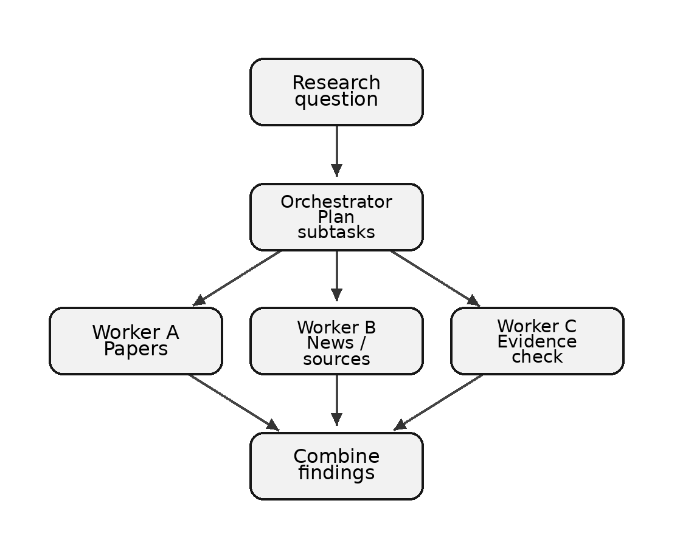</p>

**Diagram walkthrough.** The planner decides what research to delegate. Workers gather findings. A final synthesizer joins the results.

**Remember.** **Fixed parallelism:** known checks always run. **Orchestrator–workers:** the tasks are selected dynamically.


---

### 4.7. Pattern 5 — Evaluator and optimizer

[Watch 19:48](https://www.youtube.com/watch?v=D5KhiCDM9XQ&t=1188s)

The evaluator–optimizer pattern improves an output through feedback: generate, evaluate against criteria, revise if needed, and stop when acceptable.

A first draft may be unclear or incomplete. Measurable feedback helps improve it without relying on endless retries.

**Example.** An email writer drafts a message; the reviewer checks whether it states the purpose, next action, and correct tone. If not, the draft is revised.


An evaluator-optimizer loop has at least two responsibilities. One stage produces a draft; the other checks it against a rubric and returns either acceptance or actionable feedback. On rejection, the draft is revised and checked again.

This pattern is useful for emails, stories, and structured content only when the evaluator knows what success means. A vague instruction such as “make it better” produces weak feedback. Give criteria such as clarity, correctness, required facts, and format. Always bound the number of attempts so a poor evaluator cannot trigger an endless loop.

<p align="center">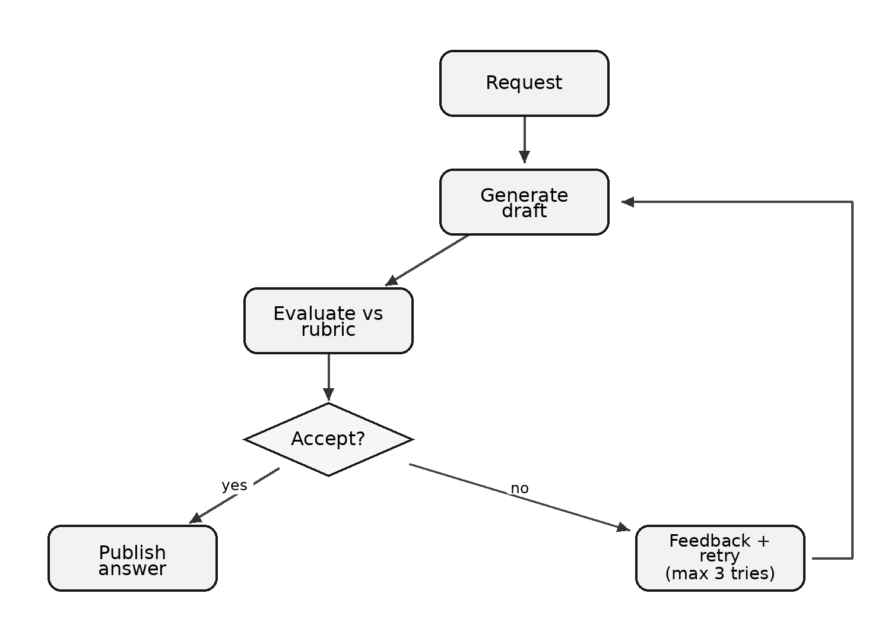</p>

**Diagram walkthrough.** The evaluator returns either ACCEPT or specific feedback. A retry limit stops an unsuccessful loop.

**Important.** A loop without a clear acceptance criterion or retry limit can waste time and API cost.


---

### 4.8. Nodes, edges, and the UPSC essay workflow

[Watch 23:00](https://www.youtube.com/watch?v=D5KhiCDM9XQ&t=1380s)

**Nodes** are work steps, **edges** are connections that choose the next step, and **conditional edges** select different paths using state.

These three ideas let you draw the real business logic before writing code.

**Example.** The app gives an essay topic, accepts a student essay, evaluates clarity, depth, and language independently, combines feedback, and optionally offers a retake.


Nodes are units of work; edges describe transitions between them. A node might receive an essay, judge one quality, or combine scores. A fixed edge says the next task is already known. A conditional edge chooses a path based on the current result. Multiple edges can activate independent grading work.

The essay-practice graph illustrates all three shapes: **topic → writing** is sequential; **clarity/depth/language grading** is parallel; **accept/revise** is conditional. A revision path loops back to essay writing. The actual student's input comes from the application's interface or an appropriately designed pause/resume step—not from a magical model-generated essay submission.

<p align="center">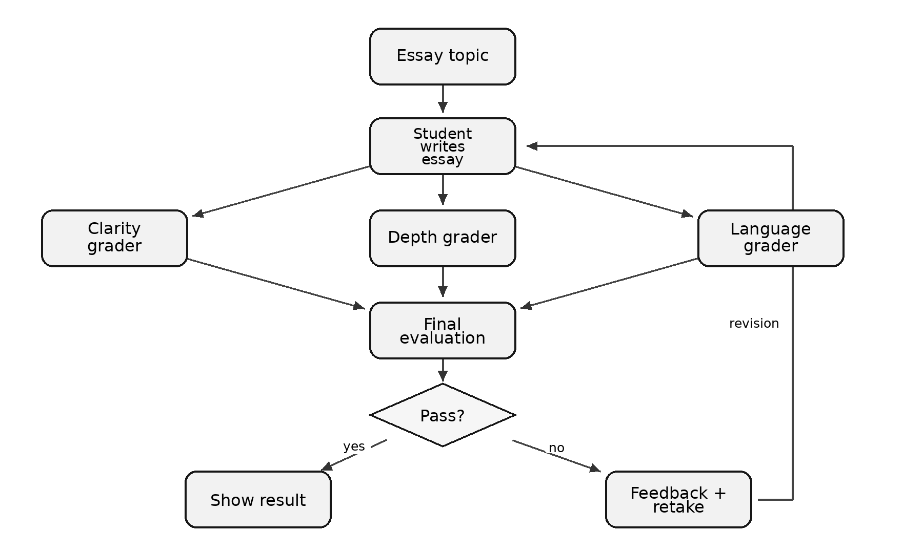</p>

**Diagram walkthrough.** The three graders can run in parallel. Final evaluation waits for them. A decision leads either to completion or a controlled rewrite.

**Important.** A node is not necessarily a model call; it can be ordinary Python, a tool, or a human-input step.


---

### 4.9. State: the shared notebook

[Watch 30:53](https://www.youtube.com/watch?v=D5KhiCDM9XQ&t=1853s)

State is the shared collection of information that graph nodes read and update while the workflow runs.

Without state, later nodes would not know the essay topic, essay text, scores, or feedback created earlier.

**Example.** Initial state has `topic`. After writing, a node adds `essay`. Three graders add `clarity`, `depth`, and `language` scores.


State is a named collection of facts available to the graph's tasks. In the essay app, it might hold the topic, current essay text, rubric scores, feedback, and current attempt number. One grading node returns `{"clarity_score": 4}`; the next step can then read the updated value.

A node generally returns a partial update instead of rebuilding an entire dictionary. This makes responsibilities clearer and is particularly important when parallel nodes are active. State is not automatically a permanent user memory system; cross-run persistence requires deliberate configuration.

<p align="center">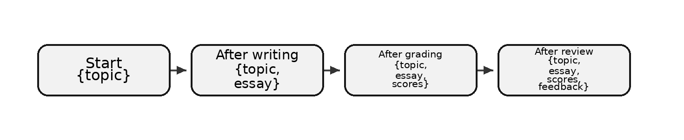</p>

**Diagram walkthrough.** A node usually returns only the fields it changes. The graph applies these updates to the existing state.

**Remember.** Shared state is not automatically long-term conversation memory; checkpointing and persistence are separate concerns.


---

### 4.10. Reducers: overwrite or keep history?

[Watch 36:07](https://www.youtube.com/watch?v=D5KhiCDM9XQ&t=2167s)

A reducer is a rule that determines how a new value is combined with the old value of one state field.

Some fields should keep only the latest value; others, such as essay versions or chat history, should collect many values.

**Example.** With inputs 5 and 6, a `result` field changes from 11 to 22 after doubling: replacement is correct. For essay drafts, new versions should append to a history list.


A reducer defines how a single state field combines an old value and a new update. The default behavior for an ordinary key is replacement. This is correct for a field like `current_score`, where the latest value should replace the earlier one.

If you want to preserve all essay drafts, use a history list with an append reducer rather than reusing the current-essay field. `Annotated[list[str], operator.add]` is a useful way to demonstrate list concatenation. Your state design should separate **latest value** from **history of values** to avoid confusing downstream tasks.

<p align="center">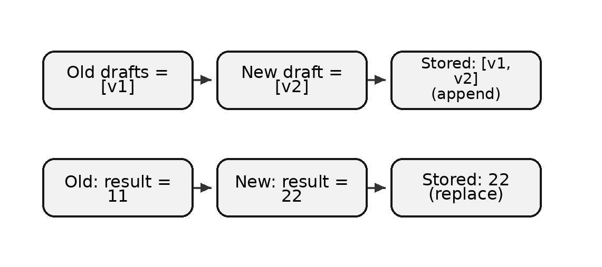</p>

**Diagram walkthrough.** Default state updates normally replace a field. A list reducer can preserve old items by adding new items to the list.

**Important.** If two parallel nodes write the same non-reduced key in one step, LangGraph can raise a concurrent-update error.


---

### 4.11. Reducers and chat history

[Watch 36:07](https://www.youtube.com/watch?v=D5KhiCDM9XQ&t=2167s)

For a chatbot, message history often needs an append-or-merge rule so earlier messages remain available to later responses.

If every new message overwrites the old one, the chatbot may lose information shared earlier in the conversation.

**Example.** User: “My name is Nitish.” Assistant: “Hello!” Later: “What is my name?” The agent needs earlier context to answer.


Chat messages are another reason to preserve history. If the user first says “My name is Nitish,” and later asks “What is my name?”, a system storing only the last message cannot see the earlier information. A messages reducer retains relevant prior exchanges.

For real chat message objects, LangGraph's `add_messages` reducer or `MessagesState` is more suitable than simply concatenating strings because it handles message identifiers and updates. Remember that storing messages in graph state and persisting them between sessions are separate concerns.

<p align="center">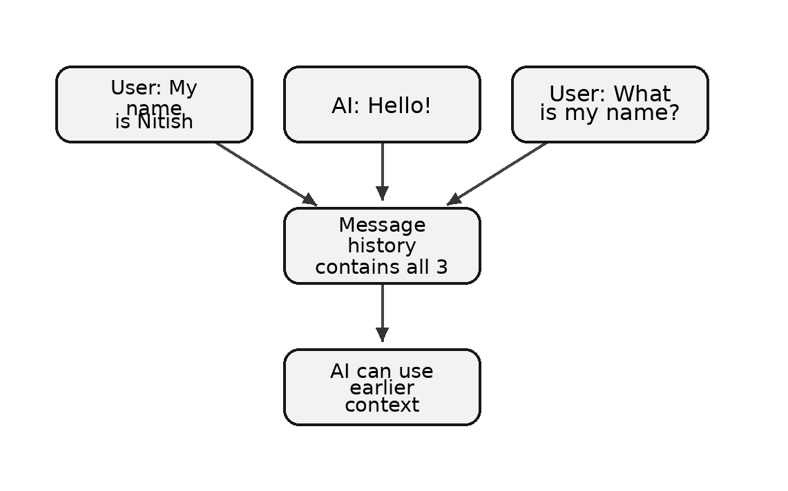</p>

**Diagram walkthrough.** Each new conversation message joins the sequence. LangGraph provides `add_messages` or `MessagesState` for message-aware updates.

**Remember.** For simple list examples, `operator.add` appends. For actual chat message objects, use the message-aware reducer.


---

### 4.12. Parallel updates: why reducers matter again

[Watch 36:07](https://www.youtube.com/watch?v=D5KhiCDM9XQ&t=2167s)

When multiple branches run in the same graph round, each may return updates. A reducer tells LangGraph how to combine updates to one shared field.

If a workflow aggregates findings from three parallel graders into a single list, it needs a well-defined merge strategy.

**Example.** Clarity returns `["clarity: 4"]`, depth returns `["depth: 3"]`, and language returns `["language: 5"]`. A list reducer collects all three.


When two nodes run in parallel, both can read a shared state snapshot and return changes. If they write different fields such as `clarity_score` and `depth_score`, the updates are straightforward. If both write the same ordinary field, the runtime needs a rule for combining them.

A reducer supplies that rule. For example, three graders may each return a one-element list for `checks`, and `operator.add` combines those lists. Do not use the order of concurrently appended items as a meaningful ranking—sort or key the results explicitly if order matters.

<p align="center">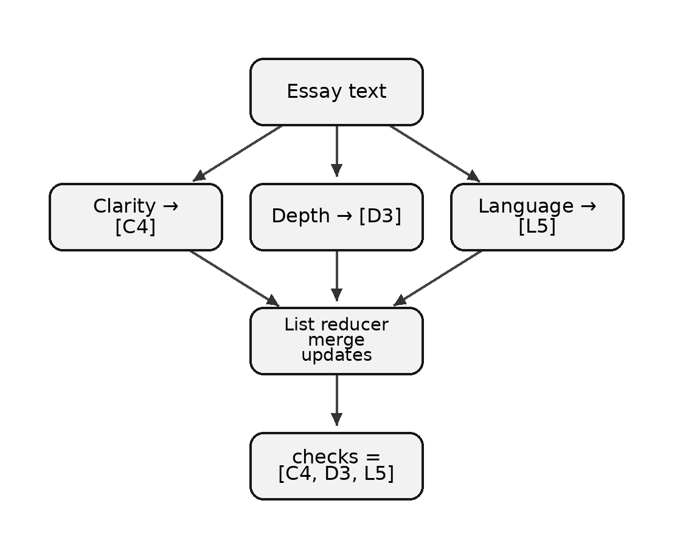</p>

**Diagram walkthrough.** Three independent nodes write to the same `checks` list. The reducer combines these updates before the summary node runs.

**Important.** Do not rely on the ordering of parallel updates as a meaningful ranking; sort records explicitly if order matters.


---

### 4.13. Execution model: super-steps

[Watch 44:38](https://www.youtube.com/watch?v=D5KhiCDM9XQ&t=2678s)

A super-step is one round of graph execution. Nodes that are ready to run together may execute during the same round.

This explains how a graph handles parallel branches while keeping their state updates synchronized for later steps.

**Example.** The essay is written first. Then clarity, depth, and language graders run in one parallel round. Finally, the scoring node combines the results.


LangGraph execution uses discrete rounds called **super-steps**. Nodes active in the same round may run concurrently; their updates are combined at the round boundary before later dependent nodes run.

For essay grading, the three rubric graders can run in one conceptual round, while final evaluation begins after their outputs are available. Thinking in rounds explains why parallel same-key updates are a special case: they happen together, before a later node can consume the combined results.

<p align="center">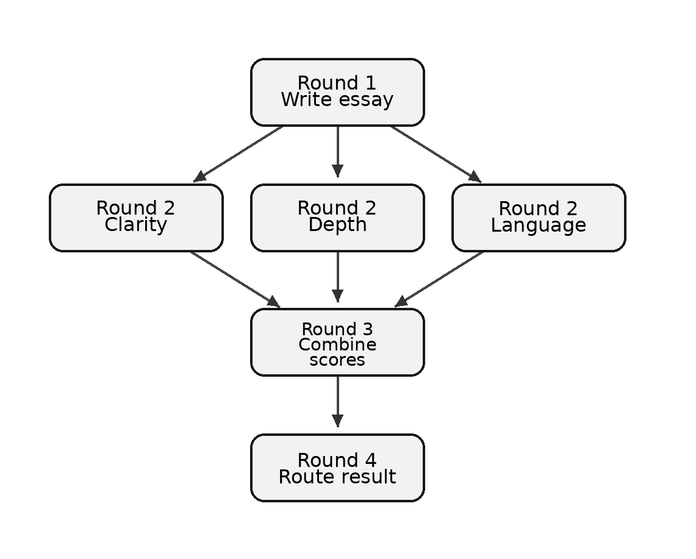</p>

**Diagram walkthrough.** First a writing step activates the graders; the parallel round returns updates; the final evaluator runs only after the required updates are ready.

**Important.** The round labels in a study diagram are conceptual, not promises about internal API counters.


---

### 4.14. From design to execution: compile and invoke

[Watch 44:38](https://www.youtube.com/watch?v=D5KhiCDM9XQ&t=2678s)

You **define** a graph, **compile** it into an executable workflow, then **invoke** it with initial state. The runtime executes active nodes and applies updates until the workflow finishes.

Separating build time from runtime makes the code easier to test: graph design does not itself call your model or execute the business task.

**Example.** Define an essay state and its graders; compile once; invoke it for a student submission; collect the final state with results and feedback.


Building a graph and running a graph are different activities. First define state and nodes, then connect edges. Next call `.compile()` to prepare an executable graph. Only `.invoke()` or a streaming execution actually processes an input through the graph.

The compiled graph does not automatically provide valid external data, correct model answers, or persistent history. Those needs require explicit design: validators, retries, checkpointers, and monitoring. A practical way to learn is to trace one small input through each node before adding a real LLM.

<p align="center">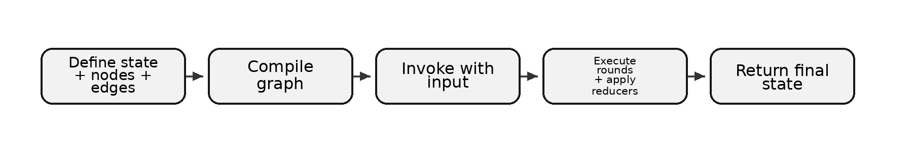</p>

**Diagram walkthrough.** Build-time defines structure. Runtime starts with input, advances through ready nodes, and returns a final result.

**Important.** Compilation can catch some structural errors but cannot guarantee tool availability, correct model answers, or valid input data.


---

## 5. Worked example: putting the concepts together

Use this example to connect the ideas. Follow one step at a time, and notice which facts must be verified before continuing.

| Step | What happens |
|---|---|
| **Start** | Topic: “Artificial intelligence in public services.” |
| **Write essay** | The student submits a draft. Store it as `essay`. |
| **Parallel checks** | Clarity=3, depth=2, language=4, stored as independent results. |
| **Final evaluation** | Total=9; threshold=12; generate focused feedback. |
| **Route** | Below threshold, and the student chooses a retry. |
| **Revise** | Student submits a new draft; append it to draft history. |
| **Recheck** | Clarity=4, depth=4, language=5; total=13. |
| **Finish** | The goal is reached; show scores and feedback. |

**Big picture:** A successful workflow is not merely a sequence of nice sentences. It produces observable results, keeps enough state for later steps, and stops when the stated goal or a safe stopping rule is reached.

## 6. Important comparisons

| Concept | Simple meaning | UPSC example |
|---|---|---|
| Node | Does one step of work | Grade clarity |
| Edge | Controls next step | Essay → graders |
| Conditional edge | Chooses a path | Score pass vs retry |
| State | Shared task information | Essay, scores, feedback |
| Reducer | Combines a field’s update | Append feedback |
| Super-step | A round of active work | Three graders run together |

## 7. Python examples and practice

These short examples help turn the diagrams into working code. You can understand the concepts without running them.

For LangGraph examples, install the open-source package with `python -m pip install langgraph`. No paid LLM key is needed for these examples.

### 7.1. Example A — a node updates shared state (no model API key)

```python
from typing_extensions import TypedDict
from langgraph.graph import StateGraph, START, END

class MathState(TypedDict):
    a: int
    b: int
    result: int

def add_numbers(state: MathState) -> dict:
    return {"result": state["a"] + state["b"]}

def double_result(state: MathState) -> dict:
    return {"result": state["result"] * 2}

builder = StateGraph(MathState)
builder.add_node("add", add_numbers)
builder.add_node("double", double_result)
builder.add_edge(START, "add")
builder.add_edge("add", "double")
builder.add_edge("double", END)
app = builder.compile()

print(app.invoke({"a": 5, "b": 6, "result": 0}))
# {'a': 5, 'b': 6, 'result': 22}
```

**What happens:** State trace: `result` starts at 0 → the add node returns 11 → the double node returns 22. The default update rule **replaces** the previous result.

### 7.2. Example B — three parallel nodes safely add to one list

```python
from operator import add
from typing import Annotated
from typing_extensions import TypedDict
from langgraph.graph import StateGraph, START, END

class EssayState(TypedDict):
    essay: str
    checks: Annotated[list[str], add]
    report: str

def clarity(state: EssayState) -> dict:
    return {"checks": ["clarity: checked"]}

def depth(state: EssayState) -> dict:
    return {"checks": ["depth: checked"]}

def language(state: EssayState) -> dict:
    return {"checks": ["language: checked"]}

def summarize(state: EssayState) -> dict:
    return {"report": ", ".join(sorted(state["checks"]))}

builder = StateGraph(EssayState)
for name, fn in [("clarity", clarity), ("depth", depth),
                 ("language", language), ("summary", summarize)]:
    builder.add_node(name, fn)
for name in ("clarity", "depth", "language"):
    builder.add_edge(START, name)
builder.add_edge(["clarity", "depth", "language"], "summary")
builder.add_edge("summary", END)
app = builder.compile()
result = app.invoke({"essay": "Sample essay", "checks": [], "report": ""})
print(result["report"])
# clarity: checked, depth: checked, language: checked
```

**What happens:** Three graders write to `checks` during the same round. `Annotated[..., add]` lets the runtime combine updates into one list. We sort only for stable display.

## 8. Common mistakes and better habits

Read each statement as a mini interview trap:
1. Nodes are not always LLM calls; they can use tools or deterministic code.
2. Routing chooses a path; parallelization runs several branches.
3. A reducer combines updates to one field, not an entire magical shared dictionary.
4. Same-key parallel writes need a reducer or separate fields.
5. State is not guaranteed to persist between separate runs without a checkpointer.
6. A quality-improvement loop needs a clear limit and stopping rule.
7. The graph is not run when you only call `.compile()`.

## 9. Key takeaways

1. LangGraph is a framework for building and running stateful workflows and AI agents as graphs of connected tasks.
2. An LLM workflow is a planned set of steps where one or more tasks use a language model, often alongside ordinary code, tools, and human input.
3. Prompt chaining sends the result of one LLM call into the next LLM call.
4. Routing selects one appropriate path based on the request or current state.
5. Parallelization runs independent tasks at the same time and later combines their results.
6. The orchestrator–workers pattern uses a planner to decide which subtasks are needed for a particular input, then assigns them to worker tasks.
7. The evaluator–optimizer pattern improves an output through feedback: generate, evaluate against criteria, revise if needed, and stop when acceptable.
8. **Nodes** are work steps, **edges** are connections that choose the next step, and **conditional edges** select different paths using state.
9. State is the shared collection of information that graph nodes read and update while the workflow runs.
10. A reducer is a rule that determines how a new value is combined with the old value of one state field.
11. For a chatbot, message history often needs an append-or-merge rule so earlier messages remain available to later responses.
12. When multiple branches run in the same graph round, each may return updates.

## 10. Revision checklist

- [ ] Define LangGraph as a stateful workflow orchestration framework.
- [ ] Draw fixed, conditional, parallel, and loop graph shapes.
- [ ] Explain each of the five workflow patterns.
- [ ] Trace the UPSC essay workflow.
- [ ] Define node, edge, and shared state.
- [ ] Explain why nodes return partial state updates.
- [ ] Compare default replace with append/merge reducers.
- [ ] Trace 5 + 6 = 11, then double to 22.
- [ ] Explain why chat history should be retained.
- [ ] Describe concurrent updates from parallel graders.
- [ ] Explain super-steps with three graders.
- [ ] Describe define → compile → invoke → execute → finish.

## 11. Practice questions and mini exercises

1. Draw a workflow that routes support queries to refund, technical, or sales.
2. Change the essay workflow so a failed depth grader causes human review.
3. Predict what happens if three parallel graders write one list key with no reducer.
4. For result=11, what should a doubling node return?
5. Add a maximum of two retries to an evaluator–optimizer loop.
6. Create a state schema with `current_essay` (replace) and `draft_history` (append).

## 12. Interview questions — short answers you can say aloud

**Q1. What is LangGraph?**

A framework for building and orchestrating stateful workflows and agents as connected nodes and edges.

**Q2. What is a node?**

A task or function that reads state and returns updates.

**Q3. What is an edge?**

A connection that controls which node or nodes execute next.

**Q4. What is state?**

The shared data snapshot nodes use and update during a graph run.

**Q5. What is a reducer?**

A field-level rule for combining an incoming update with a previous state value.

**Q6. What happens without a custom reducer?**

An update usually replaces the old value; simultaneous same-key writes can be invalid.

**Q7. What is prompt chaining?**

Sequential LLM calls in which one result becomes the input for the next.

**Q8. Routing vs parallelization?**

Routing selects a branch; parallelization runs independent branches and combines results.

**Q9. What is orchestrator–workers?**

A planner dynamically selects subtasks and delegates them to workers.

**Q10. What is evaluator–optimizer?**

A generate–review–revise loop that stops on acceptance or a defined limit.

**Q11. What is a super-step?**

A round of graph execution in which one or more ready nodes may run.

**Q12. Why compile a graph?**

To prepare and validate its structure and obtain an executable graph.

**Q13. Why do chats use message reducers?**

To preserve and update conversation history rather than replace it with only the newest message.

**Q14. Do I need a paid LLM for LangGraph?**

No. Nodes can run ordinary Python. A model provider is a separate choice.

## 13. Further reading

- [LangGraph: Graph API](https://docs.langchain.com/oss/python/langgraph/graph-api)
- [Designing with graphs](https://docs.langchain.com/oss/python/langgraph/thinking-in-graph-api)
- [Workflow and agent patterns](https://docs.langchain.com/oss/python/langgraph/workflows-agents)
- [Streaming graph runs](https://docs.langchain.com/oss/python/langgraph/streaming)

---

**One-line memory hook:** Explain the five workflow patterns, design nodes/edges/state, understand reducers and super-steps, and confidently explain the runtime in a technical interview.
