# Sequential Workflows in LangGraph

**Agentic AI using LangGraph | Video 5 | CampusX**  
**Lesson:** [Sequential Workflows in LangGraph](https://www.youtube.com/watch?v=bAWujyAl1Kk)  
**Main ideas:** sequential execution · nodes and edges · shared state · graph compilation · single-step LLM workflows · prompt chaining

> **Core idea:** A sequential workflow completes one task before starting the next. Each task can read the updated state left by earlier tasks. LangGraph represents this process using nodes, edges, and a shared state.

<p align="center">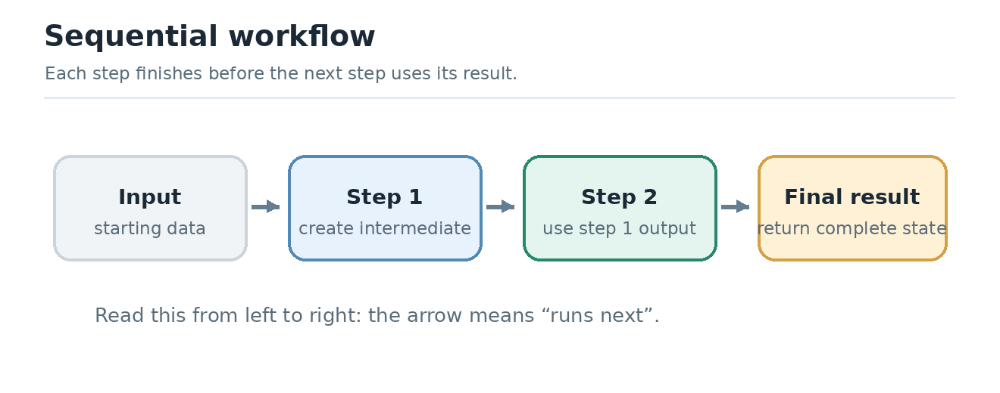</p>

## 1. Learning goals

After studying this lesson, you should be comfortable explaining a sequential workflow in your own words, designing one as a graph, and tracing its data from input to final output. You should also be able to build a small `StateGraph`, understand how an LLM fits inside a node, and explain why prompt chaining is a practical example of sequential execution.

### Video chapter links

These links take you to the lesson's named chapters. The chapter times come from the supplied video metadata.

| Time | Chapter | Focus |
| --- | --- | --- |
| [00:00](https://www.youtube.com/watch?v=bAWujyAl1Kk&t=0s) | Introduction | From graph concepts to practical workflows |
| [02:43](https://www.youtube.com/watch?v=bAWujyAl1Kk&t=163s) | Installation | Environment and library setup |
| [07:17](https://www.youtube.com/watch?v=bAWujyAl1Kk&t=437s) | First workflow | BMI example, state, nodes, edges, execution |
| [26:11](https://www.youtube.com/watch?v=bAWujyAl1Kk&t=1571s) | LLM workflow | One LLM question-answering node |
| [36:55](https://www.youtube.com/watch?v=bAWujyAl1Kk&t=2215s) | Prompt chaining | Topic → outline → blog post |
| [49:03](https://www.youtube.com/watch?v=bAWujyAl1Kk&t=2943s) | Closing | Recap |

---

## 2. Understanding sequential workflows

A **workflow** is an organized set of tasks that produces a result. A **sequential workflow** is a workflow in which tasks run in a fixed order: the next task starts after the earlier one has completed. In many sequences, a later task also depends on information produced by an earlier task.

Think about preparing a college assignment. You first **choose a topic**, then **create an outline**, then **write the answer**, and finally **proofread it**. Proofreading makes sense only after there is an answer to review. Creating the answer is easier once an outline exists. The sequence reflects these dependencies.

A similar pattern appears in software: `collect data → clean data → calculate result → format response`. Each stage has a clear responsibility. When the stages are kept separate, we can understand and test the process more easily.

### What makes a sequence different from parallel execution?

<p align="center">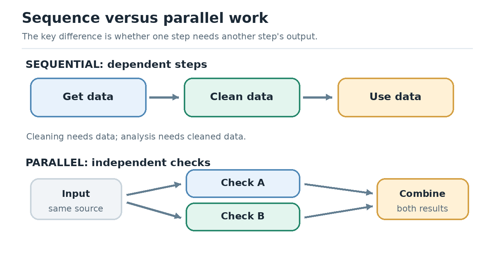</p>

In a **sequence**, task B waits for task A because B needs A's result or because the business process demands that order. In a **parallel** workflow, multiple tasks can start after the same input without waiting for one another; their results can be combined later. For example, checking a document's spelling and counting its words are independent checks. Creating a summary and then translating *that summary* are dependent tasks.

| Situation | Suitable flow | Reason |
| --- | --- | --- |
| Create an outline, then write an article | Sequential | The article uses the outline |
| Calculate BMI, then assign a label | Sequential | The label uses the BMI value |
| Check spelling and word count | Parallel | The checks do not depend on each other |
| Send billing issues to billing, technical issues to support | Conditional routing | Only the matching branch should run |

**Remember:** Sequential does not mean "one node only." A graph with a single processing node is the simplest case, but the main value of a sequence becomes clearer when several dependent nodes are connected.

### When should you use a sequential workflow?

Use one when the order is predictable, the work can be divided into meaningful stages, and you want to inspect or validate the output of each stage. A sequence is particularly useful for data preparation, report generation, document processing, onboarding forms, and staged LLM calls.

It is less suitable when you need several independent tasks to finish quickly or when the next step depends on a decision that can choose different routes. Those cases may benefit from parallel or conditional graphs. Real applications often combine all three patterns.

---

## 3. LangGraph building blocks

LangGraph lets us describe an application as a **graph**. A graph is a collection of named processing steps and connections between them. For the basic `StateGraph` approach, learn three ideas first.

**Node.** A node is one unit of work, usually implemented as a Python function. It reads the current state and returns values that should be updated. A node might calculate a number, transform text, call an LLM, use an API, or validate input.

**Edge.** An edge is the connection that decides what runs next. A normal edge such as `A → B` means B can execute after A finishes. A sequential graph usually uses these fixed edges.

**State.** State is the collection of data that the workflow needs while it runs. Instead of manually passing many separate variables between functions, nodes read relevant fields from state and return updates to those fields.

<p align="center">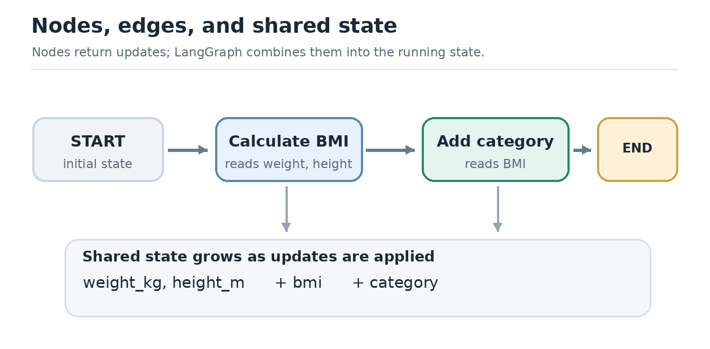</p>

### How state moves through the process

Imagine a BMI calculator. At the beginning, the workflow knows `weight_kg` and `height_m`. The calculation node computes `bmi` and returns **only** `{"bmi": 23.53}`. LangGraph applies this update, so the next node can read all three values: weight, height, and BMI. The classification node then returns `{"category": "normal range"}`. The final state contains the original inputs and both results.

This is an important distinction: a node generally does **not** need to replace or return the entire state dictionary. It can return a **partial update** containing only what changed. By default, a later update to the same key replaces that key's previous value.

### `START` and `END`

`START` and `END` are special graph markers. `START` identifies where input enters, and `END` marks a completed path. They are not ordinary functions and do not need the same implementation as a processing node. For a three-step sequence, the shape is:

```text
START → step_a → step_b → step_c → END
```

Each arrow is a fixed edge. The graph definition is separate from actually running these functions. We will see that distinction in the next example.

---

## 4. Worked example: BMI calculator

A **BMI calculator** is a good small example because its input, formula, and output are easy to follow. The formula is:

**BMI = weight in kilograms ÷ (height in metres)²**

For a weight of **68 kg** and a height of **1.70 m**, the calculation is `68 ÷ (1.70 × 1.70) = 23.53` (rounded to two decimal places). This numerical example is for understanding the software workflow, not for giving personal health advice.

We can first use one node to compute BMI. To understand sequential *dependency* more clearly, we will extend the example to a second node that attaches a simple illustrative adult BMI-range label. The second node cannot run correctly until the BMI value exists.

<p align="center">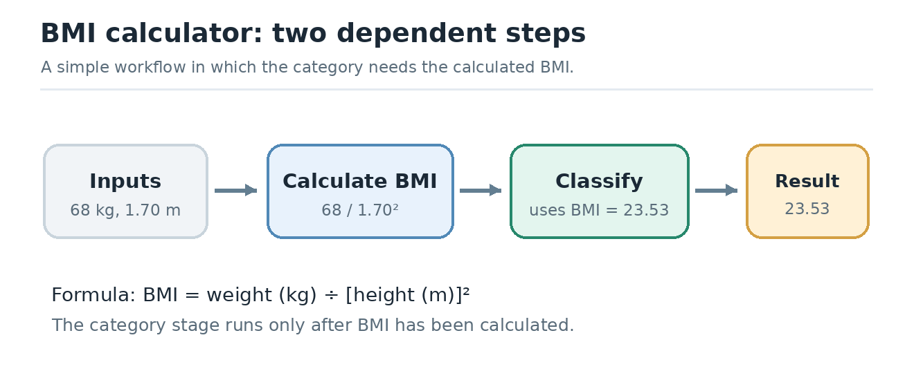</p>

### Define the state

A `TypedDict` gives names and expected types to the fields we want in our workflow. Here the two initial inputs are numeric, `bmi` will be numeric, and the label is text.

```python
from typing_extensions import TypedDict

class BMIState(TypedDict, total=False):
    weight_kg: float
    height_m: float
    bmi: float
    category: str
```

`total=False` makes every field optional **in the type declaration**, which is useful here because the initial input does not yet contain `bmi` or `category`. It does **not** automatically validate input values at runtime. Our node must still check assumptions such as a positive height.

### Write the nodes

```python
def calculate_bmi(state: BMIState) -> dict:
    height = state["height_m"]
    if height <= 0:
        raise ValueError("height_m must be greater than zero")

    bmi = state["weight_kg"] / (height ** 2)
    return {"bmi": round(bmi, 2)}


def label_bmi(state: BMIState) -> dict:
    bmi = state["bmi"]
    if bmi < 18.5:
        label = "below usual adult range"
    elif bmi < 25:
        label = "normal range"
    elif bmi < 30:
        label = "above usual adult range"
    else:
        label = "higher range"
    return {"category": label}
```

The first function reads the inputs and calculates a value. The second reads **that value**, not the original weight and height. This separation makes the dependency visible and provides a natural place to test each stage independently.

The labels above are simplified illustrative adult BMI categories. They are not a medical assessment; BMI alone cannot describe an individual's health.

### Connect, compile, and run the graph

```python
from langgraph.graph import StateGraph, START, END

builder = StateGraph(BMIState)
builder.add_node("calculate_bmi", calculate_bmi)
builder.add_node("label_bmi", label_bmi)

builder.add_edge(START, "calculate_bmi")
builder.add_edge("calculate_bmi", "label_bmi")
builder.add_edge("label_bmi", END)

app = builder.compile()

result = app.invoke({"weight_kg": 68.0, "height_m": 1.70})
print(result)
# {
#   'weight_kg': 68.0,
#   'height_m': 1.7,
#   'bmi': 23.53,
#   'category': 'normal range'
# }
```

Install the library in a virtual environment with `python -m pip install -U langgraph`. The Python example uses `typing_extensions`, which is installed by common LangGraph dependencies; if needed, install it separately. This example contains **no LLM calls and needs no API key**.

### Follow the state after each node

<p align="center">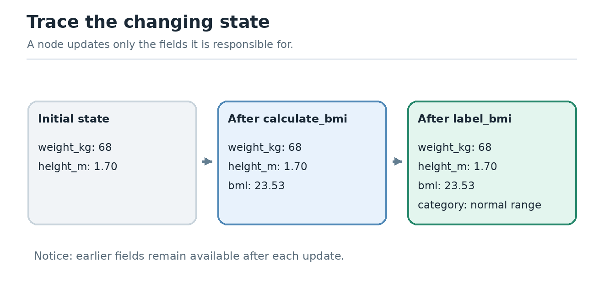</p>

| Stage | State fields available | New update |
| --- | --- | --- |
| Initial input | `weight_kg=68`, `height_m=1.70` | None yet |
| After `calculate_bmi` | Inputs and `bmi=23.53` | `{"bmi": 23.53}` |
| After `label_bmi` | Inputs, BMI, and category | `{"category": "normal range"}` |
| At `END` | All four fields | Full final state is returned |

**How to read this:** The first node does not erase the inputs when it returns the BMI. It updates one field. The second node receives a state in which BMI is already available. That is exactly why the order of execution matters.

### What if the input is invalid?

A height of zero would cause division by zero. The validation check in `calculate_bmi` raises a clear error instead. In a real service, you would also validate missing fields, non-numeric values, and sensible ranges before starting the graph or inside the input node.

<p align="center">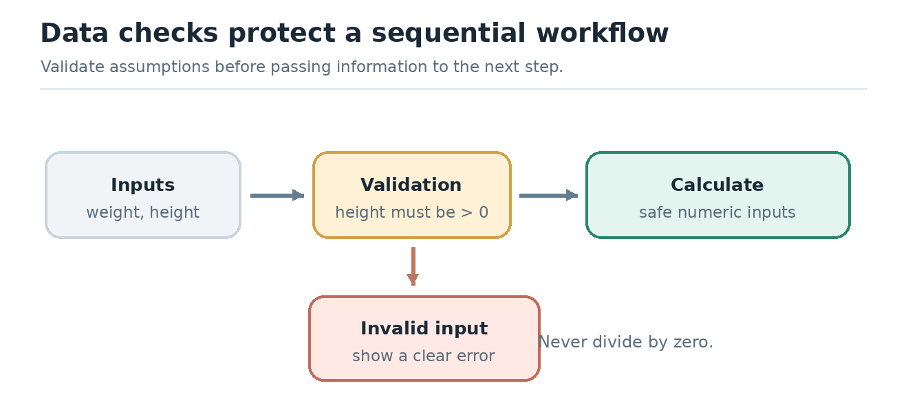</p>

A fixed sequence does not automatically provide special error handling. If a node fails and the failure is not handled, execution does not simply skip to the next node and pretend the result is valid. Plan input checks and failure behavior deliberately.

---

## 5. What happens when a graph runs?

It is useful to separate **designing a graph** from **executing a graph**. These are different phases.

<p align="center">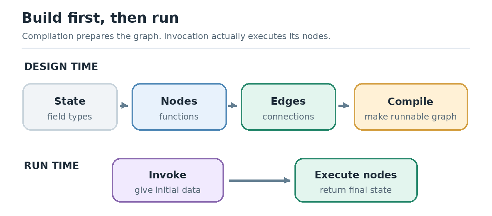</p>

1. **Define state.** Decide what data the workflow needs and the types of those values.
2. **Write nodes.** Give each step a specific responsibility. A node generally reads state and returns a partial update.
3. **Add edges.** Describe the execution order. For a sequence, each node points to the one that follows.
4. **Compile.** `builder.compile()` prepares an executable graph and checks some graph-structure problems. Compiling does not run the BMI calculation or call an LLM.
5. **Invoke.** `app.invoke(initial_state)` starts the actual run, calls the active nodes in order, applies updates, and returns the resulting state.

### Why do we need compilation?

You can think of the graph builder as a **plan** and the compiled graph as the **runnable version of that plan**. You use the builder to register steps and connections. The compiled graph supplies runtime methods such as `.invoke()` and `.stream()`. A common beginner mistake is calling `.invoke()` on the uncompiled builder.

### Sequential execution in rounds

LangGraph's execution model uses discrete rounds called **super-steps**. In a simple sequence, one active processing node typically occupies each successive round. After that node returns its updates, the next node can run with the updated state. In a parallel workflow, multiple eligible nodes may run within one super-step.

For the BMI example, the conceptual order is: `input → calculate BMI → label BMI → finish`. Do not worry about internal scheduler details at first; the practical rule is that **the second node sees the first node's completed state update**.

### Inspecting intermediate results

The simplest approach is to print the final result from `.invoke()`. To see how nodes change the state along the way, current LangGraph versions also support streaming updates:

```python
for update in app.stream(
    {"weight_kg": 68.0, "height_m": 1.70},
    stream_mode="updates",
):
    print(update)
```

The stream exposes per-node updates, making it easier to identify which step produced a value or where an unexpected result first appeared. Exact display formatting depends on the installed LangGraph version.

---

## 6. Sequential workflow with a single LLM

A LangGraph node can call a language model instead of performing a numeric calculation. Consider a simple question-answering application. The input state contains a **question**. The processing node sends that question to an LLM and stores the generated **answer**. The graph then finishes.

<p align="center">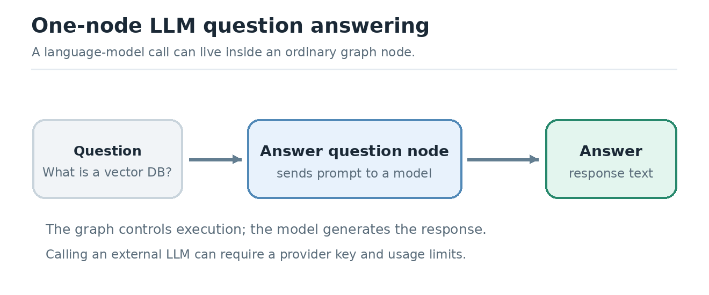</p>

A minimal state schema could be:

```python
class QAState(TypedDict, total=False):
    question: str
    answer: str
```

The conceptual node body is:

```python
def answer_question(state: QAState) -> dict:
    # "llm" means a chat model you have already configured.
    response = llm.invoke(state["question"])
    return {"answer": response.content}
```

This snippet explains **where an LLM call belongs**; it is not runnable until you configure `llm` with a chosen provider or local model. The surrounding graph construction is the same pattern used for the BMI example: register the node, connect `START → answer_question → END`, compile, and invoke.

### What does LangGraph add here?

With only one node, the graph may look more complicated than calling `llm.invoke(question)` directly. That is a fair observation. A one-node graph is mainly useful for learning the framework or as a starting point for a larger process. As requirements grow, you can add steps for input checks, document retrieval, output formatting, or human review without changing the general mental model.

The **LLM is responsible for generating text**. The **graph is responsible for organizing which steps run and how their data is shared**. LangGraph itself does not train the model or guarantee that its answer is accurate.

---

## 7. Prompt chaining: a useful multi-step LLM workflow

**Prompt chaining** means making multiple LLM calls in sequence, where a later call works with the result of an earlier call. It is useful when a complex task can be separated into smaller tasks with clear outputs.

Imagine writing a blog post about **Agentic AI**. Asking for a finished article in one call may work, but the result may be poorly organized. A two-step chain offers more control: first create an outline, then write the article using that outline.

<p align="center">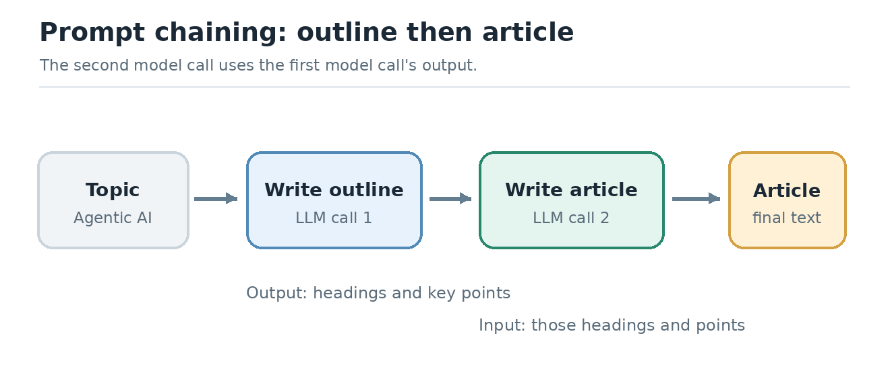</p>

### Step-by-step example

**Input:** `topic = "Agentic AI"`

**Step 1 — Create an outline.** The first node asks for a short structure that covers a definition, basic operation, an example, limitations, and a conclusion. Its result might be:

```text
1. What is Agentic AI?
2. How does an agent work?
3. Example: a customer-support agent
4. Benefits and limitations
5. Conclusion
```

**Step 2 — Write the blog post.** The second node receives both the topic and the outline. It expands the headings into paragraphs, preserving the overall structure. The final output is a complete article rather than just a list of headings.

This structure is called *chaining* because the output of the first model call becomes part of the input for the second model call. Both calls could use the **same underlying model** with different prompts, or different models if the application benefits from specialization.

### How the state changes

<p align="center">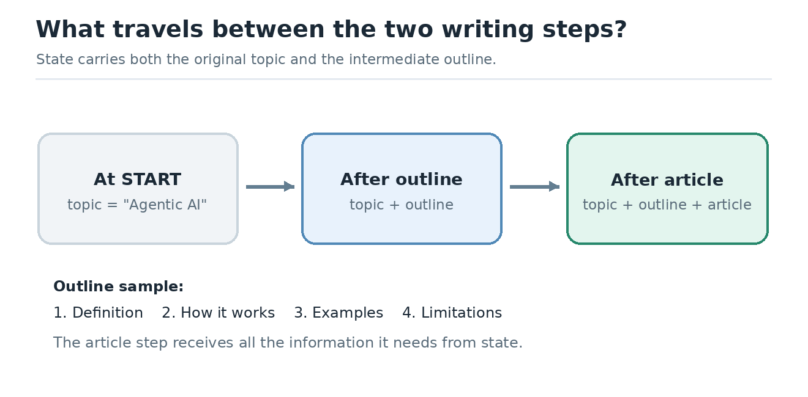</p>

| Time | `topic` | `outline` | `article` |
| --- | --- | --- | --- |
| Before first call | Agentic AI | Not created | Not created |
| After first call | Agentic AI | Five headings | Not created |
| After second call | Agentic AI | Same headings | Final blog text |

Keeping the outline in state has two benefits: the writing node can use it, and a developer can inspect it later when trying to understand a weak article.

### The Python structure

This version shows the graph wiring without requiring a paid model. It uses simple local functions to imitate the two stages. To make it a real LLM chain, replace the function bodies with configured model calls; **the graph shape stays the same**.

```python
from typing_extensions import TypedDict
from langgraph.graph import StateGraph, START, END

class BlogState(TypedDict, total=False):
    topic: str
    outline: str
    article: str

def create_outline(state: BlogState) -> dict:
    topic = state["topic"]
    outline = (
        f"1. Introduction to {topic}\n"
        "2. How it works\n"
        "3. Practical uses\n"
        "4. Limitations\n"
        "5. Conclusion"
    )
    return {"outline": outline}

def write_article(state: BlogState) -> dict:
    return {
        "article": (
            f"Article: {state['topic']}\n\n"
            f"Plan:\n{state['outline']}\n\n"
            "Draft text would expand each section in this plan."
        )
    }

builder = StateGraph(BlogState)
builder.add_node("create_outline", create_outline)
builder.add_node("write_article", write_article)
builder.add_edge(START, "create_outline")
builder.add_edge("create_outline", "write_article")
builder.add_edge("write_article", END)
app = builder.compile()

result = app.invoke({"topic": "Agentic AI"})
print(result["outline"])
print(result["article"])
```

In a real LLM implementation, `create_outline` would ask the model to generate an outline and return the text, while `write_article` would put `state["outline"]` into its prompt. It is important that the **second prompt actually uses the first result**; simply making two unrelated calls in a row is not meaningful prompt chaining.

### Why split the task into two prompts?

A chain can improve **clarity and controllability**. You can inspect the outline before writing, ask for a different structure, validate the headings, or use a specialized writing prompt. It also makes debugging easier because you can see whether a weak article started with a weak outline.

There are trade-offs. Two model calls often take longer and may cost more than one. The second call may repeat a mistake from the first. More steps do not automatically produce better content; use a chain only when its intermediate stages genuinely help.

---

## 8. Choosing the right amount of workflow complexity

<p align="center">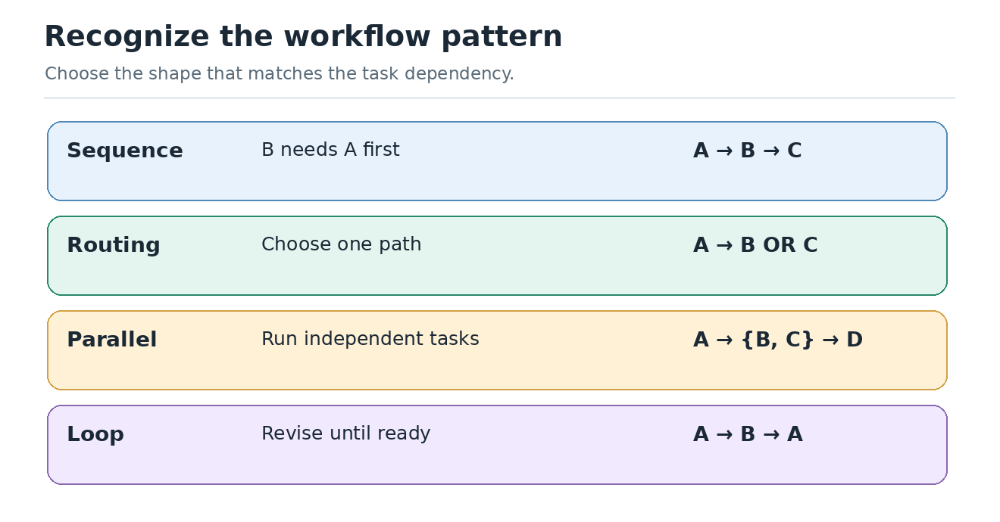</p>

A graph is useful when it matches the task, not when it contains the most nodes. Start by asking whether each step depends on another. If it does, a **sequence** may be the simplest solution. If a decision must select one specialist, add a **conditional edge**. If independent work should happen together, consider **parallel branches**. If results need review and revision, consider a **loop**, with a clear stopping rule.

An application might combine these shapes: generate an outline sequentially; run a factuality check and style check in parallel; then conditionally request revisions if the checks fail. The present lesson focuses on the sequential backbone on which more advanced graphs can be built.

### Common beginner mistakes

**1. Mixing up the builder and the compiled graph.** Call `compile()` before `invoke()`. The builder is a specification; the compiled graph is executable.

**2. Returning nothing from a node that should update state.** If the next step needs a value, return it using the correct key, for example `return {"outline": text}`.

**3. Using the wrong field name.** If the first node writes `"outline"` but the second reads `"plan"`, the workflow will fail or use missing data. Choose consistent state names.

**4. Expecting a `TypedDict` to validate everything.** Type annotations guide code readers and tools; check values from users and external APIs explicitly.

**5. Treating every node as an LLM.** Nodes can perform ordinary Python calculations, API calls, or deterministic checks. Call a model only when model reasoning or generation is genuinely useful.

**6. Building a sequence when steps are independent.** If two checks do not depend on one another, forcing them into a sequence may add unnecessary delay.

**7. Forgetting that external model calls can fail.** Plan for network errors, timeouts, malformed model outputs, and usage limits. Graph compilation does not solve these runtime problems.

---

## 9. A practical method for designing a new workflow

Before writing Python, describe your task in plain English. For example, suppose you want to turn raw meeting notes into a professional summary.

1. **Write the desired outcome.** “I want a concise, accurate meeting summary.”
2. **Find the dependent tasks.** Clean the notes → extract decisions → format the summary.
3. **Define the data.** `raw_notes`, `clean_notes`, `decisions`, `summary`.
4. **Assign one job to each node.** A node should have a simple responsibility that is easy to explain.
5. **Connect the steps.** Add fixed edges in the correct order.
6. **Test with a tiny input.** Trace which fields exist after each node and check the final result.
7. **Add model calls only if needed.** Start with predictable local functions when learning the orchestration flow.

This approach works well because it starts with **what the application must do**, not with framework syntax. Once the process is clear, LangGraph code is mostly a translation of that process into a state schema, nodes, and edges.

<p align="center">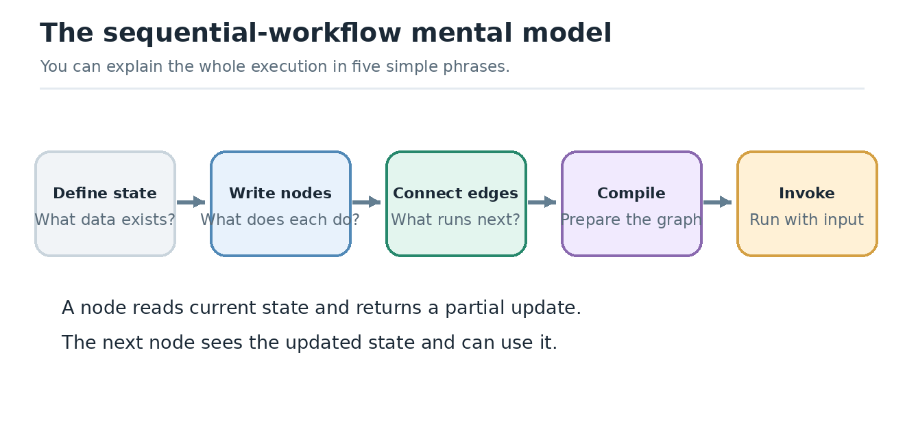</p>

---

## 10. Key takeaways

1. A **sequential workflow** runs tasks in a planned order; later tasks often depend on earlier results.
2. A **node** performs work; an **edge** controls which node runs next; **state** stores data shared during execution.
3. Nodes typically return **partial state updates**, which the graph applies before downstream nodes run.
4. `START` and `END` mark the entry and exit of a path. They are not ordinary processing functions.
5. Define the state and graph structure, then call **`compile()`** before **`invoke()`**.
6. The BMI example shows how a numeric result can be calculated first and then used by a later stage.
7. An LLM call can live inside a node, but LangGraph itself is the **orchestration layer**, not the language model.
8. **Prompt chaining** is a sequential LLM pattern: topic → outline → article, with the later prompt using earlier output.
9. More nodes are not always better. Use the simplest flow that matches the dependencies.
10. Validate input data and test each intermediate state before connecting a workflow to real services.

## 11. Revision checklist

### Fundamental concepts

- [ ] I can explain a sequential workflow with an everyday example.
- [ ] I can distinguish sequential work from independent parallel tasks.
- [ ] I can explain a node, edge, state, `START`, and `END`.
- [ ] I understand why a node can return only the fields it changes.

### Implementation

- [ ] I can define a `TypedDict` for graph state.
- [ ] I can write a node that reads state and returns a dictionary update.
- [ ] I can connect two dependent nodes using `add_edge()`.
- [ ] I can explain the difference between `compile()` and `invoke()`.
- [ ] I can trace the BMI result through each stage.
- [ ] I can catch invalid numeric input before a calculation.

### LLM workflows

- [ ] I can describe a simple question-answering LLM node.
- [ ] I can draw a topic → outline → article chain.
- [ ] I know why the article step must receive the earlier outline.
- [ ] I can name two benefits and two trade-offs of prompt chaining.

## 12. Practice questions and exercises

**Question 1.** Why must the BMI category node execute after the BMI calculation node? What happens if you reverse them?

**Question 2.** In a workflow `A → B → C`, node A returns `{"x": 5}`. Node B reads `x`, returns `{"y": 10}`, and node C uses both. Which fields should be available when C starts?

**Question 3.** Suppose a report generator contains two model calls: one produces a list of headings; the other writes paragraphs. What must the second call receive for this to be a meaningful chain?

**Question 4.** A graph is compiled successfully, but the external model service times out. Why is successful compilation not proof that the application will succeed?

**Exercise A — Modify the BMI example.** Add a third node named `format_result` that returns a sentence such as `"BMI: 23.53 (normal range)"`. Update the state schema and edges. Inspect the final state.

**Exercise B — Trace state.** Design a sequence that computes an order subtotal, applies a fixed discount, and formats a receipt. Write the state after every stage using sample numbers.

**Exercise C — Design without coding.** Draw a graph that turns lecture notes into a study guide by extracting topics, explaining each topic, and producing revision questions. Identify which fields every node reads and writes.

**Answers to check understanding:** (1) The category step needs the previously computed BMI. (2) Both `x` and `y` are available, assuming their updates were applied normally. (3) The first call's headings/outline. (4) Compilation prepares graph structure; external network/model errors occur at runtime.

## 13. Interview questions and short answers

**Q1. What is a sequential workflow?**  
A workflow where tasks run in a fixed order. Later tasks often use the outputs of earlier tasks.

**Q2. How do you create a sequential workflow in LangGraph?**  
Define state, create the processing nodes, connect them with fixed edges, compile the graph, and invoke it with initial state.

**Q3. What is the role of state?**  
State stores the data needed across workflow steps. Nodes read it and return updates, allowing later nodes to use earlier results.

**Q4. What does `add_edge("A", "B")` mean?**  
It connects A to B so B can run after A finishes; in a simple sequence, B receives the updated state.

**Q5. Why do we call `compile()`?**  
It prepares the graph definition as an executable graph and performs graph-structure checks. Actual node work begins when the graph is invoked or streamed.

**Q6. Does every node have to call an LLM?**  
No. Nodes can perform normal Python operations, checks, API requests, retrieval, or LLM calls.

**Q7. What is prompt chaining?**  
It is a sequence of model calls where the output of an earlier call becomes input or context for a later call, such as outline generation followed by article writing.

**Q8. What are the advantages of prompt chaining?**  
It separates complex work into smaller steps, makes intermediate outputs easier to check, and gives better control over each stage.

**Q9. What are its limitations?**  
It can add latency and cost, and mistakes in early stages can affect later ones.

**Q10. When would you choose a sequence instead of parallel work?**  
When the next task needs an earlier result or must follow it for a clear business reason.

## 14. Further reading

- [LangGraph Graph API — official documentation](https://docs.langchain.com/oss/python/langgraph/graph-api) — state, nodes, edges, compilation, and execution.
- [LangGraph workflows and agents — official documentation](https://docs.langchain.com/oss/python/langgraph/workflows-agents) — prompt chaining and other workflow patterns.
- [LangGraph StateGraph API reference](https://reference.langchain.com/python/langgraph/graph/state/StateGraph) — current method names and behavior.
- [Original video and chapters](https://www.youtube.com/watch?v=bAWujyAl1Kk) — to revisit a particular demonstration using the links at the beginning.

**One-sentence summary:** In LangGraph, a sequential workflow is a connected series of nodes that run in order, share evolving state, and produce a final result when the graph completes.
