# Parallel Workflows in LangGraph

*Agentic AI using LangGraph · CampusX · Video 6*

**Video:** https://www.youtube.com/watch?v=O6ryuSpqdOw

> **Main idea:** If several tasks can work on the same input independently, LangGraph can run them as parallel branches and combine their results. The crucial detail is how their **state updates** are merged.

## 1. Learning goals

By the end of this lesson, you should be able to draw a parallel graph, identify independent and dependent tasks, explain fan-out and fan-in, avoid concurrent state-update errors, use reducers correctly, and build a complete parallel workflow without paying for an LLM API.

### Video chapters

| Time | Topic |
| --- | --- |
| [00:00](https://www.youtube.com/watch?v=O6ryuSpqdOw&t=0s) | Introduction to parallel workflows |
| [02:43](https://www.youtube.com/watch?v=O6ryuSpqdOw&t=163s) | Setup and installation |
| [07:15](https://www.youtube.com/watch?v=O6ryuSpqdOw&t=435s) | First parallel workflow: cricket statistics |
| [26:11](https://www.youtube.com/watch?v=O6ryuSpqdOw&t=1571s) | Parallel LLM workflow and essay evaluation |
| [36:55](https://www.youtube.com/watch?v=O6ryuSpqdOw&t=2215s) | Combining and interpreting LLM outputs |

## 2. What is a parallel workflow?

A **parallel workflow** is a process in which two or more tasks can run independently after receiving the information they need. Instead of waiting for task A to finish before starting task B, the workflow allows both to become active at the same stage. Later, a joining step can use both results.

Consider a student essay. One grader checks **clarity**, another checks **depth**, and a third checks **language**. Each grader reads the same essay; none needs the other graders' scores to begin. That makes the three evaluations good candidates for parallel execution. A final evaluator, however, needs all three results, so it runs **after** they are available.

<p align="center">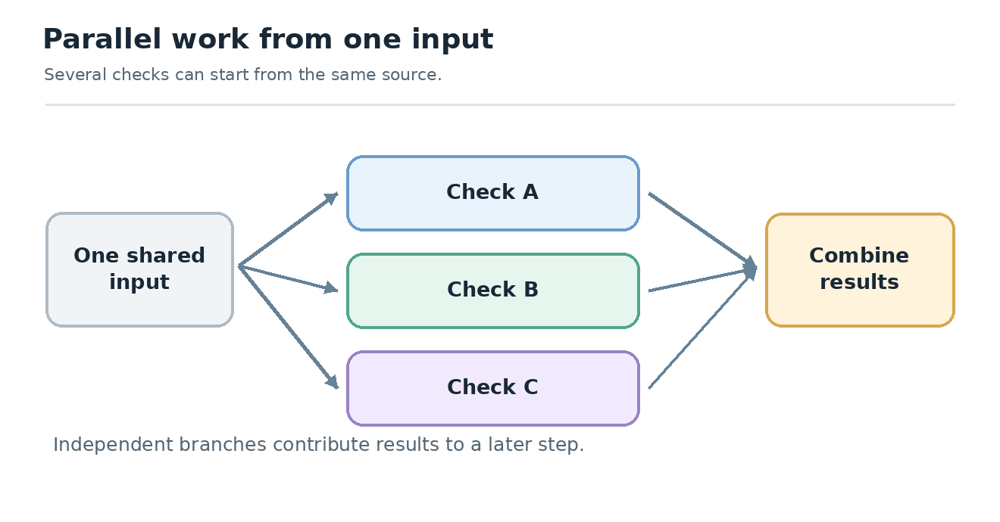</p>

### Sequential versus parallel work

In a sequence, the second task needs the first result: `collect data → clean data → analyze`. In a parallel design, independent tasks can work on the same input: `essay → {clarity, depth, language} → summary`. The difference is a **data dependency**. Putting two tasks on separate branches does not help if one task actually needs the other one's output.

**Example.** If checking clarity takes 2 seconds, depth takes 3 seconds, and language takes 4 seconds, a purely sequential design may take about 9 seconds. A parallel design might approach 4 seconds plus scheduling and aggregation overhead. Actual timing depends on model/API capacity, rate limits, and system resources. Parallel execution is not a promise that every call literally runs simultaneously on dedicated hardware.

<p align="center">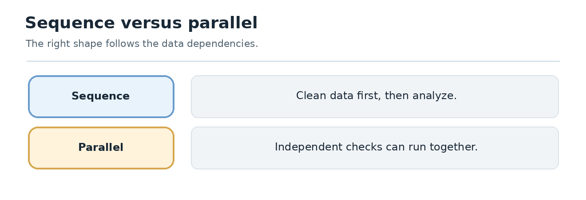</p>

## 3. Fan-out, fan-in, and synchronization

**Fan-out** means one stage activates several independent downstream stages. **Fan-in** means their outputs are brought together by a downstream stage. In LangGraph, one node may have several outgoing edges that activate multiple tasks in the next round.

The joining step is important. It should not produce a final report from only one result when all three checks are required. With the Graph API, an explicit waiting edge such as `builder.add_edge(["clarity", "depth", "language"], "summarize")` expresses the requirement that the summary follows those three nodes.

<p align="center">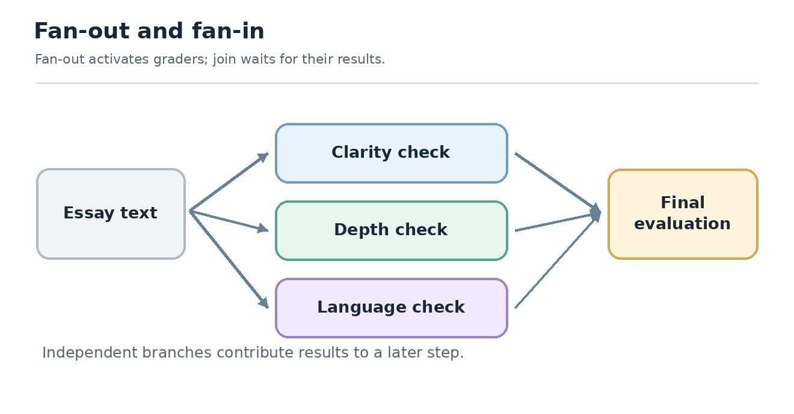</p>

**Read the diagram:** `START` provides the initial state. Three grader functions each read the essay and return a small result. The join waits for the required grading tasks; the summary uses their completed updates and ends the workflow.

## 4. Worked example: cricket batting statistics

A cricket performance summary provides a straightforward non-LLM example. Imagine a batter scored **64 runs from 40 balls**, with **36 runs coming from boundaries**. We want a strike rate and the percentage of runs coming from boundaries. The two calculations use the original inputs, so they can run independently.

**Strike rate** is `runs / balls_faced × 100`. With 64 runs from 40 balls, it is **160.0**. For our teaching example, **boundary contribution** is `boundary_runs / total_runs × 100`, so `36 / 64 × 100 = 56.25%`. We use these quantities to illustrate the graph; they are not the only batting metrics that can be calculated.

<p align="center">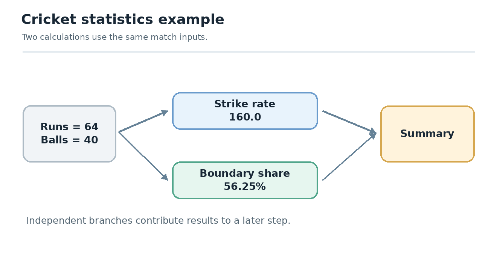</p>

### State design

State should contain the input facts and the outputs that later nodes will need. The initial input does not yet have calculated results, so the schema can mark the generated fields as optional.

```python
from typing_extensions import TypedDict

class BattingState(TypedDict, total=False):
    runs: int
    balls: int
    boundary_runs: int
    strike_rate: float
    boundary_percent: float
    summary: str
```

### Two independent processing nodes

```python
def calculate_strike_rate(state: BattingState) -> dict:
    if state["balls"] <= 0:
        raise ValueError("balls must be positive")
    value = 100 * state["runs"] / state["balls"]
    return {"strike_rate": round(value, 2)}


def calculate_boundary_percent(state: BattingState) -> dict:
    if state["runs"] <= 0:
        raise ValueError("runs must be positive")
    if not 0 <= state["boundary_runs"] <= state["runs"]:
        raise ValueError("invalid boundary_runs")
    value = 100 * state["boundary_runs"] / state["runs"]
    return {"boundary_percent": round(value, 2)}


def summarize(state: BattingState) -> dict:
    text = (
        f'Strike rate: {state["strike_rate"]}; '
        f'boundary contribution: {state["boundary_percent"]}%'
    )
    return {"summary": text}
```

Notice that each calculator returns **only the field it computed**. Neither function returns the entire input dictionary. This rule makes the two updates compatible because one writes `strike_rate` and the other writes `boundary_percent`.

### Connect and run the graph

```python
from langgraph.graph import StateGraph, START, END

builder = StateGraph(BattingState)
builder.add_node("strike_rate", calculate_strike_rate)
builder.add_node("boundary_percent", calculate_boundary_percent)
builder.add_node("summarize", summarize)

builder.add_edge(START, "strike_rate")
builder.add_edge(START, "boundary_percent")
builder.add_edge(["strike_rate", "boundary_percent"], "summarize")
builder.add_edge("summarize", END)
app = builder.compile()

result = app.invoke({"runs": 64, "balls": 40, "boundary_runs": 36})
print(result["summary"])
# Strike rate: 160.0; boundary contribution: 56.25%
```

Install using `python -m pip install -U langgraph`. This example uses ordinary Python functions. No model provider or API key is needed.

### Trace state through the graph

<p align="center">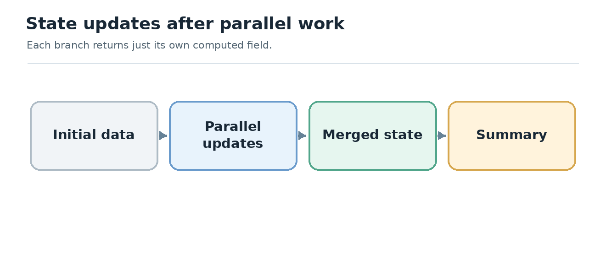</p>

| Stage | State already available | New fields written |
| --- | --- | --- |
| Input | `runs=64`, `balls=40`, `boundary_runs=36` | None |
| Parallel branch A | Same initial inputs | `strike_rate=160.0` |
| Parallel branch B | Same initial inputs | `boundary_percent=56.25` |
| After the branches | Both results plus original inputs | Both results visible |
| Summary | All calculated fields | `summary` text |

The two branches should be treated as independent readers of the same logical state for that execution round. The summary should not assume one branch happened to finish before the other. It waits for the results it needs.

## 5. A common parallel-state error

A beginner may write both parallel nodes as `return state` after adding one calculated value. That looks reasonable in ordinary Python, but it causes trouble because **both nodes attempt to write every state key**, including keys neither was responsible for changing.

Suppose the two branches both write `runs`, `balls`, and `summary` in one execution step. Without an appropriate reducer, LangGraph cannot accept multiple independent updates to a normal one-value field during that step. The runtime may raise `InvalidUpdateError` with a message about receiving more than one value per step.

<p align="center">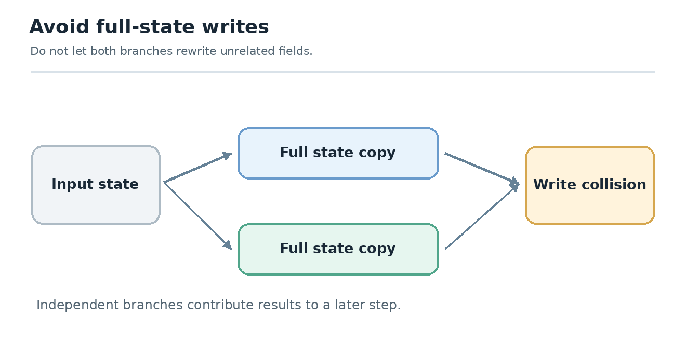</p>

The solution is not to wrap everything in a reducer. First, make each node return a **partial state update**, containing just the information it owns. This solves most cases naturally. Add a reducer only when you truly need **multiple branches to contribute to the same field**.

**Important distinction:** When one sequential node updates `result` and a later node updates `result`, replacement can work because the writes happen in different rounds. The problem arises when **multiple nodes update the same ordinary key in the same round**.

## 6. Reducers: how parallel results can be combined

A **reducer** is a function that tells LangGraph how to combine incoming updates for a specific state key. For a normal scalar field, replacement is common. For a history list or a shared collection of feedback items, appending may be more suitable.

An annotation such as `Annotated[list[str], operator.add]` tells LangGraph to concatenate lists when new updates arrive. This allows three graders to contribute separate feedback items to the same key.

<p align="center">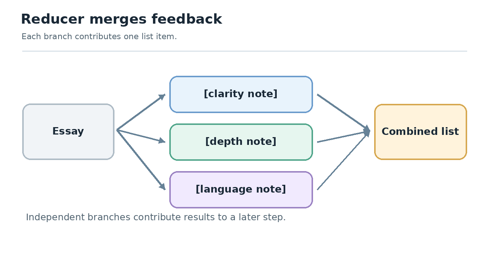</p>

```python
from operator import add
from typing import Annotated
from typing_extensions import TypedDict

class ReviewState(TypedDict):
    essay: str
    checks: Annotated[list[str], add]
    summary: str
```

Each grader can return `{"checks": ["clarity: good"]}` or another one-element list. The reducer builds a combined list. **Do not rely on the order of items returned by parallel branches** as a grading priority or timestamp; store identifiers and sort explicitly when ordering matters.

### Distinct fields or one shared list?

Prefer **distinct fields** when the outputs have fixed meanings: `clarity_score`, `depth_score`, and `language_score`. Prefer a **shared reduced list** when you are collecting an open-ended number of similarly shaped observations. Both are valid designs, but a reducer is not a universal fix for poor state design.

## 7. Parallel LLM workflow: grading an essay

A more realistic LLM workflow evaluates an essay using three different criteria. One branch checks whether the reasoning is clear; one evaluates the depth of analysis; one checks language quality. Their outputs are then combined into an overall assessment.

<p align="center">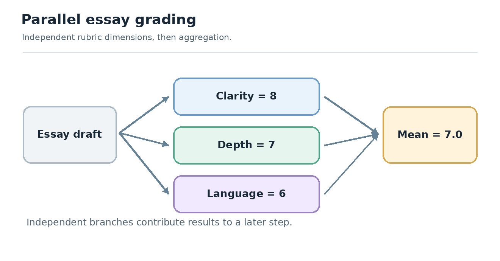</p>

The essay belongs in shared state so every grader receives the same text. If the grades are meant to be machine-readable, ask the model for structured values, such as a score from 0 to 10 and a short explanation. Real LLM graders can be inconsistent; review the rubric and validate numerical ranges before aggregating.

**Illustrative state after the graders:** `clarity=8`, `depth=7`, `language=6`. A simple deterministic final node can compute the mean: `(8 + 7 + 6) / 3 = 7.0`. A second LLM can then write readable feedback using those scores, but that model call is optional.

### How the information moves

1. The essay is submitted once and stored in state.
2. Three grading nodes receive the same essay text.
3. Each node produces its own grade and feedback.
4. LangGraph applies the updates after the parallel work.
5. The final-evaluation node reads all available grades and prepares a summary.

<p align="center">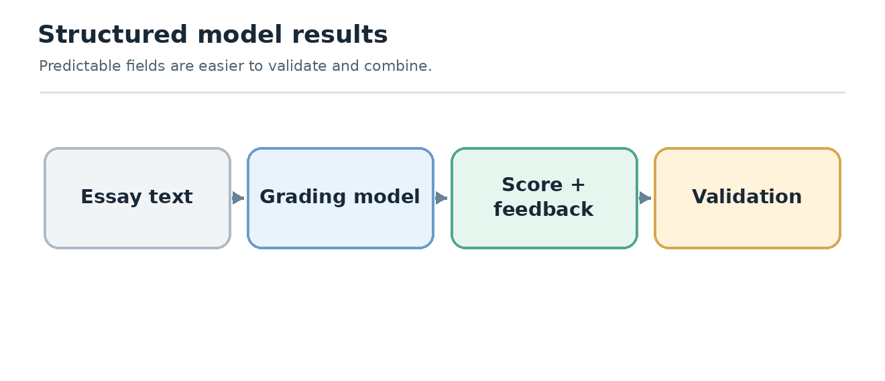</p>

Use **structured outputs** when a downstream program needs an exact score or boolean. A paragraph containing “I would give this a seven out of ten” is harder to validate than a typed object such as `{"score": 7, "feedback": "Add evidence"}`. Model API details vary by provider, so keep the graph flow stable while swapping model integrations.

## 8. Parallel execution and super-steps

LangGraph executes graph tasks in rounds called **super-steps**. In a conceptual timeline, the three graders are activated in one round; they return updates; the next round runs the final evaluation with the merged state. This explains why an aggregation node should not read half-completed results.

<p align="center">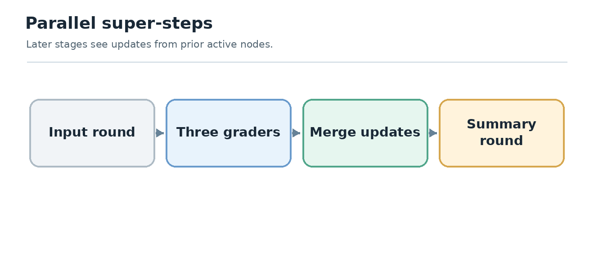</p>

Streaming updates can help you see what each node returned:

```python
for update in app.stream(
    {"runs": 64, "balls": 40, "boundary_runs": 36},
    stream_mode="updates",
):
    print(update)
```

**Operational trade-offs.** Parallel calls can improve response time but increase simultaneous resource use. APIs may enforce concurrency and request limits. More branches also mean more failure cases to consider: timeout in one branch, partial results, or an invalid structured response. Plan whether a failed branch should retry, block the summary, or trigger a fallback.

## 9. Designing a reliable parallel workflow

Start with a dependency map. For each proposed task, ask: “Does it need the output of another task?” If the answer is yes, it belongs later in a sequence. If several tasks can read the same input independently, fan them out. Next decide how the results should be represented: separate state fields, an appended collection, or a custom merge.

<p align="center">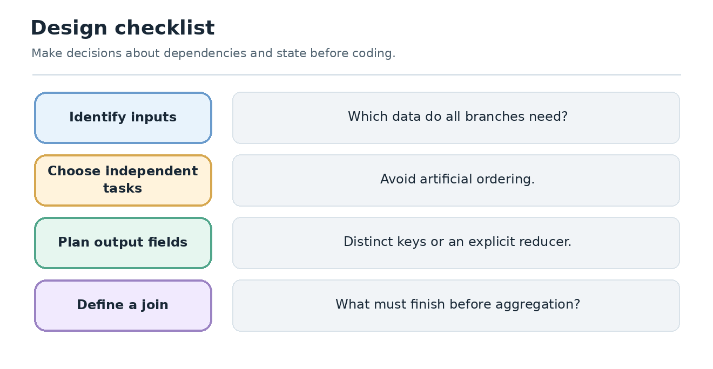</p>

Before running an LLM version, test the graph with ordinary Python outputs. Check that every expected field appears, that same-key concurrent writes are handled, and that the final node waits for everything it uses.

## 10. Key takeaways

1. Parallel workflows run independent tasks without imposing an unnecessary sequence.
2. **Fan-out** activates branches; **fan-in** combines their results.
3. Nodes should normally return **partial state updates**.
4. Writing the same ordinary state key from multiple branches can cause an invalid update.
5. A **reducer** defines how multiple updates to one key are merged.
6. Distinct named fields often work better than forcing everything into a shared list.
7. A final aggregation node reads results after the required branches complete.
8. Parallelism can reduce latency but may increase concurrency pressure and complicate error handling.
9. LangGraph organizes execution; an LLM is optional inside the nodes.
10. Design state and dependencies before writing model prompts.

## 11. Revision checklist

- [ ] I can explain parallel work with a real-world example.
- [ ] I can distinguish independent branches from sequential dependencies.
- [ ] I understand fan-out, join, and final aggregation.
- [ ] I can explain the cricket strike-rate and boundary-percentage example.
- [ ] I can write two nodes that update different state fields.
- [ ] I know why returning the full state from parallel nodes can be dangerous.
- [ ] I can describe `InvalidUpdateError` and the common fixes.
- [ ] I can define a list reducer with `Annotated` and `operator.add`.
- [ ] I understand why a final essay evaluation needs the three rubric results.
- [ ] I can use `.stream(..., stream_mode="updates")` to observe node outputs.

## 12. Practice questions and exercises

**Question 1.** Why can clarity, depth, and language grading be performed in parallel on the same essay?

**Question 2.** Two nodes both return `{"score": 5}` in one super-step. What can happen if `score` has no reducer? How could you redesign the state?

**Question 3.** A summary node needs results from A, B, and C. What does a waiting join accomplish?

**Exercise A.** Add `dot_ball_percent` as a third cricket branch. Choose the required input fields and update only your new output key.

**Exercise B.** Write a grader graph where clarity and depth return separate numerical fields. Add a summary node that computes their average.

**Exercise C.** Change the graders so they append text feedback to one list key. Observe why a reducer is required.

**Check:** Independent tasks share input but do not depend on each other's result. Same-key parallel writes need an explicit merge rule or separate output keys. A waiting join prevents the summary from starting without required upstream work.

## 13. Interview questions and short answers

**Q1. What is a parallel workflow?**  
A workflow where independent tasks are activated together and their results can be combined later.

**Q2. What is fan-out?**  
Activating several downstream tasks from one stage of execution.

**Q3. What is fan-in?**  
Combining or waiting for branch results before continuing.

**Q4. Why should LangGraph nodes return partial updates?**  
To update only the fields they own and avoid unnecessary conflicts with parallel branches.

**Q5. What is a reducer?**  
A per-field function that combines previous state with incoming updates, such as concatenating lists.

**Q6. Why does `InvalidUpdateError` occur?**  
A common cause is multiple nodes writing the same un-reduced state key in one execution round.

**Q7. What is a super-step?**  
A discrete execution round that may contain more than one concurrently active node.

**Q8. Does parallelism always make a workflow faster?**  
Not always; overhead, API limits, dependencies, and resource contention can limit the benefit.

**Q9. How would you design parallel essay grading?**  
Store the essay once, run independent rubric graders, write separate scores or reduced feedback, and aggregate after the join.

## 14. Further reading

- [LangGraph Graph API](https://docs.langchain.com/oss/python/langgraph/graph-api)
- [LangGraph workflows and agents](https://docs.langchain.com/oss/python/langgraph/workflows-agents)
- [LangGraph thinking and state design](https://docs.langchain.com/oss/python/langgraph/thinking-in-graph-api)

**One-sentence summary:** A parallel LangGraph workflow lets independent nodes run together, but correct state design and safe merging are essential for using their results.
