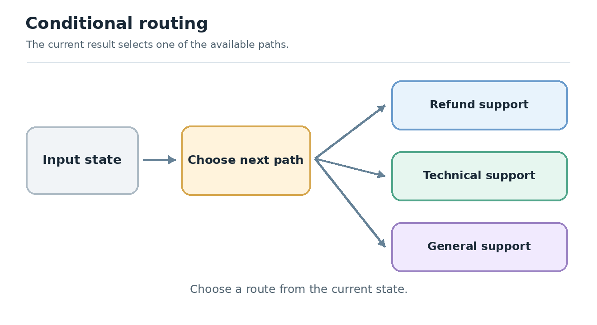
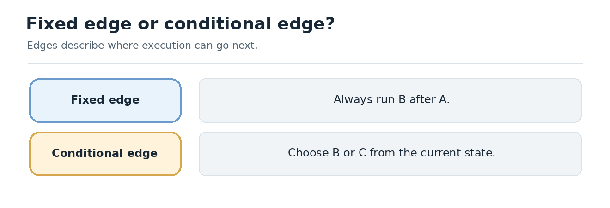
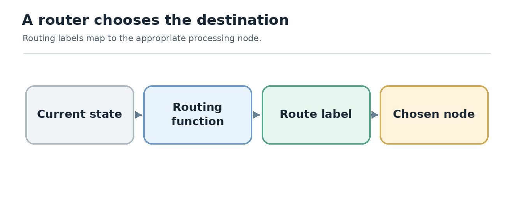
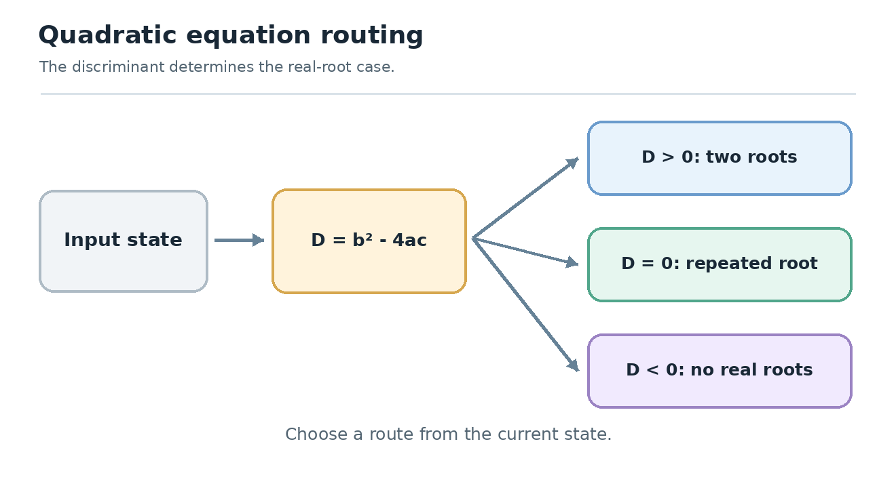
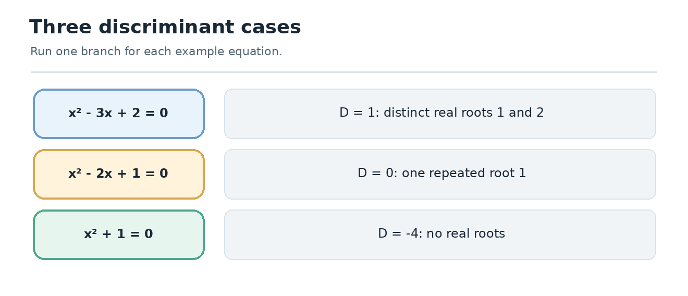
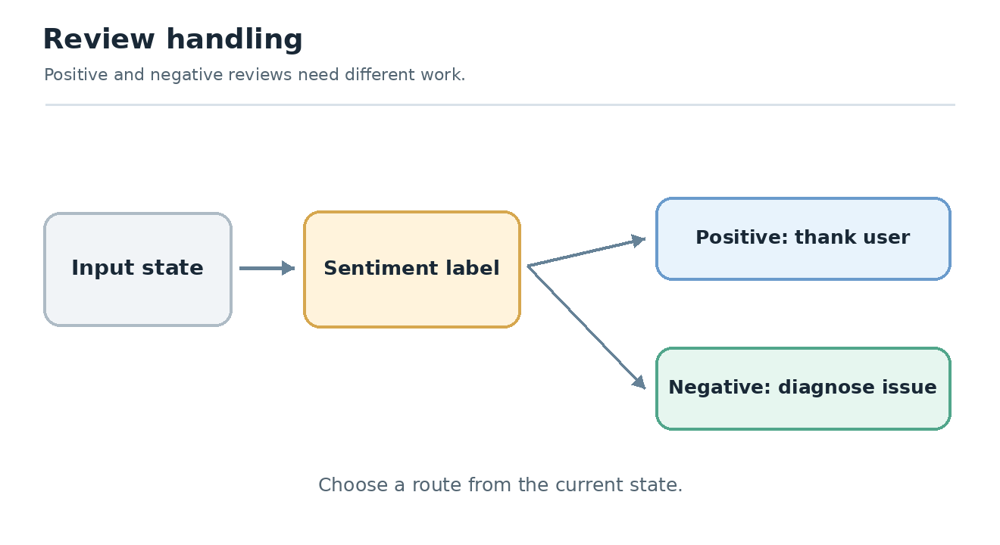
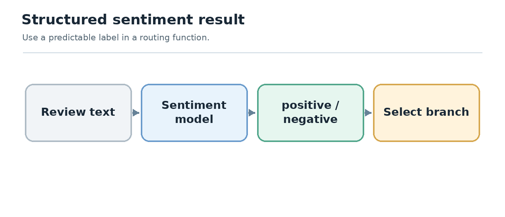
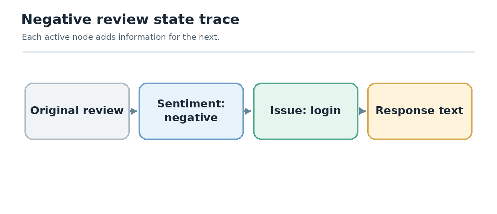
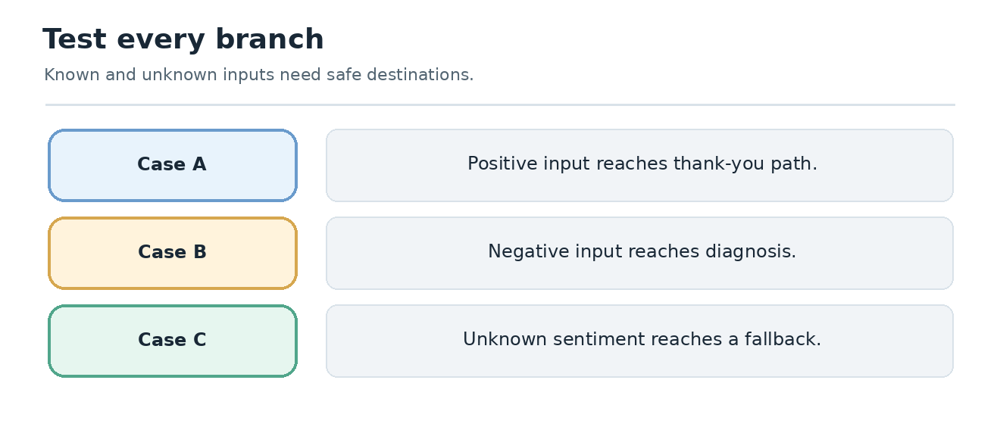
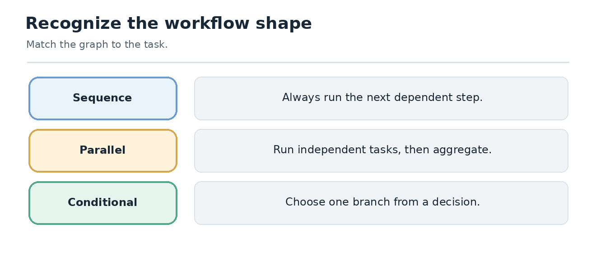

# Conditional Workflows in LangGraph

*Agentic AI using LangGraph · CampusX · Video 7*

**Video:** https://www.youtube.com/watch?v=I-dvZqTz-Wc

> **Main idea:** A conditional workflow makes a decision at runtime and sends the input to the appropriate path. The decision is based on state, not on which arrow looks closest in a diagram.

## 1. Learning goals

Understand how a conditional edge differs from a normal edge; use a routing function; solve a quadratic equation by choosing one of three branches; and design a customer-review workflow that responds differently to positive and negative feedback.

### Video chapters

| Time | Topic |
| --- | --- |
| [00:00](https://www.youtube.com/watch?v=I-dvZqTz-Wc&t=0s) | Review of workflow patterns |
| [04:38](https://www.youtube.com/watch?v=I-dvZqTz-Wc&t=278s) | Conditional workflow: quadratic equation |
| [24:20](https://www.youtube.com/watch?v=I-dvZqTz-Wc&t=1460s) | LLM workflow: customer-review handling |

## 2. What is a conditional workflow?

A **conditional workflow** is a process in which the next step is chosen using a condition evaluated during execution. In programming, an `if/elif/else` statement chooses between code blocks; in LangGraph, a **conditional edge** chooses between graph nodes.

Suppose a help desk receives a request. If it is about payment, send it to billing; if it is about a login problem, send it to technical support; otherwise, send it to a general handler. The full set of possible routes is known, but the specific route is chosen only when the request is processed.

<p align="center"></p>

### Normal edges versus conditional edges

A **normal edge** always connects one completed node to a known successor. A **conditional edge** asks a routing function where execution should go next. The routing function reads state and returns a route label, usually a short string such as `"positive"` or `"negative"`.

When the routes are alternatives, only the **selected branch** executes. This is not parallel execution. Branches are optional paths, while parallel branches are independent tasks intended to run together.

<p align="center"></p>

## 3. The routing function

The routing function is usually a pure function: it examines the state and returns a value that indicates which successor to use. This separation is useful because it keeps the **decision rule** independent of the code that carries out the work.

For example, a numeric workflow may route based on `discriminant`:

```python
def choose_case(state) -> str:
    d = state["discriminant"]
    if d > 0:
        return "two_roots"
    if d == 0:
        return "one_root"
    return "no_real_roots"
```

A graph connects those labels to nodes using `add_conditional_edges`. The route labels do not have to be identical to node names if a mapping is supplied, but matching names is often easiest to read when learning.

<p align="center"></p>

**Important:** A router returning `"two_roots"` does not calculate the roots. It only selects the node that will perform that calculation. Similarly, an LLM deciding that a review is negative does not automatically compose a helpful response; that happens in later nodes.

## 4. Worked example: quadratic equations

Consider a quadratic equation `ax² + bx + c = 0`, with `a ≠ 0`. Its **discriminant** is:

**D = b² − 4ac**

The sign of D determines which real-root case applies:

| Discriminant | Meaning | Example |
| --- | --- | --- |
| `D > 0` | Two distinct real roots | `x² − 3x + 2 = 0` gives `1` and `2` |
| `D = 0` | One repeated real root | `x² − 2x + 1 = 0` gives `1` twice |
| `D < 0` | No real roots | `x² + 1 = 0` has complex roots |

The basic workflow is: receive coefficients → calculate D → select the correct case → format the result. The first two tasks are sequential; the conditional edge then chooses one of three possible calculations.

<p align="center"></p>

### State schema and numerical input

```python
from typing_extensions import TypedDict

class EquationState(TypedDict, total=False):
    a: float
    b: float
    c: float
    discriminant: float
    result: str
```

The inputs are coefficients; the calculation node adds the discriminant; one of the branch nodes writes the final answer. The schema describes expected fields but does not by itself reject `a = 0`. We add that validation explicitly.

### Calculate the discriminant

```python
def calculate_discriminant(state: EquationState) -> dict:
    if state["a"] == 0:
        raise ValueError("a must not be zero for a quadratic equation")
    d = state["b"] ** 2 - 4 * state["a"] * state["c"]
    return {"discriminant": d}
```

### Define the three handlers

```python
from math import sqrt

def two_roots(state: EquationState) -> dict:
    a, b, d = state["a"], state["b"], state["discriminant"]
    x1, x2 = (-b + sqrt(d)) / (2 * a), (-b - sqrt(d)) / (2 * a)
    return {"result": f"Two real roots: {x1:g}, {x2:g}"}


def repeated_root(state: EquationState) -> dict:
    x = -state["b"] / (2 * state["a"])
    return {"result": f"One repeated real root: {x:g}"}


def no_real_roots(state: EquationState) -> dict:
    return {"result": "No real roots (complex roots exist)."}
```

For introductory problems with small exact coefficients, checking `d == 0` is easy to understand. In numerical applications, floating-point calculations may need a carefully chosen tolerance rather than exact comparison with zero.

### Connect the conditional graph

```python
from langgraph.graph import StateGraph, START, END

builder = StateGraph(EquationState)
builder.add_node("discriminant", calculate_discriminant)
builder.add_node("two", two_roots)
builder.add_node("repeated", repeated_root)
builder.add_node("complex", no_real_roots)

builder.add_edge(START, "discriminant")
builder.add_conditional_edges(
    "discriminant", choose_case,
    {"two_roots": "two", "one_root": "repeated", "no_real_roots": "complex"},
)
for name in ("two", "repeated", "complex"):
    builder.add_edge(name, END)
app = builder.compile()

print(app.invoke({"a": 1.0, "b": -3.0, "c": 2.0})["result"])
# Two real roots: 2, 1
```

The implementation needs `choose_case` from the earlier code block. Install with `python -m pip install -U langgraph`. This full example requires **no LLM and no API key**.

### Trace the three branches

<p align="center"></p>

For `a=1, b=-3, c=2`, the discriminant is `9−8=1`, so the two-roots node runs. For `a=1, b=-2, c=1`, D is zero and the repeated-root node runs. For `a=1, b=0, c=1`, D is negative and the no-real-roots node runs.

**Only one result handler runs per input.** The other two routes remain available for other inputs but are not executed for this particular equation.

## 5. Conditional LLM workflow: handling reviews

Routing becomes more useful when the decision itself requires language understanding. Suppose a company collects product reviews. A model classifies each review as **positive** or **negative**. Positive reviews receive a thank-you response. Negative reviews require another stage that diagnoses the complaint before drafting a helpful reply.

<p align="center"></p>

**Example 1.** “The interface is clean and the app is fast” can route to an appreciative reply. **Example 2.** “I cannot log in and support has not replied” should route to a diagnosis stage that identifies a login/access issue and an appropriate support response.

The choice of branch depends on the **review's content**. The graph itself does not understand the language; a model or classifier inside the sentiment node supplies a structured label that the routing function can inspect.

### Keep decisions structured

Instead of asking a model for a long essay explaining sentiment, ask it to return a predictable object like `{"sentiment": "negative"}`. A production schema may also include a confidence score or a category such as `billing`, `bug`, or `usability`.

<p align="center"></p>

It is risky to use unvalidated free text directly as a branch label. If the model returns “mostly negative, with some positive comments,” the routing function may not recognize it. Validate against allowed values and provide a fallback route for uncertain or mixed reviews.

## 6. A no-API version of review routing

To focus on the graph idea, the following code uses a simple keyword classifier. This is **not** a robust sentiment-analysis model; it is a demonstration of conditional edges and node responsibilities.

```python
from typing_extensions import TypedDict
from langgraph.graph import StateGraph, START, END

class ReviewState(TypedDict, total=False):
    review: str
    sentiment: str
    issue: str
    response: str


def classify(state: ReviewState) -> dict:
    text = state["review"].lower()
    negative_words = ("cannot", "broken", "error", "slow", "bad")
    return {"sentiment": "negative" if any(w in text for w in negative_words)
            else "positive"}


def route_review(state: ReviewState) -> str:
    return state["sentiment"]


def thank_customer(state: ReviewState) -> dict:
    return {"response": "Thanks for sharing your positive feedback!"}


def diagnose(state: ReviewState) -> dict:
    issue = "login/access" if "log" in state["review"].lower() else "general complaint"
    return {"issue": issue}


def help_customer(state: ReviewState) -> dict:
    return {"response": f"We're sorry about the {state['issue']} issue; "
                        "please share details through support."}

builder = StateGraph(ReviewState)
for name, fn in [("classify", classify), ("thank", thank_customer),
                 ("diagnose", diagnose), ("help", help_customer)]:
    builder.add_node(name, fn)
builder.add_edge(START, "classify")
builder.add_conditional_edges("classify", route_review,
                              {"positive": "thank", "negative": "diagnose"})
builder.add_edge("diagnose", "help")
builder.add_edge("thank", END)
builder.add_edge("help", END)
app = builder.compile()

result = app.invoke({"review": "I cannot log in."})
print(result["sentiment"], result["issue"], result["response"])
```

<p align="center"></p>

### How the negative route works

1. The review enters state under `review`.
2. `classify` reads the text and stores `sentiment="negative"`.
3. The router selects `diagnose`, not `thank`.
4. `diagnose` identifies the problem and writes `issue`.
5. `help` uses that issue to prepare a response, then execution ends.

A positive review skips diagnosis because a complaint-specific investigation is unnecessary. That is the practical benefit of routing: **different inputs receive different processing paths**.

## 7. Real-world design considerations

There are three common mistakes in conditional workflows. First, a router may return a label with no matching destination, causing an execution error. Second, the graph may select multiple branches accidentally when the intent was to choose one. Third, the classifier may produce unreliable labels, sending users to the wrong specialist.

A safer design validates the label, includes a clear fallback, and tests every branch. For customer-facing systems, retain useful context so staff can understand why the route was selected, but do not treat a model's classification as unquestionable truth.

<p align="center"></p>

**When a conditional edge is enough.** If the condition is a simple rule such as `D > 0`, implement it with ordinary Python. Use an LLM only when the decision needs language understanding or other model capabilities. The framework does not require a model to make every routing decision.

## 8. Comparing workflow shapes

<p align="center"></p>

A **sequence** says “B after A.” **Parallel work** says “B and C can both run.” **Conditional routing** says “choose B or C after examining the current state.” More complex applications mix all three. For example: classify a review, route negatives to an investigation, run independent issue checks, then produce a final response.

## 9. Key takeaways

1. Conditional workflows choose a successor based on runtime state.
2. A conditional edge performs routing; the selected node performs the task.
3. Normal edges express a fixed transition; conditional edges choose between alternatives.
4. `add_conditional_edges` connects a routing function to possible destinations.
5. A quadratic equation offers a simple example with three mathematically defined branches.
6. Only the branch matching the discriminant executes for an input.
7. An LLM may classify a review, but downstream code should validate its label.
8. Negative customer reviews may need diagnosis before a response; positive ones often do not.
9. Provide fallback behavior for unknown labels or uncertain model outputs.
10. Test every route, including invalid input and boundary cases.

## 10. Revision checklist

- [ ] I can define a conditional workflow and give an example.
- [ ] I know the difference between a fixed and conditional edge.
- [ ] I understand the router's input and returned label.
- [ ] I can compute `D = b² − 4ac` and select the correct branch.
- [ ] I can implement `add_conditional_edges` with a mapping.
- [ ] I can explain why one result handler executes for each equation.
- [ ] I can design positive versus negative review routing.
- [ ] I can explain why structured sentiment outputs help.
- [ ] I know when to use Python rules instead of an LLM.
- [ ] I can test all branches and provide a fallback path.

## 11. Practice questions and exercises

**Question 1.** Why is a conditional graph not the same as a parallel graph?

**Question 2.** For the equation `x² + 4x + 4 = 0`, which branch should run and why?

**Question 3.** A model returns `"unclear"` instead of `"positive"` or `"negative"`. What should the routing code do?

**Exercise A.** Add an input-validation node before discriminant calculation and route invalid input to an error message.

**Exercise B.** Extend review routing with a third label `"mixed"` and a human-review path.

**Exercise C.** Create a workflow where an application chooses between `urgent`, `normal`, and `low` priority paths based on a numeric rule.

**Check:** Conditional routing selects among alternatives; parallel execution activates multiple independent tasks. Here `D = 16 - 16 = 0`, so the repeated-root path runs. Unknown labels should be validated and sent to a safe fallback.

## 12. Interview questions and short answers

**Q1. What is a conditional edge in LangGraph?**  
A transition that selects the next node based on a routing function and the current state.

**Q2. How is a conditional edge different from a normal edge?**  
A normal edge follows a fixed successor; a conditional edge chooses a successor during execution.

**Q3. What does the routing function return?**  
A value, often a string label, that identifies the next destination or maps to one.

**Q4. Does the router have to call an LLM?**  
No. It may be a simple deterministic Python function.

**Q5. How can you route a customer review?**  
Classify sentiment, choose a positive or negative path, and generate the response appropriate to that path.

**Q6. Why use structured model output for routing?**  
It produces predictable labels that are easier to validate and map to nodes.

**Q7. What is a common routing failure?**  
The routing function returns an unexpected label that has no valid destination.

**Q8. Can a workflow mix conditions and parallel tasks?**  
Yes. A conditional branch can lead to a parallel subworkflow and then an aggregation stage.

## 13. Further reading

- [LangGraph Graph API](https://docs.langchain.com/oss/python/langgraph/graph-api)
- [LangGraph workflows and agents](https://docs.langchain.com/oss/python/langgraph/workflows-agents)
- [LangGraph thinking and state design](https://docs.langchain.com/oss/python/langgraph/thinking-in-graph-api)

**One-sentence summary:** A LangGraph conditional workflow uses a routing function to choose the right next node for the current input and state.
