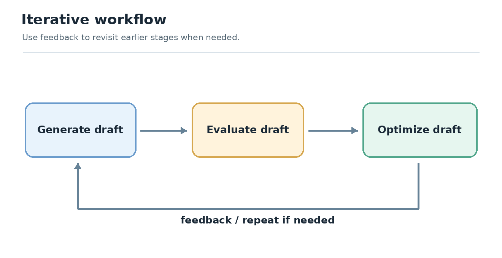
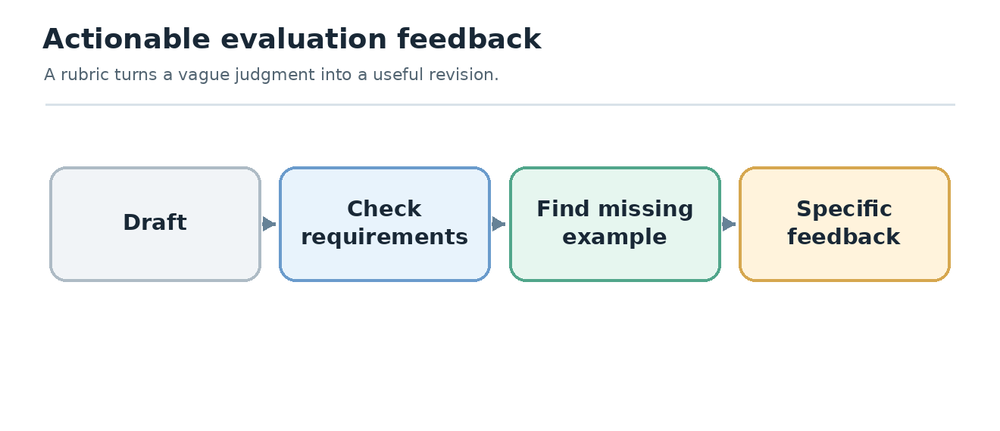
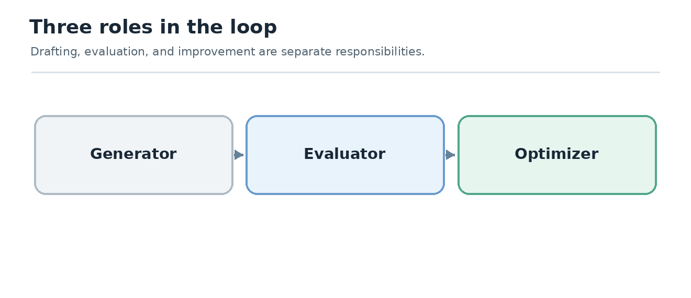
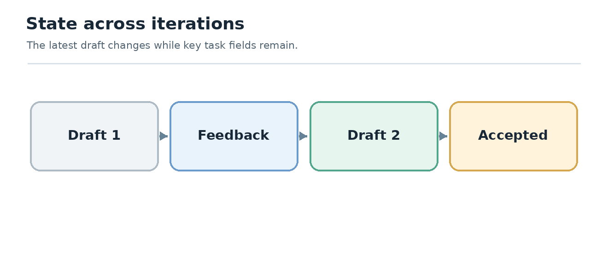
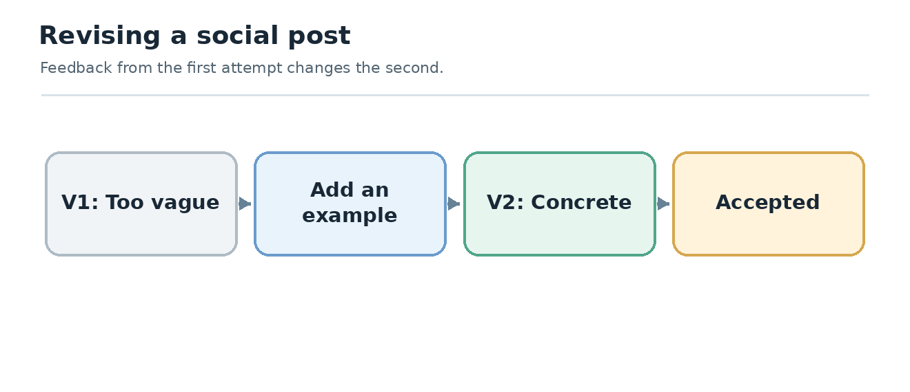
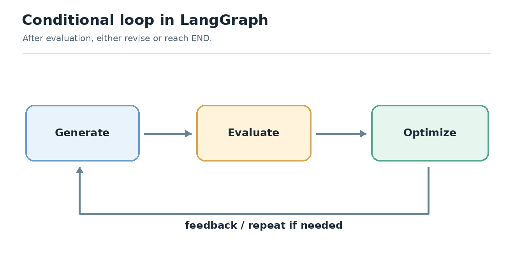
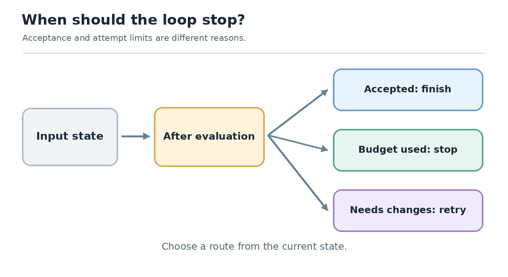
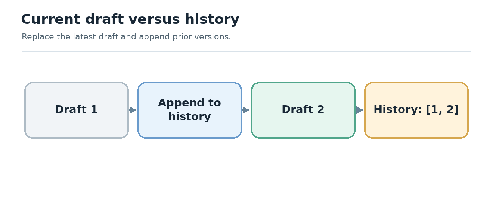
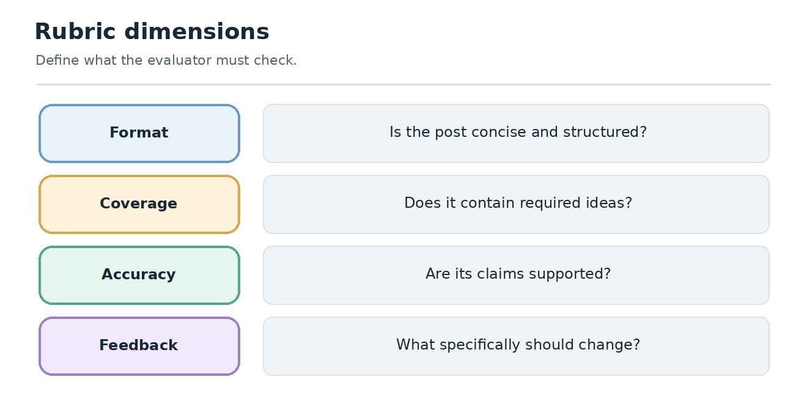
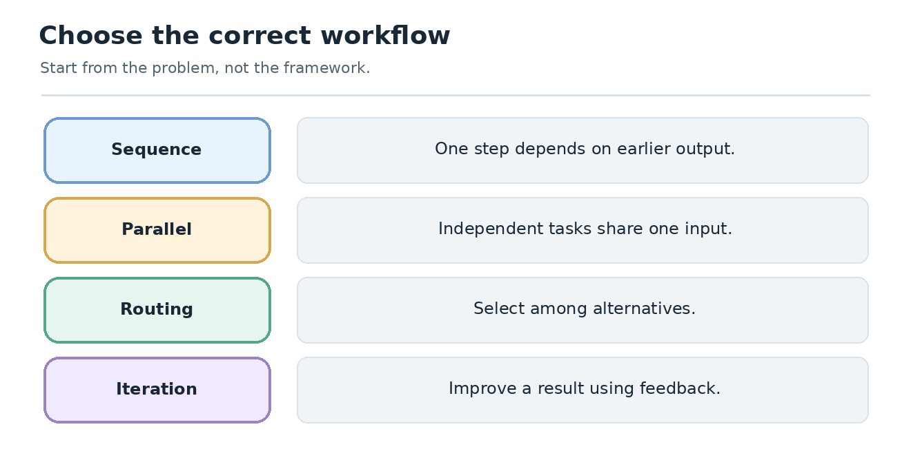

# Iterative Workflows in LangGraph

*Agentic AI using LangGraph · CampusX · Video 8*

**Video:** https://www.youtube.com/watch?v=7CbSqrovcsE

> **Main idea:** An iterative workflow improves a result through repeated **generate → evaluate → revise** cycles. It continues only while another revision is useful and stops when the result is accepted or a safe iteration limit is reached.

## 1. Learning goals

Understand loops in a graph, the evaluator–optimizer pattern, how feedback changes the next draft, why explicit stopping conditions are required, and how to preserve draft history while updating the current result. You will also build a small no-API iterative workflow.

### Video chapters

| Time | Topic |
| --- | --- |
| [00:00](https://www.youtube.com/watch?v=7CbSqrovcsE&t=0s) | Recap of workflow patterns |
| [01:51](https://www.youtube.com/watch?v=7CbSqrovcsE&t=111s) | Plan: generate, evaluate, and improve a post |
| [08:15](https://www.youtube.com/watch?v=7CbSqrovcsE&t=495s) | Building the iterative workflow |
| [29:45](https://www.youtube.com/watch?v=7CbSqrovcsE&t=1785s) | Testing the loop and observing revisions |

## 2. What is an iterative workflow?

An **iterative workflow** repeats some steps until a condition is met. A sequential workflow only moves forward. An iterative workflow can return to a previous processing stage after checking the result, making a second attempt with better information.

Consider writing a short social-media post about AI in India. The first draft may be informative but too long, unclear, or missing a useful example. An evaluator checks the draft against defined criteria. If something is missing, it sends feedback to an optimizer that revises the text. The revised text is then checked again.

<p align="center"></p>

**Important:** Repeating the same prompt without learning from feedback is not a useful optimization pattern. The reason to iterate is that each new attempt has information about what was wrong with the previous result.

## 3. Why does iteration help?

A single generation step often has to satisfy several requirements at once: correct facts, suitable tone, clear structure, required terms, and length constraints. Splitting the work into drafting and checking provides a place to detect weaknesses before the result reaches the user.

An evaluator is most helpful when it uses an explicit **rubric**—a list of requirements used to judge the output. For a social post, an example rubric might require: one clear takeaway, a practical example, a neutral tone, and fewer than 250 characters. These are teaching criteria; different platforms or applications may impose other constraints.

<p align="center"></p>

The feedback should be actionable. “Make it better” gives little guidance. “Include a concrete example and shorten the ending” tells the optimizer what to change. A strong design also protects correct details already present in the draft, rather than rewriting everything unnecessarily.

## 4. The three main responsibilities

An evaluator–optimizer workflow separates three logical jobs:

**Generator.** Produces a first candidate from the user goal. It might use an LLM, a template, or ordinary Python code.

**Evaluator.** Checks whether the current candidate satisfies requirements. It may produce a structured decision such as `accepted=True/False` plus feedback. Some checks, such as a strict length limit, can be performed deterministically.

**Optimizer.** Uses the existing candidate and feedback to improve the output. The optimizer may call an LLM with instructions like “revise the current draft to include a practical example without changing its main claim.”

<p align="center"></p>

These are **roles**, not necessarily three different model vendors. A real application could use one model with different prompts or use a deterministic length validator along with an LLM evaluator.

## 5. Designing the shared state

State must preserve enough information for the next cycle. For a writing loop, useful fields include:

| State field | Purpose | Update behavior |
| --- | --- | --- |
| `topic` | What the post should be about | Usually unchanged |
| `draft` | Latest version of the post | Replace |
| `feedback` | Explanation of what needs fixing | Replace or update |
| `accepted` | Whether the rubric passed | Replace |
| `attempts` | Number of drafts produced | Increment through a node update |
| `max_attempts` | Maximum allowed drafts | Set at start |
| `history` | Previous versions for comparison | Append |

<p align="center"></p>

Why keep `draft` and `history` separately? The current draft should be easy to read and replace. History should preserve earlier versions so you can show improvement and debug the evaluation loop. Putting every draft in the `draft` string makes code harder to reason about. Putting only the latest draft in a history list risks losing the earlier versions accidentally.

### Using a reducer for history

A list reducer gives LangGraph a way to combine new draft entries with the existing history:

```python
from operator import add
from typing import Annotated
from typing_extensions import TypedDict

class PostState(TypedDict, total=False):
    topic: str
    draft: str
    feedback: str
    accepted: bool
    attempts: int
    max_attempts: int
    history: Annotated[list[str], add]
```

When a node returns `{"history": [new_draft]}`, the list is appended. Meanwhile a new value of `draft` replaces the previous one. Reducers are configured **per field**; they do not apply automatically to the whole state.

## 6. Worked example: revising a social post

Imagine the topic is **“AI in India.”** The writing rules require a clear reference to AI, a practical example, and a concise message. The first draft is: “AI will change India.” It is relevant, but it does not contain a concrete example. The evaluator rejects it and returns “Add a practical example.”

The next draft becomes: “AI in India can help students practise interview questions with personalized feedback.” The evaluator finds the required idea and example, accepts the post, and the workflow ends. The content is illustrative; the learning goal is to trace the loop.

<p align="center"></p>

### Trace the state across attempts

| Event | `draft` | `feedback` | `attempts` | `accepted` |
| --- | --- | --- | --- | --- |
| Start | Empty | Empty | 0 | False |
| Generate | “AI will change India.” | Empty | 1 | False |
| Evaluate | Same first draft | “Include an example.” | 1 | False |
| Optimize | “AI in India can help students practise interview questions...” | Previous feedback | 2 | False |
| Re-evaluate | Same improved draft | “Accepted.” | 2 | True |

The important step is that `evaluate` does not automatically make the post better. It records the problem. The `optimize` stage then uses that feedback to produce a different candidate. The conditional edge decides whether evaluation should continue or the graph should finish.

## 7. Building a bounded iterative graph in Python

We can demonstrate the orchestration without any model calls. The sample generator intentionally creates an incomplete first draft, and the optimizer adds a concrete example after receiving feedback.

```python
from operator import add
from typing import Annotated
from typing_extensions import TypedDict
from langgraph.graph import StateGraph, START, END

class PostState(TypedDict, total=False):
    topic: str
    draft: str
    feedback: str
    accepted: bool
    attempts: int
    max_attempts: int
    history: Annotated[list[str], add]


def generate(state: PostState) -> dict:
    text = f"{state['topic']} could create new opportunities."
    return {"draft": text, "attempts": state.get("attempts", 0) + 1,
            "history": [text]}


def evaluate(state: PostState) -> dict:
    text = state["draft"].lower()
    ok = "students" in text and "interview" in text
    message = "Accepted" if ok else "Add a specific student/interview example."
    return {"accepted": ok, "feedback": message}


def optimize(state: PostState) -> dict:
    improved = (
        f"{state['topic']} can help students practise "
        "interview questions with personalized feedback."
    )
    return {"draft": improved, "attempts": state["attempts"] + 1,
            "history": [improved]}


def decide(state: PostState) -> str:
    if state["accepted"] or state["attempts"] >= state["max_attempts"]:
        return "finish"
    return "revise"

builder = StateGraph(PostState)
builder.add_node("generate", generate)
builder.add_node("evaluate", evaluate)
builder.add_node("optimize", optimize)
builder.add_edge(START, "generate")
builder.add_edge("generate", "evaluate")
builder.add_conditional_edges("evaluate", decide,
                              {"finish": END, "revise": "optimize"})
builder.add_edge("optimize", "evaluate")
app = builder.compile()

final = app.invoke({"topic": "AI in India", "attempts": 0,
                    "max_attempts": 3, "history": [],
                    "draft": "", "feedback": "", "accepted": False})
print(final["accepted"], final["attempts"])
# True 2
```

This deliberately simplified example uses deterministic text. A real writing tool would use a model in `generate` and `optimize`, and perhaps a structured LLM evaluator for criteria that cannot be checked by simple code. Install with `python -m pip install -U langgraph`.

<p align="center"></p>

### Follow the actual execution

1. `START` activates the generator, which writes the first post and sets `attempts=1`.
2. The evaluator sees no specific example and writes feedback with `accepted=False`.
3. The router returns `revise` because the content failed and the attempt limit has not been reached.
4. The optimizer writes a new draft, increases the attempt count to 2, and appends the draft to history.
5. The evaluator accepts the revised post.
6. The router returns `finish` and the workflow reaches `END`.

The loop is a **conditional cycle**, not an ordinary fixed chain. It revisits the evaluator, and the number of times that happens depends on the state.

## 8. How should a loop stop?

Without a stopping condition, an agent can continue generating and evaluating indefinitely if the evaluator never accepts an answer. In a real application, each additional attempt can use money, tokens, network calls, and user time.

There are usually at least two stopping conditions: **success** (the rubric is satisfied) and **budget exhausted** (the number of attempts or another budget reaches its limit). It may also stop for errors, a time budget, or a request for human review.

<p align="center"></p>

**Important:** Reaching the maximum number of attempts does **not** mean the result has passed review. Keep `accepted=False` if the evaluator still rejects the final attempt. The application can return the best available draft with a clear warning, request human review, or report that it could not meet the rubric.

A `recursion_limit` setting is another runtime safety mechanism, but it should not replace an application-level definition of success or a sensible attempt count. Write stopping behavior explicitly in state and routing logic.

## 9. Current draft versus draft history

Keeping history makes the loop understandable. For example, a study tool could show Draft 1, the evaluator's feedback, and Draft 2 side by side. Users then see **what changed and why**.

<p align="center"></p>

An ordinary state field like `draft: str` is overwritten on update. The `history` field with `Annotated[list[str], add]` appends new values. This is the same reducer concept that helps with conversation history and parallel feedback collection, but here it is used over repeated rounds of a loop.

For production systems, consider storing structured history entries: `{version, text, score, feedback, created_at}`. Then you can compare scores, prevent repeated identical attempts, and audit unexpected decisions.

## 10. Improving evaluation quality

A weak evaluator makes the whole loop unreliable. If the judge accepts everything, the loop ends too early. If it rejects everything, the optimizer wastes attempts. This is why the rubric matters as much as the generation prompt.

For a factual social-media post, the evaluator should separate *format checks* (length, required fields), *content checks* (clarity and coverage), and *fact checks* (verifiable claims). Deterministic checks are preferable for simple constraints. Any LLM-based evaluation should use a clear schema and should be tested against human-reviewed examples.

<p align="center"></p>

### Why repeatedly changing models is not the main lesson

A more capable model may produce a good first draft, while a smaller or less suitable model may need extra revisions. That does not change the workflow shape. The important engineering goal is to have **clear evaluation criteria, reliable feedback, and bounded retries**. Iteration is useful when each extra attempt has a reasonable chance of producing a better answer.

## 11. When iterative workflows are useful

Use an iterative workflow when a result can be checked and improved: writing, code generation with tests, formatting correction, plan refinement, or a retrieval answer that must meet a coverage rubric. Do not add a loop when the task is a simple calculation or one deterministic lookup with a clear answer.

<p align="center"></p>

**Typical mistakes** include allowing unbounded retries; using feedback too vague to guide improvements; replacing draft history unintentionally; changing factual content during a style revision; and declaring success only because a fixed number of iterations completed.

## 12. Key takeaways

1. An iterative workflow revisits earlier processing steps based on results.
2. The evaluator–optimizer pattern separates drafting, checking, and improvement.
3. Good feedback specifies what is wrong and how the next attempt should change.
4. Graph loops are expressed using conditional transitions back to earlier nodes.
5. State needs to track the latest draft, feedback, acceptance, and attempt count.
6. A history reducer can append each revised version for later comparison.
7. Stopping on success and stopping on attempt limit are different outcomes.
8. A loop must have clear safety limits to control cost and unexpected repetition.
9. A better evaluator can matter more than adding more model calls.
10. The same loop design can use deterministic logic or LLM components.

## 13. Revision checklist

- [ ] I can explain iterative workflows in plain language.
- [ ] I can draw the generate → evaluate → optimize loop.
- [ ] I understand why a useful loop needs a rubric and feedback.
- [ ] I can identify the generator, evaluator, and optimizer roles.
- [ ] I can model `draft`, `feedback`, `accepted`, and `attempts` in state.
- [ ] I can explain how a reducer preserves history.
- [ ] I can build a conditional edge that either ends or repeats the workflow.
- [ ] I can describe why unbounded retries are dangerous.
- [ ] I know the difference between passing review and reaching max attempts.
- [ ] I can test both success and failure-to-converge cases.

## 14. Practice questions and exercises

**Question 1.** Why is feedback necessary for an evaluator–optimizer loop to be useful?

**Question 2.** What happens if `accepted=False` forever and there is no attempt limit?

**Question 3.** Why is it helpful to store `draft` separately from `history`?

**Exercise A.** Change the rubric so a post must contain the words `students`, `interview`, and `India`. Update the optimizer accordingly.

**Exercise B.** Modify the optimizer so it keeps producing an unacceptable draft. Verify that the loop stops because of `max_attempts` without incorrectly setting `accepted=True`.

**Exercise C.** Build a revision history table from `history`, adding version number, acceptance status, and feedback for each draft.

**Check:** Feedback guides improvement; the attempt cap stops endless cycles; separating current draft and history preserves the latest output while retaining prior versions.

## 15. Interview questions and short answers

**Q1. What is an iterative workflow?**  
A workflow that repeats some nodes until a condition is satisfied or a stopping limit is reached.

**Q2. What is the evaluator–optimizer pattern?**  
A generator produces a draft, an evaluator checks it, and an optimizer revises it based on feedback when necessary.

**Q3. How is a loop implemented in LangGraph?**  
By connecting a conditional route back to an earlier node instead of always going forward to `END`.

**Q4. Why do we need an iteration limit?**  
To avoid infinite loops, runaway model calls, latency, and cost when the evaluator never accepts the result.

**Q5. What state should an iterative graph preserve?**  
The current output, evaluation feedback, acceptance result, attempt count, and optionally revision history.

**Q6. What is the difference between generator and optimizer?**  
The generator makes the initial output; the optimizer improves an existing output using feedback.

**Q7. How can draft history be stored?**  
Use a list field with an append reducer so new drafts are added while the current-draft field is replaced.

**Q8. Is a model required for an iterative graph?**  
No. The execution pattern also works with deterministic Python checks and transformation functions.

**Q9. Does reaching the attempt limit mean the final result is good?**  
No. Acceptance and budget exhaustion are separate terminal conditions.

## 16. Further reading

- [LangGraph workflows and agents](https://docs.langchain.com/oss/python/langgraph/workflows-agents)
- [LangGraph Graph API](https://docs.langchain.com/oss/python/langgraph/graph-api)
- [LangGraph thinking and state design](https://docs.langchain.com/oss/python/langgraph/thinking-in-graph-api)

**One-sentence summary:** Iterative LangGraph workflows use feedback-driven loops to improve output, while explicit stopping rules keep the process controlled and understandable.
