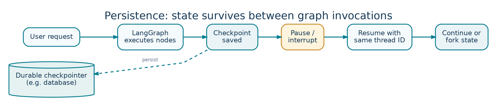

<!-- Concept illustrations are original, bundled with these notes in images/ -->

LESSON 01   /   PLAYLIST POSITION 11

# Persistence and Time Travel in LangGraph

*CampusX • Agentic AI using LangGraph  |  Theory-focused study guide  |  ~58 min*

Watch lesson: [Open original video on YouTube](https://www.youtube.com/watch?v=_IPP7_Bi8uA&list=PLKnIA16_RmvYsvB8qkUQuJmJNuiCUJFPL)

> **ABOUT THESE NOTES**
>
> These are original, concept-first study notes organized around the video's published chapter list and cross-checked against current LangGraph/LangSmith documentation. They are not a verbatim transcript. Short illustrative examples are included; project-building walkthroughs are intentionally omitted.

## Learning goals

- Understand why a stateful graph needs persistence beyond an individual invocation.

- Distinguish thread, checkpoint, checkpointer, state snapshot, and store.

- Explain how persistence enables memory, recovery, human approval, and time travel.

- Recognize what is and is not replayed when resuming a prior checkpoint.

## 1. Why persistence exists



*Figure 1. Thread-scoped persistence enables pause, resume, and time travel.*

An LLM call typically receives an input and returns an output. By itself, it does not maintain the application’s conversation state across requests. A multi-step LangGraph agent is different: it may need to remember messages, know which node should run next, wait for a reviewer, or recover after a crash.

Persistence is the mechanism that saves enough graph execution state to continue later. Consider a support chatbot that asks for an order number, searches records, and requests approval before issuing a refund. If the server restarts after approval is requested, the system needs the pending state, not merely the final sentence shown to the user.

> **MENTAL MODEL**
>
> A graph is the workflow; state is the working data; a checkpoint is a saved snapshot of that data and its execution position; a checkpointer is the component that saves and loads snapshots.

### What gets saved?

- Values: the current data channels in your graph state (such as messages, intent, or retrieved facts).

- Next: the node or nodes scheduled to execute next.

- Config and metadata: identifiers needed to reload the correct saved execution.

- Execution history: prior snapshots, allowing debugging, replay, and branching.

## 2. Threads, checkpointers, checkpoints, and stores

| Term | Meaning | Everyday analogy |
| --- | --- | --- |
| Thread | One conversation / graph-state history identified by thread_id. | A notebook for one conversation. |
| Checkpointer | Backend that saves and loads checkpoint snapshots. | The automatic save system. |
| Checkpoint | Saved state at a graph super-step boundary. | A save point in a game. |
| StateSnapshot | A view of one checkpoint, including values and next nodes. | A particular saved page. |
| Store | Cross-thread data for durable facts and preferences. | A shared knowledge cabinet. |

For short-term conversational continuity, a graph is compiled with a checkpointer and invoked with a stable thread_id. Reusing that ID lets the application load that thread’s state; using a different ID starts a separate history. A store is different: it can hold information accessible beyond a single thread, such as a long-term user preference.

```python
from langgraph.checkpoint.memory import InMemorySaver

checkpointer = InMemorySaver()
app = builder.compile(checkpointer=checkpointer)
config = {"configurable": {"thread_id": "student-42"}}

# The app can save/retrieve state for this thread.
result = app.invoke(input_state, config=config)
```

The snippet is schematic: builder and input_state are assumed to be defined. InMemorySaver persists only while the Python process remains alive. For restart-safe production persistence, use a durable backend such as PostgreSQL.

### When exactly is a checkpoint created?

LangGraph schedules work in super-steps. Multiple independent nodes may run in the same super-step. A checkpoint is created at a boundary between these steps, not after every line of Python code. This distinction matters for replay and failure recovery.

```text
Input → [Classify] → [Retrieve + Validate] → [Draft] → END
           save           save            save
```

## 3. Short-term memory for conversations

A user’s next question often depends on previous messages. A thread-scoped checkpointer can retain the message history across graph invocations so the agent can respond in context. This is application-managed memory: the model is still stateless, but the app supplies the relevant history on each new model call.

- Same thread ID: the conversation can continue with prior state.

- New thread ID: a distinct conversation with its own checkpoints.

- In-memory persistence: useful for learning and tests; lost on process restart.

- Durable persistence: requires backed storage and thoughtful retention policies.

> **IMPORTANT DISTINCTION**
>
> Persistence is not the same as sending unlimited messages to an LLM. Checkpoints may store a long history, but you must still manage context-window limits with trimming or summarization.

## 4. Fault tolerance and recovery

Suppose a graph performs document extraction, classification, and a paid API call. If the process fails near the end, rerunning everything may be slow or expensive. Checkpointing permits the runtime to resume after the last successful boundary. The runtime can also save pending writes from other nodes that finished successfully during a super-step.

- Recovery reduces repeated work but does not guarantee exactly-once execution of every external side effect.

- Place irreversible actions behind approvals or write idempotent tools (for example, with deduplication IDs).

- Checkpoints contain sensitive application state; secure storage and configure retention/access carefully.

## 5. Human-in-the-loop (HITL)

A human review step is a controlled pause before sensitive work. The application saves its state, presents the pending action to a reviewer, and later resumes with an approval, edit, or rejection. Without a checkpointer, there is no reliable location from which to continue after the pause.

Typical uses: financial transfers, deleting data, outbound communication, ambiguous compliance decisions, and high-stakes business actions. The human’s decision becomes part of the workflow rather than an informal instruction outside the state machine.

## 6. Time travel: replay versus fork

Time travel means selecting a previously saved checkpoint and continuing graph execution from there. It is valuable when an LLM selected a bad route, a retrieved document was wrong, or you want to experiment with a different state without rewriting the complete flow.

| Operation | What happens | Why use it |
| --- | --- | --- |
| Inspect | Read a saved checkpoint without running future nodes. | See what the graph knew at a point in time. |
| Replay | Resume from a prior checkpoint, re-executing downstream nodes. | Reproduce and investigate a path. |
| Fork | Modify checkpoint state, then continue along a new branch. | Compare alternative decisions or inputs. |

```python
history = list(app.get_state_history(config))
selected = history[-2]  # Example checkpoint to inspect
print(selected.values, selected.next)

# Re-execute downstream steps from this checkpoint:
replayed = app.invoke(None, config=selected.config)
```

Replay does not simply return cached future answers. Nodes after the selected checkpoint may run again, including LLM requests, API calls, interrupts, and external side effects. Results can change because models and external systems are non-deterministic.

## 7. Design decisions and pitfalls

- Give each conversation a stable, non-guessable thread_id and verify access ownership.

- Separate short-term thread state from cross-thread long-term memory.

- Choose a durable checkpointer for real recovery after restarts.

- Keep prompts and state appropriately bounded; persistence does not solve context overflow.

- Avoid putting passwords, API keys, or unnecessary personal data in state.

- Treat re-execution of external actions carefully; use idempotency and approvals.

## Quick revision

| Question | Short answer |
| --- | --- |
| What preserves a thread over invocations? | A checkpointer + consistent thread_id. |
| What is a checkpoint? | Graph state snapshot at a super-step boundary. |
| Why do we need it for HITL? | To pause and later resume reliably. |
| What is time travel? | Inspect, replay, or fork from historical checkpoints. |
| Checkpointer vs store? | Thread state vs cross-thread durable data. |

## Active-recall questions

Q. Does an LLM itself remember prior API calls?

A. No. The application supplies the relevant state/history for each call.

Q. Will InMemorySaver survive a process restart?

A. No. It stores state in process memory.

Q. If you replay a checkpoint, will downstream tools run again?

A. They may. Replays can re-execute subsequent work and side effects.

Q. Why should external actions be idempotent?

A. Recovery or replay may retry an action; idempotency prevents duplicate impact.

## Sources and further reading

Original video: [CampusX lesson](https://www.youtube.com/watch?v=_IPP7_Bi8uA)

Playlist: [Agentic AI using LangGraph](https://www.youtube.com/playlist?list=PLKnIA16_RmvYsvB8qkUQuJmJNuiCUJFPL)

Official documentation 1: [docs.langchain.com/oss/python/langgraph/persistence](https://docs.langchain.com/oss/python/langgraph/persistence)

Official documentation 2: [docs.langchain.com/oss/python/langgraph/checkpointers](https://docs.langchain.com/oss/python/langgraph/checkpointers)

Reference status: Chapter titles/timestamps are sourced from the public video description. API discussion reflects official documentation consulted in October 2026. Library APIs can change; check current documentation before running code.
