# Persistence and Time Travel in LangGraph

**Agentic AI using LangGraph | Video 11 | CampusX**  
**Lesson:** [Persistence in LangGraph | Time Travel in LangGraph | CampusX](https://www.youtube.com/watch?v=_IPP7_Bi8uA)  

> **Core idea:** Persistence saves graph state at checkpoints, allowing conversations and workflows to resume, pause for approval, recover, and revisit earlier steps.

## 1. Learning goals

Describe persistence, checkpoints, checkpointers, threads, short-term memory, fault recovery, human review, and time travel; trace a small saved workflow without a paid model.

### Video chapter links

| Time | Chapter |
| --- | --- |
| [00:00](https://www.youtube.com/watch?v=_IPP7_Bi8uA&t=0s) | Intro |
| [01:03](https://www.youtube.com/watch?v=_IPP7_Bi8uA&t=63s) | What is Persistence |
| [07:25](https://www.youtube.com/watch?v=_IPP7_Bi8uA&t=445s) | Speciality of Persistance |
| [11:21](https://www.youtube.com/watch?v=_IPP7_Bi8uA&t=681s) | Building Chatbots |
| [14:50](https://www.youtube.com/watch?v=_IPP7_Bi8uA&t=890s) | Checkpointer |
| [17:39](https://www.youtube.com/watch?v=_IPP7_Bi8uA&t=1059s) | Example of Checkpointer |
| [20:10](https://www.youtube.com/watch?v=_IPP7_Bi8uA&t=1210s) | Threads |
| [25:35](https://www.youtube.com/watch?v=_IPP7_Bi8uA&t=1535s) | Implementation/Code |
| [35:51](https://www.youtube.com/watch?v=_IPP7_Bi8uA&t=2151s) | Benefits of Persistence |
| [36:45](https://www.youtube.com/watch?v=_IPP7_Bi8uA&t=2205s) | Short Term Memory |
| [38:05](https://www.youtube.com/watch?v=_IPP7_Bi8uA&t=2285s) | Fault Tolerance |
| [44:28](https://www.youtube.com/watch?v=_IPP7_Bi8uA&t=2668s) | Human in Loop |
| [47:36](https://www.youtube.com/watch?v=_IPP7_Bi8uA&t=2856s) | Time Travel |

**Prerequisites:** Basic Python functions and dictionaries; familiarity with nodes, edges, and shared state is helpful. Terms used in this lesson are explained as they appear.

---

## 2. Persistence: keeping the workflow's progress

**Persistence** means saving useful execution state so that a LangGraph application can use it again later. Without persistence, a normal graph invocation receives some input, runs its nodes, returns a result, and has no automatic record of that run for the next invocation. A chat assistant that forgets every previous message is a simple example of the problem.

Think of editing an essay in a word processor. You may type several paragraphs, close the application, and return tomorrow. You expect the document to be available because it was **saved**. In LangGraph, a **checkpointer** performs a related role for a workflow: it saves snapshots of the workflow's state as execution progresses. These snapshots are called **checkpoints**.

<p align="center">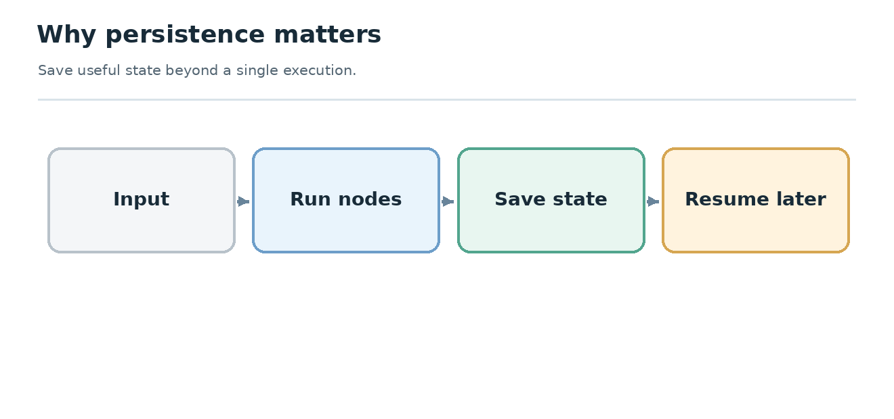</p>

**Follow the diagram:** Input starts a graph run; nodes update the state; the checkpointer stores snapshots; a later operation can load a relevant saved state. Saving is separate from generating an answer. It does not make the model understand better by itself, but it provides the context needed to continue intelligently.

### Persistence and ordinary state are different

**State** is the data that nodes read and update during a run, such as `topic`, `messages`, or `score`. **Persistence** is the mechanism that stores state so it remains available beyond that immediate execution. A state schema can exist with no checkpointer, but a persistent graph needs an appropriate checkpointer and an identifier that tells it which history to use.

In a chatbot, `messages` might contain the conversation. A first call stores “My name is Maya.” A second call asks “What is my name?” If both calls use the correct saved conversation thread, the graph can load earlier messages and answer in context. If they use separate threads, that history should not be shared.

## 3. Checkpoints and checkpointers

A **checkpoint** is a saved snapshot of the graph's execution state at a particular boundary. A **checkpointer** is the component that writes and reads those snapshots. Rather than being one final save only, the graph can produce a sequence of checkpoints as it advances through its execution steps.

<p align="center">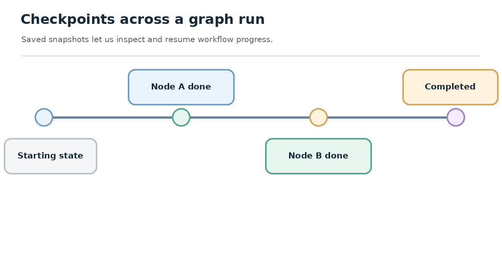</p>

Consider a small workflow: receive a topic, generate a joke, then explain the joke. There is a starting state; a later state contains the generated joke; a later one also contains the explanation. If execution is interrupted after the joke, a saved checkpoint can help the application continue from the relevant point rather than reconstructing everything blindly.

### What gets stored?

A saved state snapshot exposes information such as the current field values, configuration, metadata, and the next scheduled work. The important distinction is that a checkpoint is more than an isolated string of chat text: it can represent **where the workflow reached** and **what needs to happen next**.

<p align="center">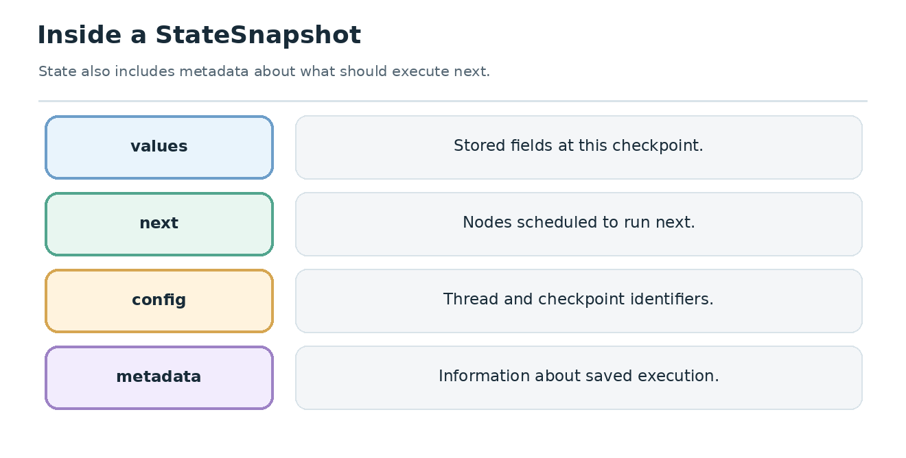</p>

The fields can be inspected through the graph's state APIs. For example, `get_state(config)` retrieves the latest snapshot for a thread and `get_state_history(config)` gives saved snapshots for inspection. The exact returned objects are richer than a plain Python dictionary; they contain execution metadata as well as values.

### Checkpoints are not simply a database of user preferences

A checkpoint normally belongs to a particular **thread**. It is ideal for the short-term memory of an active conversation and for resuming a paused graph. Reusable preferences that should be available across many unrelated conversations are a different problem: LangGraph also supports **stores** for long-term, cross-thread information.

<p align="center">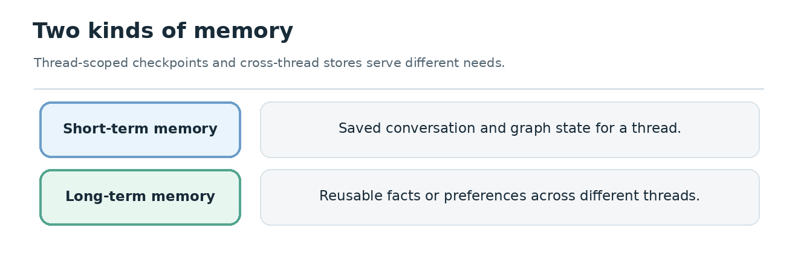</p>

For example, the thread containing a detailed interview-preparation discussion should remember the interview questions and past responses. A separate user-preference store might keep a permitted preference for concise answers and make it available in a new thread. A checkpointer alone should not be treated as a global user memory system.

## 4. Threads: keeping histories separate

A **thread** is a named sequence of graph execution state associated with a particular `thread_id`. In a chatbot, one thread often represents one conversation. Multiple users—and even multiple conversations belonging to one user—should usually have different identifiers.

<p align="center">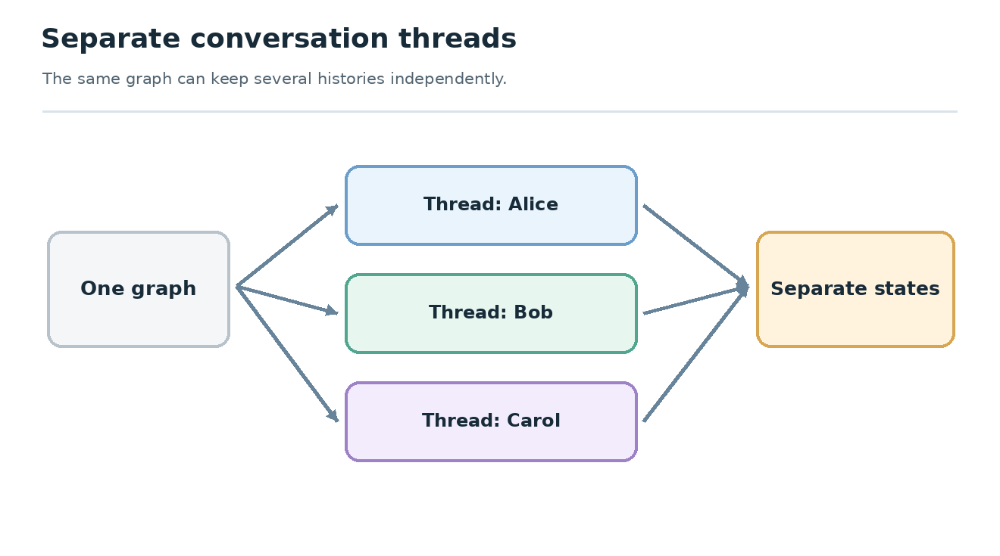</p>

The graph definition can be shared, but the data must remain separate. Alice's thread should remember Alice's questions, while Bob's thread remembers Bob's. This separation is necessary for correctness and privacy.

A simplified graph invocation might use:

```python
config = {"configurable": {"thread_id": "conversation-101"}}
result = graph.invoke(input_state, config=config)
```

When the same `thread_id` is used again with the same checkpoint storage, the graph can continue the saved history. A new identifier starts or selects a different history. A stable ID should come from the application's conversation records, not from a random constant shared by every user.

<p align="center">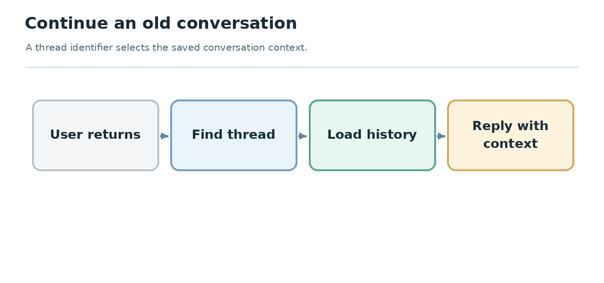</p>

### Example: returning to a previous chat

1. A learner asks, “Explain LangGraph nodes,” in conversation `lesson-7`.
2. The assistant replies, and the conversation's state is saved.
3. The learner closes the page, returns later, and selects the same conversation.
4. The application invokes the graph using the **same** thread identifier.
5. Earlier messages are available so a follow-up such as “Give me another example” has the right context.

A checkpointer does not automatically ensure that a user interface remembers which ID belongs to which conversation. The application must maintain that mapping.

## 5. Worked example: a topic-to-joke workflow

A short joke-generation pipeline illustrates checkpoints without requiring a large chatbot project. The graph has two meaningful nodes: one creates a joke about a topic, and the next explains why the joke is funny. In a model-backed version, an LLM could run inside both nodes. For an easy-to-test demonstration, deterministic Python functions are enough to show the flow.

<p align="center">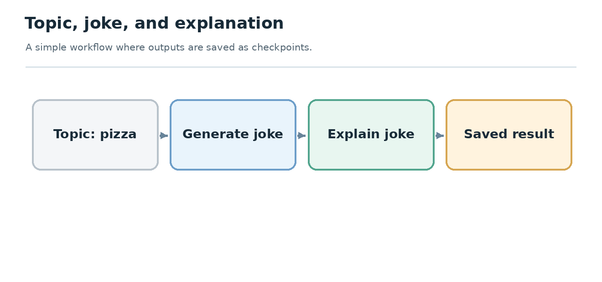</p>

**Example input:** `topic = "pizza"`. After the first node, the state holds a pizza joke. After the second, it also holds an explanation. These are two different moments in the workflow; persistent execution can record each meaningful boundary.

```python
from typing_extensions import TypedDict
from langgraph.graph import StateGraph, START, END
from langgraph.checkpoint.memory import InMemorySaver

class JokeState(TypedDict, total=False):
    topic: str
    joke: str
    explanation: str

def make_joke(state: JokeState) -> dict:
    return {"joke": f"Why did {state['topic']} get promoted? Great delivery!"}

def explain(state: JokeState) -> dict:
    return {"explanation": "The joke plays on two meanings of delivery."}

builder = StateGraph(JokeState)
builder.add_node("make_joke", make_joke)
builder.add_node("explain", explain)
builder.add_edge(START, "make_joke")
builder.add_edge("make_joke", "explain")
builder.add_edge("explain", END)

graph = builder.compile(checkpointer=InMemorySaver())
config = {"configurable": {"thread_id": "jokes-1"}}
result = graph.invoke({"topic": "pizza"}, config=config)
print(result["joke"])
print(result["explanation"])
```

The checkpointer is passed to `.compile()`, and the thread configuration is passed to `.invoke()`. Those two details matter: a graph with no checkpointer is not automatically persistent, and a checkpointed graph needs a thread identifier to organize histories.

**Important:** `InMemorySaver` is useful for learning and testing. It is not durable after the process stops. Production applications usually choose a supported persistent backend, configure access controls, and decide how long histories should be kept.

## 6. Persistence makes recovery possible

Imagine a multi-step job: collect information, prepare a report, check facts, and send a notification. If an external API fails during the fact-check step, restarting every previous step may waste time or repeat costly operations. Saved checkpoints provide a basis for continuing from a suitable point.

<p align="center">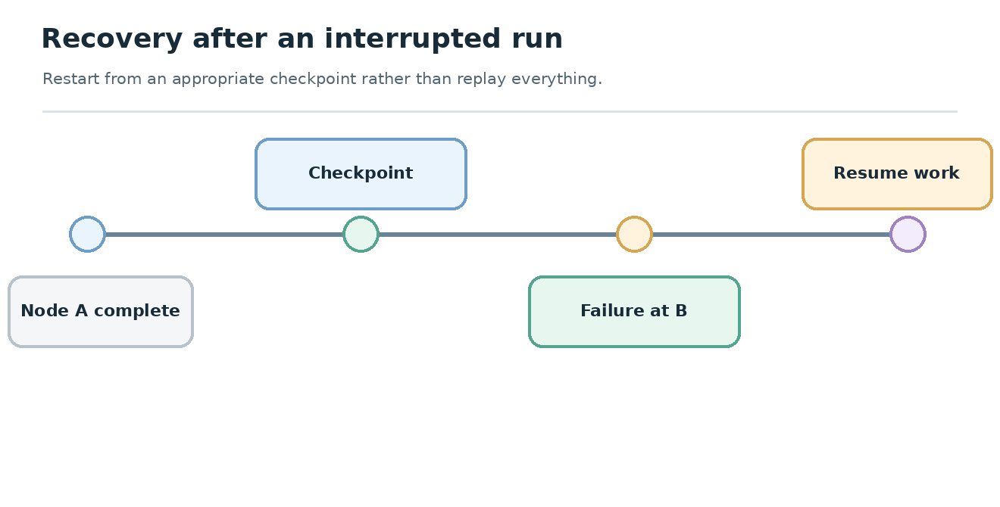</p>

**Step-by-step:** (1) the first node completes; (2) its state is checkpointed; (3) the next node fails; (4) the application investigates the error and resumes with the saved context under the appropriate execution configuration. Exact recovery behavior depends on the graph, durability settings, and the failing step; checkpoints do not guarantee that every operation can be replayed safely.

### A crucial limitation: external side effects

Suppose a node charges a credit card and then the program crashes before it records success. Simply rerunning that node might charge twice. Persistence stores state, but it does not make external APIs **exactly-once** operations. Use idempotency keys, transaction records, or explicit approval flows for high-impact actions.

<p align="center">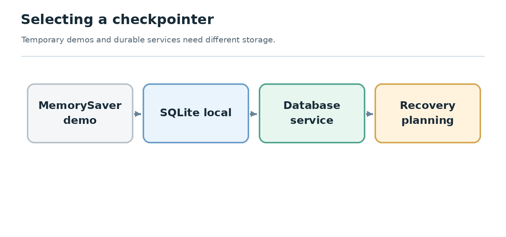</p>

For development, in-memory saving is convenient. For a real service, use a supported persistent checkpointer, appropriate backups, and a retention policy. Memory and SQLite implementations are valuable learning tools, while service deployments often need a database-backed store.

## 7. Human-in-the-loop workflows

**Human-in-the-loop** means a person can review, approve, correct, or reject a step before the graph continues. This is especially useful when the next action is difficult to undo.

Consider a LinkedIn-post assistant. It drafts a post and proposes publishing it, but a person should decide whether the wording is appropriate before anything is posted. The graph can **interrupt**, save its state, and wait for a human decision.

<p align="center">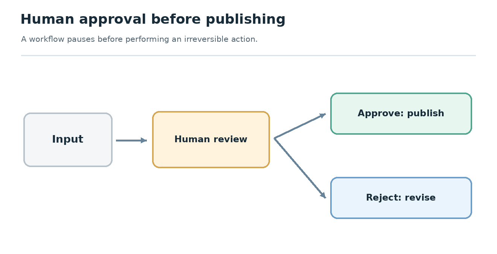</p>

The diagram has a review decision: approval allows the publish step; rejection can lead to revision. A real implementation can use `interrupt()` inside a node and later resume execution with `Command(resume=...)`, using the correct persisted thread configuration.

```python
from langgraph.types import interrupt, Command

# Inside an approval node:
def ask_for_approval(state):
    approved = interrupt({"draft": state["draft"], "question": "Publish?"})
    return {"approved": bool(approved)}

# Later, in the same saved thread:
# graph.invoke(Command(resume=True), config=config)
```

An interrupt is not a blocking `input()` statement. It is a checkpoint-aware pause, designed for an application or user interface to resume later. For sensitive actions, validate who is allowed to approve and do not assume a returned Boolean is sufficient authorization.

## 8. Time travel: replaying or changing a past decision

**Time travel** allows a graph to revisit an earlier checkpoint. Two common operations are **replay** and **fork**. Replay resumes from a saved point and re-executes subsequent work. Fork creates an alternative continuation, often after changing part of the saved state.

<p align="center">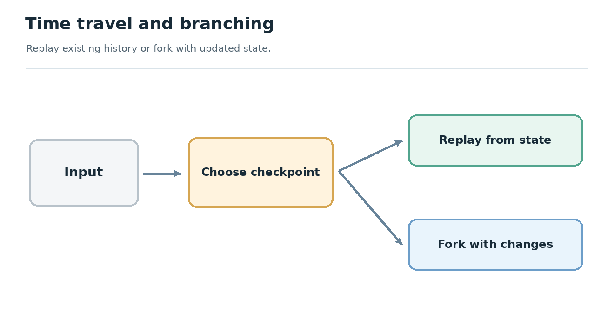</p>

Return to the pizza-joke example. Suppose the first joke was fine, but the explanation was confusing. You can inspect the checkpoint before explanation and re-run from that point with a revised explanation method. Or imagine changing the saved joke before resuming, creating a new branch of results.

Important: replay is **not** simply reading an old answer out of a cache. Nodes executed after the chosen checkpoint may call models again and produce different text. External tool side effects also require care.

```python
# Inspect earlier states; requires a compiled graph with a checkpointer.
for snapshot in graph.get_state_history(config):
    print(snapshot.config, snapshot.values)

# A chosen snapshot.config can identify a prior checkpoint for replay.
# For branching, update selected state using the checkpoint config,
# then continue from the returned fork configuration.
```

The precise replay or fork operation depends on which checkpoint you choose and on graph structure. Practice on a small deterministic graph first.

## 9. Designing a persistent LangGraph application

A reliable design begins by deciding what should be remembered. Store only the information needed to continue work. Keep conversation histories separate by thread, choose an appropriate backend, and define how the UI loads older conversations.

<p align="center">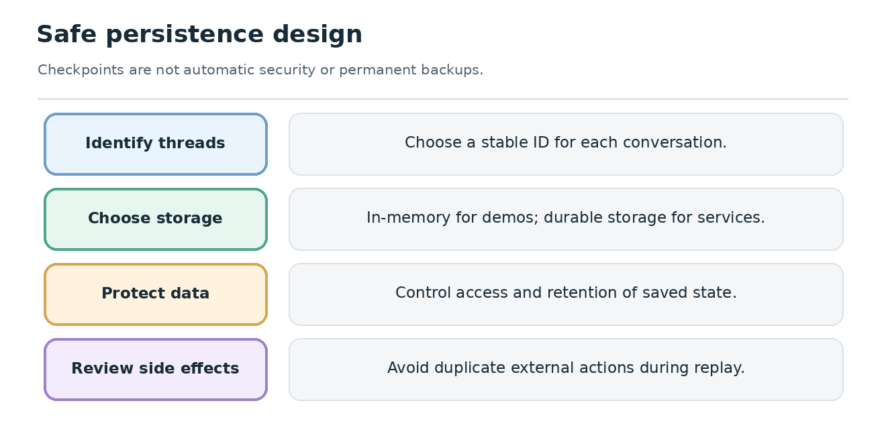</p>

A useful design sequence is: choose a state schema; decide which steps need checkpoints; select a storage backend; assign stable thread identifiers; test continuation; test interruptions and failures; verify access permissions; and document retention. **Saving state is an application capability, not a substitute for authentication, data security, or error handling.**

### Common mistakes

- **Mixing up state and persistence:** state describes current data; persistence stores the data between executions.
- **Using one ID for everyone:** this mixes conversations and can expose another person's context.
- **Expecting in-memory storage to survive a restart:** it does not.
- **Confusing short-term thread state with cross-thread memory:** they answer different needs.
- **Retrying side-effecting nodes without safeguards:** a replay may repeat external actions.
- **Assuming checkpointing automatically logs every application detail:** for full debugging you may also want tracing/observability.

### Follow two invocations with the same thread

Suppose the state schema includes `messages` with a message-append reducer. The user begins with “I am preparing for a Python interview,” and the assistant gives a short study suggestion. When the user later asks “Can you give me a coding question?”, the second invocation can load the saved first exchange because both requests use the same thread ID.

| Moment | Incoming user message | Saved state after processing |
| --- | --- | --- |
| Turn 1 | “I am preparing for a Python interview.” | First user message and assistant reply |
| Turn 2, same thread | “Give me a coding question.” | Old conversation plus the second exchange |
| Turn 2, different thread | “Give me a coding question.” | New conversation; the earlier context is not automatically present |

This also reveals why **reducers** matter. A state field storing the *latest score* should usually replace its old value. A `messages` field storing conversation history must usually **merge or append**, otherwise subsequent messages may replace older information. Persistence saves state, but the state-update policy determines what information is still present at the point of saving.

### What exactly happens when you return to a saved thread?

1. The application receives a new message and resolves a conversation identifier.
2. It passes that identifier through `configurable.thread_id`.
3. The checkpointer finds the appropriate stored execution state.
4. The graph accepts the new input, applies its update rules, and continues execution.
5. The new response and resulting checkpoints become part of the thread's history.

Some details vary by graph design and durability settings, but the principle remains consistent: **a stable identifier plus saved state makes continuity possible**. A restarted web server should only be expected to preserve this history when storage is durable and accessible to the new process.

### Time travel is useful for controlled experiments

Suppose an essay grader has produced an overly strict score. A developer can select a saved checkpoint before the grading step, adjust a rubric or input state, and run a new branch. The original history remains useful for comparison. However, time travel is an engineering feature, not an excuse to run irreversible actions repeatedly. If the graph publishes a post or sends an email, replay only the safe parts or introduce an approval/side-effect boundary.


## 10. Key takeaways

1. Persistence saves workflow state beyond a single invocation.
2. A **checkpoint** is a saved execution snapshot; a **checkpointer** creates and retrieves snapshots.
3. `thread_id` tells the graph which conversation or execution history to load.
4. Checkpoints support chat continuation, fault recovery, human approval, and time travel.
5. Short-term thread memory and long-term cross-thread memory are distinct mechanisms.
6. Replay and fork can re-execute work; external side effects need extra safeguards.
7. In-memory checkpointers are for learning, not durable deployment.

## 11. Revision checklist

- [ ] I can explain persistence, state, checkpoint, and checkpointer without confusing them.
- [ ] I can draw a graph with at least three saved checkpoints.
- [ ] I understand why each conversation needs its own `thread_id`.
- [ ] I can distinguish a thread checkpoint from a cross-thread store.
- [ ] I can explain how a previous conversation resumes.
- [ ] I know why fault tolerance still needs retry and side-effect handling.
- [ ] I can describe a pause-and-approve workflow.
- [ ] I can distinguish replay and fork.
- [ ] I can compile a small graph with an in-memory checkpointer.
- [ ] I know why production storage and privacy controls matter.

## 12. Practice questions and exercises

1. A chatbot remembers an earlier message within one conversation, but forgets it in another conversation. Is that necessarily a bug? Explain.
2. Sketch the state after each step of `topic → joke → explanation` and identify which snapshot would help rerun only the explanation.
3. Extend the example with `attempts` and explain when it should be overwritten rather than appended.
4. Design a LinkedIn-post workflow with a human approval gate and a safe rejection path.
5. Why could replaying a payment workflow cause duplicate transactions? Propose one protection.
6. Compare `InMemorySaver` with a persistent database-backed checkpoint system for a real web service.
7. Explain when a cross-thread store would be better than a checkpointer.

## 13. Interview questions and short answers

**What is persistence in LangGraph?** Saving graph execution state as checkpoints so a workflow can continue across invocations, interruptions, or failures.

**What is a thread?** An identified sequence of related graph state; applications typically use it to distinguish conversation histories.

**What is a checkpointer?** The storage component responsible for saving and retrieving graph checkpoints.

**Why do we pass `thread_id`?** So the runtime can associate new execution with the intended stored history.

**What is human-in-the-loop?** A design that pauses work to accept a human decision before continuing.

**What is time travel in LangGraph?** Replaying or branching execution from an earlier saved checkpoint.

**Does persistence ensure exactly-once actions?** No; external side effects need idempotency and application safeguards.

## 14. Further reading

- [LangGraph persistence overview](https://docs.langchain.com/oss/python/langgraph/persistence)
- [LangGraph checkpointers and threads](https://docs.langchain.com/oss/python/langgraph/checkpointers)
- [Human-in-the-loop interrupts](https://docs.langchain.com/oss/python/langgraph/interrupts)
- [Replay and time travel](https://docs.langchain.com/oss/python/langgraph/use-time-travel)
