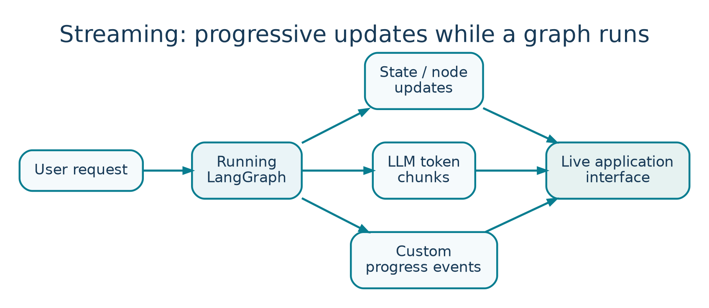

<!-- Concept illustrations are original, bundled with these notes in images/ -->

LESSON 02   /   PLAYLIST POSITION 13

# Streaming in LangGraph

*CampusX • Agentic AI using LangGraph  |  Theory-focused study guide  |  ~25 min*

Watch lesson: [Open original video on YouTube](https://www.youtube.com/watch?v=D1PcZaeQ2eg&list=PLKnIA16_RmvYsvB8qkUQuJmJNuiCUJFPL)

> **ABOUT THESE NOTES**
>
> These are original, concept-first study notes organized around the video's published chapter list and cross-checked against current LangGraph/LangSmith documentation. They are not a verbatim transcript. Short illustrative examples are included; project-building walkthroughs are intentionally omitted.

## Learning goals

- Understand the difference between a final-response API and an incremental stream.

- Distinguish node updates, complete state snapshots, model tokens, and custom progress events.

- Choose a streaming mode for chat UX, progress bars, or debugging.

- Recognize practical concerns with stream cancellation, error handling, and UI rendering.

## 1. What streaming means



*Figure 2. Streaming can deliver node updates, token chunks, and custom events.*

Without streaming, the application waits for the entire graph to finish and then displays the result. With streaming, the application consumes smaller events while graph execution is in progress. A user may see that a search has started, which node completed, or generated text arriving token by token.

```text
Blocking invoke:
User request → [retrieve] → [reason] → [answer] → ONE response

Streaming:
User request → [retrieve ✓] → [reason ✓] → token → token → token
```

Streaming improves perceived responsiveness and makes long-running agents easier to understand. It is a presentation and instrumentation mechanism, not a guarantee that the underlying computation will finish faster.

## 2. Why it matters for agents

- User experience: show useful partial output rather than a blank screen.

- Transparency: indicate whether the agent is planning, retrieving, or invoking a tool.

- Operational monitoring: observe slow or failing nodes while work is in progress.

- Interactive control: expose progress before deciding whether to cancel or intervene.

### Two kinds of streamed information

| Kind | Example | Best for |
| --- | --- | --- |
| Progress/event stream | “Retriever finished; 4 documents found.” | Progress indicators and debugging. |
| Token stream | “The”, “ answer”, “ is”, “ 42”. | Typewriter-style assistant output. |

Do not confuse the two. A graph can stream node-level updates even when an LLM does not emit tokens. Conversely, token streaming can happen during one model-generating node.

## 3. Streaming modes in LangGraph

| Mode | Typical payload | Good use case |
| --- | --- | --- |
| updates | Only the state updates generated by nodes. | Watch which node changed what. |
| values | Complete state at each step. | Debug the full evolving state. |
| messages | LLM message chunks and associated metadata. | Chat token streaming. |
| custom | Developer-defined progress payloads. | Display application-specific milestones. |
| debug / tasks / checkpoints | Detailed runtime instrumentation. | Inspection and tooling. |

The choice determines what appears in the iterator, not what the graph fundamentally does. For example, updates can be much smaller than values when the full state includes a large message history.

## 4. Minimal API mental model

Call stream() for synchronous iteration or astream() in an async application. You process each chunk as it arrives and decide whether to update the terminal, browser, or event bus. The newer v2 stream format returns objects with type, namespace, and data fields.

```text
for part in app.stream(
    input_state,
    stream_mode=["updates", "custom"],
    version="v2",
):
    if part["type"] == "updates":
        print("Node update:", part["data"])
    elif part["type"] == "custom":
        print("Progress:", part["data"])
```

This is a pattern rather than a complete runnable app; app and input_state are defined elsewhere. In older tutorials the shape of returned chunks may differ depending on whether one or multiple modes are requested. Check your installed LangGraph version.

### What the consumer receives

```text
# v2 conceptual shape (simplified)
{
  "type": "updates",   # e.g., values, messages, custom
  "ns": (),             # graph/subgraph namespace
  "data": {"node_a": {"status": "done"}}
}
```

## 5. Difference between updates and values

Imagine state starts as {question: "What is RAG?", status: "new"}. The retrieve node returns {documents: ["doc1", "doc2"]}. An updates event generally focuses on that newly returned piece; a values event represents the full combined state after the step.

| After node | updates view | values view |
| --- | --- | --- |
| retrieve | {documents: [doc1, doc2]} | {question, status, documents} |
| summarize | {answer: summary} | {question, status, documents, answer} |

Use updates to build a compact activity feed, and values to inspect a complete evolving snapshot. A large full-state stream may transfer substantially more data.

## 6. Token streaming and the chat interface

For a chat interface, a model may emit a sequence of small text pieces. The frontend appends them to the visible assistant message. Real implementations must also handle tool-call metadata, non-text content, partial Unicode boundaries, and the final response record.

- Accumulate token chunks into a stable final message rather than saving every fragment as an independent chat turn.

- Distinguish user-visible answer text from internal model or tool metadata.

- Render errors and completion states; do not leave an endless spinner if the stream fails.

- Protect private chain-of-thought or sensitive tool payloads from accidental UI exposure.

## 7. Custom events and progress messages

Custom events carry deliberate application signals: “started OCR,” “searched 3 knowledge bases,” or “human approval required.” They are often more meaningful to users than raw internal state. In LangGraph you can emit them from nodes using its stream writer facilities.

> **DESIGN PRINCIPLE**
>
> Show progress that the user can act on or understand. Avoid exposing internal prompts, raw credentials, sensitive documents, or dense framework metadata as progress messages.

## 8. Streaming in production

- Transport: a web app often delivers chunks through Server-Sent Events (SSE) or a WebSocket; browser UI must consume events incrementally.

- Cancellation: cancel the running operation gracefully and decide which state should persist.

- Backpressure: avoid overwhelming the UI when many tiny tokens arrive; batch renders when needed.

- Retries: treat stream disconnects separately from business logic failures to avoid duplicate tool actions.

- Observability: record the final trace and failures even if the user disconnects early.

- UX: label tool and retrieval steps separately from the final assistant answer.

## Quick revision

| Need | Mode to consider |
| --- | --- |
| See what each node changes | updates |
| See the whole state after each step | values |
| Show the answer arriving token by token | messages |
| Show meaningful workflow milestones | custom |
| Investigate execution internals | debug / tasks / checkpoints |

## Active-recall questions

Q. Does streaming make the model compute faster?

A. Not necessarily. It mainly reduces the delay before the user sees incremental output.

Q. What is the difference between updates and values?

A. Updates show node deltas; values expose complete state snapshots.

Q. What should a progress UI avoid showing?

A. Credentials, hidden reasoning, sensitive intermediate data, and raw internal prompts.

Q. Why handle stream errors explicitly?

A. The user needs a clear failed/completed state and the app must manage any persisted partial work.

## Sources and further reading

Original video: [CampusX lesson](https://www.youtube.com/watch?v=D1PcZaeQ2eg)

Playlist: [Agentic AI using LangGraph](https://www.youtube.com/playlist?list=PLKnIA16_RmvYsvB8qkUQuJmJNuiCUJFPL)

Official documentation 1: [docs.langchain.com/oss/python/langgraph/streaming](https://docs.langchain.com/oss/python/langgraph/streaming)

Reference status: Chapter titles/timestamps are sourced from the public video description. API discussion reflects official documentation consulted in October 2026. Library APIs can change; check current documentation before running code.

### Key video timestamps

[04:13 What is streaming?](https://www.youtube.com/watch?v=D1PcZaeQ2eg&t=253s)   |   [05:35 Why streaming matters](https://www.youtube.com/watch?v=D1PcZaeQ2eg&t=335s)   |   [12:15 Implementation concept](https://www.youtube.com/watch?v=D1PcZaeQ2eg&t=735s)   |   [14:08 Code walkthrough](https://www.youtube.com/watch?v=D1PcZaeQ2eg&t=848s)
