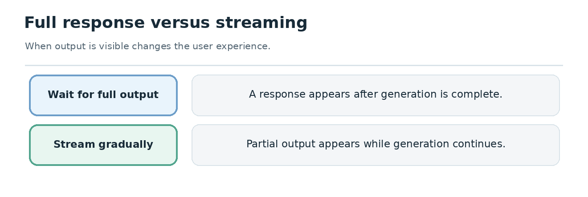
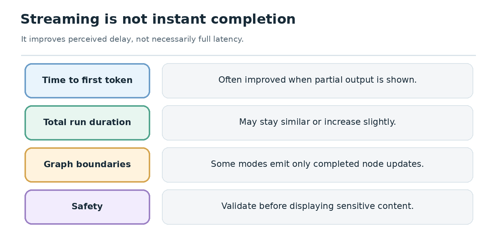
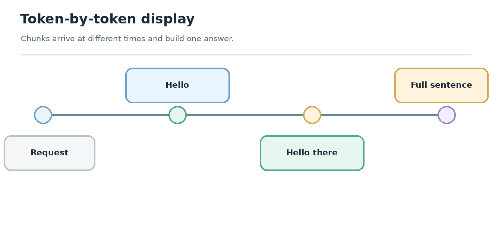
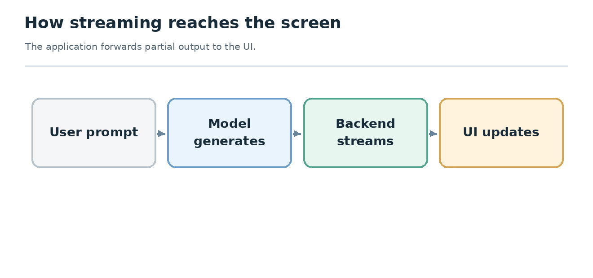
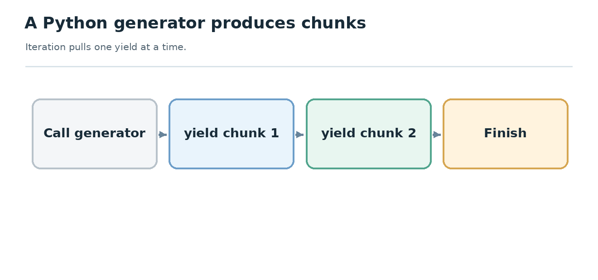
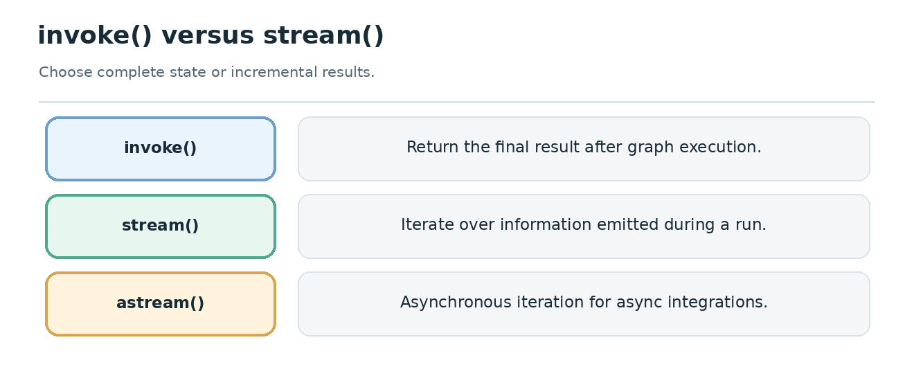
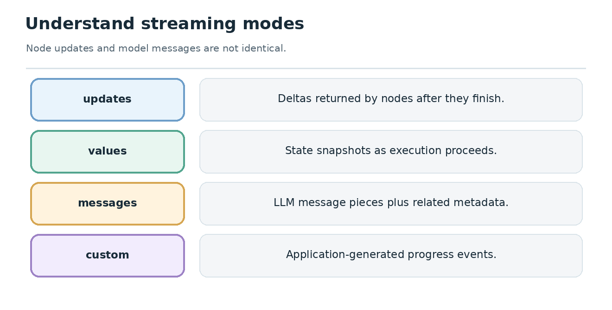
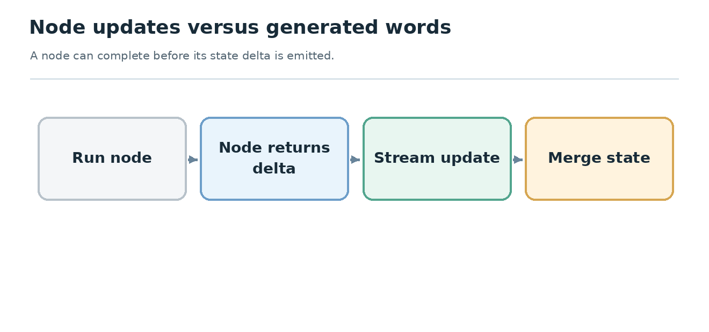
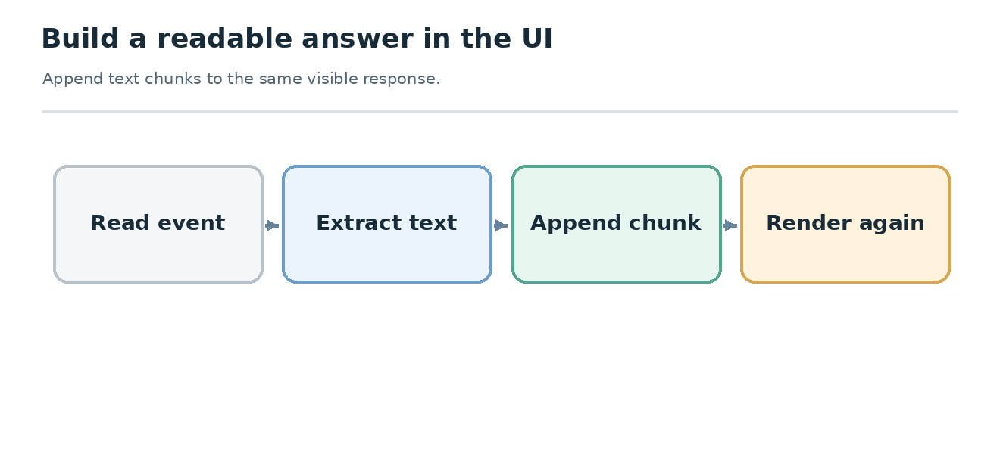
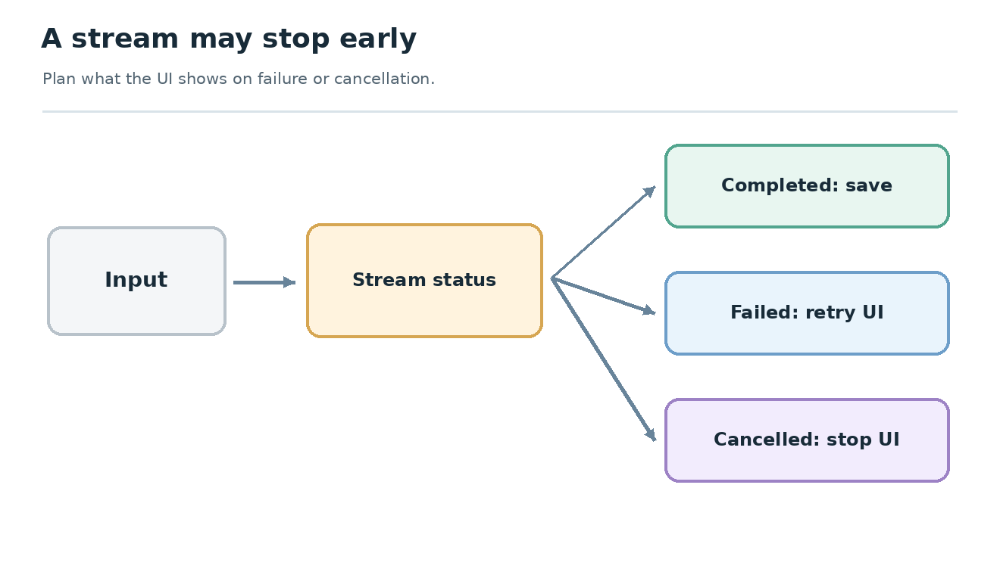

# Streaming in LangGraph

**Agentic AI using LangGraph | Video 13 | CampusX**  
**Lesson:** [Streaming in LangGraph | CampusX](https://www.youtube.com/watch?v=D1PcZaeQ2eg)  

> **Core idea:** Streaming delivers useful output or progress in pieces while an application runs; model tokens and graph-state updates are different kinds of streams.

## 1. Learning goals

Explain incremental delivery, Python generators, stream modes, token versus node-update streaming, UI handling, and streaming failure cases.

### Video chapter links

| Time | Chapter |
| --- | --- |
| [00:00](https://www.youtube.com/watch?v=D1PcZaeQ2eg&t=0s) | Intro |
| [02:55](https://www.youtube.com/watch?v=D1PcZaeQ2eg&t=175s) | Streaming Demo |
| [04:13](https://www.youtube.com/watch?v=D1PcZaeQ2eg&t=253s) | What is Streaming? |
| [05:35](https://www.youtube.com/watch?v=D1PcZaeQ2eg&t=335s) | Importance of streaming |
| [12:15](https://www.youtube.com/watch?v=D1PcZaeQ2eg&t=735s) | Implementing Streaming |
| [14:08](https://www.youtube.com/watch?v=D1PcZaeQ2eg&t=848s) | Code |

**Prerequisites:** Basic Python functions and dictionaries; familiarity with nodes, edges, and shared state is helpful. Terms used in this lesson are explained as they appear.

---

## 2. Streaming: showing results while work is happening

**Streaming** means delivering an answer or execution progress in smaller pieces as they become available, instead of waiting for the entire result and showing it at once. It is especially useful for LLM applications because generating a long answer may take several seconds.

Imagine asking a chatbot for a 500-word essay. Without streaming, the interface might display a loading indicator until the whole essay is ready. With streaming, it can begin showing the first sentences while the rest is being generated. The familiar typewriter-like appearance is a visible effect of streaming.

<p align="center"></p>

The difference is about **delivery**, not necessarily the model's intelligence. Both paths may generate essentially the same final answer. One sends the result only when ready; the other makes progress visible sooner.

### Two kinds of waiting

A useful distinction is **time to first visible output** versus **time to complete response**. Streaming often improves the first measure, making the application feel more responsive. It does not guarantee that the entire request finishes faster. Network delays, tool calls, model speed, buffering, and server load still affect the total duration.

<p align="center"></p>

For example, a full response could take eight seconds, leaving the screen blank during those eight seconds. A streamed response might show its first words after one second and finish after eight seconds. That is a much better experience for reading, even though the total work took about the same time.

## 3. How token streaming works

Language models produce output incrementally. In a simple text interface, the application receives chunks from the model, forwards them through its backend, and adds them to the answer already displayed. A chunk is **not always exactly one word or one token**; its size depends on the model integration, network, and stream interface.

<p align="center"></p>

Follow the timeline: after the user sends a request, the first piece of output becomes available. New pieces are added until the final answer is complete. Partial text can be useful before it forms a full sentence, but it may still change meaning as further words arrive. Do not treat an unfinished phrase as a complete decision.

### Example: a cooking question

Suppose the user asks, “How do I make pasta?” A streamed answer may appear as `Boil` → `Boil water` → `Boil water and add the pasta` → more complete instructions. The interface keeps appending chunks to one message. If the server sends a final completion event, the UI can stop the loading indicator and mark the answer finished.

<p align="center"></p>

The **model** generates content, the **backend** carries events, and the **frontend** renders text. These are different responsibilities. A backend that receives streamed chunks but buffers them until the end defeats much of the user-facing benefit.

## 4. Python generators: the easiest mental model

A **generator** is a Python function that can produce a sequence of values gradually using `yield`. Unlike a normal function that returns once, a generator pauses after yielding a value and can continue when the caller requests the next one.

<p align="center"></p>

```python
def answer_chunks():
    yield "Boil water. "
    yield "Add pasta. "
    yield "Cook until tender."

for chunk in answer_chunks():
    print(chunk, end="", flush=True)
```

**What happens?** First, calling `answer_chunks()` creates a generator object. Next, the `for` loop asks it for a value, which causes the function to run until the next `yield`. After printing that value, the loop requests another. This repeats until the generator is exhausted.

The output looks like one answer, but the program received it in three steps. For a real LLM, the chunks arrive from a model or API rather than from hardcoded `yield` statements. A generator is a helpful analogy; it is not the model's internal tokenization algorithm.

## 5. `.invoke()`, `.stream()`, and `.astream()`

In LangGraph, `.invoke()` is a straightforward way to run a compiled graph and receive its final output. `.stream()` exposes incremental execution information through an iterator. `.astream()` offers asynchronous iteration when the surrounding application uses `asyncio`.

<p align="center"></p>

The difference can be shown without an LLM. Imagine a graph that processes a short article through `outline → draft → proofread`. With `.invoke()`, your code receives the graph's final state when processing has finished. With `.stream()`, you can see intermediate stage outputs according to the selected stream mode.

```python
# Final state, returned after execution:
final_state = graph.invoke({"topic": "Solar power"})

# Intermediate updates, iterated as execution progresses:
for event in graph.stream({"topic": "Solar power"}, stream_mode="updates"):
    print(event)
```

**Important:** `updates` is about node output updates, not necessarily the individual words being generated by a language model. That distinction is the source of many beginners' misunderstandings.

## 6. Understanding the different stream modes

LangGraph's stream-mode API can report different kinds of information. You choose the type based on what your application needs. A debugging panel may want complete state updates, while a chat interface wants model text chunks.

<p align="center"></p>

| Stream mode | What you get | A useful scenario |
| --- | --- | --- |
| `updates` | The partial state updates produced by completed nodes | Debug which step changed a field |
| `values` | State snapshots during execution | Display current workflow state |
| `messages` | LLM message chunks and metadata | Show generated text gradually |
| `custom` | Events your application emits explicitly | Progress indicators or custom status |

Other modes, including checkpoint and debug-related events, are also available in supported versions. Recent LangGraph documentation additionally recommends **event streaming** for new application code; stream-mode APIs remain useful and well documented, especially for understanding graph execution.

### Node updates are not token streaming

<p align="center"></p>

Suppose a node generates a 400-word report and then returns `{"report": complete_text}`. Under `stream_mode="updates"`, the update is normally emitted when that node returns. The user does **not** automatically see every new word. For word-by-word LLM output, use a model-capable message streaming interface and handle message chunks.

This distinction matters because a stream from a graph is broader than a stream from one model. The graph may expose node completions, state updates, tool progress, messages, and custom events.

## 7. Worked example: observe a graph one step at a time

The code below creates a small deterministic workflow. It returns an outline first, then builds a summary. No external API key is needed. Its purpose is to make graph-level streaming easy to inspect.

```python
from typing_extensions import TypedDict
from langgraph.graph import StateGraph, START, END

class NoteState(TypedDict, total=False):
    topic: str
    outline: str
    summary: str

def outline(state: NoteState) -> dict:
    return {"outline": f"Introduction, benefits, limits of {state['topic']}"}

def summarize(state: NoteState) -> dict:
    return {"summary": f"A short explanation based on: {state['outline']}"}

builder = StateGraph(NoteState)
builder.add_node("outline", outline)
builder.add_node("summarize", summarize)
builder.add_edge(START, "outline")
builder.add_edge("outline", "summarize")
builder.add_edge("summarize", END)
graph = builder.compile()

for event in graph.stream({"topic": "solar power"}, stream_mode="updates"):
    print(event)
```

You should see updates associated with the two nodes. The first includes an outline, the second a summary. A real model-backed version would replace one or both node bodies with an LLM call, and its token stream could be handled separately.

### A state trace

| Moment | Data available | Visible streamed update |
| --- | --- | --- |
| Input | Topic only | None yet |
| After outline | Topic and outline | Outline-node update |
| After summary | Topic, outline, summary | Summary-node update |
| End | Complete state | Final result available |

This exercise proves that streaming does not require expensive model calls; it is also a useful development and debugging feature.

## 8. Showing a streamed answer in a user interface

The frontend normally needs to keep **one answer area open** and append each new text piece to it. It should not create a brand-new chat message for every chunk. A useful approach is to preserve the accumulated text and update the same message component.

<p align="center"></p>

A backend can read the streaming source, extract displayable text from each event, and forward it to the client using a suitable transport such as server-sent events or a WebSocket. The client may receive several chunks in one network packet; buffering can cause groups of words to appear at once.

### A minimal conceptual UI algorithm

```python
visible_answer = ""
for text_chunk in incoming_text_chunks:
    visible_answer += text_chunk
    render_same_answer_box(visible_answer)
```

`incoming_text_chunks` and `render_same_answer_box` are placeholders for your transport and UI framework. The crucial behavior is **append to the existing answer**. For performance, a real UI may batch frequent updates instead of rerendering after every tiny fragment.

## 9. Streaming failures, cancellation, and safety

A stream can fail halfway through. A model API may time out, the network may disconnect, or the user may cancel generation. A careful interface distinguishes between **complete**, **partial**, and **failed** answers.

<p align="center"></p>

For a partially streamed recipe, the UI might show “Response interrupted—retry” rather than pretending the instructions are complete. If a retry is offered, be clear whether it restarts the request or continues an existing operation. Do not silently duplicate external actions simply because a stream was interrupted.

Be especially careful with private data and high-stakes content. Streaming can reveal partial output before a final validator runs. Depending on the use case, buffer or validate sensitive operations before displaying or acting on them.

### When streaming is useful

Streaming works well for long answers, coding assistants, chatbots, search assistants with intermediate updates, and agents that execute many steps. It is less useful when an output is tiny, the application must validate the complete result before showing it, or partial data could confuse the user.

### A long essay, step by step

Consider a learner asking, “Write 500 words about the advantages and disadvantages of renewable energy.” The model starts generating a draft, but the user must wait before reading anything if the application uses an all-at-once response pattern.

With token-level streaming, the interface can display a heading and first paragraph as generation continues. The user sees evidence of progress and can begin reading. The application still needs to distinguish an unfinished response from a complete response: the ending of the essay, any required word count, and final validation cannot be assumed before the stream completes.

| Time in an illustrative run | What the user sees | What the application still needs to do |
| --- | --- | --- |
| First second | Loading indicator | Start model generation |
| After initial chunks | Title and first sentence | Continue reading generated chunks |
| During generation | Several paragraphs | Append content; handle cancellation |
| On successful completion | Full essay | Mark finished and run needed validations |

These timings are merely a teaching example, not measured performance data. The useful design distinction is **partial availability** versus **completed and validated output**.

### A short exercise in interpreting streamed events

Suppose a graph contains a `retrieve` node followed by a `draft` node. Under `stream_mode="updates"`, you may receive one event for the retrieved material and another event for the completed draft. Under model-message streaming, you may receive many pieces of draft text as the LLM generates them. The two event streams answer different questions: *what did each node change?* and *what text has the model produced so far?*

### Practical implementation tips

A frontend should normally batch very small text pieces to avoid excessive rerenders. It should also display an explicit status, such as “Generating,” “Completed,” or “Interrupted,” so the user knows whether the answer is final. If the browser disconnects, consider whether the backend continues working and how the client will reconnect or cancel. For tools that perform external actions, treat cancellation separately from rollback; closing a UI stream does not necessarily undo a tool call.


## 10. Key takeaways

1. Streaming delivers partial output as work progresses.
2. It usually improves perceived responsiveness more than total completion time.
3. Python `yield` is a helpful mental model for incremental delivery.
4. `.invoke()` returns the final result; `.stream()` and `.astream()` expose ongoing information.
5. `updates` shows node deltas; `messages` can show LLM message chunks.
6. A frontend should append chunks to the same visible response.
7. Production streaming needs clear completion, error, cancellation, and validation behavior.

## 11. Revision checklist

- [ ] I can describe streaming using a long chatbot answer.
- [ ] I can distinguish time to first output from total latency.
- [ ] I can explain the role of model, backend, and UI.
- [ ] I understand how a Python generator and `yield` work.
- [ ] I know when to call `.invoke()`, `.stream()`, and `.astream()`.
- [ ] I can compare `updates`, `values`, `messages`, and `custom` modes.
- [ ] I understand why a node update is not the same as a token chunk.
- [ ] I can run the deterministic streaming graph.
- [ ] I can explain UI updates and graceful failure handling.

## 12. Practice questions and exercises

1. A chatbot takes ten seconds to write an essay. Explain what streaming changes for the user and what it does not necessarily change.
2. Write a generator that yields three steps for making tea. Print them one by one without using a list.
3. Modify the sample graph with a `format` node and inspect its streamed updates.
4. Explain why `stream_mode="updates"` may show a complete 400-word node output rather than individual words.
5. Design a UI that shows a partial answer, a progress indicator, and a retry button if the stream fails.
6. Describe when buffering the complete answer might be safer than streaming it immediately.

## 13. Interview questions and short answers

**What is streaming in LangGraph?** A way to receive graph execution data or model outputs incrementally instead of waiting for a single final result.

**How is streaming different from invocation?** `.invoke()` gives the final result after execution; `.stream()` yields intermediate events according to the selected mode.

**What is the difference between `updates` and `messages`?** Updates are node-returned state deltas; messages support streamed LLM-generated message content and metadata.

**Why does streaming improve user experience?** It reduces the wait before the user sees useful progress or text.

**Does streaming always reduce total latency?** No. It mainly changes how quickly partial output becomes visible.

**What is `astream()`?** An asynchronous way to iterate streamed graph data in an async application.

## 14. Further reading

- [LangGraph streaming modes](https://docs.langchain.com/oss/python/langgraph/streaming)
- [LangGraph event streaming](https://docs.langchain.com/oss/python/langgraph/event-streaming)
- [LangGraph Graph API](https://docs.langchain.com/oss/python/langgraph/graph-api)
