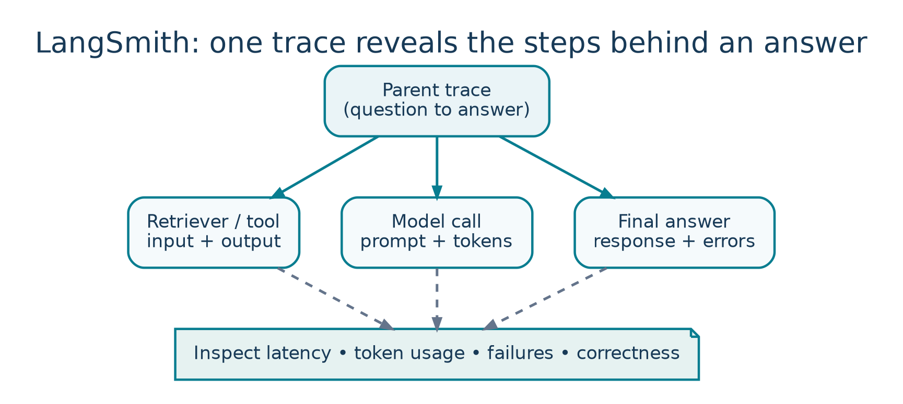

<!-- Concept illustrations are original, bundled with these notes in images/ -->

LESSON 03   /   PLAYLIST POSITION 16

# LangSmith Crash Course: Observability in GenAI

*CampusX • Agentic AI using LangGraph  |  Theory-focused study guide  |  ~2 hr 8 min*

Watch lesson: [Open original video on YouTube](https://www.youtube.com/watch?v=4FFspU4riHk&list=PLKnIA16_RmvYsvB8qkUQuJmJNuiCUJFPL)

> **ABOUT THESE NOTES**
>
> These are original, concept-first study notes organized around the video's published chapter list and cross-checked against current LangGraph/LangSmith documentation. They are not a verbatim transcript. Short illustrative examples are included; project-building walkthroughs are intentionally omitted.

## Learning goals

- Explain observability and why successful HTTP responses do not imply a good AI output.

- Read a LangSmith trace as a structured tree of steps and model/tool calls.

- Use traces to diagnose latency, token usage, wrong retrieval, and tool failures.

- Differentiate tracing, evaluation, and production monitoring.

## 1. Why GenAI needs observability



*Figure 3. A LangSmith trace lets you inspect child operations and their metrics.*

Traditional services are usually monitored using errors, request latency, and resource usage. GenAI adds new failure modes: a response may be fluent but wrong, an agent may choose an unnecessary tool, or a RAG pipeline may retrieve irrelevant documents despite returning HTTP 200. These failures require visibility into the steps that produced the answer.

LangSmith provides traces, testing/evaluation workflows, and monitoring to inspect LLM applications. It does not replace deliberate application design or guarantee factual correctness; it gives evidence for debugging and improvement.

### A motivating failure

Suppose a helpdesk assistant answers “Refunds are available after 90 days,” but company policy allows 30 days. You need to inspect whether the retriever pulled an outdated document, the prompt omitted the effective date, or the model ignored the retrieved content. The final response alone cannot answer this.

> **GOLDEN QUESTION**
>
> Not only “What answer did the model return?” but also “Which inputs, retrieved context, tool results, prompts, and decisions led to that answer?”

## 2. Core LangSmith terminology

| Concept | Meaning | Example |
| --- | --- | --- |
| Run / span | One executed operation with input, output, timing, and metadata. | Retriever search or model call. |
| Trace | The full execution tree connecting parent and child runs. | Entire RAG query lifecycle. |
| Project | A collection of traces / runs for an app or environment. | support-bot-staging. |
| Thread | Related conversation turns grouped for multi-turn inspection. | Chat with customer #123. |
| Dataset | Saved test cases and optional expected answers. | 50 policy questions. |
| Experiment | A model/prompt/app version evaluated on a dataset. | Prompt v2 vs v3. |

## 3. Anatomy of a trace

```text
User question
└─ RAG chain  [overall latency]
   ├─ Query rewrite  [prompt, model, tokens]
   ├─ Retriever      [query, document IDs, scores]
   ├─ Prompt assembly[context actually passed]
   └─ LLM answer     [model, output, tokens, cost]
```

A useful trace tells a coherent story from user input to final response. Individual runs should have clear names, appropriate tags, and enough metadata to compare failures, while avoiding unnecessary exposure of sensitive input.

### What to inspect when debugging

- Inputs: Was the user request or system prompt malformed?

- Intermediate results: Did the retriever return the correct version of a policy?

- Outputs: Which node first produced an incorrect claim?

- Timing: Did retrieval, tools, or model inference dominate latency?

- Errors/retries: Was a tool failure hidden or repeatedly retried?

- Tokens/cost: Did an overly large prompt make the request expensive?

## 4. Observability vs tracing vs evaluation

| Practice | Question answered | Typical artifact |
| --- | --- | --- |
| Tracing | What happened in this specific run? | Execution tree, run details. |
| Observability | How is the app behaving over time? | Traces + dashboards + alerts. |
| Evaluation | How good is this version on chosen criteria? | Dataset, evaluator, score, comparison. |
| Monitoring | Is production quality or cost degrading? | Trends, alerts, samples. |

A single trace is useful for root-cause analysis, but one passing example cannot validate an agent. Evaluation requires a representative collection of inputs with measurable quality criteria.

## 5. Capturing traces

For supported LangChain/LangGraph integrations, tracing can often be enabled by setting environment configuration and using normal model/chain calls. The current official setup uses the LANGSMITH_* names; older videos may use LANGCHAIN_TRACING_V2 and related legacy naming.

```text
# Example environment configuration (placeholders only)
LANGSMITH_TRACING=true
LANGSMITH_API_KEY=<your-own-langsmith-key>
# Depending on workspace/product configuration:
# LANGSMITH_PROJECT=<your-project-name>

# Never commit keys into notebooks or repositories.
```

Actual endpoint, project/agent ID, and workspace settings vary by LangSmith product/account configuration. Prefer environment variables or a secret manager over hard-coded secrets.

## 6. Tracing a RAG application

RAG failures are frequently failures of retrieval, prompt assembly, or grounding rather than model generation alone. Trace the query, returned document references, selected chunks, final assembled context, and generated answer. This lets you distinguish retrieval recall from answer faithfulness.

| Symptom | Trace investigation | Likely next change |
| --- | --- | --- |
| Correct answer not found | No relevant chunks returned. | Retrieval/indexing/filters. |
| Relevant chunks found, wrong answer | Inspect prompt and model response. | Prompt, citations, reranker, model. |
| Slow response | Inspect longest span. | Caching, batching, faster model. |
| Repeated web calls | Inspect agent/tool loop. | Tool routing/stop conditions. |

## 7. Testing and evaluation

Use a dataset of expected or representative questions, then execute a version of the application against all examples. This can catch regressions that a single demonstration misses. Evaluators may be deterministic (schema valid? required phrase present?) or model-based (faithfulness, helpfulness). Human review is still useful for high-stakes subjective tasks.

- Offline evaluation: run against curated cases before release; compare prompts, models, or retrieval pipelines.

- Online evaluation: sample production traces to detect errors and drift after release.

- Feedback loop: turn recurring production failures into new dataset examples.

- Important limits: LLM-as-judge scores are approximations and should be calibrated on human-reviewed cases.

## 8. Features worth learning after traces

- Feedback and annotation: attach human assessments to problematic outputs.

- Prompt experiments and comparisons: determine whether a revised prompt improves the whole dataset.

- Project dashboards: track latency, volume, errors, and quality indicators over time.

- Alerts and sampling: flag emerging failures while controlling observability cost.

- Multi-turn inspection: compare the behavior of the same thread across several user messages.

## 9. Data governance and responsible logging

LLM traces can contain prompts, personal information, retrieved context, and tool outputs. Do not enable broad logging without checking the data policy. Redact or avoid storing secrets, limit access by role, and choose suitable retention and sampling. The public tutorial description includes example credentials: never copy published keys into your own environment.

## Quick revision

| Term | Keep in mind |
| --- | --- |
| Trace | One end-to-end execution story. |
| Run | An individual step within the trace. |
| Project | Container for related trace data. |
| Dataset | Inputs you test repeatedly. |
| Experiment | Results from evaluating one app version. |
| Online monitoring | Quality/cost insights from live traffic. |

## Active-recall questions

Q. Why is “HTTP 200” insufficient to assess an agent?

A. The answer may be incorrect, ungrounded, or produced via a harmful/unnecessary path.

Q. Which trace spans matter for RAG?

A. Query, retrieval, context assembly, model generation, and external tool calls.

Q. What is a regression test for an LLM application?

A. Evaluate a new version against known cases and compare quality with a baseline.

Q. Can traces safely include raw API keys?

A. No. Redact sensitive values and use secret-management controls.

## Sources and further reading

Original video: [CampusX lesson](https://www.youtube.com/watch?v=4FFspU4riHk)

Playlist: [Agentic AI using LangGraph](https://www.youtube.com/playlist?list=PLKnIA16_RmvYsvB8qkUQuJmJNuiCUJFPL)

Official documentation 1: [docs.langchain.com/langsmith/observability](https://docs.langchain.com/langsmith/observability)

Official documentation 2: [docs.langchain.com/langsmith/evaluation-types](https://docs.langchain.com/langsmith/evaluation-types)

Reference status: Chapter titles/timestamps are sourced from the public video description. API discussion reflects official documentation consulted in October 2026. Library APIs can change; check current documentation before running code.

### Key video timestamps

[01:53 Why LangSmith?](https://www.youtube.com/watch?v=4FFspU4riHk&t=113s)   |   [22:15 Observability](https://www.youtube.com/watch?v=4FFspU4riHk&t=1335s)   |   [26:30 What LangSmith traces](https://www.youtube.com/watch?v=4FFspU4riHk&t=1590s)   |   [34:50 Core concepts](https://www.youtube.com/watch?v=4FFspU4riHk&t=2090s)   |   [54:17 Tracing a RAG app](https://www.youtube.com/watch?v=4FFspU4riHk&t=3257s)   |   [01:27:10 Testing a query](https://www.youtube.com/watch?v=4FFspU4riHk&t=5230s)   |   [01:33:55 LangGraph integration](https://www.youtube.com/watch?v=4FFspU4riHk&t=5635s)
