# LangSmith and Observability

**Agentic AI using LangGraph | Video 16 | CampusX**  
**Lesson:** [LangSmith Crash Course | LangSmith Tutorial for Beginners | Observability in GenAI | CampusX](https://www.youtube.com/watch?v=4FFspU4riHk)  

> **Core idea:** Traces show the operations behind an AI answer, while evaluation measures whether the application works reliably across many examples.

## 1. Learning goals

Understand traces and nested runs, diagnose RAG and agent failures, use evaluation datasets, and design safe observability practices.

### Video chapter links

| Time | Chapter |
| --- | --- |
| [00:00](https://www.youtube.com/watch?v=4FFspU4riHk&t=0s) | Intro |
| [01:53](https://www.youtube.com/watch?v=4FFspU4riHk&t=113s) | Why LangSmith? |
| [08:30](https://www.youtube.com/watch?v=4FFspU4riHk&t=510s) | Example 2 |
| [22:15](https://www.youtube.com/watch?v=4FFspU4riHk&t=1335s) | Observability |
| [26:30](https://www.youtube.com/watch?v=4FFspU4riHk&t=1590s) | What does LangSmith Trace? |
| [29:00](https://www.youtube.com/watch?v=4FFspU4riHk&t=1740s) | Setting up Agenda |
| [33:10](https://www.youtube.com/watch?v=4FFspU4riHk&t=1990s) | Code Demo |
| [34:50](https://www.youtube.com/watch?v=4FFspU4riHk&t=2090s) | Core Concepts |
| [38:00](https://www.youtube.com/watch?v=4FFspU4riHk&t=2280s) | Code Demo |
| [54:17](https://www.youtube.com/watch?v=4FFspU4riHk&t=3257s) | Tracing RAG App |
| [01:27:10](https://www.youtube.com/watch?v=4FFspU4riHk&t=5230s) | Testing Query |
| [01:33:55](https://www.youtube.com/watch?v=4FFspU4riHk&t=5635s) | LangGraph + LangSmith Integration |
| [01:47:24](https://www.youtube.com/watch?v=4FFspU4riHk&t=6444s) | Features of LangSmith |

**Prerequisites:** Basic Python functions and dictionaries; familiarity with nodes, edges, and shared state is helpful. Terms used in this lesson are explained as they appear.

---

## 2. Understanding observability in AI applications

**Observability** is the ability to understand what an application is doing internally by examining useful information it produces while running. In a traditional application, developers inspect logs, timings, metrics, and errors. In a generative-AI application, we also need to understand **which prompt was sent, which context was retrieved, which model or tool ran, and why the final answer came out the way it did**.

Imagine a student-job matching assistant. A learner enters skills and a target job role; the system searches vacancies, compares requirements, ranks suitable openings, and writes recommendations. If the final recommendations are poor, merely seeing the final answer is not enough. We need to know whether the search returned unsuitable jobs, the ranking logic was wrong, or the language model ignored the available evidence.

<p align="center">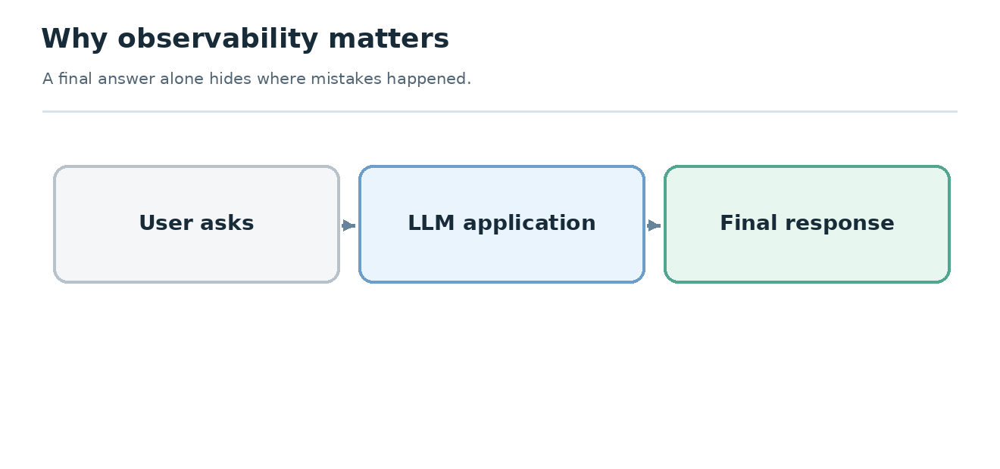</p>

This is the **black-box problem**: a complex series of internal operations gets reduced to one visible result. Good observability makes the intermediate steps visible so we can locate problems instead of guessing.

### Why GenAI applications are difficult to debug

LLM outputs are not always identical for the same input. Applications can also combine retrieval, tool calls, conditional routing, and several models. Failures may involve missing context, malformed output, unexpected tool behavior, long latency, or model uncertainty. Observability does **not** guarantee correct answers. It makes the evidence behind success and failure easier to inspect.

### Observability and monitoring are related, but different

**Monitoring** alerts you when something appears wrong, such as rising latency or failure rates. **Observability** helps you investigate *why* it happened. Metrics can tell you that responses became slower; an individual trace can show that a search tool took most of the time.

## 3. LangSmith: tracing and understanding an LLM application

**LangSmith** is a platform for inspecting, testing, evaluating, and monitoring LLM applications and agents. One of its central capabilities is **tracing**: keeping a structured record of an application run and its internal steps.

A trace is useful during development, debugging, and production analysis. LangSmith can work with LangChain and LangGraph, and it also supports a broader set of tools and integrations. You do not need to make LangSmith the engine that executes your graph; its role here is to **observe and evaluate the work your application performs**.

### What is a trace?

A **trace** records the execution of one overall operation, such as answering a user question. Inside that trace, there can be smaller **runs** or operations, such as building a prompt, calling a model, retrieving documents, and parsing the result. The parent–child relationships form a tree that explains how the answer was produced.

<p align="center">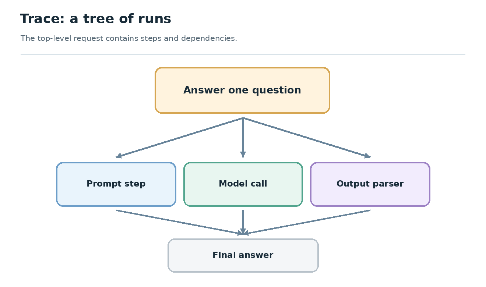</p>

**Follow the diagram:** The parent request asks for an answer. Beneath it, a prompt step prepares input, a model step generates output, and a parser or validation step interprets it. The trace records the relationship between those steps. If the parser fails, you can investigate the model output that it received.

A single trace may contain many child runs. The words **trace** and **run** are related but not interchangeable: a trace is the overall connected execution record, while a run represents one measured operation in that execution.

## 4. What information can a trace show?

A useful trace may contain inputs, outputs, timings, errors, token usage, model metadata, and the structure of nested operations. The exact fields available depend on the integration and what you choose to record.

<p align="center">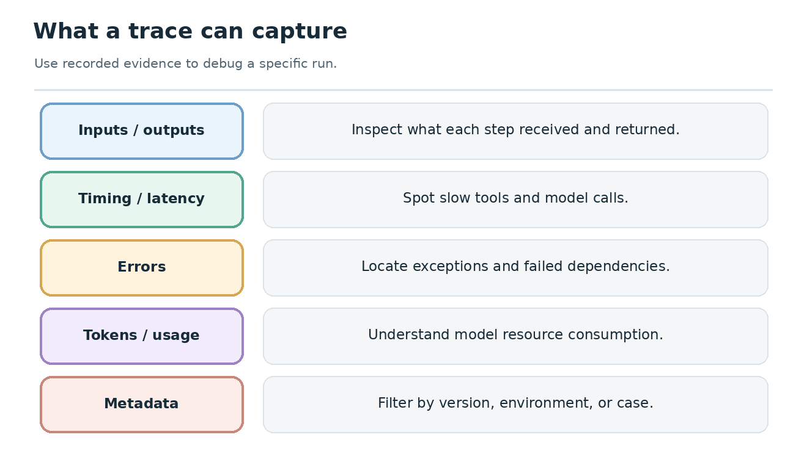</p>

Consider a support bot that gives an incorrect refund policy. First check its final answer. Next inspect the context supplied to the model. If the policy retrieved was old, the problem is likely in retrieval or document freshness. If the correct policy was present but the answer contradicted it, focus on prompt design, model behavior, and output validation. This is **evidence-based debugging**.

### Latency is not one number

Suppose a response takes eight seconds. A breakdown might show 0.2 seconds for input validation, 5 seconds for a retrieval service, 2.5 seconds for the model, and 0.3 seconds for formatting. Optimizing the final formatting step would make little difference. Observability helps developers spend effort on the real bottleneck.

<p align="center">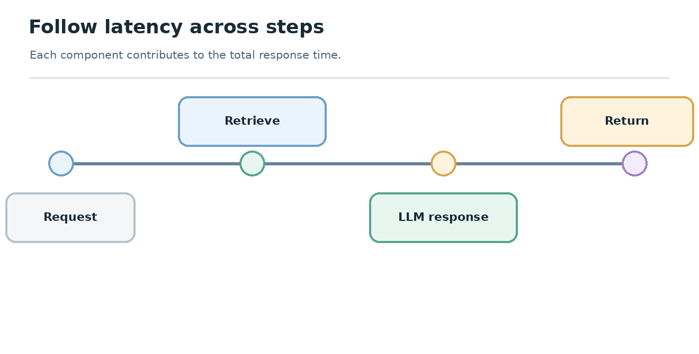</p>

Timing measurements are useful, but do not confuse one example run with a performance guarantee. Compare multiple runs, normal and failure cases, and different request sizes before making conclusions.

## 5. Projects, traces, and runs

A **project** is an organizing space where related traces can be collected, such as a customer-support agent or a document-question-answering service. Within a project, traces represent individual requests, and runs describe their internal operations.

<p align="center">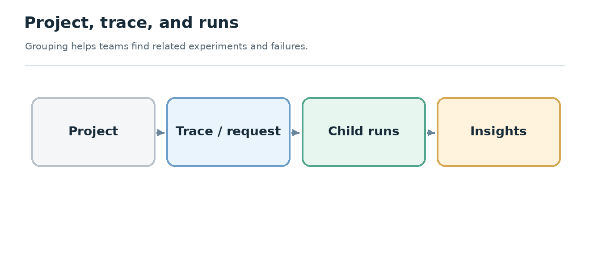</p>

For a research assistant, one trace might correspond to “Explain recent solar-energy technology.” Child operations might include searching academic sources, retrieving useful papers, writing a summary, and checking whether the answer is supported. Keeping these steps connected makes it easier to compare a successful answer with a failed one.

### Example: research assistant

A research assistant may search academic papers when asked about a scientific topic. If the final answer is unreliable, observability can show whether it found irrelevant sources, retrieved incomplete text, or produced a conclusion that the sources did not support. The underlying problem is not always “the LLM is bad.” It might be a specific source-selection or tool step.

## 6. Worked example: tracing a RAG pipeline

**Retrieval-Augmented Generation (RAG)** is a pattern in which an application retrieves relevant information and provides it as context to a language model. A typical pipeline is `question → retrieve relevant chunks → build prompt → model answer`.

<p align="center">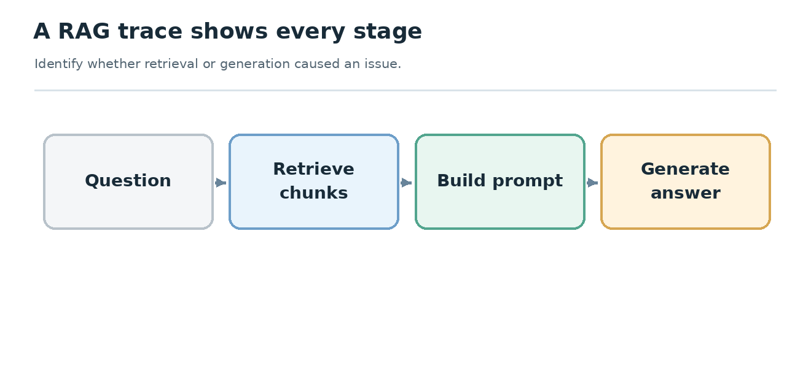</p>

Imagine asking a policy assistant, “How many annual leave days are available?” A document retriever supplies matching policy paragraphs. The LLM then produces an answer from those paragraphs. A trace makes both the retrieved evidence and the answer available for inspection.

### Diagnose an incorrect answer step by step

<p align="center">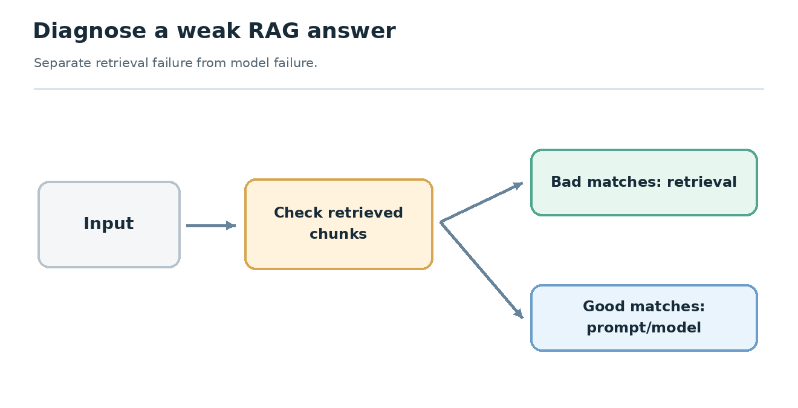</p>

1. **Inspect the user question.** Was it interpreted correctly?
2. **Inspect the retrieved chunks.** Did they contain the relevant leave-policy section?
3. **Inspect the prompt.** Were the chunks actually passed to the model?
4. **Inspect the output.** Did the answer match the supplied evidence?
5. **Record the finding.** Was the fault in retrieval, model behavior, or validation?

This separation prevents random changes to prompts when the actual problem is missing or outdated documents.

### Another example: a multi-step job assistant

A graduate asks for suitable data-science jobs. The system searches listings, filters by location, compares required skills, and drafts recommendations. A trace can reveal which listings were considered, which rules removed jobs, and which inputs influenced ranking. Any personal information or job-search details placed in traces must be handled carefully.

## 7. Enabling tracing safely

LangSmith tracing can be enabled through supported integrations or the LangSmith SDK. A typical setup uses environment variables, a project name, and an API key obtained from the user's own LangSmith account. **Never paste a real API key into shared notes, screenshots, or source code.**

```bash
# Illustrative shell setup; use a secret manager or local environment.
export LANGSMITH_TRACING=true
export LANGSMITH_API_KEY="YOUR_OWN_LANGSMITH_KEY"
export LANGSMITH_PROJECT="study-notes-demo"
```

An example of explicitly tracing an ordinary Python function is:

```python
# pip install langsmith
from langsmith import traceable

@traceable(name="recommend-topic")
def recommend_topic(topic: str) -> dict:
    return {"topic": topic, "suggestion": "Start with three key ideas."}

print(recommend_topic("solar energy"))
```

This snippet illustrates the shape of an instrumented function. Real traces require the SDK to be installed and tracing to be configured. A successful run may include the function's input, output, and duration; the exact fields visible depend on your SDK version and tracing settings.

**Privacy principle:** Do not trace passwords, payment tokens, API secrets, or private document content without appropriate controls. Limit access, configure retention, and redact sensitive fields where necessary.

## 8. Tracing LangChain and LangGraph workflows

A LangChain chain or a LangGraph application can contain model calls, ordinary Python functions, retrieval steps, and tools. Tracing should tell a coherent story across these components rather than producing unrelated log messages.

<p align="center">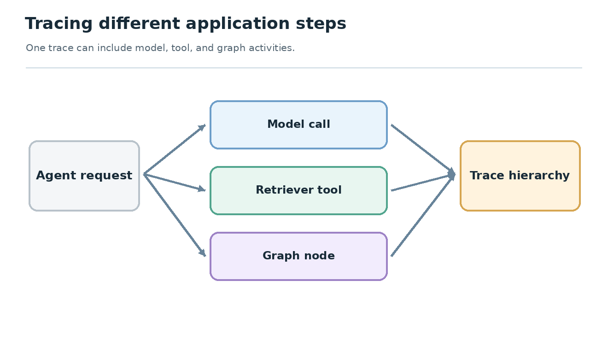</p>

A graph may have a router node, tool node, and answer node. If the response is wrong, the trace can show whether the router chose an incorrect branch, the tool returned unexpected information, or the answer node misused a correct tool result.

**Tracing is not checkpointing.** Tracing records what happened so developers can inspect the execution. Checkpointing saves graph state for continuation and recovery. Many applications use both, but one does not replace the other.

## 9. Testing a query and evaluating results

A trace helps explain **one run**. Evaluation asks whether a system works well **across many examples**. For reliable improvement, create a test dataset with representative questions, expected behavior, and, where possible, reference answers or evaluation criteria.

<p align="center">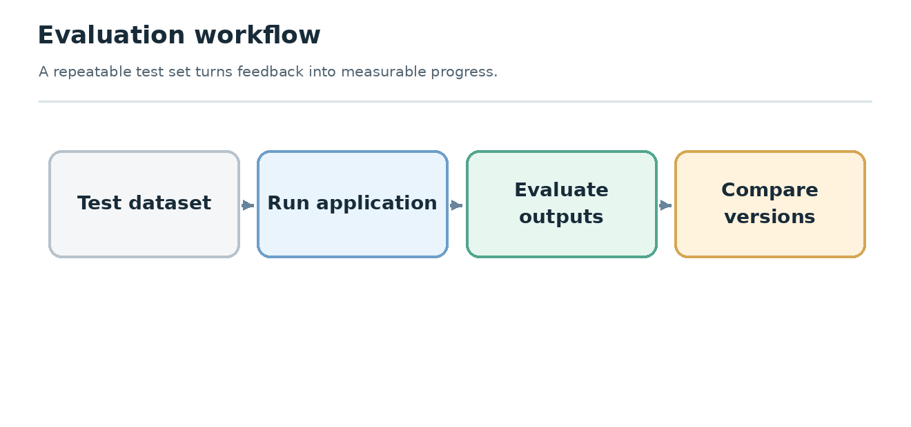</p>

For a support assistant, a dataset may include refund questions, password-reset questions, vague messages, and deliberately difficult cases. Run the application over these inputs, score the responses, and compare results before and after a change.

### Three useful evaluation methods

- **Rule-based checks:** Does the result contain a required field or valid JSON? These are fast and deterministic.
- **Human review:** Does an answer actually solve the user's problem? Human judgment is useful where nuance matters.
- **LLM-as-a-judge:** Another model evaluates an answer using an explicit rubric. This scales certain reviews but can also make mistakes, so calibrate it against human examples.

### Offline and online evaluation

<p align="center">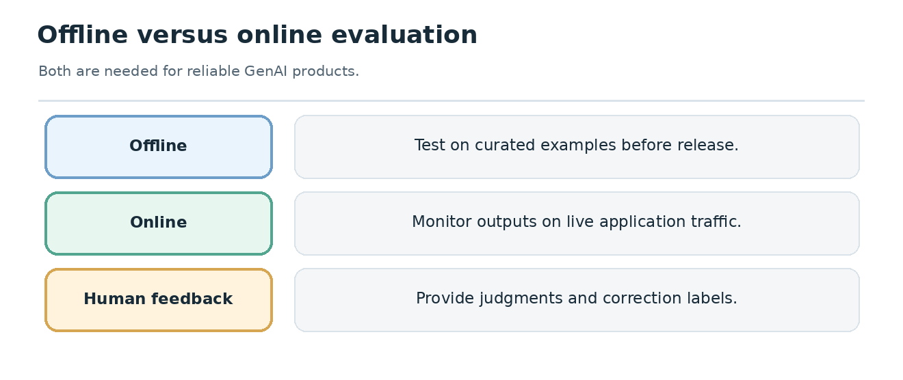</p>

**Offline evaluation** runs on curated test examples, usually before a release or after changing prompts, models, or retrieval logic. **Online evaluation** examines production outputs, typically to detect quality problems or unusual behavior. Both are valuable: offline tests are controlled, while online monitoring reveals real-world requests you may not have predicted.

## 10. From debugging to measurable improvement

<p align="center">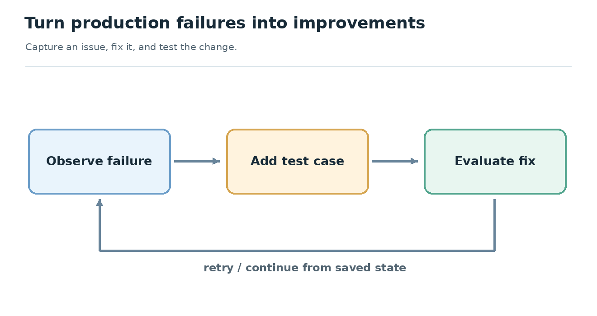</p>

Suppose the bot claims a refund is instant when the policy says it takes several days. Observe the trace, find the cause, create a test case for that exact question, correct the retrieval or answer logic, and rerun the evaluation. A fix is more trustworthy when it resolves the failure without creating new regressions.

A useful workflow is **observe → diagnose → add a test → change the system → evaluate again**. This is the engineering value of observability: instead of saying “the model sometimes behaves strangely,” the team can identify a reproducible failure mode and measure whether it improved.

## 11. Monitoring useful metrics

<p align="center">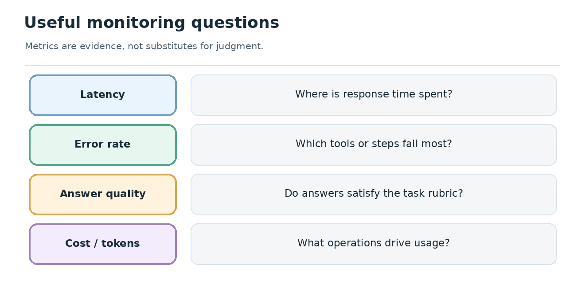</p>

Track measures such as response latency, first-token delay, tool error rate, token usage, and the share of answers meeting a quality rubric. Segment them by application version, request type, model, or tool when possible. A single average can hide slow or problematic edge cases, so inspect distributions and examples as well.

### Observability has limits

A trace may show the prompt, tool output, and final answer, but it does not expose the model's hidden internal reasoning. It also cannot prove that an answer is factually correct without appropriate external checks. And tracing has operational costs: data storage, instrumentation, retention, and sometimes service charges. Choose what to record based on real diagnostic value.

## 12. Security and privacy in tracing

<p align="center">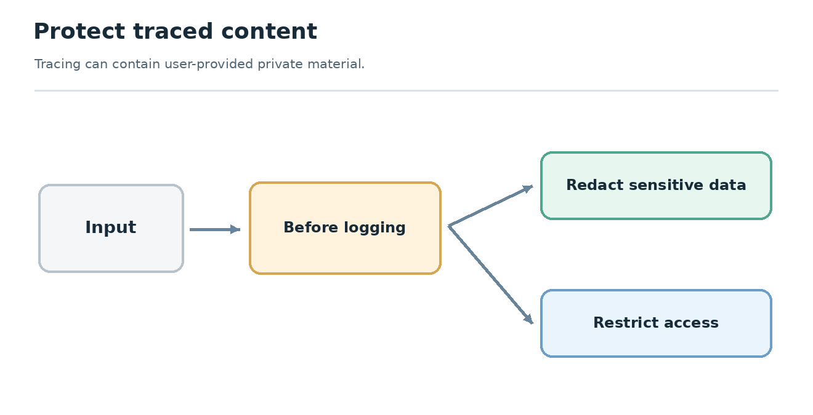</p>

GenAI traces may contain uploaded documents, customer messages, model responses, or tool arguments. Before enabling broad tracing in production, decide which fields are necessary, who can view them, and how long they should remain stored. Use redaction and access controls, and never make credentials part of trace content. Observability should help developers without exposing users' information unnecessarily.

### Compare two traces for the same question

A learner asks a RAG assistant, “What are the prerequisites for this course?” Version A gives an incorrect answer. Version B is configured with a better document retriever and gives the correct prerequisites. Rather than comparing only the final sentences, inspect the two traces.

| Stage | Trace A | Trace B | What the difference suggests |
| --- | --- | --- | --- |
| Retrieval | Unrelated course description | Relevant prerequisite section | Retriever configuration improved |
| Prompt context | Missing prerequisites | Includes prerequisite section | Better evidence was passed onward |
| Model output | Unsupported claim | Answer grounded in the section | Model was able to use relevant context |
| Evaluation | Incorrect | Correct | The improvement should be recorded as a regression test |

This shows why tracing and evaluation work best together. The trace explains **what changed**, while the evaluation tells you **whether the change was beneficial across representative cases**. A single example does not establish that a new retriever is universally better.

### A trace is evidence, not hidden reasoning

A trace can show that the model received a question and certain documents, then returned a particular sentence. It cannot directly reveal every internal computation that caused the model to choose those words. Engineers should avoid claiming to inspect the model's private thought process. Instead, study observable inputs, outputs, tool activities, declared settings, and test outcomes.

### What belongs in a good evaluation dataset?

Start with common questions, then add edge cases that are likely to break the application: ambiguous requests, questions with no supporting evidence, contradictory documents, very long input, and tool timeouts. Include expected behavior such as “answer with citations,” “ask for clarification,” or “state that the information is unavailable.” Not every evaluation needs an exact reference sentence; some need a rubric or deterministic safety rule.

For changes to prompts or retrievers, compare against the **same** dataset before deployment. Use separate categories for accuracy, faithfulness to sources, completeness, and response format. A polished but unsupported answer should not receive a high score merely for sounding confident.


## 13. Common mistakes and best practices

- **Looking only at final output:** always inspect intermediate retrieval and tool steps when debugging.
- **Treating a single trace as a benchmark:** evaluate across varied questions and representative datasets.
- **Changing prompts before locating the failing component:** use evidence to identify the actual stage.
- **Confusing tracing with persistence:** traces explain execution; checkpoints resume graph state.
- **Collecting everything without a privacy policy:** logging may retain sensitive data.
- **Optimizing the wrong stage:** use timing breakdowns to locate bottlenecks.
- **Ignoring evaluation quality:** an untested judge can reward polished but incorrect answers.

## 14. Key takeaways

1. Observability explains what an AI application did and why a particular run might have failed.
2. LangSmith records traces containing connected runs and their inputs, outputs, timings, and errors.
3. Traces help localize failures to retrieval, prompting, tools, model calls, or output processing.
4. Evaluation measures behavior across many test cases, not just one trace.
5. Offline tests and online monitoring complement each other.
6. Tracing and LangGraph checkpointing solve different problems.
7. Privacy, credentials, and retention must be considered when recording traces.

## 15. Revision checklist

- [ ] I can explain observability and the black-box problem.
- [ ] I can distinguish monitoring, tracing, and evaluation.
- [ ] I can describe parent traces and child runs.
- [ ] I can explain what a LangSmith project organizes.
- [ ] I can diagnose retrieval errors versus generation errors in RAG.
- [ ] I understand why latency needs a step-by-step breakdown.
- [ ] I can describe how SDK tracing is configured without revealing credentials.
- [ ] I can contrast tracing with checkpointing.
- [ ] I can design a small offline evaluation dataset.
- [ ] I understand code, human, and LLM-judge evaluation methods.
- [ ] I can list privacy safeguards for traced data.

## 16. Practice questions and exercises

1. A research assistant returns a misleading answer. Which trace fields would you inspect to determine whether retrieval or generation caused it?
2. Sketch a trace tree for `question → classify → search → summarize` and identify the parent and child operations.
3. Design five test questions for a helpdesk assistant, including an ambiguous and an out-of-scope case.
4. Suppose retrieval takes five seconds and the model takes one second. Which operation would you investigate first to improve latency, and why?
5. Compare a deterministic JSON-format evaluator with an LLM judge for answer helpfulness.
6. Explain why raw API keys must never appear in demonstration code or traces.
7. Describe how a production failure can become an offline regression test.

## 17. Interview questions and short answers

**What is observability in GenAI?** The ability to inspect an application's execution, including prompts, model calls, retrieval, tools, errors, and performance, to understand its behavior.

**What is LangSmith?** A platform for tracing, debugging, evaluating, and monitoring LLM applications and agents.

**What is a trace?** A connected record of one operation, often containing nested runs for its internal steps.

**How do you debug a bad RAG answer?** Inspect retrieved documents, the assembled prompt, model output, and any validation step to identify where the answer became incorrect.

**Tracing versus checkpointing?** Tracing explains what happened; checkpointing saves execution state so a graph can resume or revisit it.

**What is offline evaluation?** Testing against a curated dataset before or during development to measure behavior and regressions.

**How do you use LangSmith safely?** Protect credentials, minimize logged private content, control access, and configure appropriate retention.

## 18. Further reading

- [LangSmith Observability overview](https://docs.langchain.com/langsmith/observability)
- [LangSmith evaluation types](https://docs.langchain.com/langsmith/evaluation-types)
- [LangGraph persistence overview](https://docs.langchain.com/oss/python/langgraph/persistence)
- [LangGraph workflows and agents](https://docs.langchain.com/oss/python/langgraph/workflows-agents)
