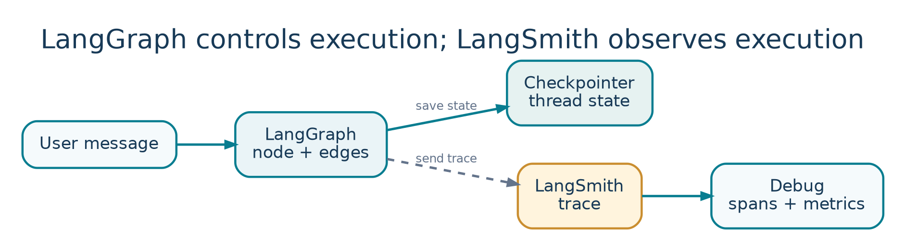

<!-- Concept illustrations are original, bundled with these notes in images/ -->

LESSON 04   /   PLAYLIST POSITION 17

# Observability in LangGraph: LangSmith Integration

*CampusX • Agentic AI using LangGraph  |  Theory-focused study guide  |  ~22 min*

Watch lesson: [Open original video on YouTube](https://www.youtube.com/watch?v=ikzN6byFNWw&list=PLKnIA16_RmvYsvB8qkUQuJmJNuiCUJFPL)

> **ABOUT THESE NOTES**
>
> These are original, concept-first study notes organized around the video's published chapter list and cross-checked against current LangGraph/LangSmith documentation. They are not a verbatim transcript. Short illustrative examples are included; project-building walkthroughs are intentionally omitted.

## Learning goals

- Connect the LangGraph execution model to LangSmith tracing.

- Understand the relationship between a LangGraph thread and a LangSmith trace.

- Know the minimum configuration and how to inspect the first recorded conversation.

- Use trace evidence to diagnose graph behavior without exposing sensitive state.

## 1. Two complementary systems



*Figure 4. Graph persistence and tracing answer different questions.*

| LangGraph | LangSmith |
| --- | --- |
| Controls graph nodes, edges, state, checkpointers, and resumption. | Records and analyzes what executed, including latency, inputs, outputs, and errors. |
| A thread identifies a persisted conversation/execution history. | Traces show individual executions and can group related conversation turns. |
| Answers: “What should run next?” | Answers: “What happened, why, and how well?” |

Use LangGraph for orchestration and persistence; use LangSmith to see and evaluate the behavior. They can work together, but LangSmith tracing is not a substitute for a checkpointer. Turning on tracing will not automatically give an otherwise stateless graph conversational memory.

## 2. Why an agent trace is more informative

A simple chatbot may make one model call. A LangGraph assistant can invoke a model, route to a tool, receive a tool result, call the model again, and save state. The trace lets you inspect the tool loop and identify which operation created a wrong answer or latency spike.

```text
LangGraph graph execution:
START → agent → tools → agent → END
                ↑         │
                └─────────┘  (if more tools are needed)

LangSmith view:
Parent trace → model call → tool run → model call
```

## 3. Setup: API key and tracing

Create or access a LangSmith workspace, generate your own API key, and supply tracing configuration securely. The video introduces the API-key setup, then demonstrates logging the first thread. Use the current names in official documentation where your installed version supports them.

```python
# Environment variables: illustrative placeholders
export LANGSMITH_TRACING=true
export LANGSMITH_API_KEY="<YOUR_OWN_KEY>"
# Optional, depending on your LangSmith workspace setup:
export LANGSMITH_PROJECT="langgraph-learning"

# Application calls can then be traced normally.
```

- Ensure your code runs in an environment that has permission to send traces.

- Do not paste API keys into screenshots, public notebooks, or shared GitHub repositories.

- Use descriptive project or agent names to distinguish development, staging, and production.

- If traces are not appearing, verify that the integration, environment variables, endpoint/region, and credentials match.

## 4. What happens when you invoke a graph?

A traced LangGraph invocation can create a parent trace with children for model calls, tool executions, and graph operations. When persistence is configured, the same logical conversation can accumulate checkpoints across turns using its thread ID. Tracing records what happened within these executions for analysis.

```python
config = {"configurable": {"thread_id": "conversation-001"}}

# Graph already compiled elsewhere; tracing is configured.
first = app.invoke(first_input, config=config)
second = app.invoke(second_input, config=config)

# Reusing thread_id supports thread-scoped continuity
# only if a suitable checkpointer is configured.
```

> **AVOID A COMMON CONFUSION**
>
> The same thread_id groups persisted LangGraph state. A LangSmith trace documents an execution. A conversation can have multiple turns and traces; persistence and tracing solve different problems.

## 5. Inspect your first thread in LangSmith

- Open the relevant project or agent workspace and select a recent trace.

- Look at the top-level input/output: was the observed result the one expected?

- Expand child spans to see model prompts, tool calls, arguments, outputs, and errors.

- Inspect duration and usage to locate expensive or slow steps.

- Filter or group related turns to understand conversation continuity.

### Example: a misleading answer

A user asks “What is 17% of 250?” The graph routes to a calculator tool, but the answer shown is 17.5. A trace may reveal that the agent passed 17 rather than 0.17 to the tool, or ignored a correct tool result. Fixing a routing/prompt issue is more effective than merely retrying the model.

## 6. Trace metadata and operational hygiene

Useful trace metadata can include app version, model name, environment, latency, and test scenario. Tags such as “billing”, “RAG”, or “tool-calling” make later comparisons easier. Avoid high-cardinality or sensitive metadata without a concrete use case.

| Signal | Question it answers |
| --- | --- |
| Node/model latency | Where does time go? |
| Tool arguments and results | Was the external action called correctly? |
| Errors/retries | Which dependency failed and how often? |
| Token use and cost | Which prompt or model drives cost? |
| Thread history | Did previous context affect the current turn? |

## 7. Three important debugging exercises

- Tool selection: run a question that should trigger exactly one tool; inspect whether extra tool calls were made.

- Memory: send a follow-up under the same thread ID; verify the earlier context is represented correctly.

- Failure: simulate a recoverable tool error, then check whether the trace makes the retry and final outcome understandable.

## 8. Production cautions

- Do not treat a trace as an authorization log for side effects; keep audit controls in your app where necessary.

- Apply sampling/retention where volume and privacy requirements demand it.

- Verify compliance and data handling before logging raw customer prompts or documents.

- Keep official documentation handy: environment variables and platform configuration evolve.

## Quick revision

| Statement | Correct? |
| --- | --- |
| LangSmith tracing provides LangGraph persistence. | No: a checkpointer provides thread persistence. |
| LangSmith can reveal model/tool execution structure. | Yes: that is a key observability benefit. |
| A graph thread may span multiple turns. | Yes: reuse a thread_id with persistence. |
| Publicly pasted API keys are safe for tutorials. | No: always generate private keys and rotate exposures. |

## Active-recall questions

Q. What is the first thing to inspect when a trace looks wrong?

A. The top-level input/output, then the relevant child spans.

Q. Why reuse a thread ID?

A. To connect invocations to the same persisted conversation state when a checkpointer exists.

Q. How is a LangSmith project useful?

A. It organizes related traces for an app or environment.

Q. Which system should enforce approval before issuing refunds?

A. Application / LangGraph workflow logic, not tracing itself.

## Sources and further reading

Original video: [CampusX lesson](https://www.youtube.com/watch?v=ikzN6byFNWw)

Playlist: [Agentic AI using LangGraph](https://www.youtube.com/playlist?list=PLKnIA16_RmvYsvB8qkUQuJmJNuiCUJFPL)

Official documentation 1: [docs.langchain.com/langsmith/trace-with-langgraph](https://docs.langchain.com/langsmith/trace-with-langgraph)

Official documentation 2: [docs.langchain.com/langsmith/observability](https://docs.langchain.com/langsmith/observability)

Reference status: Chapter titles/timestamps are sourced from the public video description. API discussion reflects official documentation consulted in October 2026. Library APIs can change; check current documentation before running code.

### Key video timestamps

[03:25 Getting an API key](https://www.youtube.com/watch?v=ikzN6byFNWw&t=205s)   |   [13:00 Logging the first thread](https://www.youtube.com/watch?v=ikzN6byFNWw&t=780s)
