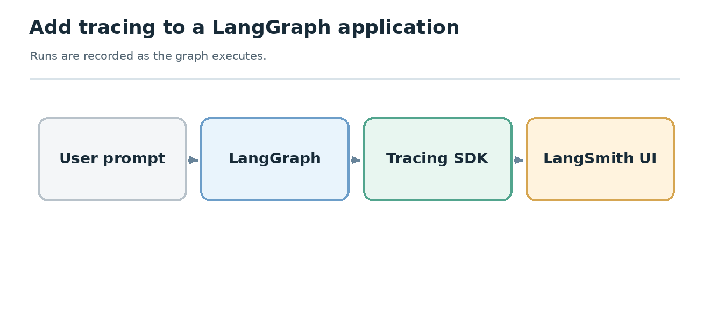
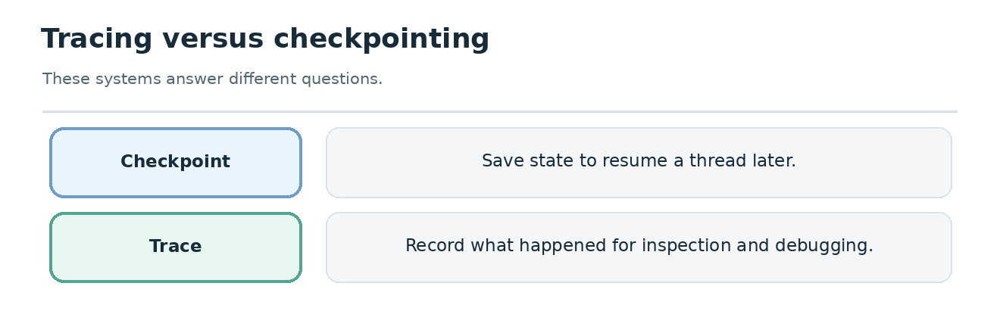
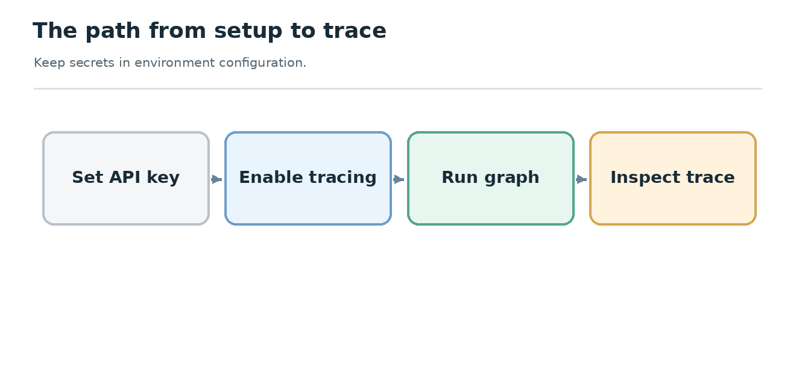
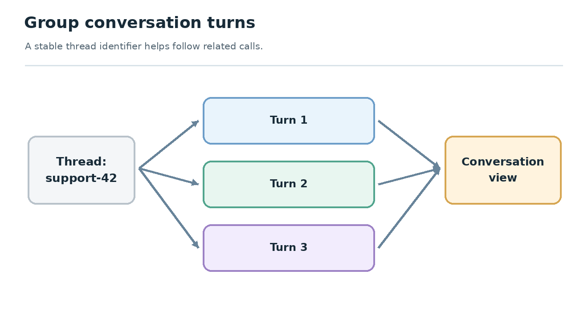
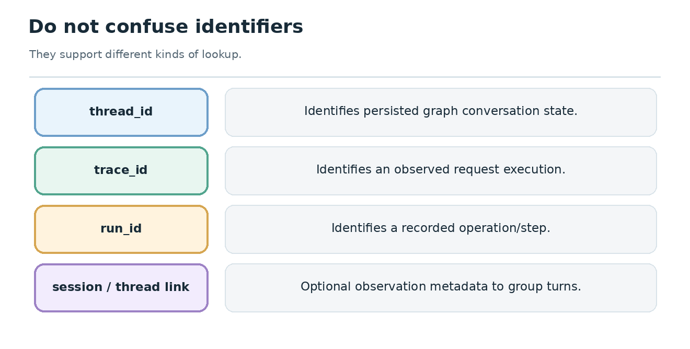
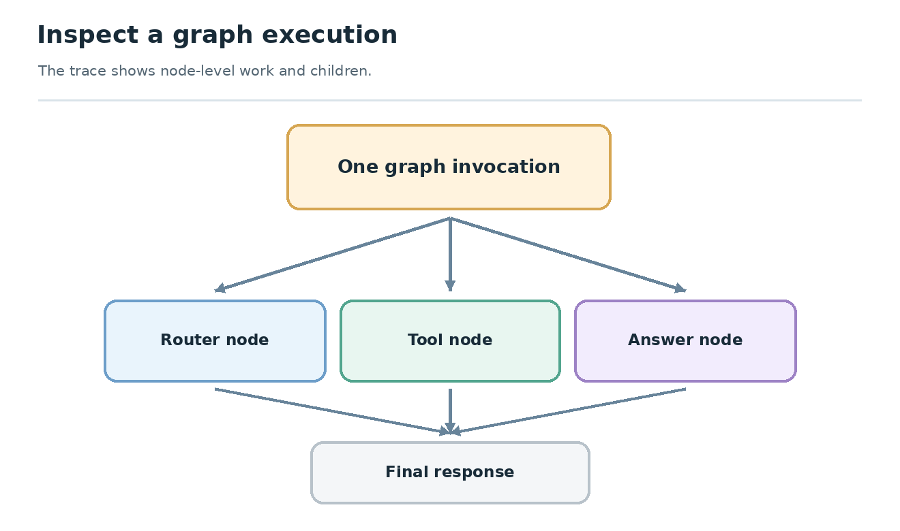
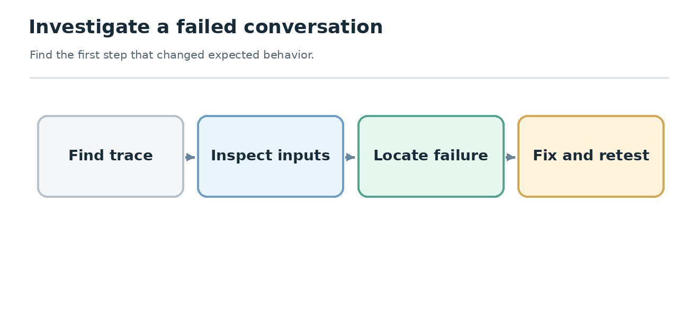
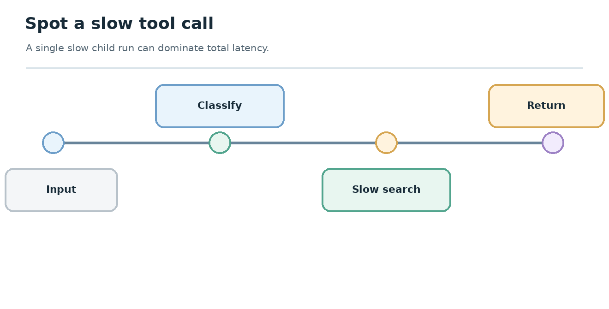
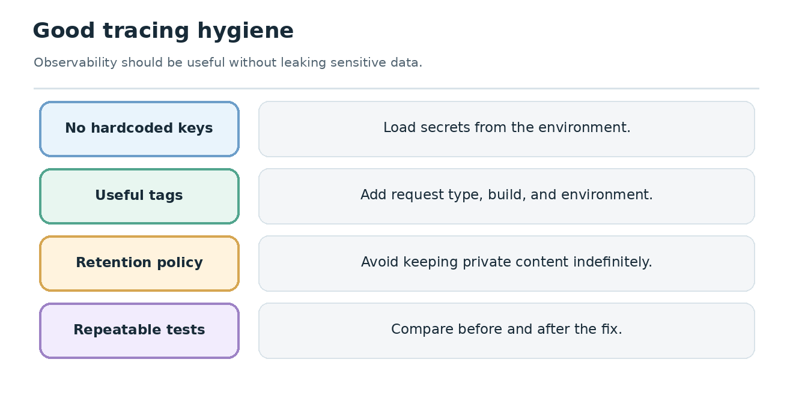
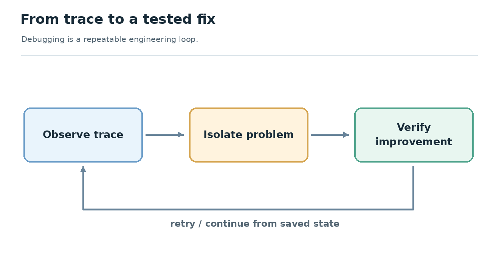

# Observability Integration with LangGraph

**Agentic AI using LangGraph | Video 17 | CampusX**  
**Lesson:** [Observability in LangGraph | LangSmith Integration with LangGraph](https://www.youtube.com/watch?v=ikzN6byFNWw)  

> **Core idea:** LangGraph runs the workflow; LangSmith records traces so developers can inspect nodes, tool calls, timing, and failures.

## 1. Learning goals

Set up a tracing mental model for LangGraph, distinguish persistence from tracing, connect conversation turns, and debug a failing run.

### Video chapter links

| Time | Chapter |
| --- | --- |
| [00:00](https://www.youtube.com/watch?v=ikzN6byFNWw&t=0s) | Intro |
| [00:10](https://www.youtube.com/watch?v=ikzN6byFNWw&t=10s) | Recap |
| [03:25](https://www.youtube.com/watch?v=ikzN6byFNWw&t=205s) | Getting API Key |
| [13:00](https://www.youtube.com/watch?v=ikzN6byFNWw&t=780s) | Logging your first Thread |

**Prerequisites:** Basic Python functions and dictionaries; familiarity with nodes, edges, and shared state is helpful. Terms used in this lesson are explained as they appear.

---

## 2. Observing a LangGraph application as it runs

A LangGraph application often contains several steps: understand the user question, choose a route, call a tool, and prepare the final response. **Observability** helps us inspect those steps while the application runs. Instead of seeing only the last answer, we can look at a record of the graph execution and understand how the response was produced.

LangSmith is a practical way to collect and inspect these records. A small chatbot may work perfectly during a demo, but once users send unexpected requests, the team needs to know where an answer became incorrect or why a particular response took too long.

<p align="center"></p>

The application executes in LangGraph. Tracing records information about the execution and sends it to LangSmith when configured. The observability interface lets us inspect connected steps, input and output values, timing, and failures. **Tracing does not decide which graph nodes execute**; LangGraph still controls the workflow.

### Example: a research chatbot

A user asks for the latest research on batteries. The chatbot may classify the question, search a source, summarize results, and return an answer. If the answer refers to outdated information, a trace can show whether the search step retrieved older documents or the summary step misrepresented recent evidence.

## 3. Tracing is different from persistence

This is one of the most important distinctions in a stateful chatbot. **Persistence** saves the state of a conversation so the assistant can remember earlier exchanges and resume later. **Tracing** records execution details so developers can inspect what happened.

<p align="center"></p>

| Question | Best mechanism |
| --- | --- |
| What did the user say in the previous turn? | Saved conversation state / checkpoint |
| What node handled this request? | Execution trace |
| Why did the model answer incorrectly? | Trace inputs, tool results, and outputs |
| Where should the graph resume after an interrupt? | Checkpointer and thread state |
| Which step is slow? | Trace timings and performance metrics |

A production application may use both mechanisms. A checkpointer is not automatically a complete debugging trace, and tracing does not automatically provide saved state for resuming a paused graph.

## 4. Connecting an application to LangSmith

Before tracing can appear in LangSmith, the application needs appropriate SDK or framework integration, a project or destination, and valid credentials. Configuration is generally supplied through environment variables or a secure secret manager, not through hardcoded strings in source code.

<p align="center"></p>

```bash
# Linux/macOS demonstration using placeholders only
export LANGSMITH_TRACING=true
export LANGSMITH_API_KEY="YOUR_OWN_LANGSMITH_KEY"
export LANGSMITH_PROJECT="langgraph-observability-demo"
```

In a real service, store secrets securely and make sure private data is not copied into a public repository. The particular SDK, deployment environment, and tracing integration determine whether further configuration is needed.

### What happens after configuration?

1. A user sends a question to the application.
2. The compiled LangGraph graph runs its nodes.
3. The tracing integration records connected operations.
4. LangSmith groups them under the configured project.
5. A developer selects a trace and inspects its steps.

Configuration alone is not a substitute for testing. Send a harmless known question, verify that one trace appears, and confirm the recorded run actually corresponds to that test.

## 5. Conversation threads and correlated traces

A chatbot can have many separate conversations. When a learner opens a previous conversation, the application typically reuses its saved LangGraph `thread_id`. From an observability perspective, it is helpful to associate the traces of successive turns so they can be examined together as one conversation.

<p align="center"></p>

Imagine three questions in one helpdesk conversation: “My login fails,” then “I tried resetting the password,” then “What should I do next?” The application might run the graph three times. Those are separate executions, but they belong to one conversational context and should be easy to find together when investigating the incident.

**Do not confuse the identifiers:**

<p align="center"></p>

- A **LangGraph thread ID** identifies the persisted conversation state.
- A **trace ID** identifies a traced execution.
- A **run ID** identifies a particular recorded operation within an execution.
- A **LangSmith thread/session association** can group related turns for viewing, depending on the integration and metadata used.

The IDs play different roles. A single persisted conversation may produce multiple traced requests. How thread grouping appears in LangSmith depends on the instrumentation and tracing API, so verify it with a real two-turn test instead of assuming automatic grouping.

## 6. Reading a graph trace

<p align="center"></p>

Suppose the graph has three nodes: `classify`, `search`, and `answer`. The parent trace represents the user's request. Under it, the classification step chooses the category; the search step looks for information; the answer step prepares the response. A trace makes the relationships visible and shows data passed into or returned by each step when recorded.

### Debug a wrong answer

A user asks, “What is the status of my support ticket?” The final answer talks about billing. Start at the trace and inspect the classification result. If the router mislabeled the request, fix classification. If the label was correct but the wrong handler executed, investigate graph control flow. If the correct handler ran but used stale data, investigate the tool integration.

<p align="center"></p>

**Debugging sequence:** locate a failed trace → identify the first unexpected output → inspect its input and dependencies → reproduce the failure → change one component → rerun the same test. This is faster and more reliable than adjusting prompts at random.

### Follow the time spent in each step

<p align="center"></p>

A request may take eight seconds even though the final language-model call takes only one second. A trace can show whether a search tool, database, or network operation consumes the remaining time. Optimize the slowest responsible step first rather than making unmeasured changes to the whole graph.

## 7. A minimal workflow for understanding instrumentation

Here is a tiny LangGraph program that classifies a support question and produces a deterministic response. It does not need an LLM or a paid model provider. If your LangGraph/LangSmith integration is correctly configured, you can use this predictable graph to understand the relationship between a graph run and the trace data collected for it.

```python
from typing_extensions import TypedDict
from langgraph.graph import StateGraph, START, END

class SupportState(TypedDict, total=False):
    query: str
    category: str
    answer: str

def classify(state: SupportState) -> dict:
    category = "login" if "login" in state["query"].lower() else "general"
    return {"category": category}

def respond(state: SupportState) -> dict:
    if state["category"] == "login":
        return {"answer": "Check whether password reset is available."}
    return {"answer": "Please provide more details about the issue."}

builder = StateGraph(SupportState)
builder.add_node("classify", classify)
builder.add_node("respond", respond)
builder.add_edge(START, "classify")
builder.add_edge("classify", "respond")
builder.add_edge("respond", END)
graph = builder.compile()

print(graph.invoke({"query": "My login is failing"}))
```

Once you can see this run, inspect the category and answer values. Then change the test input to an unrelated question. Do you see a different category? That is the core idea of verifying observation against known program behavior.

### A graph run is not necessarily a chat session

In this example, the graph is stateless between separate invocations because no checkpointer is configured. It may still be traced. That proves the two features are independent: you can observe a run without persisting a conversation, and you can persist state without enabling LangSmith tracing.

## 8. Practical logging practices for real projects

A tracing setup becomes more useful when it records relevant context in a consistent way. For example, attach application version, environment, workflow name, and a non-sensitive request category where supported. These can help you compare a failing production run to a successful development run.

<p align="center"></p>

Good practices include keeping API keys in a secret manager; restricting who can view traces; redacting private conversations and documents when appropriate; avoiding unnecessary retention; and checking recorded inputs for sensitive values. Never assume a demonstration tracing configuration is safe to deploy without privacy review.

### What if traces do not appear?

Check whether tracing is enabled, the key is valid, the project name is correct, and the process has restarted after environment changes. Then invoke a small deterministic function and inspect logs for integration errors. Some applications also need explicit SDK instrumentation. Network restrictions or wrong environment settings may prevent trace delivery.

## 9. Turning an observed problem into a fix

<p align="center"></p>

For each serious failure, try to preserve a non-sensitive reproduction case. First capture what happened. Next identify the specific failing component. Then modify it and repeat the request. Finally add a regression test so the same issue is easier to catch in the future. Observability becomes most valuable when connected to a reliable improvement process.

### Common misunderstandings

- **“LangSmith runs my graph.”** No; LangGraph runs the workflow, and LangSmith can observe it.
- **“A trace is the same as a saved conversation.”** No; traces explain execution, checkpoints preserve state.
- **“Every chat turn has the same trace ID.”** Usually separate invocations have separate trace records; group them through supported thread/session metadata.
- **“Tracing fixes wrong answers automatically.”** No; it supplies evidence for debugging and evaluation.
- **“Tracing must record all content.”** No; minimize or redact sensitive information.

### Mini case study: inspect two turns of the same conversation

Imagine a customer asks “Can I reset my password?” and receives instructions. In the next turn, the same person asks “That link has expired; what now?” A stateful chatbot should know the second request refers to a password reset, while an observability tool should let the developer inspect the handling of both turns.

The application may use the same saved `thread_id` for both turns. However, the two user requests normally have distinct executions and therefore distinct trace records. An observability system can associate the traces as one conversation through supported thread or session metadata.

| Item | First turn | Second turn |
| --- | --- | --- |
| User intent | Password reset | Expired reset link |
| Persisted conversation | Starts with first question | Includes earlier context |
| Observed execution | Router → login response | Router → expired-link response |
| Debugging question | Was the correct category selected? | Did prior context influence routing? |

Suppose the second request gets routed to billing. With persistence alone, you know the chatbot should have prior context, but you do not know exactly why the route was wrong. The trace helps locate the wrong classification step and inspect the state or prompt that was available at that point.

### A practical troubleshooting checklist

When a trace appears missing, first check the process environment—not only the shell where you typed the variables. Restart a notebook or app server after changing tracing configuration. Confirm the key is valid and has the right workspace permissions; inspect the correct LangSmith project and time range. Then send a tiny known request that avoids unrelated model-provider errors.

When traces exist but are difficult to interpret, improve operation names, add non-sensitive labels, and ensure nested work is traced with parent–child relationships where supported. Make debugging easier **before** a failure happens by maintaining a few simple reproducible test cases.


## 10. Key takeaways

1. LangGraph controls execution; LangSmith helps inspect it.
2. Trace records explain the operations behind an application response.
3. A thread ID for persistent state is not the same as a trace or run ID.
4. Related conversation traces can be grouped using appropriate metadata or integration support.
5. Tracing and persistence complement each other without replacing one another.
6. Useful traces reveal incorrect routing, broken tools, slow steps, and model or data issues.
7. Observability setup needs secure credentials, privacy controls, and explicit verification.

## 11. Revision checklist

- [ ] I can distinguish tracing from checkpointing.
- [ ] I understand what a parent trace and child run represent.
- [ ] I can explain the purpose of a LangSmith project.
- [ ] I can configure tracing without hardcoding a key.
- [ ] I can identify which data a thread ID, trace ID, and run ID refer to.
- [ ] I can sketch a trace for a three-node graph.
- [ ] I can follow input and output values to find the earliest wrong step.
- [ ] I understand how trace timing helps locate performance bottlenecks.
- [ ] I can test whether traces are actually being recorded.
- [ ] I know when to redact data and restrict trace access.

## 12. Practice questions and exercises

1. Sketch a trace for `classify → search → answer`; explain how you would debug a wrong answer.
2. Why is a thread ID not a substitute for a trace ID?
3. Add a third `validate` node to the sample graph and predict which step should appear after `respond`.
4. Describe how to group three conversation turns without merging their underlying trace identifiers.
5. Explain what to inspect if a support bot is slow but the model call itself is fast.
6. Design a safe approach for logging support questions that might contain private account information.
7. What checks would you perform if no traces appear in the LangSmith project?

## 13. Interview questions and short answers

**What does LangSmith add to LangGraph?** Observability of graph executions, including related runs, timing, inputs, outputs, and errors when configured.

**What is the difference between LangGraph persistence and LangSmith tracing?** Persistence saves state for continuing a workflow; tracing records execution details for investigation.

**What is a trace?** A connected execution record containing the operations performed while handling a request.

**What is a LangGraph thread ID?** The identifier that associates execution with stored conversation or workflow state.

**How would you investigate a wrong agent response?** Find the trace, inspect each intermediate step, locate the first incorrect result, and reproduce the problem.

**Does enabling tracing guarantee accurate answers?** No. Tracing makes behavior inspectable; correctness still requires testing and evaluation.

## 14. Further reading

- [LangSmith Observability](https://docs.langchain.com/langsmith/observability)
- [LangGraph persistence](https://docs.langchain.com/oss/python/langgraph/persistence)
- [LangGraph streaming and debugging](https://docs.langchain.com/oss/python/langgraph/streaming)
- [LangSmith evaluation types](https://docs.langchain.com/langsmith/evaluation-types)
