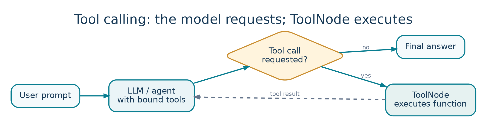

<!-- Concept illustrations are original, bundled with these notes in images/ -->

LESSON 05   /   PLAYLIST POSITION 18

# Tools in LangGraph: ToolNode and Tool Calling

*CampusX • Agentic AI using LangGraph  |  Theory-focused study guide  |  ~34 min*

Watch lesson: [Open original video on YouTube](https://www.youtube.com/watch?v=_UuUigoM9MA&list=PLKnIA16_RmvYsvB8qkUQuJmJNuiCUJFPL)

> **ABOUT THESE NOTES**
>
> These are original, concept-first study notes organized around the video's published chapter list and cross-checked against current LangGraph/LangSmith documentation. They are not a verbatim transcript. Short illustrative examples are included; project-building walkthroughs are intentionally omitted.

## Learning goals

- Define tools and distinguish model-selected tool calls from actual execution.

- Understand the roles of @tool, bind_tools, ToolNode, and conditional routing.

- Trace a basic agent–tool–agent loop.

- Apply safe tool design principles: validation, permissions, idempotency, and approval.

## 1. Why agents need tools

A language model can generate text, but it cannot automatically read a live database, call an external API, or change application state. Tools are functions that expose selected capabilities to the agent. They let an application ground answers in fresh information or take authorized actions.

Examples include searching documentation, querying inventory, calculating tax, generating a ticket, and sending an email. A good tool has a clear name, description, argument schema, and bounded behavior.

> **CORE DISTINCTION**
>
> A model can request a tool call, but the application executes the tool. Tool calling is a structured decision, not proof that an external action has already happened.

## 2. The tool-call loop



*Figure 5. The tool execution loop routes requested tool calls through ToolNode.*

```text
User asks a question
        ↓
  [Agent / LLM] ─── no tool needed ───→ final answer
        │
        └── tool call requested
                   ↓
              [ToolNode]
                   ↓
             Tool result message
                   ↓
              [Agent / LLM] → final answer or another tool
```

The graph needs a rule to decide whether to proceed to ToolNode or finish. After a tool returns, the graph usually routes back to the agent so the model can incorporate the result into its answer.

## 3. The essential building blocks

| Building block | What it does |
| --- | --- |
| @tool | Wraps a function with a name, description, and callable schema. |
| bind_tools([...]) | Tells a compatible chat model which tools it may request. |
| AIMessage.tool_calls | Structured tool requests returned by the model. |
| ToolNode([...]) | Executes requested tools and emits tool-result messages. |
| tools_condition | Routes to tools or END based on the model message. |
| MessagesState | Common conversation-state schema for message-driven agents. |

### A minimal tool definition

```python
from langchain.tools import tool

@tool
def multiply(a: int, b: int) -> int:
    """Multiply two integers and return the product."""
    return a * b

# A compatible model can be offered this tool:
model_with_tools = model.bind_tools([multiply])
```

The docstring helps the model decide when the tool is appropriate. The argument types help define structured inputs. Binding tools only describes the available capability: it does not automatically run the Python function.

## 4. What ToolNode does

ToolNode is a prebuilt LangGraph node for executing tool calls requested by a model. It receives a state containing model messages, finds requested tool calls, dispatches them to the matching functions, and returns results as tool messages. It can simplify the execution layer so you do not write your own dispatcher for common cases.

### Small illustrative graph pattern

```python
from langgraph.graph import StateGraph, MessagesState, START
from langgraph.prebuilt import ToolNode, tools_condition

builder = StateGraph(MessagesState)
builder.add_node("agent", call_model)   # defined elsewhere
builder.add_node("tools", ToolNode([multiply]))
builder.add_edge(START, "agent")
builder.add_conditional_edges("agent", tools_condition)
builder.add_edge("tools", "agent")
app = builder.compile()
```

This intentionally omits provider setup and the call_model implementation. Conceptually, the agent calls the model with the tool definitions bound; tools_condition examines the latest AI message; ToolNode executes requested calls; the graph can cycle until the model returns a final response.

## 5. Tool calling vs ordinary functions

| Ordinary app function | Agent tool |
| --- | --- |
| Application code chooses when to run it. | The model may request execution based on context. |
| Inputs are chosen by the programmer. | Arguments may be generated by the model and need validation. |
| Control flow is usually explicit. | Control flow can contain loops and conditional routing. |
| Errors are predictable program branches. | Errors may need to be reported back to the model for recovery. |

Do not assume agent-selected calls are always appropriate. Tools execute under the permissions provided to them; this makes a small, deliberate capability surface essential.

## 6. Tool schemas and argument validation

- Give tools unambiguous names; avoid overlapping tools with nearly identical purposes.

- Write descriptions specifying when the tool should and should not be used.

- Use typed parameters and validate ranges, formats, and ownership inside the tool.

- Return concise, structured results and actionable error messages.

- Avoid exposing internal stack traces or credentials in tool outputs.

## 7. A practical example: currency conversion

User: “Convert 150 USD to EUR at today’s rate.” The model identifies that a current exchange rate is needed, requests a rate-lookup tool with currency codes, and receives the fresh rate. It then computes the converted amount and explains the rate timestamp. Without a tool or fresh rate source, the model could only guess.

For a production tool, check API response validity, currency units, rate timestamp, retry policy, and user-visible disclosure of uncertainty. The model should never fabricate a successful tool execution if the API failed.

## 8. Safety and robustness for tools

| Risk | Safer design |
| --- | --- |
| Unapproved side effects | Human approval before emails, purchases, or deletes. |
| Duplicate actions on retry | Idempotency key and action deduplication. |
| Prompt injection via tool result | Treat external text as untrusted data. |
| Overbroad permissions | Least-privilege tool credentials and scoped access. |
| Malformed arguments | Schema validation and explicit error returns. |
| Infinite tool loop | Maximum steps / timeout / stop conditions. |

A tool result might contain instructions from a webpage or document. These are data, not trusted system instructions. Separate instructions from tool output and check that the requested action is authorized.

## 9. How to debug a tool agent

- Did the model output a tool call or a normal answer?

- Was the requested tool name available to ToolNode?

- Were the generated arguments correctly typed and within valid bounds?

- Did execution succeed? Check error messages and timeouts.

- Did the model use the tool result accurately in the final response?

- Did the graph terminate instead of looping indefinitely?

> **CONNECTION TO OTHER LESSONS**
>
> Persistence lets a tool-based agent resume conversations; streaming shows tool progress; LangSmith traces reveal which tools ran, with what arguments and results. Together they support a more inspectable agent.

## Quick revision

| Question | Answer |
| --- | --- |
| Who chooses to request a tool? | The model may propose a tool call. |
| Who executes it? | Your application / ToolNode. |
| What is bind_tools? | Declares callable tool schemas to a compatible model. |
| What is tools_condition? | Conditional routing based on pending tool calls. |
| Why route tools back to agent? | To interpret tool results and continue or finalize. |

## Active-recall questions

Q. Does binding a tool immediately execute it?

A. No. The model may request it; an execution layer must run it.

Q. Where should user permissions be enforced?

A. In application authorization and tool implementation, not by trusting a model alone.

Q. What is one sign of a routing bug?

A. The model requests a tool but the graph terminates without executing it.

Q. Why are tool calls an observability concern?

A. They influence answers, latency, cost, and external side effects.

## Sources and further reading

Original video: [CampusX lesson](https://www.youtube.com/watch?v=_UuUigoM9MA)

Playlist: [Agentic AI using LangGraph](https://www.youtube.com/playlist?list=PLKnIA16_RmvYsvB8qkUQuJmJNuiCUJFPL)

Official documentation 1: [docs.langchain.com/langsmith/trace-with-langgraph](https://docs.langchain.com/langsmith/trace-with-langgraph)

Official documentation 2: [docs.langchain.com/oss/python/langgraph/thinking-in-langgraph](https://docs.langchain.com/oss/python/langgraph/thinking-in-langgraph)

Reference status: Chapter titles/timestamps are sourced from the public video description. API discussion reflects official documentation consulted in October 2026. Library APIs can change; check current documentation before running code.
