# Tools and ToolNode in LangGraph

**Agentic AI using LangGraph | Video 18 | CampusX**  
**Lesson:** [Tools in LangGraph | Agentic AI using LangGraph | CampusX](https://www.youtube.com/watch?v=_UuUigoM9MA)  

> **Core idea:** The model requests tools, ToolNode executes those requests, and tool results return to the model through the graph.

## 1. Learning goals

Explain tools and schemas, ToolNode, tool routing, message-state flow, permissions, and a deterministic no-paid-API tool demonstration.

### Video chapter links

| Time | Chapter |
| --- | --- |
| [00:00](https://www.youtube.com/watch?v=_UuUigoM9MA&t=0s) | Intro & Demo |
| [05:37](https://www.youtube.com/watch?v=_UuUigoM9MA&t=337s) | Plan of action |
| [06:48](https://www.youtube.com/watch?v=_UuUigoM9MA&t=408s) | Tools in LangGraph |
| [11:15](https://www.youtube.com/watch?v=_UuUigoM9MA&t=675s) | Definition of ToolNode |
| [13:05](https://www.youtube.com/watch?v=_UuUigoM9MA&t=785s) | Code implementation |
| [33:00](https://www.youtube.com/watch?v=_UuUigoM9MA&t=1980s) | Final Changes |

**Prerequisites:** Basic Python functions and dictionaries; familiarity with nodes, edges, and shared state is helpful. Terms used in this lesson are explained as they appear.

---

## 2. Why an AI assistant needs tools

An LLM is good at reading and generating text, but it cannot automatically perform every real-world action. It may be able to *describe* how to calculate something, search the web, or check a stock price, but actually carrying out those tasks requires a suitable connection to software or data.

A **tool** is a function or service the assistant can request to perform a specific operation. Examples include a calculator, a web search API, a database query, or a function that looks up a record. Tools make an assistant useful beyond producing general explanations.

<p align="center">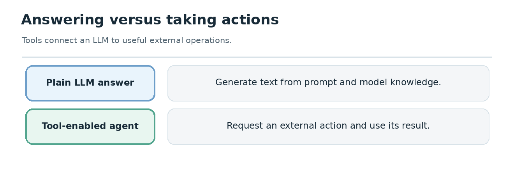</p>

A plain chat model can answer “What is the capital of India?” directly. But a request such as “Find today's top headlines” needs current information from a reliable search or news source. A calculator request such as “Multiply 12 by 8” can use deterministic code and return the exact result `96`. The key improvement is **access to the right operation**, not merely a more complex prompt.

### Tools and permissions

Just because an LLM can *request* an action does not mean it should always be allowed to perform it. Reading a public page, deleting a file, and transferring money have very different consequences. The surrounding application must enforce permission, validation, and human approval where appropriate.

## 3. Tool calling: model decision versus real execution

**Tool calling** is a two-part process. First, the LLM decides a tool would be useful and generates a structured request such as a tool name plus arguments. Second, application code executes the requested tool and returns its result. The model does not directly execute arbitrary Python by simply mentioning a function.

<p align="center">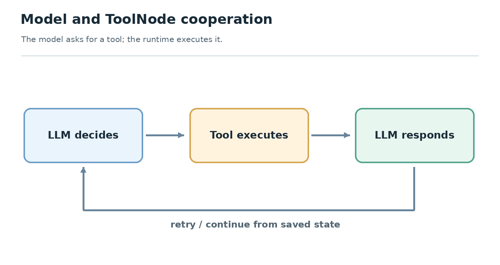</p>

**Follow the loop:** A user asks a question. The model decides whether it needs a tool. If it does, it emits a structured tool call; the application executes the corresponding function; the result is returned to the conversation; the model reads the result and produces an answer. The loop may repeat for additional tool calls and should have clear stopping conditions.

For example:

| Step | What happens |
| --- | --- |
| User question | “What is 12 multiplied by 8?” |
| Assistant tool request | `multiply(a=12, b=8)` |
| Tool execution | Python computes `96` |
| Tool result | Result `96` is returned as a tool message |
| Assistant answer | “12 × 8 = 96.” |

The tool is responsible for calculation; the model is responsible for choosing when the tool is useful and explaining the result.

## 4. The anatomy of a tool

A useful tool has a **name**, a **description**, an **input contract**, an **implementation**, and an **output**. The model can use the name and description to select a tool, while the application validates arguments against the tool's expected schema.

<p align="center">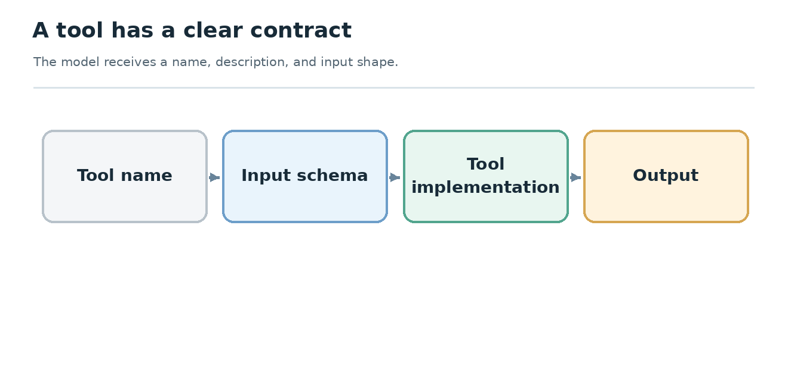</p>

For a calculator, the name might be `multiply`, the inputs might be integers `a` and `b`, and the output might be an integer. For a search tool, the input could be a search query and the output could be structured results with titles and source links. Clear descriptions reduce confusion when an assistant has many similar tools.

### A Python tool

```python
from langchain_core.tools import tool

@tool
def multiply(a: int, b: int) -> int:
    """Multiply two whole numbers and return their product."""
    return a * b

print(multiply.invoke({"a": 12, "b": 8}))  # 96
```

The `@tool` decorator exposes the function through LangChain's tool interface. The docstring helps describe its purpose. Using `invoke` on the tool is different from asking an LLM to choose and call it; here we are directly testing that the tool works.

**Common mistake:** A tool should not silently accept arbitrary input. Validate arguments, handle errors, and give the model a predictable result shape whenever possible.

## 5. What is `ToolNode` in LangGraph?

**`ToolNode`** is a ready-made LangGraph node that handles tool calls requested by an assistant. It is given a collection of available tools. When it receives an AI message containing tool calls, it selects the matching tools, executes them with the provided arguments, and returns tool-result messages.

<p align="center">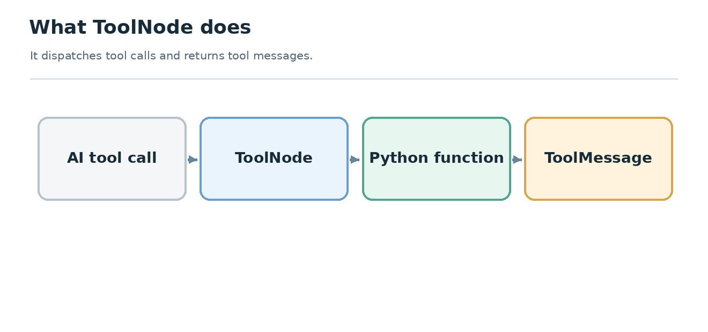</p>

A normal custom node is useful for one specialized task. `ToolNode` is convenient when you want a standard dispatcher for many tools and do not want to manually decode every tool call and construct every response. It does not itself decide *which* tool the assistant should request; that decision normally comes from the model or your own routing logic.

### ToolNode versus a tool

- A **tool** is the callable operation, such as `multiply` or `search`.
- A **ToolNode** is a node in the graph that **executes requested tools** and passes their results back into the state.
- A **tool-calling model** generates the structured request that identifies the tool and arguments.

These roles work together, but they should not be confused.

## 6. Routing between the model and ToolNode

In a common design, an assistant node generates a response. If that response contains tool calls, a conditional route sends execution to `ToolNode`. If there are no tool calls, the graph can finish. After the tool node executes, the result flows back to the assistant so it can prepare the final response or request another tool.

<p align="center">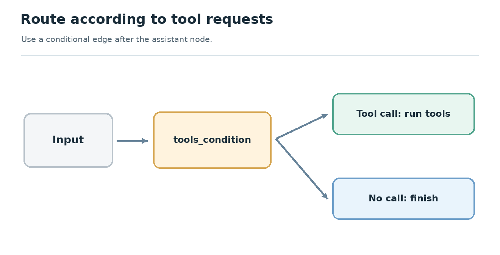</p>

The `tools_condition` helper is commonly used for the decision. It inspects the last assistant message and chooses the tools path when tool calls are present. If not, it chooses the ending path.

```python
from langgraph.prebuilt import ToolNode, tools_condition

# Typical graph wiring after defining an assistant node:
# builder.add_node("assistant", assistant_node)
# builder.add_node("tools", ToolNode([multiply]))
# builder.add_conditional_edges("assistant", tools_condition)
# builder.add_edge("tools", "assistant")
```

This illustrates the relationship between the two nodes. It is **graph wiring**, not a complete application by itself: the assistant node and message-state schema must also exist. Names and routing destinations must match the actual graph structure.

## 7. Worked example: a calculator tool without an LLM key

We can test `ToolNode` directly by creating a sample AI message that asks for a multiplication. This avoids a paid model API and lets us understand the mechanics before adding model-generated tool calls.

<p align="center">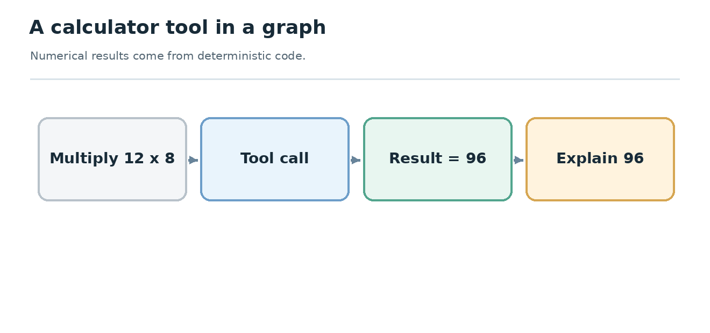</p>

```python
# Install: pip install langgraph langchain-core
from langchain_core.tools import tool
from langchain_core.messages import AIMessage
from langgraph.prebuilt import ToolNode

@tool
def multiply(a: int, b: int) -> int:
    """Multiply two integers."""
    return a * b

node = ToolNode([multiply])
mock_ai_message = AIMessage(
    content="",
    tool_calls=[{
        "name": "multiply",
        "args": {"a": 12, "b": 8},
        "id": "call_multiply_1"
    }]
)

result = node.invoke({"messages": [mock_ai_message]})
print(result["messages"][0].content)  # 96
```

**Walk through the code:** We define a tool, create a `ToolNode` containing it, and construct an `AIMessage` with one tool call. `ToolNode` reads the requested name and arguments, runs `multiply(12, 8)`, and returns a tool message. The output is text content representing the computed result. This is a **simulated model request**, not a real language-model inference.

<p align="center">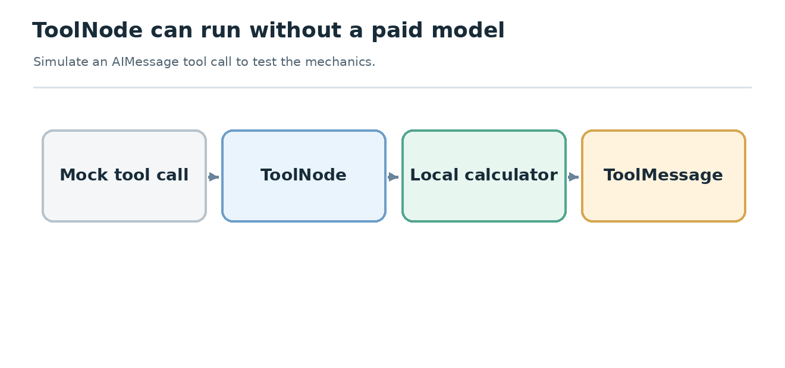</p>

This simple exercise is important: tool execution and model reasoning can be tested separately. When a future model integration fails, you can first check whether the calculator itself works and whether the tool call arguments were correct.

## 8. Using several tools in one assistant

An assistant may have a calculator, search tool, and stock-data lookup available. These tools serve different purposes. A live stock price should come from an authorized current market-data source; it is not reliable for a language model to guess it. Search is appropriate for finding up-to-date pages, while a calculator is appropriate for exact arithmetic.

<p align="center">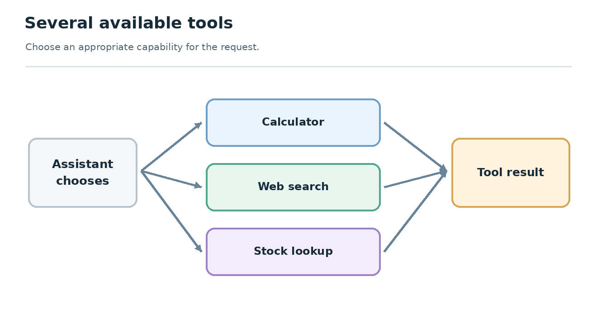</p>

A user asks, “What is the most recent quarterly revenue of Company X, and what is 10% of it?” A capable assistant may first retrieve a trustworthy financial report, extract the revenue value, and use a calculator. The application should preserve citations and avoid acting as though unsupported figures are verified.

### How tools are exposed to a model

For supported model integrations, tools are typically registered with the model using a method such as `.bind_tools([...])`. The model then sees tool schemas and can produce structured tool calls. That is separate from adding a `ToolNode` to the graph: the first step lets the **model know what to request**, and the second enables the **graph to execute the request**.

## 9. Tool calls and messages in shared state

In a tool-using graph, state often contains a conversation-message list. A tool interaction adds more than one kind of message: the user asks, the AI requests a tool, the tool returns a result, and the AI writes an answer.

<p align="center">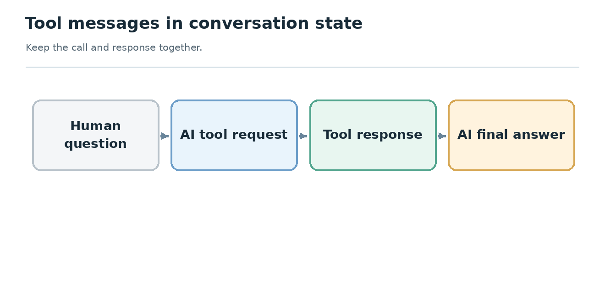</p>

Keeping those messages connected matters. Without the tool result, the assistant may not know what the external function returned. LangGraph's message-state patterns typically use the `add_messages` reducer or `MessagesState`, which helps preserve and reconcile messages rather than blindly replacing the entire conversation.

A tool result is data for the assistant; it is not necessarily a trusted instruction. For example, a web page returned by a search tool could contain text telling the assistant to ignore safety rules. The application should treat that text as **untrusted source content**, not as authority over its instructions.

## 10. Practical safety rules for tools

<p align="center">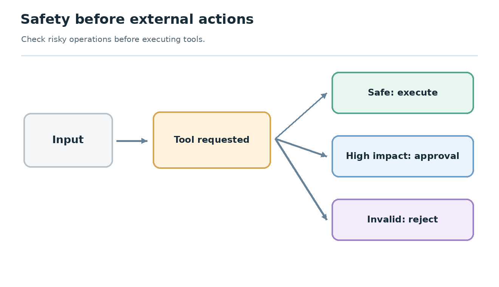</p>

Tool execution can have real consequences. A read-only calculator is usually low risk. Sending an email, deleting files, buying stocks, or writing to a production database requires stronger safeguards. A good design checks user authorization, validates parameters, limits tool scope, and requests confirmation for high-impact actions.

**Examples:** An agent can calculate the price of ten items automatically. But if it is asked to place an order, the application may need to display the order details and receive explicit approval. The LLM's choice to call a function must never bypass application authorization checks.

### Tool failures are normal

<p align="center">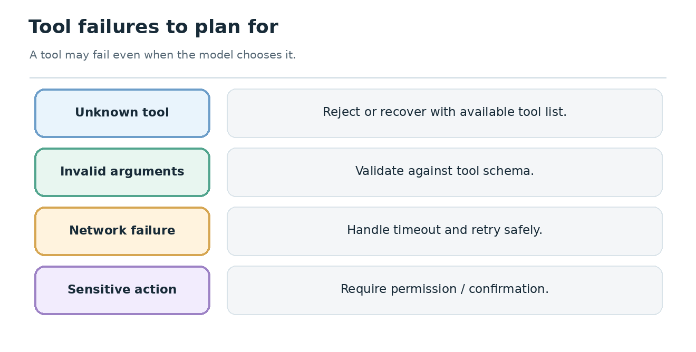</p>

A tool name may be unknown, arguments may be invalid, an API may time out, or a response may be empty. A robust application returns a clear error result, retries transient failures within limits, and never assumes that a tool's output is correct solely because it executed successfully.

For external services, rate limits and cost also matter. Avoid automatic repeated calls with no maximum attempts, and do not invent a “successful result” when a tool fails.

## 11. Designing a tool-enabled agent step by step

<p align="center">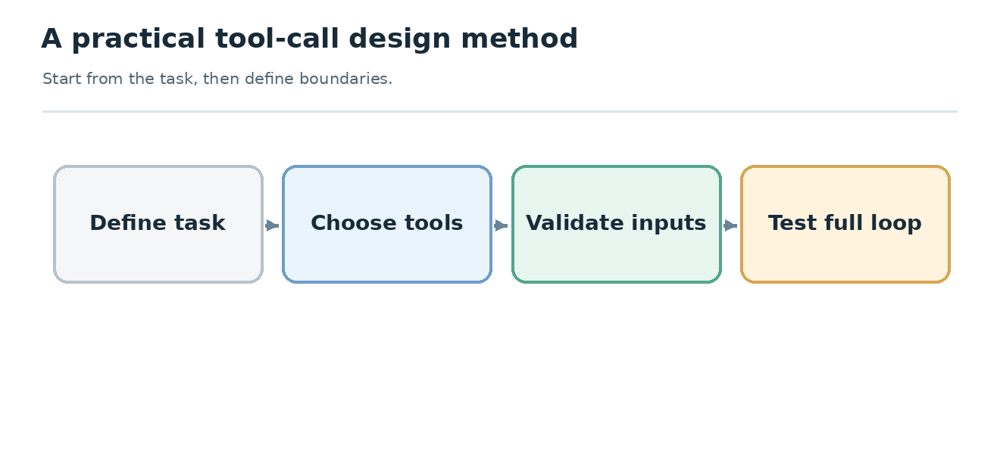</p>

Begin with a user task. Identify which information is already in the model's context and which operations need a tool. Define narrow functions, document the accepted inputs, test each function independently, register the tools with the model and graph, and then test the complete model–tool–model loop.

### How to choose between tool calling and ordinary logic

Not every calculation or branch needs model-driven tool selection. If you already know exactly which function must run, call it directly or use a fixed graph node. Tool calling becomes useful when the **user's request determines which operation is needed** and the model can select among a controlled set of functions.

### One complete decision trace

Consider a customer assistant receiving “How much would 12 notebooks cost at ₹8 each?” A model with a calculator tool may request multiplication. The tool's result is `96`, and the assistant can explain that the total is ₹96. Contrast this with “Tell me about notebooks,” which might be answerable without any tool call. A good agent does not invoke tools just because tools are available.

| User request | Model decision | ToolNode action | Final response |
| --- | --- | --- | --- |
| “Calculate 12 × 8” | Request `multiply` | Run calculator | “96” |
| “Explain what a notebook is” | No tool required | None | Direct explanation |
| “Find current notebook prices” | Request supported search tool | Call search service | Grounded price summary, if available |

The tool node is involved only when a valid tool call has been requested and correctly routed. If the assistant does not ask for any tool, the graph should be able to finish without pointlessly passing through the tool node.

### Failures that can happen at each boundary

There are several different failure points. The model can select the **wrong tool** even when every tool works correctly. It can supply **invalid arguments**, such as a text value where an integer is required. The actual tool may fail because of network problems or authorization. Finally, the model can misinterpret a correct tool result. Treat these as different bugs: a better prompt will not repair an unavailable API, and fixing the API will not solve wrong routing.

### Test tools independently before introducing a model

First call the Python function directly using controlled inputs. Then invoke it through a `ToolNode` with a mock AI message. Only after those tests succeed should you add the model's ability to choose tools. This staged approach narrows the number of possible failure points and can often be tested without a paid model API.


## 12. Key takeaways

1. A tool connects an assistant to a defined operation such as calculation, search, or data lookup.
2. The LLM **requests** a tool; application code executes it.
3. `ToolNode` dispatches tool calls and returns tool-result messages.
4. `tools_condition` commonly chooses between calling tools and finishing.
5. Tool outputs usually flow back to the assistant for explanation or further work.
6. Tool schemas, message history, and error handling are important design details.
7. Tool access must be limited by permissions, validation, and approval for sensitive actions.

## 13. Revision checklist

- [ ] I can explain why an LLM benefits from tools.
- [ ] I can distinguish tool calling from tool execution.
- [ ] I can name the parts of a tool contract.
- [ ] I know the purpose of `@tool` and `.bind_tools()`.
- [ ] I can explain what `ToolNode` does.
- [ ] I can explain how `tools_condition` routes execution.
- [ ] I can draw the full model → tool → model loop.
- [ ] I can trace user, AI tool-call, tool-result, and AI answer messages.
- [ ] I can run a no-paid-API ToolNode test with a mocked tool call.
- [ ] I understand validation, permissions, retries, and error handling.

## 14. Practice questions and exercises

1. Explain why a language model should use a calculator for exact arithmetic even if it can sometimes calculate mentally.
2. Design a `get_weather(city)` tool contract. What should its arguments and result contain?
3. Sketch the graph path when the assistant requests a tool and when it does not.
4. Modify the calculator example to create a `subtract(a, b)` tool and invoke it through a mock AI message.
5. What happens when a model requests a tool that was not registered? Suggest a safe error response.
6. Design a human approval step for an agent that drafts an email and wants to send it.
7. Explain how to handle an untrusted web search result returned as tool content.

## 15. Interview questions and short answers

**What is a tool in LangGraph?** A callable operation that the assistant can request to access data or perform a defined action.

**What is tool calling?** The model produces a structured request specifying a tool and arguments; the application executes that request.

**What is `ToolNode`?** A ready-made graph node that dispatches tool calls and returns tool-result messages.

**What does `tools_condition` do?** It routes execution to tools when the latest AI message contains tool calls, otherwise toward the graph's finish path.

**What is the difference between `.bind_tools()` and `ToolNode`?** Binding exposes tool schemas to the model; `ToolNode` executes selected tools within the graph.

**Why preserve tool messages?** They provide the actual results that the assistant needs to answer accurately or decide what to do next.

**What security precautions matter?** Validate arguments, enforce permissions, handle errors, and require approval before high-impact actions.

## 16. Further reading

- [LangGraph Graph API](https://docs.langchain.com/oss/python/langgraph/graph-api)
- [LangGraph workflows and agents](https://docs.langchain.com/oss/python/langgraph/workflows-agents)
- [LangChain tools documentation](https://docs.langchain.com/oss/python/langchain/tools)
- [LangGraph persistence and message state](https://docs.langchain.com/oss/python/langgraph/persistence)
