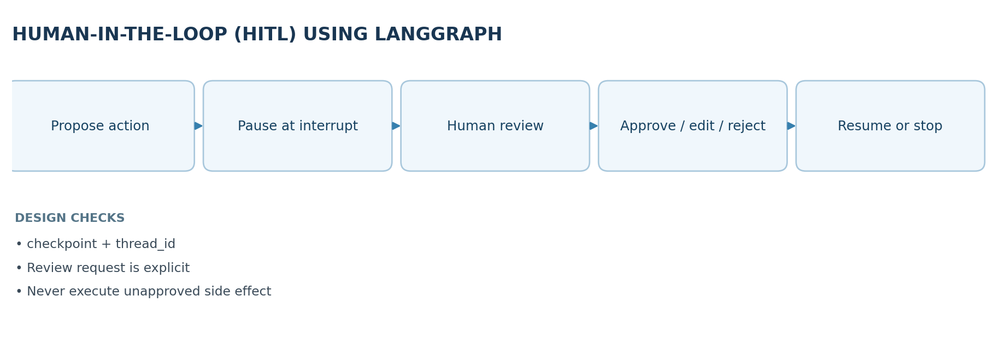
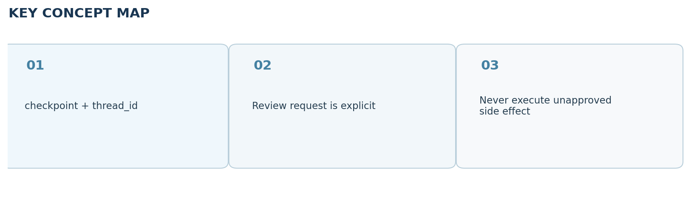

# Video 21 — Human-in-the-Loop (HITL) using LangGraph

> **CampusX Agentic AI using LangGraph · Playlist position 21 · Theory-first study notes**  \
> [Watch the lesson](https://www.youtube.com/watch?v=xxqZzVZ4gE0&list=PLKnIA16_RmvYsvB8qkUQuJmJNuiCUJFPL&index=21) · [Full playlist](https://www.youtube.com/playlist?list=PLKnIA16_RmvYsvB8qkUQuJmJNuiCUJFPL)

**Study scope:** Important conceptual material and small teaching examples, not a recreation of the tutorial project. These are original explanatory notes based on the video’s public chapter outline and the linked technical sources—not a transcript.



## Learning objectives

By the end of this lesson, you should be able to explain **when an autonomous agent should stop and ask a person**, distinguish approval from clarification and output review, and describe how LangGraph's `interrupt()`, a checkpointer, a `thread_id`, and `Command(resume=...)` cooperate.

## 1. Why human-in-the-loop matters

An agent can plan, retrieve information and invoke tools, but fluency is not proof that an action is correct or authorized. A mistaken answer is sometimes recoverable; a mistaken payment, deletion, or external message may not be. HITL creates explicit handoff points where the system pauses and a human decides whether or how execution should continue.

Two motivations are worth keeping distinct:

- **Reliability:** a human may correct missing facts, ambiguity, uncertain classifications or poor drafts.
- **Accountability and control:** a human remains responsible for sensitive actions, policy exceptions and irreversible side effects. A correct-looking model output still requires authorization if the action is high impact.

HITL does **not** mean a person approves every generated token. Over-review slows the workflow and produces approval fatigue; place gates where consequences, uncertainty or legal requirements justify them.

## 2. Four practical HITL patterns

| Pattern | Trigger | Human provides | Example |
|---|---|---|---|
| Action approval | Before a side-effecting tool runs | Approve / deny / sometimes edit | Release an invoice or send an email |
| Output review | Before draft is published | Corrections or replacement text | Review a customer-facing response |
| Clarification | User request lacks a needed fact | A missing value or choice | Which account should be charged? |
| Escalation | System cannot safely decide | Human resolution | Disputed refund or compliance exception |

**Example:** an agent drafts a refund of $500. Rather than executing the payment immediately, it produces a structured approval request containing the amount, payee, reason, and risk. The reviewer approves or rejects it; only an approved path reaches the actual payment tool.

## 3. LangGraph's pause-and-resume lifecycle

LangGraph's dynamic `interrupt()` pauses the graph **inside a node** and returns a serializable request to the caller. A **checkpointer** saves state. The caller retains a stable **thread ID** identifying the interrupted run, collects input from a reviewer, then resumes with `Command(resume=value)` using **the same thread ID**. The resumed value becomes the return value of the paused `interrupt()` call.

A crucial nuance: **when resumed, the node executes again from its beginning.** Code *before* the interrupt can run again. Do not put a charge, send, delete, or non-idempotent operation before an interrupt; put the approval first, then perform the side effect exactly once using an idempotency key where possible.

### Minimal teaching example

```python
from typing_extensions import TypedDict
from langgraph.graph import StateGraph, START, END
from langgraph.checkpoint.memory import InMemorySaver
from langgraph.types import interrupt, Command

class State(TypedDict):
    request: str
    approved: bool

def get_approval(state: State):
    decision = interrupt({"question": "Approve this action?", "request": state["request"]})
    return {"approved": bool(decision)}

builder = StateGraph(State)
builder.add_node("approval", get_approval)
builder.add_edge(START, "approval")
builder.add_edge("approval", END)
app = builder.compile(checkpointer=InMemorySaver())

config = {"configurable": {"thread_id": "demo-approval-001"}}
paused = app.invoke({"request": "Publish draft", "approved": False}, config=config)
# Show the interrupt request to a reviewer; collect the answer.
result = app.invoke(Command(resume=True), config=config)
assert result["approved"] is True
```

This illustrates **pausing and resuming only**; it does not actually publish anything. `InMemorySaver` is convenient for demonstration, but a production system needs persistent checkpoint storage and authentication for the approving reviewer.

## 4. Static checkpoints vs. dynamic interrupts

- **Static breakpoints** (`interrupt_before` / `interrupt_after` when supported) are useful during debugging and inspection at node boundaries.
- **Dynamic interrupts** (`interrupt()` inside a node) can carry a question and be conditioned on state: e.g., request approval only if `amount > policy_limit`.
- **Tool-level approvals** intercept sensitive tool calls; the agent can still autonomously perform low-risk read-only calls.

A human approval event should be logged with reviewer identity, timestamp, exact proposed action, decision, and resulting execution. This is an **application design recommendation**, not something automatically supplied by the graph.

## 5. Robust design checklist

1. **Specify the review boundary:** which action will happen only *after* the human approves?
2. **Make requests comprehensible:** pass a minimal, structured, non-secret summary to the reviewer.
3. **Persist across restarts:** use a durable checkpointer; keep the same `thread_id` for resume.
4. **Treat resume values as untrusted input:** validate allowed decisions and edited fields.
5. **Prevent replayed side effects:** remember that the paused node restarts, and use idempotent operations.
6. **Handle denial and timeouts:** explicitly route to cancellation, revision or escalation.
7. **Test both branches:** approval *and* rejection should be correct and auditable.

## 6. Key distinctions and misconceptions

**Approval is not evaluation.** A judge-model score is not the same as human authorization. **Persistence is not memory personalization.** Checkpointing saves execution state for continuation; it is not automatically a store of reusable user preferences. **Paused is not finished.** An interrupt leaves the graph incomplete until a valid resume input arrives.

## 7. Quick revision

- HITL trades a small amount of autonomy for safer decisions and human accountability.
- Use `interrupt()` + a checkpointer + stable `thread_id` to pause; `Command(resume=...)` to continue.
- The node is re-executed from its beginning when it resumes: keep side effects after the approval gate.
- Prefer risk-based gates over blanket approval for every step.

### Self-check questions

1. Why is an approval gate more important for a payment tool than for a read-only search tool?
2. Which three components are needed for a resumable LangGraph interrupt?
3. What dangerous behavior can occur if a network request runs before `interrupt()`?
4. How would your graph represent a reviewer rejecting a proposed action?

**Suggested answers:** (1) payments create side effects; (2) interrupt, checkpointer, thread ID (plus resume command to continue); (3) the request may be repeated; (4) route to a cancel/revise branch without executing the action.

## Visual recap



## Clickable video chapters

- [00:00:00 — Introduction: What is Human-in-the-Loop?](https://www.youtube.com/watch?v=xxqZzVZ4gE0&list=PLKnIA16_RmvYsvB8qkUQuJmJNuiCUJFPL&index=21&t=0s)
- [00:01:14 — Why agents need human oversight](https://www.youtube.com/watch?v=xxqZzVZ4gE0&list=PLKnIA16_RmvYsvB8qkUQuJmJNuiCUJFPL&index=21&t=74s)
- [00:03:44 — Real-world HITL examples](https://www.youtube.com/watch?v=xxqZzVZ4gE0&list=PLKnIA16_RmvYsvB8qkUQuJmJNuiCUJFPL&index=21&t=224s)
- [00:04:22 — Accuracy and accountability](https://www.youtube.com/watch?v=xxqZzVZ4gE0&list=PLKnIA16_RmvYsvB8qkUQuJmJNuiCUJFPL&index=21&t=262s)
- [00:08:46 — Benefits of HITL](https://www.youtube.com/watch?v=xxqZzVZ4gE0&list=PLKnIA16_RmvYsvB8qkUQuJmJNuiCUJFPL&index=21&t=526s)
- [00:11:36 — Common HITL patterns](https://www.youtube.com/watch?v=xxqZzVZ4gE0&list=PLKnIA16_RmvYsvB8qkUQuJmJNuiCUJFPL&index=21&t=696s)
- [00:14:21 — LangGraph perspective](https://www.youtube.com/watch?v=xxqZzVZ4gE0&list=PLKnIA16_RmvYsvB8qkUQuJmJNuiCUJFPL&index=21&t=861s)
- [00:16:30 — Interrupt workflow](https://www.youtube.com/watch?v=xxqZzVZ4gE0&list=PLKnIA16_RmvYsvB8qkUQuJmJNuiCUJFPL&index=21&t=990s)
- [00:22:49 — Basic HITL code](https://www.youtube.com/watch?v=xxqZzVZ4gE0&list=PLKnIA16_RmvYsvB8qkUQuJmJNuiCUJFPL&index=21&t=1369s)
- [00:31:22 — Tool-using chatbot example](https://www.youtube.com/watch?v=xxqZzVZ4gE0&list=PLKnIA16_RmvYsvB8qkUQuJmJNuiCUJFPL&index=21&t=1882s)
- [00:39:42 — Key takeaways](https://www.youtube.com/watch?v=xxqZzVZ4gE0&list=PLKnIA16_RmvYsvB8qkUQuJmJNuiCUJFPL&index=21&t=2382s)

## References and further reading

- [CampusX video and chapter list](https://playlist.tools/playlist/PLKnIA16_RmvYsvB8qkUQuJmJNuiCUJFPL/xxqZzVZ4gE0)
- [Official LangGraph interrupts guide](https://docs.langchain.com/oss/python/langgraph/interrupts)

*Prepared October 2026. Figures are original study diagrams, not screenshots or official CampusX illustrations. Some APIs may change; consult the linked official references before production use.*
