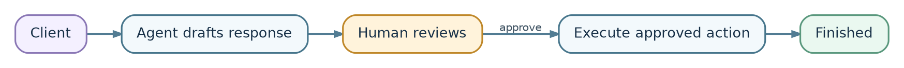
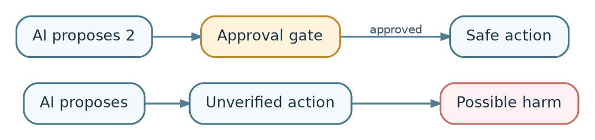
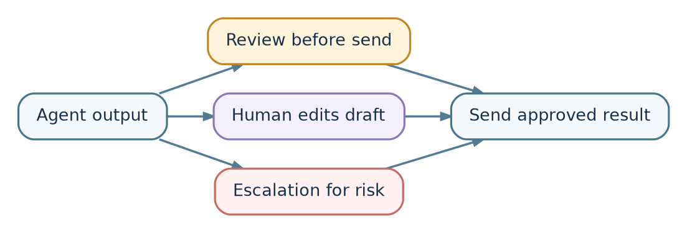
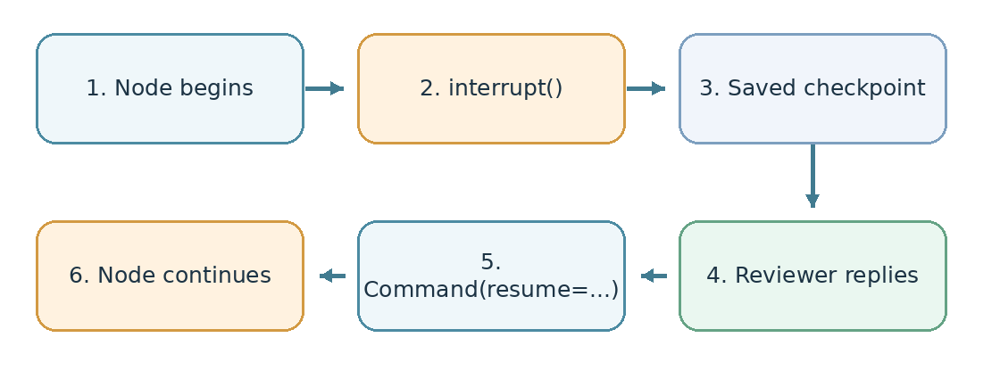
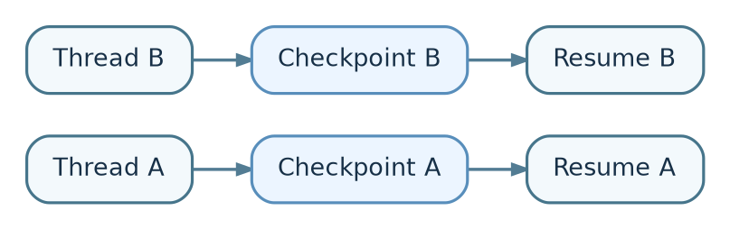
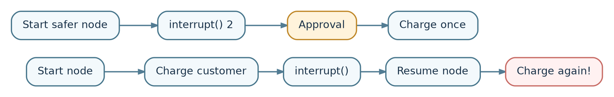
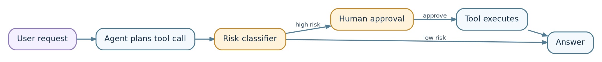
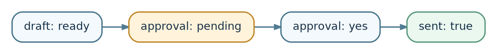
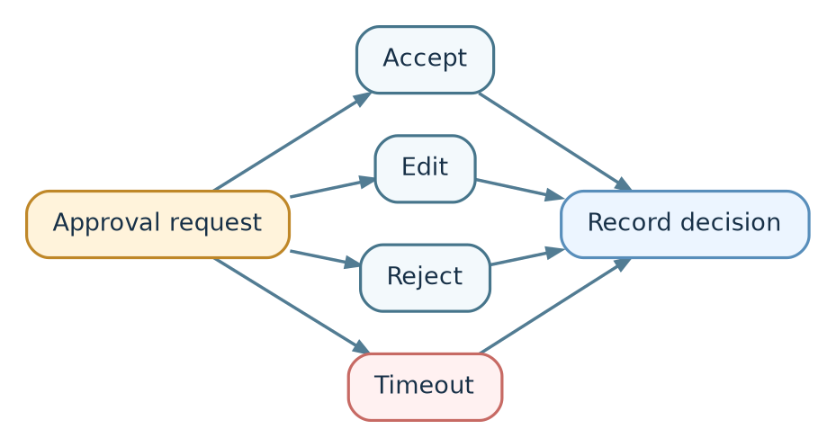

# Human-in-the-Loop in LangGraph

**Agentic AI using LangGraph | Video 21 | CampusX**  
**Lesson:** [Human in the loop (HITL) using LangGraph | CampusX](https://www.youtube.com/watch?v=xxqZzVZ4gE0)

> **Core idea:** A human-in-the-loop workflow pauses an AI system at a meaningful decision so an authorized person can approve, edit, or reject the proposed action.

## 1. Learning goals

Understand human oversight, approval patterns, `interrupt()`, checkpointing, thread-based resumption, and safe tool execution.

### Video chapter links

| Time | Chapter |
| --- | --- |
| [00:00](https://www.youtube.com/watch?v=xxqZzVZ4gE0&t=0s) | Introduction: What is Human-in-the-Loop (HITL)? |
| [01:14](https://www.youtube.com/watch?v=xxqZzVZ4gE0&t=74s) | Why Agentic AI Needs Human Oversight |
| [03:44](https://www.youtube.com/watch?v=xxqZzVZ4gE0&t=224s) | HITL Explained with Real-World Examples |
| [04:22](https://www.youtube.com/watch?v=xxqZzVZ4gE0&t=262s) | Core Reasons for HITL: Accuracy & Accountability |
| [08:46](https://www.youtube.com/watch?v=xxqZzVZ4gE0&t=526s) | Benefits of HITL in Agentic Systems |
| [11:36](https://www.youtube.com/watch?v=xxqZzVZ4gE0&t=696s) | Common HITL Patterns in AI Systems |
| [14:21](https://www.youtube.com/watch?v=xxqZzVZ4gE0&t=861s) | HITL from a LangGraph Perspective |
| [16:30](https://www.youtube.com/watch?v=xxqZzVZ4gE0&t=990s) | Conceptual Workflow: HITL with Interrupts |
| [22:49](https://www.youtube.com/watch?v=xxqZzVZ4gE0&t=1369s) | Basic HITL Code Example in LangGraph |
| [31:22](https://www.youtube.com/watch?v=xxqZzVZ4gE0&t=1882s) | Advanced Example: HITL in a Tool-Using Chatbot |
| [39:42](https://www.youtube.com/watch?v=xxqZzVZ4gE0&t=2382s) | Key Takeaways and Final Thoughts |

**Prerequisites:** Basic Python and the idea of an LLM workflow are helpful. New terms are explained when first used.

---

## 2. Understanding human-in-the-loop workflows

**Human-in-the-loop (HITL)** means deliberately involving a person in an AI workflow at a decision point. The person might approve an action, correct a draft, supply missing information, or take responsibility for a high-risk decision. The AI still performs useful work; it simply does not make every final decision by itself.

Imagine an assistant that writes customer refund emails. Drafting is a relatively low-risk task. Sending an incorrect refund promise, initiating a payment, or disclosing private account data can have real consequences. A sensible system lets the assistant prepare a proposed response, then asks an authorized employee to inspect it before sending.

<p align="center"></p>

**Read the diagram:** the agent drafts a response and stops before the consequential action. The reviewer sees the proposed action and either approves it, changes it, or declines it. Only the approved work proceeds. HITL adds a controlled boundary between *suggesting* and *executing*.

An important distinction: HITL is not the same as asking the user a normal follow-up question. The workflow explicitly records where it stopped and what it is waiting for, so it can continue correctly when an authorized person responds.

### Why human oversight helps

Models can produce persuasive but incorrect reasoning, misunderstand the user's goal, or choose a tool call that is technically valid but inappropriate. A human checkpoint is particularly valuable for actions that are **hard to undo**, involve **money or permissions**, affect **other people**, or require **accountability**. It is also useful when a model gives low-confidence output or faces an unfamiliar situation.

<p align="center"></p>

The two paths illustrate the difference between allowing an unchecked action and requiring review. However, a human reviewer is not magically accurate: the UI must show the evidence, the exact proposed action, and the consequences. A bare “Approve?” button without context provides little protection.

## 3. The common HITL patterns

**Approval before action.** The AI generates a proposal and waits for a yes/no response. Example: a purchasing agent prepares a purchase order, but the finance team authorizes it.

**Human correction.** The AI creates a draft and the reviewer edits it before execution. Example: a customer-support agent prepares an email and a support specialist corrects the refund conditions.

**Escalation.** The system detects uncertainty or elevated risk and transfers the decision to a person. Example: an ambiguous legal or compliance request is moved to a qualified reviewer instead of answered automatically.

**Human data input.** The workflow stops because it needs information the AI cannot infer: a missing tracking number, a selected option, or a revised essay.

<p align="center"></p>

The patterns share one idea: the AI can make progress up to a clearly defined boundary, but a person controls the next sensitive step. Choose the boundary using business risk rather than pausing after every harmless operation. Too many approvals create delays and reviewers may start clicking without carefully reading.

## 4. How LangGraph pauses and resumes execution

LangGraph provides **interrupts** for controlled pauses. A node calls `interrupt(payload)` when it needs input. The payload can contain a proposed tool call, a draft, or a question for the reviewer. The graph saves the execution context through a **checkpointer** and returns control to the application. A human can then view the pending request.

To continue, the application calls the compiled graph with `Command(resume=value)` using the **same thread ID**. The returned value from `interrupt()` is the resume value. Execution continues after the interrupt in that node, and subsequent edges follow the updated state.

<p align="center"></p>

This flow involves two different operations. **First invocation:** execute until `interrupt()` and store the paused state. **Second invocation:** resume the waiting thread with the reviewer decision. The pause can last longer than the original HTTP request because the workflow is not required to keep a Python function call blocked the entire time.

A **thread** is a named execution history. Its `thread_id` lets the checkpointer find the correct paused state. If you resume with a different ID, the runtime cannot reliably continue the intended checkpoint.

<p align="center"></p>

### A small runnable example

Install `langgraph` in a Python virtual environment. This example has **no model and no API key**; it teaches only the approval mechanism.

```python
from typing_extensions import TypedDict
from langgraph.graph import StateGraph, START, END
from langgraph.types import interrupt, Command
from langgraph.checkpoint.memory import InMemorySaver

class ApprovalState(TypedDict):
    message: str
    status: str

def ask_for_approval(state: ApprovalState):
    decision = interrupt({
        "question": "Send this message?",
        "draft": state["message"],
    })
    return {"status": "approved" if decision["approved"] else "rejected"}

builder = StateGraph(ApprovalState)
builder.add_node("review", ask_for_approval)
builder.add_edge(START, "review")
builder.add_edge("review", END)
app = builder.compile(checkpointer=InMemorySaver())

config = {"configurable": {"thread_id": "review-001"}}
paused = app.invoke({"message": "Your order is ready.", "status": "pending"}, config)
# The result contains an __interrupt__ entry for the caller to display.

finished = app.invoke(Command(resume={"approved": True}), config)
print(finished["status"])  # approved
```

The important state change is `pending → approved` (or `rejected`). The reviewer decision is **not generated by the model**; it comes from the application that is hosting the approval screen. In a real deployment, authenticate reviewers and store a durable audit trail.

## 5. A subtle rule: interrupted nodes can restart

On resumption, LangGraph may **re-execute the node from its beginning**, replaying the logic up to the interrupt. This has a serious consequence: do not place irreversible side effects before the `interrupt()` call unless they are idempotent and safe to repeat.

<p align="center"></p>

Consider a bad design: a node charges a credit card, calls `interrupt()`, then on resume starts from the beginning and charges the card again. The safe design is to ask for approval **before** charging and place the charge in a later node (or use a properly idempotent payment operation). The two paths in the diagram show why ordering matters.

**Practical rule:** compute and display a proposal first → pause → validate approval → perform the external action once → record the result. For databases, payments, emails, and file mutations, use idempotency keys, audit logs, and explicit confirmation of the exact action that was approved.

## 6. Human review of an agent's tool call

A tool-using agent may decide to search the web, calculate a number, send an email, update a CRM record, or execute a database command. These operations do not all have the same risk. A useful system places a review gate around **sensitive tool calls**, not necessarily around ordinary reads.

<p align="center"></p>

For example, the agent may answer “What is the delivery status?” by reading a tracking system without approval. But if it wants to **cancel** the order, it should show the order number, estimated consequence, and cancellation request before proceeding. A reviewer can approve exactly that request or reject it. If the request is modified after approval, it may need a new review.

A robust approval record includes: who reviewed, what was proposed, what was accepted or edited, when it happened, and the resulting tool outcome. Logging only “approved=True” is usually insufficient for high-stakes operations.

## 7. State walkthrough: from proposal to final action

<p align="center"></p>

| Moment | State fields | Meaning |
| --- | --- | --- |
| Draft created | `draft="..."`, `status="pending"` | Work is prepared but not released |
| Paused | checkpoint saved for `thread_id` | The application can wait for review |
| Reviewer responds | `approved=True` or `False` | An authorized person makes the decision |
| Graph resumes | `status="approved"` or `"rejected"` | Later logic can act on the decision |
| Safe execution | `sent=True` only if approved | The external effect is controlled |

Notice that the **node returns a state update**. The state schema can have additional fields for `reviewer_id`, `decision_reason`, `approved_payload_hash`, and `tool_result`. Do not treat the example's `status` string as a complete production approval system.

## 8. Failure handling and practical safeguards

Approval is not always a simple yes. The reviewer may **edit**, **reject**, or **never respond**. A complete workflow defines outcomes for all of these. A timeout might cancel the pending action, trigger a reminder, or escalate to another authorized reviewer. It should not silently convert “no response” into approval.

<p align="center"></p>

Common pitfalls include resuming a different thread; performing the action before approval; hiding tool arguments from the reviewer; using an in-memory checkpointer and expecting survival after a restart; and assuming the model can authenticate its own approvals. For production, use a durable checkpointer, separate permissions for reviewers, a bounded waiting policy, and idempotent action execution.

**Choose HITL when:** the consequence of a wrong action exceeds the cost of review, or a human has information or authority the model does not. Do not add it just because a flowchart looks more sophisticated with a review node.


## 9. Worked example: reviewing a refund request

Consider a support assistant that handles a customer message: “I was charged twice; please refund the extra payment.” The assistant first reads the policy and relevant transaction record using **read-only** tools. It drafts a refund proposal with the transaction ID, refund amount, policy basis, and a human-readable explanation. At this point the assistant has **not** issued the refund.

The proposed action reaches a human review step. The reviewer needs enough information to make a meaningful decision: the original charge, duplicate charge, customer identity as verified through the application, and the exact amount to be returned. They may **approve**, **edit the amount**, or **reject** the request. The backend verifies the reviewer's authorization independently of the model.

| Stage | Stored result | Allowed next action |
| --- | --- | --- |
| Read transactions | two matching charges | Draft refund proposal |
| Draft refund | `amount=500`, reason=duplicate | Pause for review |
| Human approves | authorized decision and timestamp | Issue exactly the approved refund |
| Payment processor replies | transaction reference and status | Confirm to customer |
| Human rejects | rejection reason | Explain policy; do not pay |

The key design is **separation of duties**. The model proposes, the reviewer authorizes, and a controlled service executes. The executed tool arguments should match the approved proposal. If the amount changes after approval, do not silently substitute the new amount.

### Testing a human review flow

Test more than the happy path. Try resuming a wrong thread ID, submitting a malformed decision, using an unauthorized reviewer, approving twice, and restarting the server while a request is paused. The expected behavior is deterministic rejection or safe recovery, never accidental execution. An approval timeout should have a clearly documented response such as escalation or cancellation.


---

## Key takeaways for quick revision

1. Explain why AI actions need human oversight in some workflows.
2. Distinguish approval, editing, escalation, and information-request patterns.
3. Draw an interrupt → checkpoint → resume sequence.
4. Explain `thread_id` and `Command(resume=...)`.
5. Describe how to avoid duplicated side effects.
6. Design reject, timeout, and audit-log paths.

## Revision checklist

- [ ] Explain why AI actions need human oversight in some workflows.
- [ ] Distinguish approval, editing, escalation, and information-request patterns.
- [ ] Draw an interrupt → checkpoint → resume sequence.
- [ ] Explain `thread_id` and `Command(resume=...)`.
- [ ] Describe how to avoid duplicated side effects.
- [ ] Design reject, timeout, and audit-log paths.

## Practice questions and mini exercises

1. Design an expense-reimbursement agent that requires finance approval over a threshold. Which exact data should the approver see?
2. Modify the example so a rejected message returns a reason and does not enter a send node.
3. Explain how to make a “send email” tool call idempotent and auditable.

## Interview questions and concise answers

**Q1. What is HITL in an AI workflow?**  
It is a deliberate point where a person reviews, changes, or authorizes an AI decision before the workflow proceeds.

**Q2. How does LangGraph pause a workflow?**  
A node calls `interrupt()`; with a checkpointer, the runtime saves execution state and exposes the pending request.

**Q3. How do you resume an interruption?**  
Call the graph with `Command(resume=value)` and the matching thread ID.

**Q4. Why should external actions not run before an interrupt?**  
A paused node can restart when resumed, potentially repeating side effects.

**Q5. What happens if a reviewer rejects the action?**  
The graph follows a rejection route and should not execute the sensitive tool call.

**Q6. Why is an in-memory checkpointer limited?**  
A process restart can erase its checkpoints, so it is suitable for learning, not durable approval queues.


## Further learning

- [docs.langchain.com — Interrupts](https://docs.langchain.com/oss/python/langgraph/interrupts)
- [docs.langchain.com — Persistence](https://docs.langchain.com/oss/python/langgraph/persistence)

**One-sentence summary:** A human-in-the-loop workflow pauses an AI system at a meaningful decision so an authorized person can approve, edit, or reject the proposed action.
