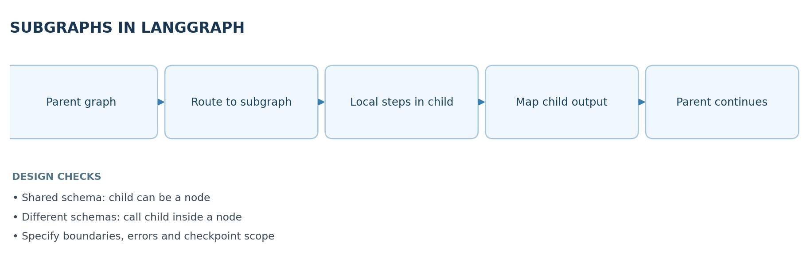
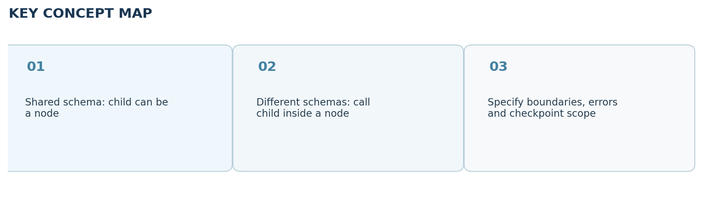

# Video 22 — Subgraphs in LangGraph

> **CampusX Agentic AI using LangGraph · Playlist position 22 · Theory-first study notes**  \
> [Watch the lesson](https://www.youtube.com/watch?v=wcHcocpAoX4&list=PLKnIA16_RmvYsvB8qkUQuJmJNuiCUJFPL&index=22) · [Full playlist](https://www.youtube.com/playlist?list=PLKnIA16_RmvYsvB8qkUQuJmJNuiCUJFPL)

**Study scope:** Important conceptual material and small teaching examples, not a recreation of the tutorial project. These are original explanatory notes based on the video’s public chapter outline and the linked technical sources—not a transcript.



## Learning objectives

Explain why a **graph can be nested inside another graph**, choose between shared-state and isolated-state integration, and identify how subgraphs improve maintainability, observability and multi-agent design.

## 1. What is a subgraph?

A **subgraph** is a smaller LangGraph workflow invoked as part of a larger **parent graph**. It can have its own nodes, conditional routing and internal state. The parent sees the subgraph as a reusable unit of work rather than needing to understand its internal steps. Think of a translation workflow: the parent writes an answer; a child graph detects language, translates, and validates the translation.

Subgraphs are particularly valuable when one enormous graph becomes difficult to test or visualize, or when multiple agents own separate responsibilities such as research, review, calculation and formatting.

### When to use one

- A step has several internal stages that form a coherent responsibility.
- The same multi-step process is reused by multiple parent workflows.
- The child requires different tools or state that should not clutter parent state.
- You want a sensible unit for monitoring, testing and error handling.

A subgraph is **not automatically a separate process or microservice**. It is an architectural boundary inside graph execution, not a guarantee of independent deployment or security isolation.

## 2. The two integration patterns

| Pattern | State relationship | How it works | Appropriate use |
|---|---|---|---|
| Add compiled child directly as a node | Parent and child share compatible state keys | Parent calls child as a graph node | Shared data contract, simple composition |
| Invoke child inside a wrapper node | Parent and child use different state schemas | Wrapper maps parent input to child input, invokes child, maps result back | Private child state, explicit contract |

**Shared-state path:** both graphs agree on keys such as `text` and `translated_text`; the compiled child becomes a node in the parent. **Isolated-state path:** parent may have `query` while the child expects `source_text`; a wrapper translates between schemas. The isolation is about **state interface and visibility**, not an automatic access-control or network boundary.

## 3. Mental model: parent/child contracts

1. **Parent inputs:** what information is the child allowed to see?
2. **Child state:** which values are needed inside the child only?
3. **Child outputs:** what facts, artifacts or decisions must be surfaced back to the parent?
4. **Error boundary:** what happens if the child cannot complete its job?
5. **Persistence:** which state and checkpoints are needed for pause/resume or debugging?

Define the interface before creating nodes. Leaking the whole parent state into every child increases coupling and can expose information needlessly.

## 4. Tiny teaching example: child as a reusable unit

```python
from typing_extensions import TypedDict
from langgraph.graph import StateGraph, START, END

class ChildState(TypedDict):
    text: str
    translated_text: str

def translate(state: ChildState):
    # Replace with an actual translator/model in a real system.
    return {"translated_text": f"[translated] {state['text']}"}

child = StateGraph(ChildState)
child.add_node("translate", translate)
child.add_edge(START, "translate")
child.add_edge("translate", END)
child_graph = child.compile()

class ParentState(TypedDict):
    query: str
    result: str

def call_child(state: ParentState):
    child_result = child_graph.invoke({
        "text": state["query"], "translated_text": ""
    })
    return {"result": child_result["translated_text"]}

parent = StateGraph(ParentState)
parent.add_node("translation_subgraph", call_child)
parent.add_edge(START, "translation_subgraph")
parent.add_edge("translation_subgraph", END)
app = parent.compile()
```

Notice the explicit mapping `query -> text` and `translated_text -> result`. The example demonstrates **isolated state contracts** without an actual language model, so it can be understood independently.

## 5. What changes in multi-agent systems?

An agent may itself comprise a graph with reasoning, tools and safeguards. A parent workflow can delegate specific tasks to child agents (e.g., a researcher, analyst and editor) and only receive structured results. This supports **separation of concerns** and makes failures easier to localize. However, deciding *when* to call a subgraph remains the parent workflow's responsibility.

Subgraphs do not magically provide good coordination. You still need conflict-resolution rules if two children update the same state field, clear termination conditions, budgets, and policies around tool access.

## 6. Observability, checkpoints and failure handling

- Trace the **parent span** and **child spans** so it is clear which internal node produced an incorrect result.
- Decide whether the child has a different retry policy from the parent; retries should not duplicate side effects.
- Document checkpointing behavior, especially when a subgraph contains interrupts. Parent-graph persistence and child-graph persistence are related but not interchangeable configuration choices.
- Prefer small, stable interfaces. A child should return a clean result and a status/error field instead of leaking incidental internal state.

## 7. Key comparisons

**Subgraph vs ordinary function:** a function is ideal for a tiny deterministic operation; a subgraph is useful when the operation itself needs graph routing, state, observation, or resumability. **Subgraph vs tool:** a tool is a capability exposed for invocation; a subgraph represents a multi-step workflow, though one can wrap the other. **Separate state vs separate security:** defining a child state schema does not replace authorization.

## 8. Quick revision

- Subgraphs help scale **system organization**, not necessarily compute throughput.
- Use direct composition when schemas share keys; use a wrapper for different schemas.
- Minimize parent/child coupling, and plan for errors and observability.
- A subgraph is the right abstraction for a reusable, meaningful multi-stage responsibility.

### Self-check questions

1. Why might you keep a translation agent's scratchpad outside the parent state?
2. When is a wrapper node preferable to adding a compiled child directly?
3. Is a subgraph the same as a remote microservice? Why or why not?
4. What tracing information helps debug a failure inside a child graph?

**Suggested answers:** (1) reduce coupling and irrelevant state; (2) differing state schemas; (3) no, it is a workflow composition boundary; (4) parent/child spans, node inputs and outputs, checkpoint/exception context.

## Visual recap



## Clickable video chapters

- [00:00:00 — Introduction](https://www.youtube.com/watch?v=wcHcocpAoX4&list=PLKnIA16_RmvYsvB8qkUQuJmJNuiCUJFPL&index=22&t=0s)
- [00:01:06 — What are subgraphs?](https://www.youtube.com/watch?v=wcHcocpAoX4&list=PLKnIA16_RmvYsvB8qkUQuJmJNuiCUJFPL&index=22&t=66s)
- [00:02:19 — Why complex workflows need them](https://www.youtube.com/watch?v=wcHcocpAoX4&list=PLKnIA16_RmvYsvB8qkUQuJmJNuiCUJFPL&index=22&t=139s)
- [00:05:57 — Multi-agent architectures](https://www.youtube.com/watch?v=wcHcocpAoX4&list=PLKnIA16_RmvYsvB8qkUQuJmJNuiCUJFPL&index=22&t=357s)
- [00:07:04 — Modularity, reuse, maintainability](https://www.youtube.com/watch?v=wcHcocpAoX4&list=PLKnIA16_RmvYsvB8qkUQuJmJNuiCUJFPL&index=22&t=424s)
- [00:08:09 — LangGraph-specific benefits](https://www.youtube.com/watch?v=wcHcocpAoX4&list=PLKnIA16_RmvYsvB8qkUQuJmJNuiCUJFPL&index=22&t=489s)
- [00:11:08 — Subgraph implementation options](https://www.youtube.com/watch?v=wcHcocpAoX4&list=PLKnIA16_RmvYsvB8qkUQuJmJNuiCUJFPL&index=22&t=668s)
- [00:13:40 — Translation workflow example](https://www.youtube.com/watch?v=wcHcocpAoX4&list=PLKnIA16_RmvYsvB8qkUQuJmJNuiCUJFPL&index=22&t=820s)
- [00:19:11 — Isolated vs shared state](https://www.youtube.com/watch?v=wcHcocpAoX4&list=PLKnIA16_RmvYsvB8qkUQuJmJNuiCUJFPL&index=22&t=1151s)
- [00:21:26 — Persistence and observability](https://www.youtube.com/watch?v=wcHcocpAoX4&list=PLKnIA16_RmvYsvB8qkUQuJmJNuiCUJFPL&index=22&t=1286s)
- [00:22:36 — Wrap-up](https://www.youtube.com/watch?v=wcHcocpAoX4&list=PLKnIA16_RmvYsvB8qkUQuJmJNuiCUJFPL&index=22&t=1356s)

## References and further reading

- [CampusX video and chapters](https://playlist.tools/playlist/PLKnIA16_RmvYsvB8qkUQuJmJNuiCUJFPL/wcHcocpAoX4)
- [LangGraph subgraphs guide](https://docs.langchain.com/oss/python/langgraph/use-subgraphs)

*Prepared October 2026. Figures are original study diagrams, not screenshots or official CampusX illustrations. Some APIs may change; consult the linked official references before production use.*
