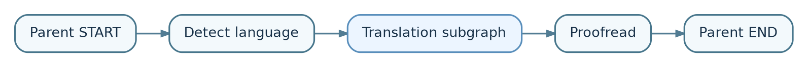
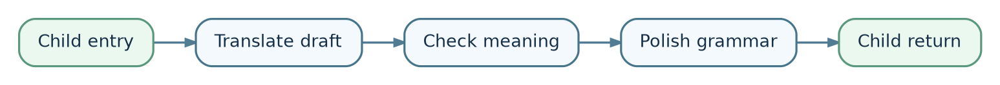
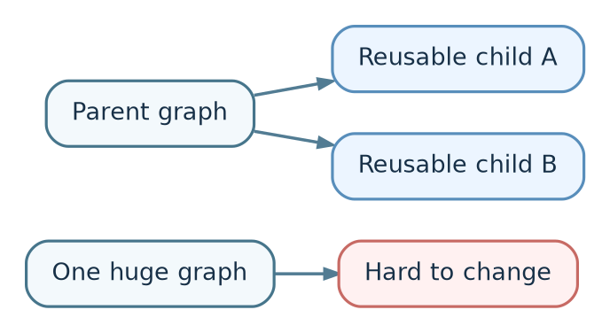
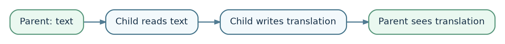
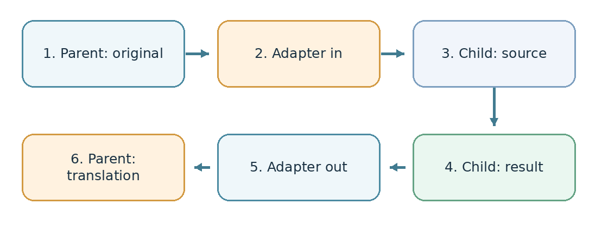
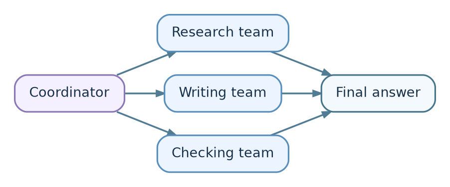
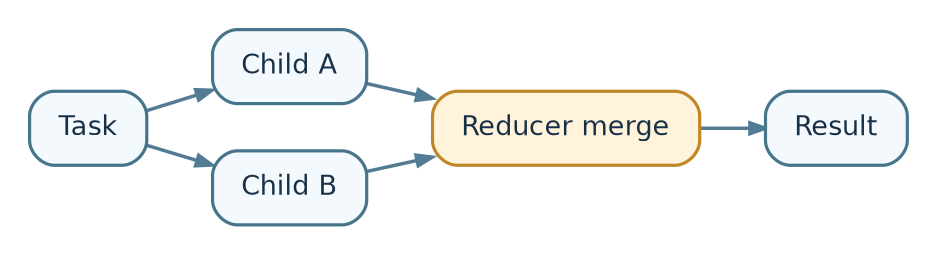
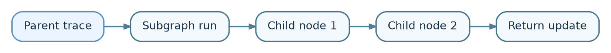
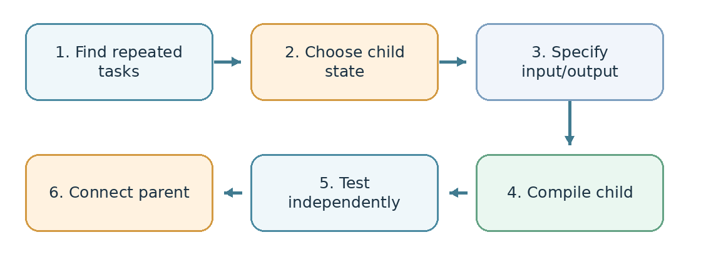

# Subgraphs in LangGraph

**Agentic AI using LangGraph | Video 22 | CampusX**  
**Lesson:** [How to build Subgraphs in LangGraph](https://www.youtube.com/watch?v=wcHcocpAoX4)

> **Core idea:** A subgraph is a smaller graph used as a reusable component of a parent workflow, allowing complex applications to be organized into understandable modules.

## 1. Learning goals

Understand nested graphs, parent/child state, shared versus different schemas, wrapper nodes, and multi-agent composition.

### Video chapter links

| Time | Chapter |
| --- | --- |
| [00:00](https://www.youtube.com/watch?v=wcHcocpAoX4&t=0s) | Introduction: Subgraphs in Agentic AI and LangGraph |
| [01:06](https://www.youtube.com/watch?v=wcHcocpAoX4&t=66s) | What Are Subgraphs? (Conceptual Understanding) |
| [02:19](https://www.youtube.com/watch?v=wcHcocpAoX4&t=139s) | Why Subgraphs Are Needed in Complex GenAI Workflows |
| [05:57](https://www.youtube.com/watch?v=wcHcocpAoX4&t=357s) | Subgraphs for Multi-Agent Architectures |
| [07:04](https://www.youtube.com/watch?v=wcHcocpAoX4&t=424s) | Core Benefits: Modularity, Reusability, Maintainability |
| [08:09](https://www.youtube.com/watch?v=wcHcocpAoX4&t=489s) | LangGraph-Specific Benefits of Subgraphs |
| [11:08](https://www.youtube.com/watch?v=wcHcocpAoX4&t=668s) | Ways to Implement Subgraphs in LangGraph |
| [13:40](https://www.youtube.com/watch?v=wcHcocpAoX4&t=820s) | Practical Example: Translation Workflow with Subgraphs |
| [19:11](https://www.youtube.com/watch?v=wcHcocpAoX4&t=1151s) | Two Subgraph Mechanisms Compared (Isolated vs Shared State) |
| [21:26](https://www.youtube.com/watch?v=wcHcocpAoX4&t=1286s) | Best Practices, Persistence, and Observability |
| [22:36](https://www.youtube.com/watch?v=wcHcocpAoX4&t=1356s) | Wrap-up |

**Prerequisites:** Basic Python and the idea of an LLM workflow are helpful. New terms are explained when first used.

---

## 2. What is a subgraph?

A **subgraph** is a graph used as a component inside a larger graph. Instead of building one enormous workflow where every step belongs to a single top-level graph, we can group related steps into a smaller, understandable unit and connect that unit to the parent workflow.

Suppose a language-learning application receives a paragraph and must detect the language, translate the text, check the meaning, improve grammar, and return the result. The parent graph may handle user interaction, while a **translation subgraph** contains the three translation-specific processing steps. The parent treats that subgraph as a useful reusable component.

<p align="center"></p>

**Read the diagram:** the parent runs `Detect language`, then enters the translation component, then receives the translated result and performs its final proofread. From the parent's point of view, the whole translation process is one named stage. Inside that stage, however, there are several nodes with their own edges and state updates.

<p align="center"></p>

The child graph can have its own entry, intermediate steps, and return value. One reason to separate it is that translation may later require a new quality-check node. You can change the child without redesigning unrelated user-interface or document-management nodes.

## 3. Why modular graphs matter

As AI applications grow, a single graph can become difficult to read. Consider a research assistant with retrieval, source checking, summarization, translation, proofreading, and report formatting. Putting every small operation at the same level turns the graph into a crowded diagram. It becomes harder to test one feature or reuse it elsewhere.

<p align="center"></p>

Subgraphs provide **modularity** (each part has a clear responsibility), **reusability** (the same component can appear in multiple workflows), **maintainability** (changes stay local), and **team ownership** (one group can improve retrieval while another improves writing). They are also useful when a specialist agent requires several internal steps but the coordinator only needs its final output.

A subgraph does not create a new intelligent model. It is an organizational and execution pattern. The child still contains ordinary nodes, edges, state, and possibly tool calls. Use subgraphs where the steps form a meaningful cohesive feature, rather than nesting every two-line function.

## 4. Two ways the parent and child share information

The important implementation question is **state shape**: do the parent and child have shared state keys, or does the child use a different schema?

### Approach A: shared state keys

If both parent and child understand a common field such as `text` or `translated_text`, the compiled subgraph can be attached as a node to the parent. The child reads the shared fields and returns updates, which become visible to the parent. The two graphs may each have additional private fields; only the appropriate shared updates cross the boundary.

<p align="center"></p>

Example: a parent holds `{"text": "Good morning", "translation": ""}`. The child reads `text`, creates a translation, and updates `translation`. When the parent continues, it can inspect the translated text. This is the simplest option when the schemas naturally overlap.

### Approach B: different schemas with a wrapper

Sometimes the parent uses `original` and `final_answer`, while a translation library expects `source` and `result`. Instead of forcing every feature into one giant state schema, define a **wrapper node** that converts fields into the child format and maps the output back.

<p align="center"></p>

The mapping is explicit: `parent.original → child.source`, then `child.result → parent.final_answer`. The wrapper makes interface boundaries clear and reduces accidental coupling. It is like adapting the input and output of a normal function.

## 5. A minimal Python example

The code below uses **deterministic text processing**, so it runs without model calls or API keys. The child graph prepares a greeting. The parent calls it as one step and adds a closing phrase.

```python
from typing_extensions import TypedDict
from langgraph.graph import StateGraph, START, END

class Shared(TypedDict):
    name: str
    greeting: str
    result: str

# Child graph
child_builder = StateGraph(Shared)
child_builder.add_node("greet", lambda s: {"greeting": f"Hello, {s['name']}"})
child_builder.add_edge(START, "greet")
child_builder.add_edge("greet", END)
child = child_builder.compile()

# Parent graph; compiled child is registered as a node.
parent_builder = StateGraph(Shared)
parent_builder.add_node("greeting_subgraph", child)
parent_builder.add_node("finish", lambda s: {"result": s["greeting"] + "!"})
parent_builder.add_edge(START, "greeting_subgraph")
parent_builder.add_edge("greeting_subgraph", "finish")
parent_builder.add_edge("finish", END)
app = parent_builder.compile()

print(app.invoke({"name": "Asha", "greeting": "", "result": ""})["result"])
# Hello, Asha!
```

The child is not called by the model; it is invoked because the parent graph reaches the registered `greeting_subgraph` node. This example has a shared schema. For different schemas, a parent node would call `child.invoke({...})` and return only the mapped parent update.

## 6. Subgraphs as specialist agents

A multi-agent system can give different responsibilities to different specialist graphs. A coordinator might delegate research to one subgraph, writing to a second, and quality checking to a third. Each specialist can use its own workflow and tools; the parent manages the larger goal.

<p align="center"></p>

For instance, when the user requests a short report about a battery technology, the research component gathers sources, the writing component builds a first draft, and the checking component tests citations and consistency. The coordinator brings the results together. Not every subgraph must be powered by a separate model: one may be entirely deterministic.

### Parallel subgraphs and reducers

Some child graphs can run at the same time when their work is independent. A parent may launch two specialists and merge their results. If they update the same parent state key in one super-step, a **reducer** or a different state design may be necessary.

<p align="center"></p>

A good pattern is to return separate fields such as `research_summary` and `risk_summary`, then combine them in a later node. If the application needs a list of findings, an append/merge reducer can be used. The parent should not rely on an arbitrary parallel completion order for correctness.

## 7. Debugging, persistence, and important boundaries

A hierarchy makes the architecture easier to understand, but it can hide bugs unless you inspect what happens inside the child. A trace may need to show parent execution, child execution, and internal node outputs. Streaming and observability tools can expose nested updates when configured appropriately.

<p align="center"></p>

Persistence is also important. A child can pause or use checkpoints as part of a larger persistent execution. The exact persistence and namespace behavior depends on how the subgraph is compiled and called. Decide explicitly whether a child should inherit a parent's execution context or manage its own memory. Avoid assuming that any child automatically carries a separate forever-persistent user session.

### A practical design sequence

<p align="center"></p>

First identify a cohesive group of steps. Then define the child state, its expected inputs, and the outputs the parent needs. Compile and test the child independently. Decide whether shared keys are sufficient or whether a wrapper is needed. Finally, attach it to the parent and test ordinary paths, errors, pauses, and parallel updates.

**Common mistake:** introducing a subgraph purely for appearance, even when it makes data flow harder to follow. The best boundary reflects a real feature or responsibility, not an arbitrary number of nodes.


## 8. Worked example: a translation component with its own schema

Suppose a parent content workflow uses `original_text` and `final_text` fields, while a reusable translation component uses `source` and `translated`. These names differ because the parent manages whole documents and the child specializes in translation. A wrapper node can isolate this mismatch.

```python
# Assume translated_graph is a separately compiled StateGraph
# expecting {"source": str, "translated": str}.
def translate_wrapper(parent_state):
    child_result = translated_graph.invoke({
        "source": parent_state["original_text"],
        "translated": "",
    })
    return {"final_text": child_result["translated"]}
```

| Boundary | Incoming field | Outgoing field |
| --- | --- | --- |
| Parent → wrapper | `original_text` | — |
| Wrapper → child | `source` | — |
| Child result | — | `translated` |
| Wrapper → parent | — | `final_text` |

This mapping also explains **why a subgraph should have an interface contract**. The parent should not assume that every internal child key is part of its public output. If the child later adds an internal `confidence_score` or temporary prompt, the parent can continue to depend only on the translated text.

### Testing boundaries

Test the child by itself with an empty input, a normal sentence, and unsupported text. Then test the wrapper with the parent schema. Finally test the parent graph including the subgraph. This layered testing reduces debugging time because you know whether the problem is in **translation logic**, **input mapping**, **output mapping**, or **parent routing**.

A specialist agent can be a subgraph even when it has loops and internal tool calls. The coordinator still sees a stable interface: request in, result out. That is the main architectural advantage of nesting.


---

## Key takeaways for quick revision

1. Explain a subgraph using the translation workflow.
2. Draw parent and child execution boundaries.
3. Compare shared-state and separate-schema integration.
4. Write a wrapper that maps child output to parent state.
5. Explain a coordinator with specialist subgraphs.
6. Test nested state updates and parallel merges.

## Revision checklist

- [ ] Explain a subgraph using the translation workflow.
- [ ] Draw parent and child execution boundaries.
- [ ] Compare shared-state and separate-schema integration.
- [ ] Write a wrapper that maps child output to parent state.
- [ ] Explain a coordinator with specialist subgraphs.
- [ ] Test nested state updates and parallel merges.

## Practice questions and mini exercises

1. Split a writing assistant into research, drafting, and checking components. List their input and output fields.
2. Change the runnable child demo to format a greeting in uppercase before returning it.
3. Design a parent graph that uses the same translation subgraph for two target languages.

## Interview questions and concise answers

**Q1. What is a subgraph?**  
A graph connected as a component inside a larger parent graph.

**Q2. Why use subgraphs?**  
To group related steps, simplify architecture, reuse features, and test them independently.

**Q3. When can a compiled child be added directly as a parent node?**  
When parent and child share the necessary state keys and their updates can flow across that boundary.

**Q4. When is a wrapper needed?**  
When the child and parent have different state schemas and inputs/outputs must be mapped.

**Q5. Does a subgraph require a separate LLM?**  
No. A subgraph is a control-flow component and can contain any mixture of ordinary functions, tools, and model calls.

**Q6. What can go wrong with parallel child graphs?**  
Concurrent writes to the same parent key need a reducer or a clearer state design.


## Further learning

- [docs.langchain.com — Use Subgraphs](https://docs.langchain.com/oss/python/langgraph/use-subgraphs)
- [docs.langchain.com — Graph Api](https://docs.langchain.com/oss/python/langgraph/graph-api)

**One-sentence summary:** A subgraph is a smaller graph used as a reusable component of a parent workflow, allowing complex applications to be organized into understandable modules.
