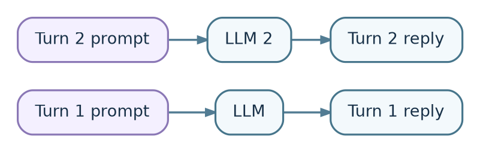
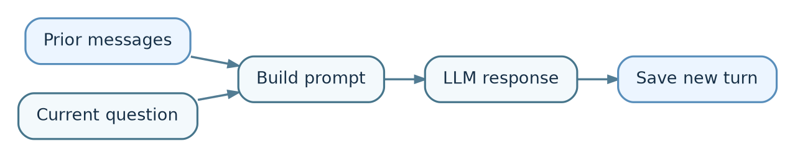
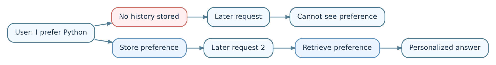
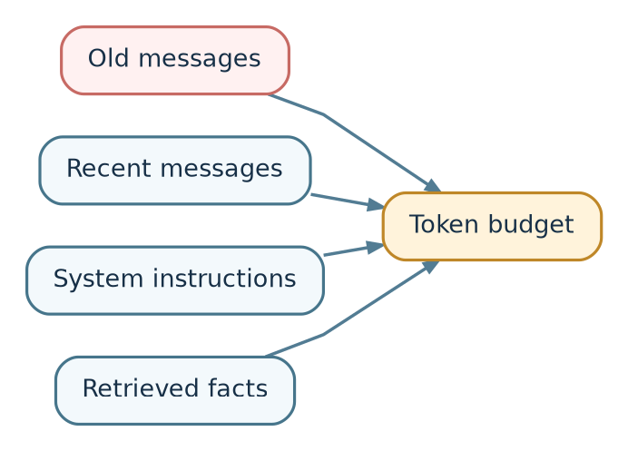
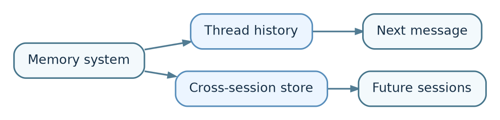
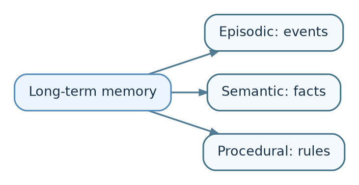
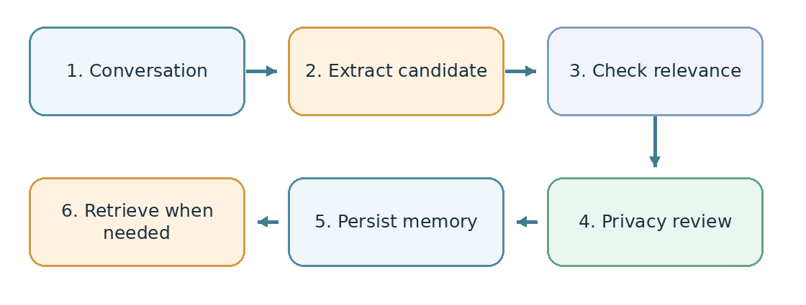
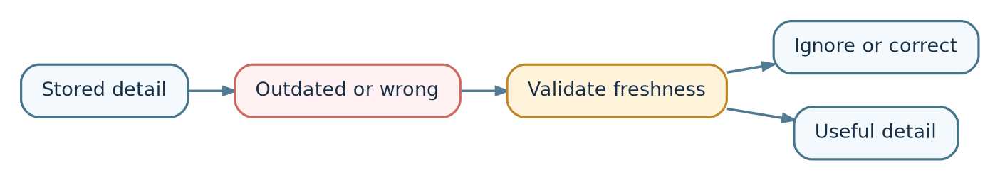

# How LLM Memory Works

**Agentic AI using LangGraph | Video 23 | CampusX**  
**Lesson:** [LLMs Don’t Have Memory — So How Do They Remember?](https://www.youtube.com/watch?v=DcPKJrOF9Wo)

> **Core idea:** LLMs receive context per inference call. Applications create the experience of memory by saving, retrieving, and supplying earlier information when it is relevant.

## 1. Learning goals

Explain stateless inference, chat-history injection, context windows, short-term versus long-term memory, and episodic/semantic/procedural memories.

### Video chapter links

| Time | Chapter |
| --- | --- |
| [00:00](https://www.youtube.com/watch?v=DcPKJrOF9Wo&t=0s) | Introduction: Why Memory Matters in GenAI |
| [02:01](https://www.youtube.com/watch?v=DcPKJrOF9Wo&t=121s) | How LLMs Work at Inference (Stateless by Design) |
| [09:44](https://www.youtube.com/watch?v=DcPKJrOF9Wo&t=584s) | The Core Problem: LLMs Have No Memory |
| [12:28](https://www.youtube.com/watch?v=DcPKJrOF9Wo&t=748s) | Building Memory Around LLMs (First-Principles Approach) |
| [13:05](https://www.youtube.com/watch?v=DcPKJrOF9Wo&t=785s) | Context Window and In-Context Learning |
| [18:51](https://www.youtube.com/watch?v=DcPKJrOF9Wo&t=1131s) | Short-Term Memory Using Conversation History |
| [23:43](https://www.youtube.com/watch?v=DcPKJrOF9Wo&t=1423s) | How Chatbots Implement Short-Term Memory |
| [26:33](https://www.youtube.com/watch?v=DcPKJrOF9Wo&t=1593s) | Limitations of Short-Term Memory |
| [40:06](https://www.youtube.com/watch?v=DcPKJrOF9Wo&t=2406s) | Why We Need Long-Term Memory |
| [43:32](https://www.youtube.com/watch?v=DcPKJrOF9Wo&t=2612s) | Types of Long-Term Memory (Episodic, Semantic, Procedural) |
| [47:20](https://www.youtube.com/watch?v=DcPKJrOF9Wo&t=2840s) | How Long-Term Memory Works (High-Level Architecture) |
| [53:36](https://www.youtube.com/watch?v=DcPKJrOF9Wo&t=3216s) | Challenges and Tools for Memory Systems |
| [56:40](https://www.youtube.com/watch?v=DcPKJrOF9Wo&t=3400s) | Future of Memory in LLMs |
| [57:39](https://www.youtube.com/watch?v=DcPKJrOF9Wo&t=3459s) | Closing Thoughts |

**Prerequisites:** Basic Python and the idea of an LLM workflow are helpful. New terms are explained when first used.

---

## 2. Why an LLM does not remember a conversation by itself

An **LLM is generally stateless at inference time**: each model call works with the prompt and context supplied to that call. The model's trained parameters contain learned patterns and broad knowledge, but those parameters are not automatically rewritten every time a person sends a chat message. If you call the same model twice with separate prompts, the second call does not inherently know what happened in the first one.

Think of a student who answers one question using a sheet of notes. When the sheet is taken away, the next question does not automatically come with the previous conversation. For a chatbot, the surrounding **application** has to save relevant messages and provide them again when necessary.

<p align="center"></p>

The diagram shows two independent model calls. Unless the application places information from the first call into the second prompt, there is no reliable connection between them. This is the main difference between **model knowledge** and **application memory**.

## 3. How a chatbot creates the experience of memory

A typical chat application stores conversation messages. On the next turn, it retrieves prior relevant messages, adds the newest question, sends that combined context to the model, and stores the new reply. The model looks as if it remembers because it can *see* earlier material in the current prompt.

<p align="center"></p>

Example: 

1. User: “I am preparing for a Python interview.”
2. Assistant: “Which topics are you studying?”
3. User: “Give me an exercise based on my goal.”

If the third request is sent alone, “my goal” is ambiguous. If it is sent with the earlier messages, the assistant can infer that the goal is a Python interview. The connection comes from saved and supplied context, not from the model permanently storing the user’s goal in its weights.

<p align="center"></p>

**Three separate jobs** are involved: **storage** keeps earlier information, **retrieval** chooses what the next call needs, and **prompt construction** places that information alongside the current request. These operations can be implemented using simple lists and dictionaries or more capable storage systems.

## 4. The context window and its limitations

A model has a **context window**: an upper limit on the text, messages, and other tokens it can process for one request. The prompt often contains system instructions, earlier messages, retrieved documents, tool outputs, and the latest question. All of them compete for a limited budget.

<p align="center"></p>

If the conversation becomes very long, simply attaching every old message can be expensive, slow, or impossible. Even before reaching a hard limit, large amounts of irrelevant context can distract the model and make answers less focused. This is why production systems often trim old messages, summarize older conversations, or retrieve only the facts that matter.

**In-context learning** is a related but different idea. The model can follow patterns or examples supplied inside the prompt without changing its trained weights. For example, if a prompt shows two examples of how to classify customer messages, the model may continue in the same pattern. Those examples still need to be provided again when relevant.

## 5. Short-term and long-term memory

**Short-term memory** is the working context of an active conversation: recent chat turns, current task information, and saved state for one conversation thread. It helps resolve references such as “that example,” “the previous answer,” or “continue where we stopped.”

**Long-term memory** stores useful information that may need to be recalled across separate conversations. Examples include a user’s permitted communication preference, a project’s established facts, or a recurring workflow rule. Long-term memory does not need to be injected into every prompt; the application retrieves it when it is relevant.

<p align="center"></p>

| Question | Short-term memory | Long-term memory |
| --- | --- | --- |
| What is usually stored? | Conversation turns and current state | Durable facts, preferences, experiences, rules |
| Typical scope | A thread or session | Across threads or sessions |
| Typical mechanism | Checkpointed graph state | Separate store, database, or memory service |
| Example | “What did I just ask?” | “Which code language do I prefer?” |
| Main risk | Context-window overflow | Stale, incorrect, or privacy-sensitive memories |

Neither mechanism improves the model’s factual reasoning by itself. They improve **access to context**. Whether the result is correct still depends on source quality, prompt design, validation, and the model.

## 6. Episodic, semantic, and procedural memory

These labels describe **what is remembered**, not three special built-in LLM components.

- **Episodic memory** captures an event or past experience. Example: “During the last debugging session, the API failed because a key was missing.”
- **Semantic memory** captures a stable fact or preference. Example: “This project uses PostgreSQL,” or an explicitly saved preferred response format.
- **Procedural memory** captures a rule or procedure. Example: “When publishing an article, check citations before sending it for approval.”

<p align="center"></p>

A practical assistant may use several types together. For example, a coding assistant could remember a past dependency conflict (episodic), the repository's Python version (semantic), and the team's test-before-commit routine (procedural). These categories overlap in practice; the system's data schema and retrieval strategy determine how the information is stored.

## 7. A practical memory architecture

A useful memory system should not automatically save everything people say. It first identifies candidate information, evaluates whether the detail is durable and helpful, checks whether saving it is allowed, and only then writes it to the correct storage location. At answer time, it searches for relevant memories rather than blindly placing the whole database into the model prompt.

<p align="center"></p>

Example: a user says, “For future code examples, use Python unless I ask otherwise.” That instruction can be useful across many conversations. A system could store a small preference with a timestamp and source, then retrieve it when generating later code examples. In contrast, “The coffee on my desk is warm” is temporary and not useful as a durable memory.

<p align="center"></p>

**End-to-end trace:** the question arrives → the application recognizes that code-language preference may matter → it searches the user's authorized memory area → finds the Python preference → includes it as supporting context → generates the answer. The stored preference is evidence about the user's prior choice, not a system-level command that overrides all later instructions.

## 8. What makes memory difficult?

**Relevance:** A memory that is accurate but unrelated can distract the model. **Freshness:** A user may change preferences, switch projects, or correct earlier statements. **Conflicts:** Two memories may disagree. **Privacy:** Sensitive details should not be stored or exposed without appropriate controls. **Evaluation:** The model can misremember even when relevant data is present.

<p align="center"></p>

A reliable system records provenance, permits correction and deletion, separates users' information, and has a policy for old memories. Semantic search can find related ideas rather than exact keywords, but it can also return plausible *wrong* matches. For important facts, verify the retrieved item and its scope before relying on it.

### Simple Python mental model

```python
history = [
    {"role": "user", "content": "I am learning Python."},
    {"role": "assistant", "content": "What would you like to practice?"},
]

new_message = {"role": "user", "content": "Give me a small exercise."}
model_input = history + [new_message]
# The application sends model_input, not just new_message.
# A real chat app stores the reply and manages token limits.
```

This small list demonstrates short-term history, not full long-term memory. Storing a list in Python RAM also does not guarantee that it survives a process restart. Later lessons add checkpointers and memory stores to solve those operational problems.


## 9. Worked example: what belongs in the model prompt?

Consider a learner who has used a coding assistant for several sessions. The assistant has stored recent conversation turns and two authorized long-term preferences: the learner studies Python, and they prefer explanations with diagrams. The new request is “Explain decorators with an example.” The application should assemble only context that helps with **this** answer.

| Available information | Use now? | Reason |
| --- | --- | --- |
| Current question about decorators | Yes | Defines the immediate task |
| Python learning preference | Yes | Determines suitable example language |
| Preference for diagrams | Usually | Helps choose presentation style |
| Yesterday's unrelated weather chat | No | Does not help explain decorators |
| A previous debugging error about a different repository | Probably no | Not relevant to the current concept |

The application can combine the request with the two preferences and call the model. This is **retrieval-augmented context**, not an invisible change to the model's parameters. If the user says “Actually use Java for this one,” the latest instruction should override the older general Python preference for the current answer.

### How to evaluate a memory system

A useful test set includes questions that require earlier context, questions where old context is irrelevant, and questions where a preference has changed. Measure **correct recall**, **wrong recall**, **privacy boundary violations**, **answer usefulness**, and **unnecessary context size**. The goal is not to retrieve the most memories; it is to retrieve the **right** memories.

Memory also needs a failure policy. If a saved fact lacks provenance or contradicts a newer message, the assistant should verify or ask rather than confidently presenting stale information. This is especially important for dates, prices, medical data, and other changing facts.


---

## Key takeaways for quick revision

1. Explain the distinction between model weights and conversation history.
2. Trace a multi-turn chat prompt.
3. Describe what consumes context-window tokens.
4. Differentiate short- and long-term memory.
5. Give one episodic, semantic, and procedural memory example.
6. Describe safe memory extraction and retrieval.

## Revision checklist

- [ ] Explain the distinction between model weights and conversation history.
- [ ] Trace a multi-turn chat prompt.
- [ ] Describe what consumes context-window tokens.
- [ ] Differentiate short- and long-term memory.
- [ ] Give one episodic, semantic, and procedural memory example.
- [ ] Describe safe memory extraction and retrieval.

## Practice questions and mini exercises

1. Write a tiny Python chat-history list and show the model input for a third turn.
2. Classify five example user facts as ephemeral, episodic, semantic, or procedural.
3. Design a context strategy for a long tutoring conversation without retaining irrelevant details.

## Interview questions and concise answers

**Q1. Why do we call an LLM stateless?**  
A normal inference call does not automatically remember a separate earlier call unless earlier context is supplied.

**Q2. How does a chatbot appear to remember?**  
The application saves earlier messages and includes relevant history in the next model input.

**Q3. What is a context window?**  
The bounded token budget available to a model for the current request and any supplied context.

**Q4. How is short-term memory different from long-term memory?**  
Short-term memory primarily supports the current thread; long-term memory persists selected information for reuse across threads.

**Q5. What is semantic memory?**  
Durable facts or concepts, such as established project details or authorized preferences.

**Q6. What are common memory problems?**  
Context overflow, irrelevant recall, outdated facts, privacy, and contradictions.


## Further learning

- [docs.langchain.com — Add Memory](https://docs.langchain.com/oss/python/langgraph/add-memory)
- [docs.langchain.com — Persistence](https://docs.langchain.com/oss/python/langgraph/persistence)

**One-sentence summary:** LLMs receive context per inference call. Applications create the experience of memory by saving, retrieving, and supplying earlier information when it is relevant.
