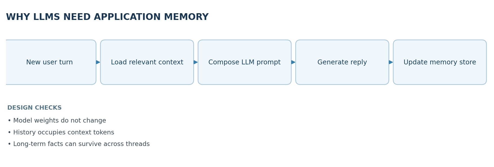
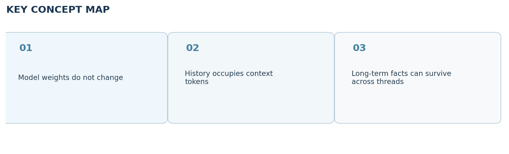

# Video 23 — Why LLMs Need Application Memory

> **CampusX Agentic AI using LangGraph · Playlist position 23 · Theory-first study notes**  \
> [Watch the lesson](https://www.youtube.com/watch?v=DcPKJrOF9Wo&list=PLKnIA16_RmvYsvB8qkUQuJmJNuiCUJFPL&index=23) · [Full playlist](https://www.youtube.com/playlist?list=PLKnIA16_RmvYsvB8qkUQuJmJNuiCUJFPL)

**Study scope:** Important conceptual material and small teaching examples, not a recreation of the tutorial project. These are original explanatory notes based on the video’s public chapter outline and the linked technical sources—not a transcript.



## Learning objectives

Understand why an LLM does not independently remember previous requests, how the **context window** differs from a memory system, and the roles of **short-term**, **semantic**, **episodic**, and **procedural** memory in AI agents.

## 1. Why an LLM is stateless by default

An LLM predicts its next output from the tokens it receives at inference time. Between calls, the model usually does **not update its weights** with what you said. If a new API call does not include earlier turns or retrieved facts, the model cannot reliably reference them. An application can create the *experience* of remembering by storing previous information and sending useful portions back into later prompts.

**Analogy:** the model is a capable reader; the prompt is the page currently placed in front of the reader. A chat app or agent is the librarian that chooses which earlier pages to bring back.

### What is and is not memory?

| Mechanism | What persists | Important limitation |
|---|---|---|
| Model parameters | Knowledge from training / fine-tuning | Not automatically updated by chatting |
| Prompt context | Text provided in this one call | Limited tokens; not durable on its own |
| Conversation history | Saved recent messages | Grows costly; can include irrelevant content |
| Long-term memory store | Selected facts, events or procedures | Needs write/retrieval policy, correction and privacy controls |

## 2. Context windows and in-context learning

The **context window** bounds how many tokens can be considered in one model invocation. Earlier messages, retrieved documents, system instructions, tool output and the current query all compete for that token budget. Sending more history can help with continuity but may increase cost, latency and irrelevant context. Simply expanding the prompt is not the same as building a memory system.

**In-context learning** describes adapting behavior from examples and information supplied in the prompt without updating model weights. It can seem like the model learned a preference permanently, but the effect normally disappears unless the application sends the preference again.

## 3. Short-term memory: conversation continuity

The most direct approach is keeping a sequence of recent user and assistant messages. When a user says, “What about its price?”, the model can resolve *its* from the immediately preceding exchange. Frameworks such as LangGraph persist per-thread state with **checkpointers**. In LangGraph, a `thread_id` identifies the ongoing conversation and a checkpoint holds state at particular execution points.

**Example:**

1. User: “I’m comparing laptop A and laptop B.”
2. Assistant: compares both.
3. User: “Which one has longer battery life?”
4. Application supplies the earlier exchanges; the model recognizes what “one” refers to.

Without message history, the final question is ambiguous. Notice that this is **application-level context management**, not new knowledge encoded into the model itself.

## 4. Why short-term memory alone fails

- **Finite window:** eventually the thread exceeds token limits.
- **Irrelevance:** carrying all earlier messages adds distracting details.
- **Cost:** large prompts require more tokens and longer processing.
- **Lost continuity:** old conversation content may be dropped to fit the budget.
- **Cross-thread isolation:** a fresh conversation may not see prior information unless deliberately retrieved.

Common mitigations are recent-message windows, selective trimming, summaries and explicit extraction of durable facts into a long-term store. Every mitigation can lose something: a summary is **lossy**, so do not rely on it as the only copy of high-stakes facts.

## 5. Long-term memory: durable, retrievable information

Long-term memory is selected information kept beyond the immediate conversation. Three useful cognitive-inspired categories are:

- **Semantic memory:** facts or stable preferences. Example: “The user prefers code examples in Python.”
- **Episodic memory:** records of events and what happened. Example: “A deployment on Tuesday failed because the token expired.”
- **Procedural memory:** instructions and reusable process patterns. Example: “Before publishing, run tests and request review.”

These are **design categories**, not built-in guarantee that memories are accurate or appropriately stored. Systems may represent them as records, document chunks, summaries or other structured objects.

## 6. Read path and write path

A memory system has **two separate workflows**:

**Write:** conversation/event -> candidate extraction -> validation and deduplication -> privacy/retention decision -> persist. **Read:** new request -> decide whether memory is needed -> search/filter by identity and relevance -> inject selected memory into context -> generate. The application decides what to store and retrieve; the base model does not do this automatically.

### Example memory record (illustrative)

```json
{
  "namespace": ["users", "user_42", "preferences"],
  "key": "code_language",
  "value": {"language": "Python", "source": "explicit user preference"}
}
```

Real systems must support deletion, updates, access rules, expiration and identifying contradictory facts. Do not automatically store secrets or every statement made in a conversation.

## 7. Practical memory design principles

- Keep short-term **thread state** separate from cross-thread **user/agent memory**.
- Retrieve narrowly: a finance question probably does not need the user's last recipe preference.
- Respect identity boundaries: a memory written for one user must not leak to another.
- Let users correct or delete stale or mistaken memories.
- Evaluate relevance *and* faithfulness; confidently recalled wrong information is worse than asking a question.

## 8. Quick revision

An LLM is not a persistent database. What feels like remembering is typically a system combining **storage**, **retrieval**, and **prompt construction**. Short-term memory preserves nearby dialogue; long-term memory preserves selected knowledge across a longer period or multiple threads.

### Self-check questions

1. Why doesn't calling the same LLM again automatically carry forward the previous API call?
2. What is the difference between a context window and a memory store?
3. Classify an incident report, a language preference, and a recurring checklist into memory types.
4. What could go wrong if memory retrieval ignores the current user's identity?

**Suggested answers:** (1) default inference is stateless; (2) one-call token budget versus persisted data; (3) episodic / semantic / procedural; (4) personal-data leakage and wrong personalization.

## Visual recap



## Clickable video chapters

- [00:00:00 — Why memory matters](https://www.youtube.com/watch?v=DcPKJrOF9Wo&list=PLKnIA16_RmvYsvB8qkUQuJmJNuiCUJFPL&index=23&t=0s)
- [00:02:01 — LLM inference is stateless](https://www.youtube.com/watch?v=DcPKJrOF9Wo&list=PLKnIA16_RmvYsvB8qkUQuJmJNuiCUJFPL&index=23&t=121s)
- [00:09:44 — The no-memory problem](https://www.youtube.com/watch?v=DcPKJrOF9Wo&list=PLKnIA16_RmvYsvB8qkUQuJmJNuiCUJFPL&index=23&t=584s)
- [00:12:28 — Building memory around LLMs](https://www.youtube.com/watch?v=DcPKJrOF9Wo&list=PLKnIA16_RmvYsvB8qkUQuJmJNuiCUJFPL&index=23&t=748s)
- [00:13:05 — Context windows and in-context learning](https://www.youtube.com/watch?v=DcPKJrOF9Wo&list=PLKnIA16_RmvYsvB8qkUQuJmJNuiCUJFPL&index=23&t=785s)
- [00:18:51 — Short-term memory with history](https://www.youtube.com/watch?v=DcPKJrOF9Wo&list=PLKnIA16_RmvYsvB8qkUQuJmJNuiCUJFPL&index=23&t=1131s)
- [00:23:43 — Chatbot implementations](https://www.youtube.com/watch?v=DcPKJrOF9Wo&list=PLKnIA16_RmvYsvB8qkUQuJmJNuiCUJFPL&index=23&t=1423s)
- [00:26:33 — Short-term memory limits](https://www.youtube.com/watch?v=DcPKJrOF9Wo&list=PLKnIA16_RmvYsvB8qkUQuJmJNuiCUJFPL&index=23&t=1593s)
- [00:40:06 — Need for long-term memory](https://www.youtube.com/watch?v=DcPKJrOF9Wo&list=PLKnIA16_RmvYsvB8qkUQuJmJNuiCUJFPL&index=23&t=2406s)
- [00:43:32 — Episodic, semantic, procedural memory](https://www.youtube.com/watch?v=DcPKJrOF9Wo&list=PLKnIA16_RmvYsvB8qkUQuJmJNuiCUJFPL&index=23&t=2612s)
- [00:47:20 — Long-term memory architecture](https://www.youtube.com/watch?v=DcPKJrOF9Wo&list=PLKnIA16_RmvYsvB8qkUQuJmJNuiCUJFPL&index=23&t=2840s)
- [00:53:36 — Challenges and tools](https://www.youtube.com/watch?v=DcPKJrOF9Wo&list=PLKnIA16_RmvYsvB8qkUQuJmJNuiCUJFPL&index=23&t=3216s)
- [00:56:40 — Future directions](https://www.youtube.com/watch?v=DcPKJrOF9Wo&list=PLKnIA16_RmvYsvB8qkUQuJmJNuiCUJFPL&index=23&t=3400s)
- [00:57:39 — Closing](https://www.youtube.com/watch?v=DcPKJrOF9Wo&list=PLKnIA16_RmvYsvB8qkUQuJmJNuiCUJFPL&index=23&t=3459s)

## References and further reading

- [CampusX video and chapters](https://playlist.tools/playlist/PLKnIA16_RmvYsvB8qkUQuJmJNuiCUJFPL/DcPKJrOF9Wo)
- [LangGraph memory guide](https://docs.langchain.com/oss/python/langgraph/add-memory)

*Prepared October 2026. Figures are original study diagrams, not screenshots or official CampusX illustrations. Some APIs may change; consult the linked official references before production use.*
