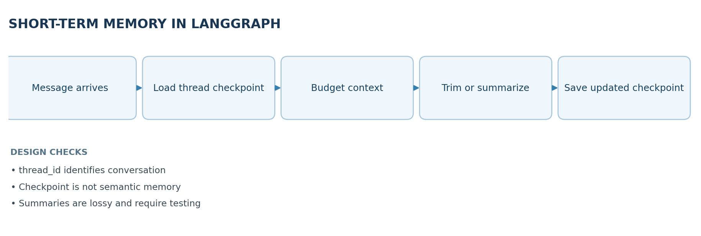
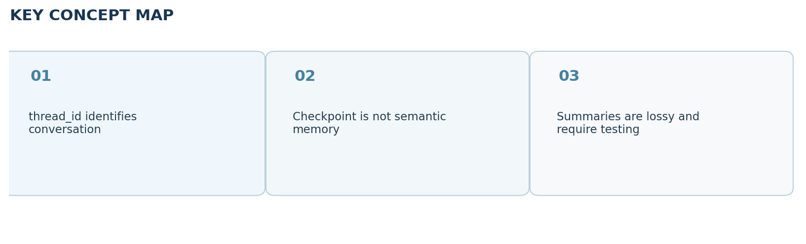

# Video 24 — Short-Term Memory in LangGraph

> **CampusX Agentic AI using LangGraph · Playlist position 24 · Theory-first study notes**  \
> [Watch the lesson](https://www.youtube.com/watch?v=FSBkTI1QuvY&list=PLKnIA16_RmvYsvB8qkUQuJmJNuiCUJFPL&index=24) · [Full playlist](https://www.youtube.com/playlist?list=PLKnIA16_RmvYsvB8qkUQuJmJNuiCUJFPL)

**Study scope:** Important conceptual material and small teaching examples, not a recreation of the tutorial project. These are original explanatory notes based on the video’s public chapter outline and the linked technical sources—not a transcript.



## Learning objectives

Explain LangGraph **checkpointers**, why thread identifiers matter, how PostgreSQL changes persistence durability, and how to manage long conversation histories using **trimming, deletion and summarization**.

## 1. What LangGraph short-term memory stores

Short-term memory is the context an agent carries across messages **within the same conversation thread**. LangGraph represents the workflow's current state as typed fields, often including `messages`. A **checkpointer** stores successive snapshots of that state, so the next invocation can load an earlier checkpoint associated with a `thread_id`.

- `thread_id`: a stable identifier for one conversation or task. It is not by itself authentication.
- Checkpointer: storage adapter that writes and retrieves graph state and execution progress.
- Checkpoint: saved state at a particular execution step.
- Persistent database: ensures saved state remains available after a process restart (subject to configuration).

Important distinction: **saving chat history is not the same as remembering a user's preferences across unrelated threads**. For that, use a cross-thread long-term store or a deliberate retrieval mechanism.

## 2. In-memory vs durable persistence

| Storage choice | Strength | Limitation | Typical role |
|---|---|---|---|
| `InMemorySaver()` | Easy and fast for demonstration | Lost on process exit; not shared across workers | Notebook tests |
| SQLite-based checkpointer | Durable local file | Local concurrency and operational limits | Prototypes / single-host apps |
| PostgreSQL checkpointer | Durable, service-friendly relational backend | Database setup, migrations, access and maintenance | Production deployment |

**Persistence test:** send message A in thread X; restart the application; send message B in thread X. If B can use A's history after the restart, the checkpoint store is persistent. Repeat using thread Y to ensure isolation between conversations.

## 3. Minimal checkpointer pattern

```python
from typing_extensions import TypedDict
from langgraph.graph import StateGraph, START, END
from langgraph.checkpoint.memory import InMemorySaver

class ChatState(TypedDict):
    last_message: str
    reply: str

def respond(state: ChatState):
    return {"reply": f"Received: {state['last_message']}"}

builder = StateGraph(ChatState)
builder.add_node("respond", respond)
builder.add_edge(START, "respond")
builder.add_edge("respond", END)
app = builder.compile(checkpointer=InMemorySaver())

config = {"configurable": {"thread_id": "conversation-001"}}
app.invoke({"last_message": "Hello", "reply": ""}, config=config)
saved = app.get_state(config)
print(saved.values["reply"])
```

This example shows the mechanism, not a full chat history implementation. Real chat graphs typically use `MessagesState` and a message reducer to append new turns correctly. Replace the in-memory saver with a durable backend when persistence across restarts is required.

## 4. Why a context strategy is necessary

A database may store thousands of conversation messages, but a model may only accept a limited number of input tokens. Your application needs to decide which messages to **include in the next model call**. Keeping the full state in a database does not force the whole history into the prompt. Good systems distinguish the retained historical record from the smaller prompt context.

### Strategy comparison

| Strategy | What happens | Pros | Risks |
|---|---|---|---|
| Trim | Select a recent/budgeted subset for the model | Simple; bounded tokens | Older dependencies vanish |
| Delete | Remove selected messages from saved state | Smaller persistent state | History may be permanently lost |
| Summarize | Replace/complement older history with concise summary | Keeps more context per token | Summary can omit or distort facts |
| Retrieve | Select relevant earlier turns or external memory | Useful over long periods | Retrieval may miss important facts |

**Trimming** can be prompt-only (preserve history in storage) or state-changing, depending on your code. **Deletion** is a deliberate mutation of persisted state. **Summarization** turns multiple turns into an information-dense but imperfect representation.

## 5. Summarization workflow, step by step

1. Count or estimate prompt tokens when a new message arrives.
2. If the budget is safe, continue with ordinary recent history.
3. Otherwise, summarize older turns, retaining names, decisions, constraints and unresolved questions.
4. Keep a recent uncompressed window next to the summary so local references remain accurate.
5. If required, delete old messages from state using appropriate message IDs/reducer semantics.
6. On the next turn, build the prompt from system instruction + summary + recent turns + new user input.

**Example:** a user and assistant plan a week-long itinerary over 30 messages. A useful summary preserves the travel dates, cities, budget, and reservations; it does **not** need every abandoned hotel suggestion.

## 6. Common implementation mistakes

- Starting every request with a fresh `thread_id`: continuity disappears.
- Reusing one thread ID for multiple users: data from separate conversations can mix.
- Confusing a stored checkpoint with a valid, concise prompt context.
- Deleting old turns *before* the summary captures important decisions.
- Trimming away tool call / tool result pairs, causing malformed message sequences.
- Summarizing repeatedly without verification; errors can compound across summaries.
- Assuming `InMemorySaver` survives a server or notebook restart.

## 7. Production checkpoints

Use durable storage with backups, sensible retention, encryption and access control. Consider **thread ownership checks**, database connection handling, and how snapshots are deleted on user request. Where messages contain private data, minimize what is written to logs and traces.

## 8. Quick revision

Short-term memory is **per-thread state backed by a checkpointer**. A durable checkpointer addresses restarts; context management addresses token limits. These are independent problems, and a production system generally needs both solutions.

### Self-check questions

1. Why does changing the thread ID change the accessible conversation state?
2. Which problem does PostgreSQL solve that a context summarizer does not?
3. How is trimming different from deleting the messages in persisted state?
4. What information should survive when summarizing a travel-planning conversation?

**Suggested answers:** (1) checkpoints are looked up per thread; (2) process-restart durability; (3) one can only filter prompt input, the other removes saved data; (4) decisions, requirements, dates and unresolved tasks.

## Visual recap



## Clickable video chapters

- [00:00:00 — Overview](https://www.youtube.com/watch?v=FSBkTI1QuvY&list=PLKnIA16_RmvYsvB8qkUQuJmJNuiCUJFPL&index=24&t=0s)
- [00:01:38 — Stateless LLM recap](https://www.youtube.com/watch?v=FSBkTI1QuvY&list=PLKnIA16_RmvYsvB8qkUQuJmJNuiCUJFPL&index=24&t=98s)
- [00:03:33 — Checkpointers and short-term memory](https://www.youtube.com/watch?v=FSBkTI1QuvY&list=PLKnIA16_RmvYsvB8qkUQuJmJNuiCUJFPL&index=24&t=213s)
- [00:04:46 — Threads and in-memory state](https://www.youtube.com/watch?v=FSBkTI1QuvY&list=PLKnIA16_RmvYsvB8qkUQuJmJNuiCUJFPL&index=24&t=286s)
- [00:09:22 — In-memory limitations](https://www.youtube.com/watch?v=FSBkTI1QuvY&list=PLKnIA16_RmvYsvB8qkUQuJmJNuiCUJFPL&index=24&t=562s)
- [00:11:16 — Production persistence](https://www.youtube.com/watch?v=FSBkTI1QuvY&list=PLKnIA16_RmvYsvB8qkUQuJmJNuiCUJFPL&index=24&t=676s)
- [00:12:38 — PostgreSQL with Docker](https://www.youtube.com/watch?v=FSBkTI1QuvY&list=PLKnIA16_RmvYsvB8qkUQuJmJNuiCUJFPL&index=24&t=758s)
- [00:15:54 — PostgreSQL checkpointer](https://www.youtube.com/watch?v=FSBkTI1QuvY&list=PLKnIA16_RmvYsvB8qkUQuJmJNuiCUJFPL&index=24&t=954s)
- [00:17:36 — Restart persistence test](https://www.youtube.com/watch?v=FSBkTI1QuvY&list=PLKnIA16_RmvYsvB8qkUQuJmJNuiCUJFPL&index=24&t=1056s)
- [00:19:30 — Context overflow](https://www.youtube.com/watch?v=FSBkTI1QuvY&list=PLKnIA16_RmvYsvB8qkUQuJmJNuiCUJFPL&index=24&t=1170s)
- [00:21:38 — Trimming messages](https://www.youtube.com/watch?v=FSBkTI1QuvY&list=PLKnIA16_RmvYsvB8qkUQuJmJNuiCUJFPL&index=24&t=1298s)
- [00:31:19 — Trimming trade-offs](https://www.youtube.com/watch?v=FSBkTI1QuvY&list=PLKnIA16_RmvYsvB8qkUQuJmJNuiCUJFPL&index=24&t=1879s)
- [00:32:03 — Summarization approach](https://www.youtube.com/watch?v=FSBkTI1QuvY&list=PLKnIA16_RmvYsvB8qkUQuJmJNuiCUJFPL&index=24&t=1923s)
- [00:35:24 — Deleting old messages](https://www.youtube.com/watch?v=FSBkTI1QuvY&list=PLKnIA16_RmvYsvB8qkUQuJmJNuiCUJFPL&index=24&t=2124s)
- [00:40:12 — Summarization graph](https://www.youtube.com/watch?v=FSBkTI1QuvY&list=PLKnIA16_RmvYsvB8qkUQuJmJNuiCUJFPL&index=24&t=2412s)
- [00:49:26 — Testing summaries](https://www.youtube.com/watch?v=FSBkTI1QuvY&list=PLKnIA16_RmvYsvB8qkUQuJmJNuiCUJFPL&index=24&t=2966s)
- [00:52:08 — Recap](https://www.youtube.com/watch?v=FSBkTI1QuvY&list=PLKnIA16_RmvYsvB8qkUQuJmJNuiCUJFPL&index=24&t=3128s)

## References and further reading

- [CampusX video and chapters](https://playlist.tools/playlist/PLKnIA16_RmvYsvB8qkUQuJmJNuiCUJFPL/FSBkTI1QuvY)
- [LangGraph add-memory guide](https://docs.langchain.com/oss/python/langgraph/add-memory)

*Prepared October 2026. Figures are original study diagrams, not screenshots or official CampusX illustrations. Some APIs may change; consult the linked official references before production use.*
