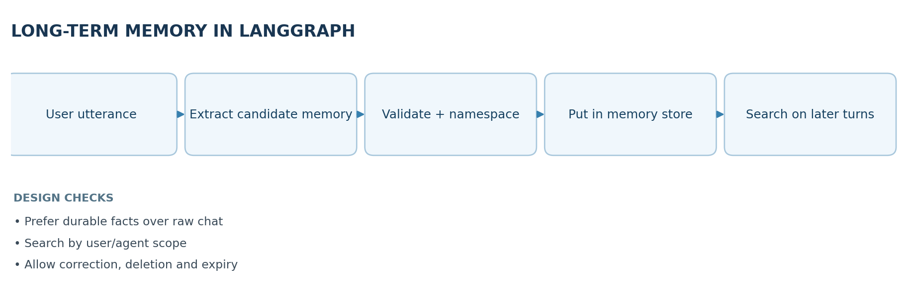
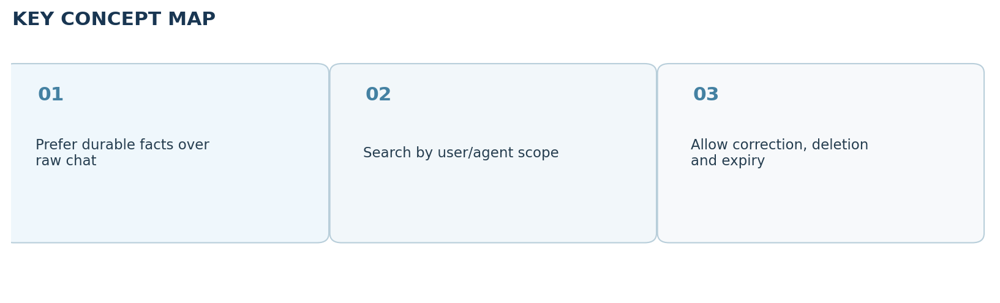

# Video 25 — Long-Term Memory in LangGraph

> **CampusX Agentic AI using LangGraph · Playlist position 25 · Theory-first study notes**  \
> [Watch the lesson](https://www.youtube.com/watch?v=KrXBcokM3Tc&list=PLKnIA16_RmvYsvB8qkUQuJmJNuiCUJFPL&index=25) · [Full playlist](https://www.youtube.com/playlist?list=PLKnIA16_RmvYsvB8qkUQuJmJNuiCUJFPL)

**Study scope:** Important conceptual material and small teaching examples, not a recreation of the tutorial project. These are original explanatory notes based on the video’s public chapter outline and the linked technical sources—not a transcript.



## Learning objectives

Distinguish **long-term memory** from per-thread checkpointing, explain LangGraph's **store abstraction**, design **namespaces and keys** for safe retrieval, and reason about when an agent should write, search, update or delete reusable knowledge.

## 1. Defining long-term memory

Short-term context answers, “What was said in this thread?” Long-term memory answers, “What useful fact, event or reusable instruction should still be available later—even in another thread?” The application extracts and persists selected information separately from the model's short-lived prompt.

Examples: preferred programming language, repeated formatting constraints, the outcome of a previous deployment, a reusable troubleshooting strategy. Long-term memory should be **selective**, not an uncontrolled copy of every chat line.

## 2. LangGraph stores versus checkpointers

| Concern | Checkpointer | Store |
|---|---|---|
| Primary scope | One graph execution or conversation thread | Across threads, users or workflows as configured |
| Typical content | Messages and intermediate graph state | Facts, notes, episodes, procedures |
| Common lookup | `thread_id` | Namespace + key, and optional semantic search |
| Lifecycle | Snapshots during execution | Explicitly written, read, updated and removed items |

In LangGraph, a store exposes operations such as `put`, `get`, `search` and `delete` (depending on backend), and a graph can be compiled with a store so nodes can access it. Storage scope comes from **your chosen namespace**; it does not enforce identity policy automatically.

## 3. Memory types, with examples

- **Semantic:** stable facts. “Prefers concise Python examples.” Good for personalization if explicitly provided and still relevant.
- **Episodic:** experiences or outcomes. “The last pipeline run failed because the credentials had expired.” Good for troubleshooting and continuity.
- **Procedural:** preferred steps. “When deploying, run tests then request review.” Good for repeatable agent behavior.

Do not overfit human memory terminology to a database. The **design question** is what data to keep, at what scope and how to retrieve it safely.

## 4. Namespace design: who can see this memory?

A namespace might be a tuple such as `("users", user_id, "preferences")` or `("teams", team_id, "deployment_lessons")`. A separate key identifies a specific record. The app must verify that the caller is allowed to access the namespace before search or retrieval; never trust a user-supplied identity string by itself.

### Minimal LangGraph store example

```python
from langgraph.store.memory import InMemoryStore

store = InMemoryStore()
namespace = ("users", "user_42", "preferences")
store.put(namespace, "preferred_language", {"language": "Python"})
item = store.get(namespace, "preferred_language")
print(item.value)

# Reading another namespace requires application authorization.
for item in store.search(namespace):
    print(item.key, item.value)
```

This works as a **conceptual synchronous in-memory example**. It does not survive restart. A production store should be persistent, access-controlled and configured for any semantic-search indexing you actually need. Plain key lookup and semantic search are different capabilities.

## 5. Memory write path: what deserves storage?

A good system should first classify candidate information:

1. **Usefulness:** will it matter again?
2. **Reliability:** was it explicitly stated, independently verified, or merely guessed by the model?
3. **Sensitivity:** is it necessary and appropriate to store? Does user consent or policy allow it?
4. **Scope and duration:** one thread, one user, shared team, or temporary task?
5. **Conflict check:** does an existing memory contradict the candidate?
6. **Update operation:** create a new record, correct an old one, or discard the candidate.

**Bad pattern:** store every inferred preference as permanent fact. **Better pattern:** persist explicit durable preferences and provide a correction/deletion path.

## 6. Memory read path: relevant recall

At the beginning of a new request, the agent determines whether past facts are useful. It then searches within an **authorized namespace**, possibly using keywords or vector similarity, retrieves a small number of records, filters them for relevance and freshness, and constructs a concise prompt with the selected facts.

**Example:** if the user asks about a bug in a Python dependency, recall a saved preference for Python and a recent incident involving that dependency—not unrelated travel plans. This controls token cost and minimizes accidental disclosure.

## 7. Semantic indexing and retrieval

A vector-enabled store may embed the searchable text of memory records and retrieve candidates whose meanings are related to the query. Embedding similarity is a **candidate ranking signal**, not proof that a memory is true, current or allowed. Metadata filters, exact-key lookups and per-user namespaces often matter just as much as vector similarity.

**Trade-offs:** a very small number of detailed records is easy to reason about but may omit nuance; thousands of tiny memories improve granularity but increase duplicate detection, retrieval complexity and maintenance work.

## 8. Lifecycle, security and evaluation

- Provide mechanisms to **inspect, edit, forget and expire** saved memories.
- Remove secrets, credentials and regulated information from candidate storage unless explicitly supported and authorized.
- Test “not found” behavior; an agent should ask or abstain rather than inventing a past preference.
- Audit cross-user data isolation and permission boundaries.
- Measure memory precision (recalled facts are correct), recall (needed facts are found) and useful personalization (output improves).
- Preserve the source/provenance and last-updated timestamp where possible to resolve conflicts.

## 9. Quick revision

Checkpointers preserve an execution's **state**. Long-term stores preserve selected **knowledge**. The system needs well-defined **write rules**, **read rules**, identity boundaries and lifecycle controls for either mechanism to be trustworthy.

### Self-check questions

1. Why isn't a persistent checkpoint automatically a long-term user preference memory?
2. What is a namespace used for, and why doesn't it replace authorization?
3. How do exact-key search and semantic search differ?
4. Should a single one-off request always be stored as a durable preference?

**Suggested answers:** (1) checkpoints track one thread and do not imply cross-thread fact extraction; (2) logical grouping but caller permissions are separate; (3) direct identifier lookup versus ranked similarity; (4) no—only when useful, reliable and appropriate.

## Visual recap



## Clickable video chapters

- [Watch the full video (Long-Term Memory in LangGraph)](https://www.youtube.com/watch?v=KrXBcokM3Tc&list=PLKnIA16_RmvYsvB8qkUQuJmJNuiCUJFPL&index=25) — no independently verified chapter timestamps were available, so none are invented.

## References and further reading

- [CampusX video](https://www.youtube.com/watch?v=KrXBcokM3Tc)
- [Long-term memory guide](https://docs.langchain.com/oss/python/langgraph/add-memory)

*Prepared October 2026. Figures are original study diagrams, not screenshots or official CampusX illustrations. Some APIs may change; consult the linked official references before production use.*
