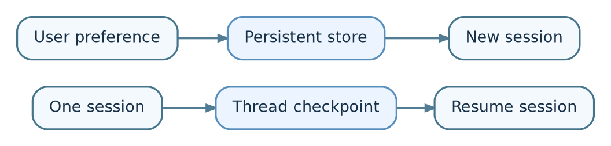
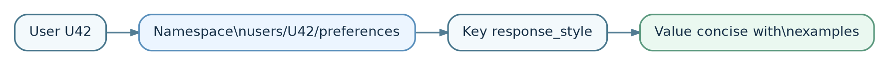
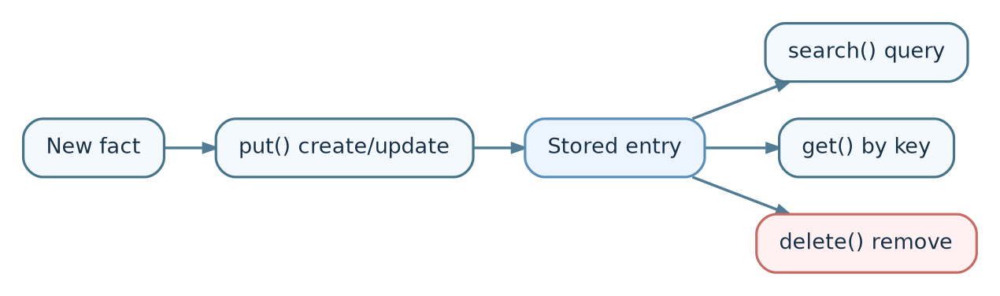
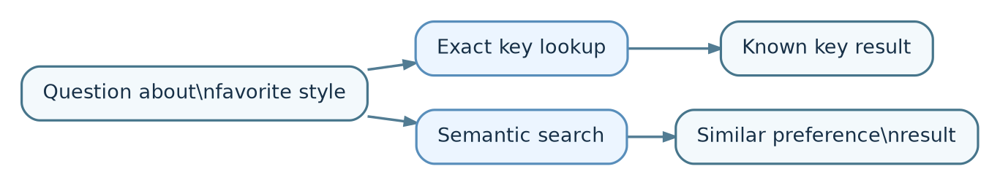
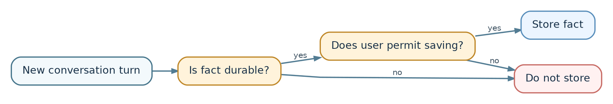
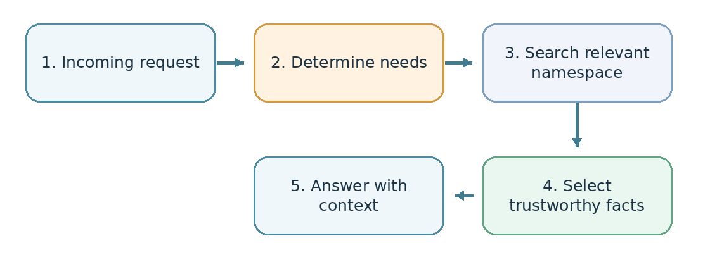
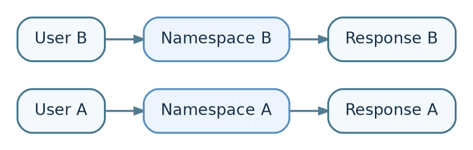

# Long-Term Memory in LangGraph

**Agentic AI using LangGraph | Video 25 | CampusX**  
**Lesson:** [Long Term Memory in LangGraph](https://www.youtube.com/watch?v=KrXBcokM3Tc)

> **Core idea:** Long-term memory is selected information stored outside one conversation thread and retrieved later using an authorized namespace and query.

## 1. Learning goals

Understand stores, namespaces, put/get/search/delete, semantic retrieval, memory writing, cross-thread recall, privacy, and updates.

### Video chapter links

| Time | Chapter |
| --- | --- |
| [00:00](https://www.youtube.com/watch?v=KrXBcokM3Tc&t=0s) | Start of lesson | Full lesson (no chapter markers supplied) |

**Prerequisites:** Basic Python and the idea of an LLM workflow are helpful. New terms are explained when first used.

---

## 2. What long-term memory adds to a chatbot

**Long-term memory** lets an AI application save selected information that can remain useful **across different conversation threads**. It might remember an explicitly authorized preference, a durable project fact, or something learned from a previous session. The application stores that information separately and retrieves it when a later request needs it.

A chatbot may hold the last few messages of a conversation but still forget the user's preferred learning format after starting a new chat. Long-term memory addresses that problem. It is not the model secretly updating its neural-network weights; it is an **external memory system** used as additional context when the model runs.

<p align="center"></p>

**Follow the diagram:** in conversation A, useful information is extracted and saved. Conversation B begins with a separate history, but the application can look up the saved information and use it when relevant. The memory store acts as a bridge between conversations.

## 3. Checkpointers and stores: two different responsibilities

LangGraph uses **checkpointers** to preserve the execution state of a specific **thread**, including chat messages and where the workflow paused. For information that should be accessible across threads, a **store** provides a different persistence interface. A store can organize structured memories under namespaces, retrieve them by key, and search for matching information.

<p align="center"></p>

A useful analogy is a notebook plus a filing cabinet. A **thread checkpoint** is the current notebook for one discussion. A **long-term store** is the filing cabinet containing selected facts you might need in several different discussions. They complement one another; neither replaces the other.

| Capability | Checkpointer | Memory store |
| --- | --- | --- |
| Main purpose | Resume one graph thread | Recall information across threads |
| Typical data | Messages, state, execution progress | Facts, preferences, history summaries |
| Common lookup | `thread_id` | Namespace, key, and optional search query |
| Example | Continue an unfinished interview chat | Remember approved answer-format preference |

The store itself must use a **durable backend** if memories need to survive service restarts. An in-process store is appropriate for demos, but not sufficient for long-lived production memory.

## 4. Namespaces and keys

A **namespace** groups related memories. It is commonly represented as a tuple of strings, such as `("users", "u42", "preferences")`. A **key** identifies one entry within that namespace, such as `"response_style"`. The stored **value** is usually a dictionary containing the actual memory and any metadata the application needs.

<p align="center"></p>

For example, an approved stored preference might look like this:

```python
namespace = ("users", "u42", "preferences")
key = "response_style"
value = {"style": "explain with Python examples", "source": "user preference"}
```

The namespace is more than a convenient name. In multi-user software, it is part of how you prevent one person's memories from appearing in another person's answers. The application must still **authenticate the user** and enforce access control: simply trusting any user-supplied namespace string is unsafe.

## 5. Creating, reading, updating, searching, and deleting memories

LangGraph's store interface provides familiar operations: `put`, `get`, `search`, and `delete`. A simple `InMemoryStore` example illustrates the idea without requiring any external embedding model or paid API.

<p align="center"></p>

```python
from langgraph.store.memory import InMemoryStore

store = InMemoryStore()  # Tutorial only: lives in this Python process.
namespace = ("users", "u42", "preferences")

store.put(namespace, "response_style", {"text": "Use clear Python examples"})
entry = store.get(namespace, "response_style")
print(entry.value["text"])  # Use clear Python examples

# Search can list entries in this namespace even without semantic indexing.
results = store.search(namespace)
print([item.key for item in results])

store.put(namespace, "response_style", {"text": "Prefer diagrams and examples"})
store.delete(namespace, "response_style")
```

Here `put` with the same namespace and key updates the entry; `get` retrieves a known item; `search` looks through a namespace; and `delete` removes one stored memory. **Deleting an item from this store is distinct from deleting every reference to it in logs, backups, or other systems**, so production deletion requirements must account for the full data lifecycle.

## 6. Exact lookup versus semantic search

If you know the key (`response_style`), exact lookup is straightforward. But a real question may be worded differently: “How should you explain technical topics to me?” It may be useful to retrieve a memory about *learning preferences* without knowing an exact key.

<p align="center"></p>

**Semantic search** compares the meaning of a query with stored memories using embeddings or other retrieval techniques. It can find related content even when keywords differ. It is powerful but not perfect: a similar-sounding memory might belong to a different project, be outdated, or not answer the question. The application should filter by namespace, permissions, relevance, and freshness before using results.

Semantic indexing in LangGraph requires appropriate embedding/index configuration; `InMemoryStore()` by itself does **not** automatically provide a high-quality vector-search service. For a beginner, first understand exact keys and namespace-scoped retrieval, then add semantic search when use cases demand it.

## 7. What should the application remember?

A memory writer should ask whether the information is **useful later**, **stable enough**, **permitted to store**, and **expressed clearly**. Some details are one-time instructions for the current answer. Others are durable preferences or reusable facts. A safe system does not transform every casual sentence into a permanent personal profile.

<p align="center"></p>

**Example:** “Use concise numbered steps when explaining code errors” is a potentially useful formatting preference when the user authorizes saving it. “I bought lunch at noon” is likely irrelevant to future coding help. A memory about an account password should not be captured as ordinary application memory at all.

Common memory-writing approaches include **explicitly saving** a user-provided preference, **extracting** candidates from an interaction, and **revising** older entries when the user corrects them. For sensitive or high-impact uses, prefer a review or consent step before storing extracted details.

## 8. Retrieving memories at the right moment

Saving information is only half of the problem. If the chatbot blindly inserts every memory into every prompt, the input becomes noisy, expensive, and potentially privacy-invasive. The application should decide what information the **current task** needs and retrieve only an appropriate subset.

<p align="center"></p>

Suppose a user begins a new conversation: “Show me a code example for state reducers.” A memory that the user prefers Python examples is relevant; a memory about a past travel plan is not. The retrieved preference can steer the style of the answer without changing the underlying technical truth.

The complete flow is: identify the current user → determine whether memory may help → search the authorized namespace → check confidence and freshness → pass relevant facts to the model or node → produce an answer. When needed, cite or show the source of a remembered fact so the user can correct it.

## 9. Memory boundaries, updates, and forgetting

Two separate users must have separate memory scopes. An administrator's access to one account should not automatically grant access to all memory data. Use stable internal identifiers, server-enforced permissions, and careful logging policies.

<p align="center"></p>

Preferences can change. A learner who previously preferred Java might later switch to Python; a team may migrate from one database to another. An outdated memory should not override newer, explicit instructions. Good systems record update dates and source provenance, resolve contradictions, and support correction or deletion.

<p align="center"></p>

Long-term memory is useful for personalization and continuity, but it adds real engineering responsibilities: privacy, retention, accuracy, retrieval quality, and user control. Treat it as a **data system with governance**, not as an invisible extra model capability.


## 10. Worked example: remembering a study preference across sessions

Suppose a learner explicitly wants technical notes with **clear diagrams, detailed explanations, and Python examples**. They start a new chat next week and ask for notes about message reducers. A cross-thread store can supply the earlier preference so the response matches the established style, even though the new thread has no prior messages.

| Phase | System operation | Result |
| --- | --- | --- |
| User expresses durable preference | Validate that it may be saved | Candidate memory |
| Write | `put(namespace, key, value)` | Memory stored under user's area |
| New conversation starts | Load new thread only | No unrelated old chat history |
| User asks for notes | Search relevant user memory | Matching style preference found |
| Answer | Apply current request + approved preference | Explanations include diagrams and code |

The **newest instruction wins** when the user asks for a different format in the current conversation. A stored preference should help when the current request is silent; it should not trap the user in an earlier choice.

### When to overwrite, add, or delete a memory

If the learner now prefers short explanations, update the style memory. If they start learning a second programming language, store a new fact rather than deleting the existing skill automatically. If they ask to stop remembering a category of details, enforce the deletion/retention procedure across the relevant memory systems and avoid reconstructing the deleted information from unrelated logs.

The quality of a memory system depends as much on **what it chooses not to remember** as on what it can recall. Treat permissions, retention, and conflict resolution as first-class features rather than later enhancements.


---

## Key takeaways for quick revision

1. Distinguish checkpointed state and cross-thread store.
2. Design namespaces for two users and two projects.
3. Demonstrate put, get, search, and delete.
4. Explain exact lookup versus semantic search.
5. Decide which candidate details should be saved.
6. Describe stale-memory correction and user data boundaries.

## Revision checklist

- [ ] Distinguish checkpointed state and cross-thread store.
- [ ] Design namespaces for two users and two projects.
- [ ] Demonstrate put, get, search, and delete.
- [ ] Explain exact lookup versus semantic search.
- [ ] Decide which candidate details should be saved.
- [ ] Describe stale-memory correction and user data boundaries.

## Practice questions and mini exercises

1. Use `InMemoryStore` to create two distinct users; confirm each has separate keys.
2. Design a user-preference memory with a timestamp and a source field.
3. Build a decision table for what should happen when a stored preference conflicts with a new user instruction.

## Interview questions and concise answers

**Q1. How does long-term memory differ from a checkpointer?**  
A checkpointer maintains a thread’s execution state; a store holds selected information that can be accessed across threads.

**Q2. What is a namespace?**  
A tuple-like grouping that scopes stored items, often by user or application purpose.

**Q3. What does `put()` do?**  
Creates or updates a value under a namespace and key.

**Q4. Why use semantic search?**  
To retrieve meaning-related memories even when the exact key or wording is unknown.

**Q5. Does InMemoryStore survive a process restart?**  
No. A durable backend is needed for persistent deployment.

**Q6. What makes long-term memory safe?**  
Permission checks, minimization, source tracking, correction, deletion, and per-user isolation.


## Further learning

- [docs.langchain.com — Add Memory](https://docs.langchain.com/oss/python/langgraph/add-memory)
- [docs.langchain.com — Use Subgraphs](https://docs.langchain.com/oss/python/langgraph/use-subgraphs)

**One-sentence summary:** Long-term memory is selected information stored outside one conversation thread and retrieved later using an authorized namespace and query.
