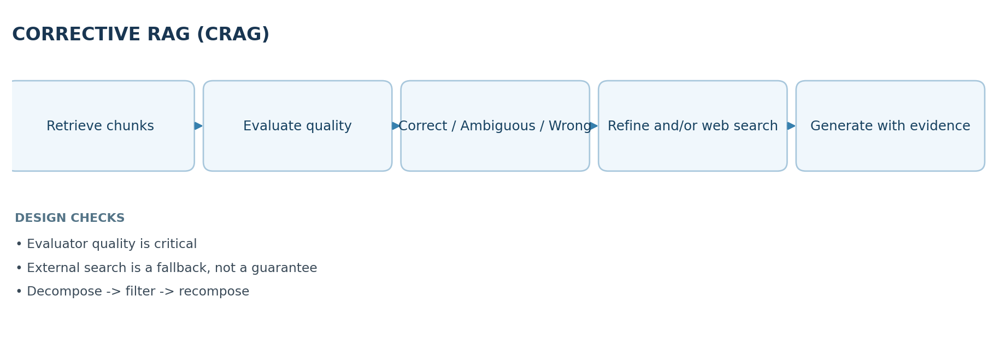
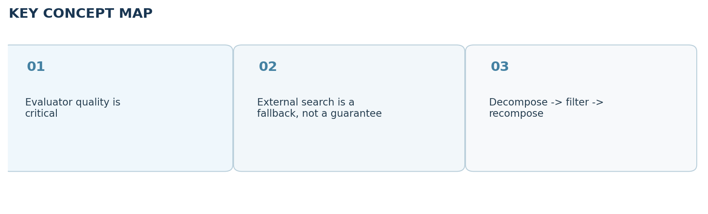

# Video 27 — Corrective RAG (CRAG)

> **CampusX Agentic AI using LangGraph · Playlist position 27 · Theory-first study notes**  \
> [Watch the lesson](https://www.youtube.com/watch?v=41XDn81nR5c&list=PLKnIA16_RmvYsvB8qkUQuJmJNuiCUJFPL&index=27) · [Full playlist](https://www.youtube.com/playlist?list=PLKnIA16_RmvYsvB8qkUQuJmJNuiCUJFPL)

**Study scope:** Important conceptual material and small teaching examples, not a recreation of the tutorial project. These are original explanatory notes based on the video’s public chapter outline and the linked technical sources—not a transcript.



## Learning objectives

Describe the “**blind-trust**” problem in traditional RAG, distinguish **correct / ambiguous / incorrect retrieval**, and explain the roles of a **retrieval evaluator**, **knowledge refinement**, **external search** and **query rewriting** in Corrective RAG (CRAG).

## 1. What traditional RAG actually does

A standard retrieval-augmented generation pipeline typically splits documents into chunks, embeds and indexes them, retrieves the top-k candidate passages for a user query, then asks an LLM to answer using those passages. RAG can supply data outside model weights, but **retrieval can fail**: the nearest vector may be semantically similar yet unhelpful, stale, incomplete or simply wrong for the question.

**Blind trust** means passing whatever documents the retriever returned into the generation prompt as though those documents were sufficient evidence. If the answer needs recent information but the vector store contains only older books, the model may still produce a persuasive unsupported response.

## 2. The core CRAG idea

The research paper *Corrective Retrieval Augmented Generation* proposes checking the **quality of retrieval before generation**. A lightweight retrieval evaluator gives a confidence signal that controls the next action. Instead of blindly trusting a retrieved bundle, the system can **refine** useful internal evidence, supplement or replace it with **web retrieval**, or combine sources when confidence is mixed.

The CampusX lesson expresses the choice as three useful conceptual cases:

| Retrieval assessment | Meaning | Appropriate next step |
|---|---|---|
| Correct | Retrieved evidence supports the query | Refine passages and answer |
| Incorrect | Evidence is mostly irrelevant or inadequate | Search outside the local store; maybe rewrite query |
| Ambiguous | Partly relevant or conflicting evidence | Combine/refine internal and external evidence |

These three cases are a **teaching abstraction**; practical systems choose thresholds, confidence scores, and policies that may be more nuanced than a strict three-way split.

## 3. Knowledge refinement: decompose, filter, recompose

Long chunks can contain both useful and distracting sentences. CRAG's **knowledge refinement** breaks retrieved text into smaller units, estimates which parts help answer the question, filters out noise, and recomposes a denser evidence set.

**Example query:** “What is the bias–variance tradeoff?”

- Retrieved chunk: a full chapter that includes the relevant definition plus unrelated historical anecdotes.
- Decompose: split into smaller, coherent units.
- Filter: keep explanations about model complexity, underfitting and overfitting.
- Recompose: pass those selected facts to the answer generator.

**Caution:** overly aggressive filtering can remove caveats or qualifiers. Preserve enough source attribution that the final answer can cite exactly which passages support it.

## 4. The evaluator is a policy gate

A retrieval evaluator might be a smaller model, an LLM classifier, or a score derived from retrieval features. It asks: *Does this candidate evidence actually answer the current question?* The classification must be **calibrated**, tested across query types and validated against human-labeled examples. A high similarity score alone does not guarantee factual usefulness.

A simple educational routing sketch:

```python
def choose_route(evaluation: str) -> str:
    if evaluation == "correct":
        return "refine_internal"
    if evaluation == "incorrect":
        return "search_external"
    return "combine_sources"  # ambiguous / mixed evidence
```

This is a **decision-policy sketch**, not a full implementation of the original research paper.

## 5. When and why to use external search

External search is helpful when a query falls **outside the local corpus**, especially for recent facts. But web evidence can be low quality, manipulated or contradictory. A search result is not automatically reliable; record provenance, freshness, source authority and whether the text directly supports the answer.

**Query rewriting** can increase coverage: replace a vague question with a focused search phrase, expand acronyms when useful, and remove irrelevant conversational references. Rewriting can also go wrong if it changes the user's intended question, so preserve the original query for comparison.

## 6. Walkthrough: one question in three branches

Imagine a private engineering knowledge base and the question “Which version of library X fixes the 2026 vulnerability?”

1. Retriever returns three release-note chunks.
2. Evaluator checks whether the chunks discuss the named vulnerability and relevant version.
3. **Correct:** keep precise release details, produce sourced answer.
4. **Incorrect:** local docs predate the vulnerability; search recent vendor advisories.
5. **Ambiguous:** local docs mention a patch, but a newer advisory conflicts; reconcile and state uncertainty.
6. Final generator uses only evidence with acceptable provenance and surfaces caveats where the evidence is incomplete.

## 7. CRAG vs baseline RAG

| Dimension | Standard RAG | Corrective RAG |
|---|---|---|
| Retrieval | Often top-k retrieval then immediate generation | Evaluate evidence quality first |
| Bad evidence | May be used without warning | Trigger correction path |
| Knowledge source | Usually predefined index | Can add external retrieval |
| Context | Raw retrieved chunks | Refined/selected evidence |
| Complexity | Lower latency and fewer calls | More evaluation, search and orchestration |

No architecture eliminates hallucinations. CRAG **reduces one failure mode** by questioning retrieval quality, while increasing runtime complexity and dependency on evaluator accuracy.

## 8. Production design recommendations

- Evaluate **retrieval precision, answer groundedness and citation accuracy** separately.
- Log evaluator verdict, thresholds, selected evidence and search paths for inspection.
- Cap external-search queries, retries, token budgets and total latency.
- Separate trusted internal documents from untrusted web pages; never follow instructions embedded in retrieved content.
- Detect disagreement across sources and permit “I cannot verify this” as a valid outcome.

## 9. Quick revision

**CRAG = RAG + retrieval evaluation + corrective routing.** It asks whether evidence is good enough *before* generating, and may refine internal passages, seek external evidence or combine both.

### Self-check questions

1. Why can a high vector-similarity score still produce a bad answer?
2. When should CRAG use an external knowledge source?
3. What problem does the decompose-filter-recompose strategy solve?
4. Why must you test the retrieval evaluator independently?

**Suggested answers:** (1) semantic similarity does not prove answer sufficiency or truth; (2) when local evidence is inadequate/stale; (3) removes irrelevant material while retaining supporting facts; (4) evaluator errors cause the wrong branch to be taken.

## Visual recap



## Clickable video chapters

- [00:00:00 — CRAG introduction](https://www.youtube.com/watch?v=41XDn81nR5c&list=PLKnIA16_RmvYsvB8qkUQuJmJNuiCUJFPL&index=27&t=0s)
- [00:01:12 — Blind trust and hallucinations](https://www.youtube.com/watch?v=41XDn81nR5c&list=PLKnIA16_RmvYsvB8qkUQuJmJNuiCUJFPL&index=27&t=72s)
- [00:02:00 — Vector DB and retrieval workflow](https://www.youtube.com/watch?v=41XDn81nR5c&list=PLKnIA16_RmvYsvB8qkUQuJmJNuiCUJFPL&index=27&t=120s)
- [00:04:22 — Out-of-distribution questions](https://www.youtube.com/watch?v=41XDn81nR5c&list=PLKnIA16_RmvYsvB8qkUQuJmJNuiCUJFPL&index=27&t=262s)
- [00:07:04 — Baseline retriever code](https://www.youtube.com/watch?v=41XDn81nR5c&list=PLKnIA16_RmvYsvB8qkUQuJmJNuiCUJFPL&index=27&t=424s)
- [00:10:17 — Baseline testing](https://www.youtube.com/watch?v=41XDn81nR5c&list=PLKnIA16_RmvYsvB8qkUQuJmJNuiCUJFPL&index=27&t=617s)
- [00:13:51 — Hallucination example](https://www.youtube.com/watch?v=41XDn81nR5c&list=PLKnIA16_RmvYsvB8qkUQuJmJNuiCUJFPL&index=27&t=831s)
- [00:15:53 — CRAG research paper architecture](https://www.youtube.com/watch?v=41XDn81nR5c&list=PLKnIA16_RmvYsvB8qkUQuJmJNuiCUJFPL&index=27&t=953s)
- [00:17:20 — Correct / incorrect / ambiguous retrieval](https://www.youtube.com/watch?v=41XDn81nR5c&list=PLKnIA16_RmvYsvB8qkUQuJmJNuiCUJFPL&index=27&t=1040s)
- [00:21:01 — Internal versus external knowledge](https://www.youtube.com/watch?v=41XDn81nR5c&list=PLKnIA16_RmvYsvB8qkUQuJmJNuiCUJFPL&index=27&t=1261s)
- [00:23:02 — Knowledge refinement](https://www.youtube.com/watch?v=41XDn81nR5c&list=PLKnIA16_RmvYsvB8qkUQuJmJNuiCUJFPL&index=27&t=1382s)
- [00:30:11 — Refinement node code](https://www.youtube.com/watch?v=41XDn81nR5c&list=PLKnIA16_RmvYsvB8qkUQuJmJNuiCUJFPL&index=27&t=1811s)
- [00:35:40 — Retrieval evaluation logic](https://www.youtube.com/watch?v=41XDn81nR5c&list=PLKnIA16_RmvYsvB8qkUQuJmJNuiCUJFPL&index=27&t=2140s)
- [00:45:36 — Evaluation node and schema](https://www.youtube.com/watch?v=41XDn81nR5c&list=PLKnIA16_RmvYsvB8qkUQuJmJNuiCUJFPL&index=27&t=2736s)
- [00:51:40 — Evaluator testing](https://www.youtube.com/watch?v=41XDn81nR5c&list=PLKnIA16_RmvYsvB8qkUQuJmJNuiCUJFPL&index=27&t=3100s)
- [00:53:42 — Web search integration](https://www.youtube.com/watch?v=41XDn81nR5c&list=PLKnIA16_RmvYsvB8qkUQuJmJNuiCUJFPL&index=27&t=3222s)
- [01:00:43 — Query rewriting](https://www.youtube.com/watch?v=41XDn81nR5c&list=PLKnIA16_RmvYsvB8qkUQuJmJNuiCUJFPL&index=27&t=3643s)
- [01:07:18 — Merging mixed evidence](https://www.youtube.com/watch?v=41XDn81nR5c&list=PLKnIA16_RmvYsvB8qkUQuJmJNuiCUJFPL&index=27&t=4038s)
- [01:14:19 — Paper comparison](https://www.youtube.com/watch?v=41XDn81nR5c&list=PLKnIA16_RmvYsvB8qkUQuJmJNuiCUJFPL&index=27&t=4459s)

## References and further reading

- [CampusX video and chapters](https://playlist.tools/playlist/PLKnIA16_RmvYsvB8qkUQuJmJNuiCUJFPL/41XDn81nR5c)
- [Original CRAG paper](https://arxiv.org/abs/2401.15884)

*Prepared October 2026. Figures are original study diagrams, not screenshots or official CampusX illustrations. Some APIs may change; consult the linked official references before production use.*
