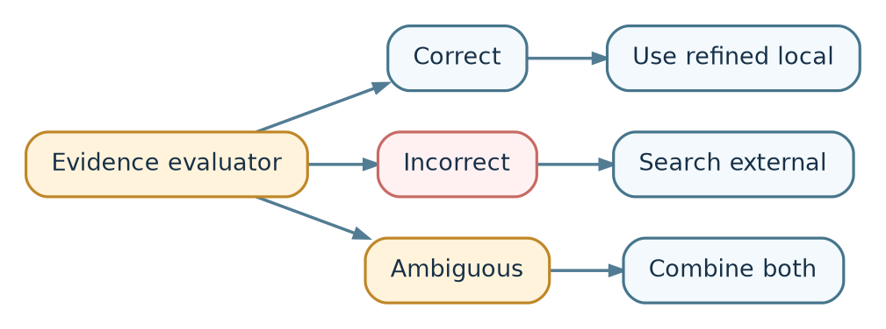
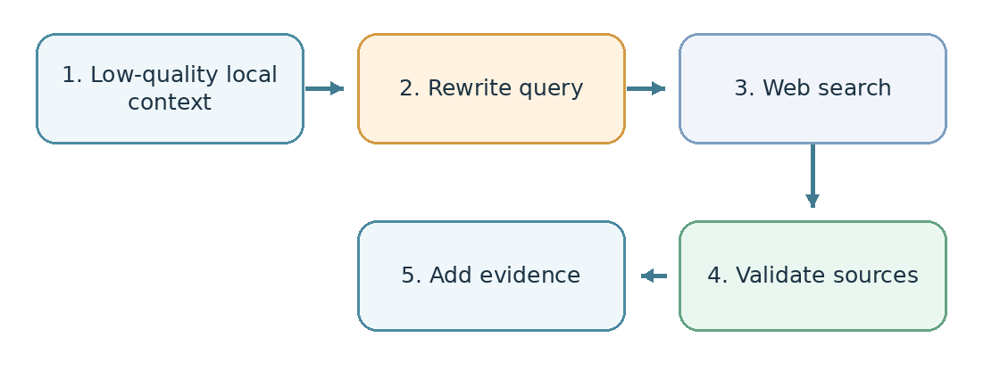
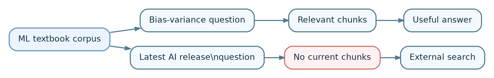
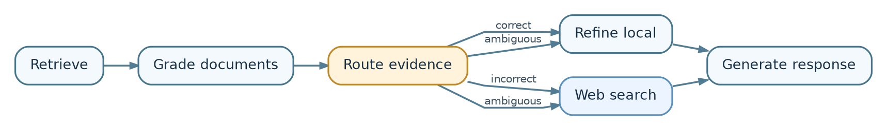
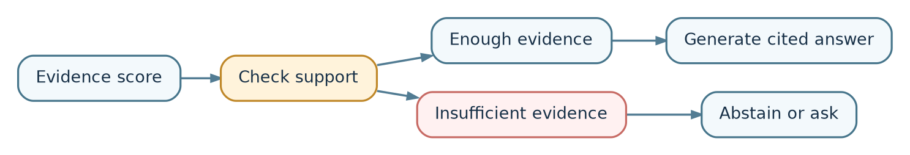

# Corrective RAG (CRAG)

**Agentic AI using LangGraph | Video 27 | CampusX**  
**Lesson:** [Advanced RAG: How Corrective RAG (CRAG) Solves Traditional RAG Problems | CampusX](https://www.youtube.com/watch?v=41XDn81nR5c)

> **Core idea:** Corrective RAG evaluates the quality of retrieved evidence and repairs weak context by refining local documents, searching additional sources, or combining both.

## 1. Learning goals

Explain traditional RAG failure modes, three retrieval-quality cases, refinement, web fallback, evaluator routing, and reliability checks.

### Video chapter links

| Time | Chapter |
| --- | --- |
| [00:00](https://www.youtube.com/watch?v=41XDn81nR5c&t=0s) | What is Corrective RAG (CRAG)? |
| [01:12](https://www.youtube.com/watch?v=41XDn81nR5c&t=72s) | The problem with Traditional RAG: "Blind Trust" & Hallucinations |
| [02:00](https://www.youtube.com/watch?v=41XDn81nR5c&t=120s) | Visualising the Vector Database & Retrieval Workflow |
| [04:22](https://www.youtube.com/watch?v=41XDn81nR5c&t=262s) | Practical Example: When LLMs fail on "Out of Distribution" queries |
| [07:04](https://www.youtube.com/watch?v=41XDn81nR5c&t=424s) | Code Walkthrough: Loading ML books and creating a basic Retriever |
| [10:17](https://www.youtube.com/watch?v=41XDn81nR5c&t=617s) | Testing the Baseline: Bias-Variance Tradeoff vs. Recent AI News |
| [13:51](https://www.youtube.com/watch?v=41XDn81nR5c&t=831s) | Identifying Hallucinations in the Transformer architecture query |
| [15:53](https://www.youtube.com/watch?v=41XDn81nR5c&t=953s) | Deep Dive: The CRAG Research Paper & Proposed Architecture |
| [17:20](https://www.youtube.com/watch?v=41XDn81nR5c&t=1040s) | The 3 Retrieval Cases: Correct, Incorrect, and Ambiguous |
| [21:01](https://www.youtube.com/watch?v=41XDn81nR5c&t=1261s) | Retrieval Evaluator: Refining Internal vs. External Knowledge |
| [23:02](https://www.youtube.com/watch?v=41XDn81nR5c&t=1382s) | Iteration 1: Knowledge Refinement (Decomposition & Filtration) |
| [30:11](https://www.youtube.com/watch?v=41XDn81nR5c&t=1811s) | Code: Building the Refined Value Node with Sentence Strips |
| [35:40](https://www.youtube.com/watch?v=41XDn81nR5c&t=2140s) | Iteration 2: Retrieval Evaluation (Thresholding Logic) |
| [45:36](https://www.youtube.com/watch?v=41XDn81nR5c&t=2736s) | Code: Implementing the Evaluation Node & Pydantic Schema |
| [51:40](https://www.youtube.com/watch?v=41XDn81nR5c&t=3100s) | Testing the Evaluator: Correct vs. Incorrect Verdicts |
| [53:42](https://www.youtube.com/watch?v=41XDn81nR5c&t=3222s) | Iteration 3: Web Search Integration using Tavily |
| [01:00:43](https://www.youtube.com/watch?v=41XDn81nR5c&t=3643s) | Iteration 4: Query Rewriting for Better Search Results |
| [01:07:18](https://www.youtube.com/watch?v=41XDn81nR5c&t=4038s) | Handling Ambiguous Knowledge: Merging Internal & External Context |
| [01:14:19](https://www.youtube.com/watch?v=41XDn81nR5c&t=4459s) | Conclusion: Comparing our implementation to the Original Paper |

**Prerequisites:** Basic Python and the idea of an LLM workflow are helpful. New terms are explained when first used.

---

## 2. A quick review of ordinary RAG

**Retrieval-Augmented Generation (RAG)** is a technique where an application retrieves external documents that may help answer a question and includes their content as context for a language model. Instead of relying only on facts encoded in the model's parameters, it can consult a company knowledge base, research papers, manuals, or other sources.

A typical pipeline is **question → retrieve chunks → give the chunks to an LLM → generate an answer**. This can be useful, but there is an important assumption hidden inside it: the retrieved chunks actually contain relevant and reliable evidence.

<p align="center"></p>

For example, imagine a vector database built from machine-learning textbooks. If the user asks, “Explain the bias-variance trade-off,” the retriever should find relevant passages and the model can explain the concept. If the user asks about a brand-new AI announcement not covered by those books, retrieving the closest textbook paragraph does not magically produce the missing information.

## 3. Why traditional RAG can fail

A retriever tries to find documents *similar* to a question, but a similar passage is not necessarily sufficient, accurate, or current. The model may then **trust irrelevant retrieved text** and produce a confident answer that lacks evidence. This failure is sometimes described as **blind trust in retrieval**.

<p align="center"></p>

Three recurring problems are **irrelevance** (wrong topic), **incompleteness** (document contains only part of the answer), and **staleness** (document is no longer current). A fourth problem is **noisy chunks**: long passages mix helpful details with unrelated text. Increasing the number of retrieved passages may add more noise rather than improving quality.

A good RAG system therefore needs a way to **evaluate and, when necessary, correct** its evidence before asking the model to answer.

## 4. What Corrective RAG changes

**Corrective RAG (CRAG)** improves ordinary RAG by checking the quality of retrieved evidence and taking a corrective action when the evidence is weak. A retrieval evaluator estimates whether the local documents are useful. Depending on the result, the workflow can refine them, search external sources, or combine both.

<p align="center"></p>

The goal is not to force the LLM to try harder with bad input. It is to improve **the input evidence itself**. A useful analogy is writing a research report: before quoting a book, you check whether the relevant page actually answers the question; if not, you look for a better source.

The original CRAG research proposes a lightweight evaluator, confidence-based corrective decisions, knowledge refinement, and web search. A teaching implementation can approximate these parts using LangGraph nodes and LLM-based graders. That approximation follows the **control-flow idea** but is not automatically the same as the original trained research system.

## 5. The three evidence-quality cases

A CRAG-style evaluator may assign one of three outcomes:

**Correct.** The retrieved material is sufficiently relevant. Keep it, refine it, and use it for generation.

**Incorrect.** The retrieved material is clearly unsuitable. Do not rely on it. Search additional sources, often using a rewritten query.

**Ambiguous.** The local evidence contains some useful information but is incomplete or uncertain. Use a combination of refined local and supplementary external evidence, with careful validation.

<p align="center"></p>

Example: with an ML textbook corpus, “What is overfitting?” may lead to **correct** retrieval, “What happened in AI news this morning?” may lead to **incorrect** retrieval because textbooks are not current news, and “How do older techniques compare with a new model release?” may be **ambiguous** because part of the answer is in the books and part requires updated information.

### Evaluator decisions are not ground truth

Thresholds and LLM graders can be wrong. An evaluator may accept a passage because it uses similar terms while missing the key fact. Therefore, test the evaluator against known examples and record its decisions. A high confidence score should never be treated as a mathematical guarantee of factual accuracy.

## 6. Knowledge refinement: decompose, filter, recompose

Even a relevant document may contain paragraphs that do not help answer the question. CRAG describes a **decompose–filter–recompose** idea: split documents into smaller knowledge units, filter out irrelevant pieces, then combine the useful pieces into cleaner context.

<p align="center"></p>

Imagine a ten-page chapter discussing evaluation metrics, dataset preparation, and bias-variance trade-offs. If the question is specifically about bias-variance, the system can keep the explanatory sentences and remove unrelated pages before forming the context sent to the generator.

This process is sometimes described as extracting **knowledge strips**. Refinement is not ordinary text summarization: the goal is to preserve *relevant evidence* and discard distracting material. But aggressive filtering can remove nuance. Always retain enough surrounding information to avoid changing a statement's meaning.

## 7. Web search and query rewriting as correction tools

When local retrieval fails, the workflow may rewrite the question into an effective search query and use an external search tool. The returned results should be **validated** for provenance, recency, and relevance. Search results are not automatically trustworthy merely because they came from the internet.

<p align="center"></p>

For example, “What is the current release status of model X?” should not be answered from a general ML textbook. A corrected search could include the model name, release version, and official announcement domain. If nothing reliable can be found, the system should say the information is unverified instead of inventing the release date.

## 8. Working through a textbook example

<p align="center"></p>

| Question | Local collection | Likely outcome | Next action |
| --- | --- | --- | --- |
| “Explain bias-variance trade-off.” | ML books | Relevant passages | Refine and answer |
| “What is the Transformer architecture?” | Mixed ML notes | Maybe partial or noisy | Inspect relevance; supplement if needed |
| “What changed in AI this week?” | Old textbooks | Not current enough | Seek reliable recent sources |

This example shows why **retrieval quality** and **collection coverage** are separate questions. A good vector index still cannot return a document that was never put into it.

## 9. A LangGraph-style CRAG workflow

LangGraph is well suited to CRAG because the next step depends on an evaluator decision. One node retrieves context, another grades it, conditional edges choose refinement or web search, and a final node generates an answer using the accepted evidence.

<p align="center"></p>

A simplified routing function might look like this:

```python
def choose_evidence_route(state: dict) -> str:
    """Return a routing label from a previously computed quality score."""
    score = state["retrieval_quality"]  # illustrative value in [0, 1]
    if score >= 0.80:
        return "refine_local"
    if score <= 0.35:
        return "search_web"
    return "combine_sources"

# In a StateGraph, add_conditional_edges can map these
# route labels to the appropriate refinement/search nodes.
```

The numeric thresholds here are **illustrative design choices**, not universal CRAG paper constants. You must calibrate them for your retriever, evaluator, data, and accuracy requirements. A complete implementation also needs retrieval, safe web searching, source checking, and answer generation.

## 10. Risks, stopping conditions, and evaluation

<p align="center"></p>

CRAG can reduce some retrieval failures, but it is not a guarantee against hallucination. The evaluator can misclassify evidence, the web search can find poor sources, and the generator can still introduce unsupported claims. Good systems test **retrieval precision, answer grounding, citation correctness, latency, and cost**.

A robust fallback for insufficient evidence is to **ask for clarification or abstain**, not to keep searching forever. Set tool-use budgets and log which documents led to the answer. The clearest mental model is: **retrieve → judge evidence → correct evidence if needed → generate with the corrected evidence**.


## 11. Worked example: evaluating three retrieved passages

A learner asks, “What is the bias-variance trade-off?” The knowledge base contains three chunks. One defines bias and variance, one discusses general statistical learning, and one describes a completely different algorithm. A CRAG-style evaluator must decide which chunks actually support an answer.

| Retrieved text | Quality judgment | Reason |
| --- | --- | --- |
| “High bias underfits; high variance overfits...” | Strong | Directly addresses the question |
| “Models are trained using data and metrics...” | Weak / partial | True but too general |
| “How to install a database driver...” | Incorrect | Unrelated to the requested concept |

The **knowledge refinement** stage can keep the first chunk, perhaps keep a useful sentence from the second, and drop the third. The generator receives a smaller, more focused body of evidence. If *every* chunk was poor, the workflow would need a different source rather than pretending the closest match answered the question.

Now change the question to “What AI product was announced yesterday?” The old textbooks cannot give a current answer even if the retriever returns semantically similar AI passages. The evaluator should recognize **collection insufficiency**, trigger a reliable recent search if permitted, and attach appropriate source details to the answer.

### How to test retrieval correction

Create test questions grouped by **correct**, **incorrect**, and **ambiguous** retrieved evidence. Record the route chosen, quality of accepted context, whether claims are supported, and additional latency from external search. Watch for overconfident thresholds and situations where local and web sources disagree. A system that always searches the web may be expensive; one that never searches is likely to miss current information.


---

## Key takeaways for quick revision

1. Draw the ordinary RAG pipeline and identify its failure point.
2. Explain correct, incorrect, and ambiguous evidence cases.
3. Describe decompose–filter–recompose.
4. Explain when to rewrite and search externally.
5. Trace a CRAG-style conditional LangGraph route.
6. List evidence-quality and answer-quality metrics.

## Revision checklist

- [ ] Draw the ordinary RAG pipeline and identify its failure point.
- [ ] Explain correct, incorrect, and ambiguous evidence cases.
- [ ] Describe decompose–filter–recompose.
- [ ] Explain when to rewrite and search externally.
- [ ] Trace a CRAG-style conditional LangGraph route.
- [ ] List evidence-quality and answer-quality metrics.

## Practice questions and mini exercises

1. Classify a bias-variance query, a recent-news query, and a mixed query against an old ML textbook collection.
2. Write three sample document grades and choose a route for each.
3. Design a fallback that refuses to invent facts when both local retrieval and external search fail.

## Interview questions and concise answers

**Q1. What problem does CRAG solve?**  
It addresses poor or irrelevant retrieved evidence before generating a response.

**Q2. What are the three evaluator outcomes?**  
Correct, incorrect, and ambiguous retrieval quality.

**Q3. What happens when retrieval is correct?**  
Refine the useful local knowledge and use it in generation.

**Q4. What happens when retrieval is incorrect?**  
Avoid relying on the poor context and seek better evidence, often externally.

**Q5. What is knowledge refinement?**  
Decomposing text into smaller units, filtering for relevance, and recomposing useful evidence.

**Q6. Does CRAG guarantee no hallucinations?**  
No. Evaluators and sources can still be wrong, so answer grounding must be checked.


## Further learning

- [arxiv.org — 2401.15884](https://arxiv.org/abs/2401.15884)
- [docs.langchain.com — Workflows Agents](https://docs.langchain.com/oss/python/langgraph/workflows-agents)

**One-sentence summary:** Corrective RAG evaluates the quality of retrieved evidence and repairs weak context by refining local documents, searching additional sources, or combining both.
