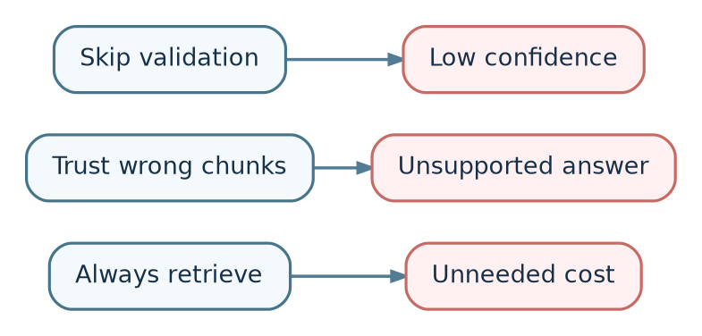
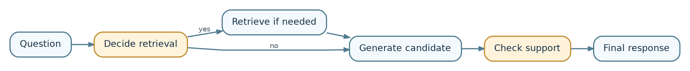
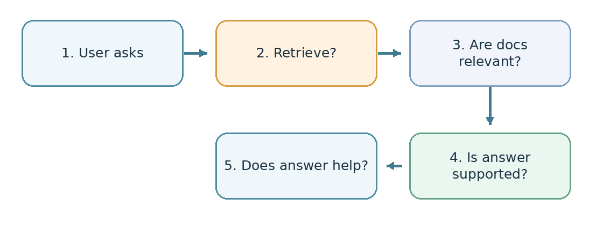
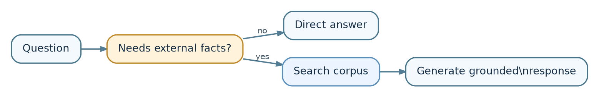
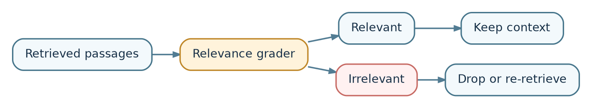
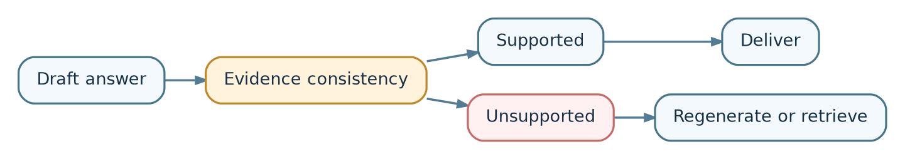
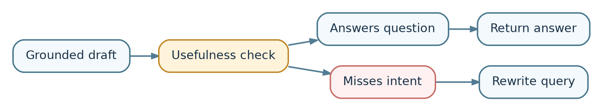
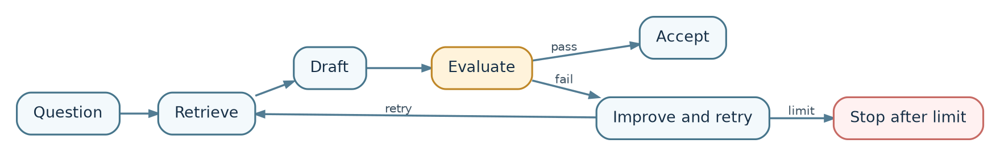
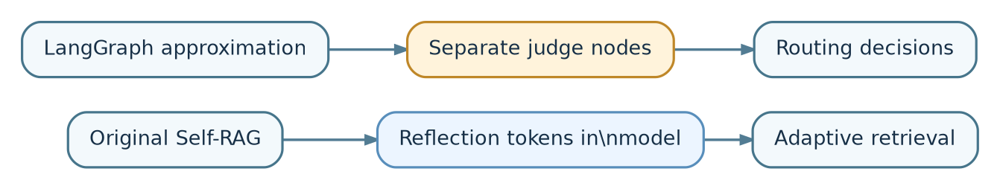
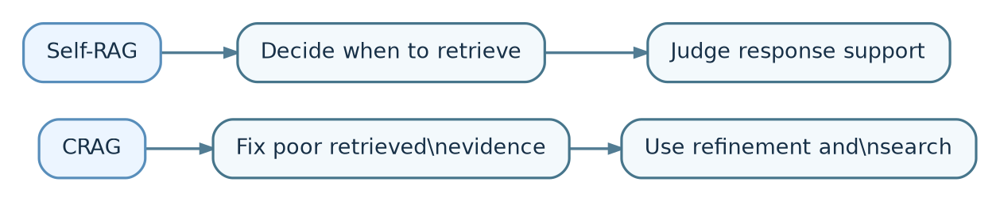

# Self-RAG

**Agentic AI using LangGraph | Video 28 | CampusX**  
**Lesson:** [Self-RAG Tutorial: How to Make Your AI Fact-Check Itself | Advanced RAG | CampusX](https://www.youtube.com/watch?v=BbO_XaEjzaA)

> **Core idea:** Self-RAG adds adaptive retrieval and self-reflection so the system can judge whether evidence is needed, whether it is relevant, and whether the generated answer is supported and useful.

## 1. Learning goals

Understand adaptive retrieval, relevance grading, grounding checks, answer usefulness, feedback loops, and the original Self-RAG token mechanism.

### Video chapter links

| Time | Chapter |
| --- | --- |
| [00:00](https://www.youtube.com/watch?v=BbO_XaEjzaA&t=0s) | Introduction to Advanced RAG Techniques |
| [01:00](https://www.youtube.com/watch?v=BbO_XaEjzaA&t=60s) | Prerequisites & Disclaimer |
| [01:48](https://www.youtube.com/watch?v=BbO_XaEjzaA&t=108s) | 3 Major Problems with Traditional RAG |
| [02:14](https://www.youtube.com/watch?v=BbO_XaEjzaA&t=134s) | Problem 1: Indiscriminate/Unnecessary Retrieval |
| [05:17](https://www.youtube.com/watch?v=BbO_XaEjzaA&t=317s) | Problem 2: Blind Trust in Documents |
| [06:55](https://www.youtube.com/watch?v=BbO_XaEjzaA&t=415s) | Problem 3: Lack of Answer Verification |
| [07:34](https://www.youtube.com/watch?v=BbO_XaEjzaA&t=454s) | What is Self-RAG? (Self-Reflective RAG) |
| [08:24](https://www.youtube.com/watch?v=BbO_XaEjzaA&t=504s) | The 4 Key Questions Self-RAG Answers |
| [12:40](https://www.youtube.com/watch?v=BbO_XaEjzaA&t=760s) | Architectural Overview & Logic |
| [15:05](https://www.youtube.com/watch?v=BbO_XaEjzaA&t=905s) | Step 1: Implementing the Retrieval Decision Node |
| [35:30](https://www.youtube.com/watch?v=BbO_XaEjzaA&t=2130s) | Step 2: Filtering Relevant Documents |
| [41:00](https://www.youtube.com/watch?v=BbO_XaEjzaA&t=2460s) | Step 3: Generating Answers from Context |
| [45:56](https://www.youtube.com/watch?v=BbO_XaEjzaA&t=2756s) | Step 4: Detecting Hallucinations (Support Node) |
| [53:36](https://www.youtube.com/watch?v=BbO_XaEjzaA&t=3216s) | Step 5: Implementing the Revised Answer Loop |
| [58:23](https://www.youtube.com/watch?v=BbO_XaEjzaA&t=3503s) | Step 6: Testing Answer Usefulness & Query Rewriting |
| [01:08:13](https://www.youtube.com/watch?v=BbO_XaEjzaA&t=4093s) | Conclusion & Final Summary |

**Prerequisites:** Basic Python and the idea of an LLM workflow are helpful. New terms are explained when first used.

---

## 2. The limits of fixed retrieval

Traditional RAG usually retrieves passages for every question, even when retrieval is unnecessary. It may then pass low-quality chunks to a language model and accept whatever answer the model produces without checking whether the evidence supports it.

Three problems follow: **unnecessary retrieval**, **blind trust in retrieved documents**, and **missing answer verification**. A strong RAG system should ask not only “What documents did we find?” but also “Did we need them, are they relevant, and did the answer actually use them correctly?”

<p align="center"></p>

For example, “What is 2 + 2?” does not need a document search. “What does this company's latest policy say?” likely does. And “Summarize a policy from a retrieved PDF” should be checked against the actual passage rather than answered from general impressions.

## 3. The idea behind Self-RAG

**Self-RAG** means *self-reflective retrieval-augmented generation*: the system uses feedback about retrieval and its own answers to improve factual grounding and usefulness. Instead of treating retrieval as a fixed preprocessing step, the system can decide **when to retrieve**, judge the evidence, generate a candidate, and critique that candidate.

<p align="center"></p>

An intuitive way to remember the pattern is **think → retrieve if needed → answer → check → revise or finish**. The purpose of checking is not to produce longer answers; it is to reduce unsupported claims and make the final answer match the user's actual question.

**Important research distinction:** the original Self-RAG paper trains a model to emit special **reflection tokens** that guide retrieval and critique during generation. A practical LangGraph tutorial often builds a similar behavior using **separate evaluator nodes and conditional edges**. That is a useful implementation pattern, but it is not identical to the paper's model-training method.

## 4. Four questions in a self-reflective workflow

A simple way to understand this approach is to examine four decisions:

1. **Do I need to retrieve information?** A basic mathematical or drafting request might not need a database search, while a question about a document probably does.
2. **Are the retrieved documents relevant?** A passage containing similar words may still fail to answer the actual question.
3. **Is the generated answer grounded in those documents?** A response can sound fluent while adding facts that the sources never supported.
4. **Is the answer useful for the user's question?** An answer might be factually supported yet address the wrong part of the request.

<p align="center"></p>

These decisions can be separate nodes in a graph. The system should record what each evaluator decided and choose a path accordingly: answer directly, retrieve, filter, regenerate, rewrite the query, or stop with a limitation.

## 5. Deciding whether retrieval is needed

A model or classifier can estimate whether a request requires external evidence. For example, a definition of a common programming term may be answerable from general model knowledge. A question asking for **the latest version of a software library** needs a current source because versions change.

<p align="center"></p>

Skipping retrieval where it adds no value can reduce latency and avoid distracting passages. But the classifier should be conservative when the answer depends on current, private, or document-specific facts. If the system cannot determine whether external evidence is required, it can retrieve rather than confidently guess.

## 6. Checking document relevance

After retrieval, a grading step can decide which chunks are suitable for the question. A useful passage should contain evidence directly related to the question, not just a shared keyword. If all retrieved documents fail the check, the system may rewrite the query, use another source, or ask for clarification.

<p align="center"></p>

Suppose the user asks, “What does our leave policy say about carryover?” The search returns a document titled “Annual leave policy,” but its extracted chunk covers only holiday calendars. The title is promising, yet the chunk does not contain the carryover rule. The correct action is to find a better part of the policy rather than make up an answer.

## 7. Detecting unsupported claims

A **grounding check** asks whether the draft answer is supported by the retrieved evidence. It differs from a relevance check. Relevance asks if the documents are useful; grounding asks if the **answer's claims** follow from those documents.

<p align="center"></p>

Example: the source says “Employees may carry over up to five days.” A draft saying “Employees can carry over ten days” is unsupported, even though the source is completely relevant. The system can regenerate the answer using the source more strictly or decline to answer if evidence remains uncertain.

Grounding evaluators can make mistakes, too. For important applications, verify using structured evidence, quotations or citations, deterministic checks when possible, and human review for high-risk claims.

## 8. Evaluating answer usefulness

An answer can be well grounded but still fail to help. If the user asks “How do I apply for leave?” and the response correctly describes **how leave days are calculated**, it may be factual but not responsive. A separate usefulness check can trigger query rewriting or a more focused retrieval step.

<p align="center"></p>

This distinction is important in practice: **truthfulness** and **answer relevance** are separate goals. A useful evaluator asks, “Does this output directly answer what the user asked?” rather than simply giving the answer a vague quality score.

## 9. Putting the checks together in a bounded graph

<p align="center"></p>

A typical educational LangGraph pattern uses nodes for routing, retrieving, grading documents, generating an answer, checking support, and checking usefulness. Conditional edges send the workflow back to retrieval or generation when a check fails. Because any evaluator can keep rejecting outputs, the graph needs **explicit stopping conditions** such as maximum retries, latency budget, and a safe “not enough evidence” result.

Here is a **control-flow example**, not a complete Self-RAG implementation:

```python
def after_answer_review(state: dict) -> str:
    if state["grounded"] and state["useful"]:
        return "finish"
    if state["attempts"] >= 3:
        return "stop_without_claim"
    if not state["grounded"]:
        return "retrieve_again"
    return "rewrite_question"

# Map returned labels with StateGraph.add_conditional_edges(...).
# A real system must implement retrieval, generation, and scoring nodes.
```

The example chooses concrete actions. A failed grounding check sends the application toward better evidence; a grounded but unhelpful answer suggests improving the query or response focus. The fallback stops the loop rather than pretending that repeated attempts guarantee success.

## 10. Original Self-RAG research and a LangGraph adaptation

<p align="center"></p>

The original research mechanism learns to emit **retrieval and critique tokens** as part of language-model generation. Those tokens signal whether to retrieve and help evaluate passage relevance, support, and output quality. This makes retrieval and reflection part of the model's learned generation process.

A common LangGraph adaptation instead uses a standard model for answer generation and separate nodes or model calls for relevance grading, hallucination checks, and routing. It is easier to understand as an application workflow, but you should not claim it reproduces the original paper's model weights or learned token behavior.

## 11. How Self-RAG differs from CRAG

<p align="center"></p>

**CRAG** focuses on **correcting poor retrieved evidence** using evaluation, refinement, and supplementary searching. **Self-RAG** emphasizes **adaptive retrieval and self-critique** of the produced answer. Real systems can combine both: decide whether to retrieve, evaluate the retrieved chunks, correct weak evidence, generate an answer, and check that the answer is grounded and useful.

| Design question | CRAG emphasis | Self-RAG emphasis |
| --- | --- | --- |
| Are retrieved chunks good enough? | Central question | Also important |
| Should retrieval happen now? | Less central | Central question |
| How should weak context be repaired? | Refine / search / combine | Re-retrieve or rewrite as needed |
| Does the answer follow the evidence? | Must still be checked | Explicit critique step |
| Can the workflow retry? | Yes, if designed | Yes, with a bound |

**Bottom line:** adaptive retrieval and answer checking improve the *process*, but neither method guarantees correctness. Trustworthy sources, measurable evaluation, and transparent failure handling remain essential.


## 12. Worked example: deciding whether an answer is supported and useful

A user asks, “How many leave days can I carry over?” The company policy document contains the sentence “Employees may carry forward up to five unused annual-leave days into the next year.” The system retrieves the policy, generates a draft, and then runs two different checks.

**Candidate A:** “You can carry over ten days.” This directly addresses the question, but it is **not grounded** in the policy. The grounding check should reject it.

**Candidate B:** “The company has several types of employee leave.” This may be true and supported somewhere in the document, but it is **not useful** for the specific carryover question. The usefulness check should reject or refocus it.

**Candidate C:** “The policy allows up to five unused annual-leave days to be carried forward.” This answers the question and matches the source. It is a suitable result, assuming the document version is current.

| Draft | Grounded? | Answers question? | Next step |
| --- | --- | --- | --- |
| Ten days | No | Yes | Regenerate from verified evidence |
| Various leave types | Maybe | No | Refocus or rewrite query |
| Five annual-leave days | Yes | Yes | Deliver with source reference |

This shows why **document relevance**, **answer grounding**, and **answer usefulness** are not interchangeable scores. Each check addresses a different failure mode. A robust system also verifies that the policy version is current and avoids infinite retries if the relevant document is missing.

### Evaluator confidence is not a guarantee

An LLM judge can mistakenly approve a persuasive false statement or reject an awkward but correct one. Use measurable test cases, structured output labels, source checks, and bounded retries. For high-stakes questions, consider a human review rather than letting the system repeatedly approve itself.


---

## Key takeaways for quick revision

1. Explain why retrieval should sometimes be skipped.
2. Draw the four decision points.
3. Distinguish document relevance from answer grounding.
4. Distinguish grounding from usefulness.
5. Trace a retry path and an eventual stop condition.
6. Explain the paper-level reflection token distinction.

## Revision checklist

- [ ] Explain why retrieval should sometimes be skipped.
- [ ] Draw the four decision points.
- [ ] Distinguish document relevance from answer grounding.
- [ ] Distinguish grounding from usefulness.
- [ ] Trace a retry path and an eventual stop condition.
- [ ] Explain the paper-level reflection token distinction.

## Practice questions and mini exercises

1. Design a path for a question that needs no retrieval and a path for a question about a current company policy.
2. Write an example of a grounded but unhelpful answer and identify the repair step.
3. Build a simple decision table for acceptance, retrieval retry, query rewrite, and graceful failure.

## Interview questions and concise answers

**Q1. What is Self-RAG?**  
A retrieval-augmented generation approach that can decide when to retrieve and critique evidence and outputs.

**Q2. What are four useful questions in a Self-RAG workflow?**  
Retrieve? Are documents relevant? Is the answer supported? Is the answer useful?

**Q3. What is grounding?**  
Whether the answer’s factual claims are supported by the supplied evidence.

**Q4. Why can a relevant answer still fail?**  
It may be unsupported, inaccurate, or fail to address the user’s intent.

**Q5. How does the original Self-RAG research differ from a LangGraph tutorial?**  
The research trains a model with reflection tokens; an application tutorial commonly uses separate evaluator nodes and conditional routing.

**Q6. How is Self-RAG different from CRAG?**  
Self-RAG emphasizes adaptive retrieval and answer critique; CRAG emphasizes correcting weak retrieved context.


## Further learning

- [arxiv.org — 2310.11511](https://arxiv.org/abs/2310.11511)
- [docs.langchain.com — Workflows Agents](https://docs.langchain.com/oss/python/langgraph/workflows-agents)

**One-sentence summary:** Self-RAG adds adaptive retrieval and self-reflection so the system can judge whether evidence is needed, whether it is relevant, and whether the generated answer is supported and useful.
