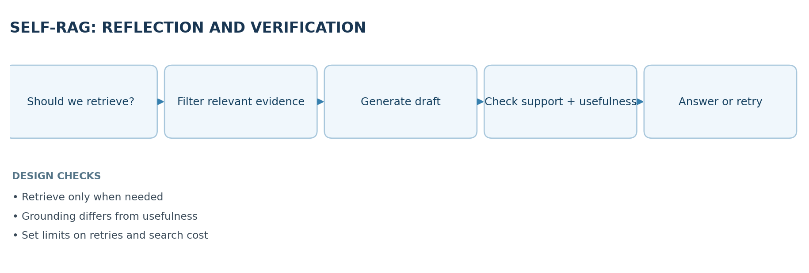
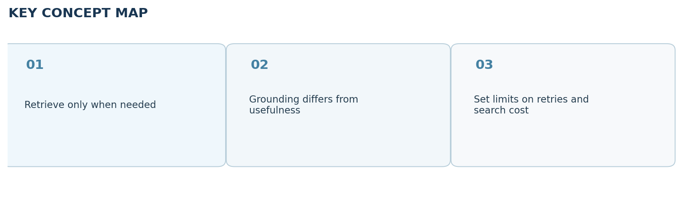

# Video 28 — Self-RAG: Reflection and Verification

> **CampusX Agentic AI using LangGraph · Playlist position 28 · Theory-first study notes**  \
> [Watch the lesson](https://www.youtube.com/watch?v=BbO_XaEjzaA&list=PLKnIA16_RmvYsvB8qkUQuJmJNuiCUJFPL&index=28) · [Full playlist](https://www.youtube.com/playlist?list=PLKnIA16_RmvYsvB8qkUQuJmJNuiCUJFPL)

**Study scope:** Important conceptual material and small teaching examples, not a recreation of the tutorial project. These are original explanatory notes based on the video’s public chapter outline and the linked technical sources—not a transcript.



## Learning objectives

Explain why Self-RAG adds **retrieval decisions, relevance checks, evidence-grounding checks and usefulness evaluation**, and distinguish the original **research framework** from the more practical **LangGraph reflection workflow** demonstrated in the lesson.

## 1. Three weaknesses of ordinary RAG

Standard RAG often retrieves a fixed number of chunks for every question. This produces three common problems:

1. **Unnecessary retrieval:** “What is 2 + 2?” may not need a vector search at all.
2. **Blind trust:** the returned chunks may be irrelevant, stale or contradictory.
3. **Unverified answers:** even with relevant evidence, the generated answer may contain unsupported claims.

A good advanced-RAG design should decide **when retrieval is useful**, **which evidence is relevant**, and **whether the final answer is supported and helpful**.

## 2. What does “Self-RAG” mean?

The research paper *Self-RAG: Learning to Retrieve, Generate, and Critique through Self-Reflection* describes training a model to retrieve adaptively and critique its generation using special **reflection tokens**. In LangGraph educational implementations, the same *design goals* are often represented as separate graph nodes: a retrieval router, document relevance grader, answer generator, grounding checker, usefulness checker and conditional retries.

**Important distinction:** a LangGraph pipeline using ordinary LLM grader nodes is **Self-RAG-inspired**; it is not automatically the original paper's trained single-model, reflection-token implementation. The CampusX tutorial focuses on the practical workflow architecture.

## 3. Four central decisions

| Question | Typical node | Why it matters |
|---|---|---|
| Do we need external information? | Retrieval router | Saves needless retrieval cost |
| Are these retrieved chunks relevant? | Document grader | Stops noise before generation |
| Is the answer supported by the supplied evidence? | Hallucination / support grader | Checks groundedness |
| Does the answer actually address the user's question? | Usefulness grader | Checks task completion |

**Groundedness is not usefulness.** An answer can be perfectly supported by a document and still fail to answer the question. Conversely, a helpful-sounding answer can be unsupported by evidence.

## 4. A conceptual Self-RAG-style loop

1. Receive a query and determine whether local knowledge is sufficient or retrieval is needed.
2. If needed, retrieve candidate documents.
3. Grade and discard clearly irrelevant chunks.
4. If evidence is missing, rewrite the query and retry retrieval within a budget.
5. Generate an answer using the relevant context.
6. Evaluate whether claims are supported by that context.
7. If unsupported, revise or regenerate; if supported, check whether the answer answers the question.
8. If useful and grounded, return; otherwise retry a bounded number of times or abstain.

An agent must set a **maximum retry/search limit**. An unbounded self-reflection loop can run indefinitely, consume tokens and keep producing confident unsupported output.

## 5. Minimal routing sketch (illustrative)

```python
def route_after_generation(grounded: bool, useful: bool, attempts: int):
    if grounded and useful:
        return "finish"
    if attempts >= 2:
        return "abstain_or_escalate"
    if not grounded:
        return "regenerate_from_evidence"
    return "rewrite_query_and_retrieve"
```

A complete LangGraph implementation would model each action as a node and use conditional edges or `Command` for routing. The sketch deliberately avoids provider-specific model code to emphasize **the decision logic**.

## 6. Worked example: an internal policy question

**Question:** “Does the current employee policy allow reimbursement for international coworking spaces?”

- Router: retrieval is needed; policies are private and can change.
- Retriever: returns travel and reimbursement chunks.
- Relevance grader: removes a chunk about domestic parking claims.
- Generator: drafts “International coworking costs are reimbursable with manager approval.”
- Grounding check: discovers the provided documents say only “domestic coworking.” The international claim is unsupported.
- Recovery: the system searches a different policy version or asks for a human policy owner instead of quietly affirming the claim.

This illustrates why **post-generation checking** can catch errors that relevance filtering alone cannot prevent.

## 7. Self-RAG vs CRAG vs traditional RAG

| Architecture | Core question | Common correction |
|---|---|---|
| Standard RAG | What chunks can I retrieve? | Usually none by default |
| CRAG | Is the retrieval itself trustworthy/adequate? | Refine or supplement retrieved evidence |
| Self-RAG-inspired graph | Do I need retrieval; are evidence and answer good? | Route, re-retrieve, regenerate, critique |

These approaches can be combined: a system may evaluate retrieved evidence **and** verify the answer it generates. The distinction is mainly about **where the control gates are placed**.

## 8. Limits of self-grading

An LLM grader is not an oracle. The same model family may share systematic errors with the generating model; a grader can be fooled by prompt injection inside retrieved documents or by overly broad criteria. Improve reliability with structured grader outputs, independent test sets, deterministic policy checks, source provenance, task-specific benchmarks and human review for critical decisions.

### Design checklist

- Identify which decisions need **hard evidence** rather than subjective model confidence.
- Keep source text separate from instructions; retrieved content is untrusted input.
- Bound attempts and create a safe failure/abstention path.
- Capture trace records explaining each routing decision.
- Measure final answer faithfulness, helpfulness, cost and latency—not just retrieval similarity.

## 9. Quick revision

Self-RAG-inspired agents **decide -> retrieve -> filter -> generate -> verify -> revise**. The four important questions are: *Do we retrieve? Are documents relevant? Is output supported? Is output useful?* The paper's reflection-token method and the LangGraph multi-node implementation share the goal but are not identical systems.

### Self-check questions

1. Give an example of a question for which retrieval is unnecessary.
2. Can a grounded answer be unhelpful? Explain.
3. Which check detects claims not supported by evidence?
4. Why should a system bound regeneration and query rewriting?

**Suggested answers:** (1) basic arithmetic; (2) yes, a document-backed paragraph might be off-topic; (3) grounding/support check; (4) avoid runaway loops, latency and cost.

## Visual recap



## Clickable video chapters

- [00:00:00 — Advanced RAG overview](https://www.youtube.com/watch?v=BbO_XaEjzaA&list=PLKnIA16_RmvYsvB8qkUQuJmJNuiCUJFPL&index=28&t=0s)
- [00:01:00 — Prerequisites](https://www.youtube.com/watch?v=BbO_XaEjzaA&list=PLKnIA16_RmvYsvB8qkUQuJmJNuiCUJFPL&index=28&t=60s)
- [00:01:48 — Three traditional RAG weaknesses](https://www.youtube.com/watch?v=BbO_XaEjzaA&list=PLKnIA16_RmvYsvB8qkUQuJmJNuiCUJFPL&index=28&t=108s)
- [00:02:14 — Unnecessary retrieval](https://www.youtube.com/watch?v=BbO_XaEjzaA&list=PLKnIA16_RmvYsvB8qkUQuJmJNuiCUJFPL&index=28&t=134s)
- [00:05:17 — Blind trust in documents](https://www.youtube.com/watch?v=BbO_XaEjzaA&list=PLKnIA16_RmvYsvB8qkUQuJmJNuiCUJFPL&index=28&t=317s)
- [00:06:55 — Missing answer verification](https://www.youtube.com/watch?v=BbO_XaEjzaA&list=PLKnIA16_RmvYsvB8qkUQuJmJNuiCUJFPL&index=28&t=415s)
- [00:07:34 — What is Self-RAG?](https://www.youtube.com/watch?v=BbO_XaEjzaA&list=PLKnIA16_RmvYsvB8qkUQuJmJNuiCUJFPL&index=28&t=454s)
- [00:08:24 — Four decisions](https://www.youtube.com/watch?v=BbO_XaEjzaA&list=PLKnIA16_RmvYsvB8qkUQuJmJNuiCUJFPL&index=28&t=504s)
- [00:12:40 — Architecture and routing](https://www.youtube.com/watch?v=BbO_XaEjzaA&list=PLKnIA16_RmvYsvB8qkUQuJmJNuiCUJFPL&index=28&t=760s)
- [00:15:05 — Retrieval decision node](https://www.youtube.com/watch?v=BbO_XaEjzaA&list=PLKnIA16_RmvYsvB8qkUQuJmJNuiCUJFPL&index=28&t=905s)
- [00:35:30 — Document relevance filtering](https://www.youtube.com/watch?v=BbO_XaEjzaA&list=PLKnIA16_RmvYsvB8qkUQuJmJNuiCUJFPL&index=28&t=2130s)
- [00:41:00 — Context-grounded generation](https://www.youtube.com/watch?v=BbO_XaEjzaA&list=PLKnIA16_RmvYsvB8qkUQuJmJNuiCUJFPL&index=28&t=2460s)
- [00:45:56 — Hallucination/support evaluation](https://www.youtube.com/watch?v=BbO_XaEjzaA&list=PLKnIA16_RmvYsvB8qkUQuJmJNuiCUJFPL&index=28&t=2756s)
- [00:53:36 — Answer revision loop](https://www.youtube.com/watch?v=BbO_XaEjzaA&list=PLKnIA16_RmvYsvB8qkUQuJmJNuiCUJFPL&index=28&t=3216s)
- [00:58:23 — Usefulness and query rewrite](https://www.youtube.com/watch?v=BbO_XaEjzaA&list=PLKnIA16_RmvYsvB8qkUQuJmJNuiCUJFPL&index=28&t=3503s)
- [01:08:13 — Final summary](https://www.youtube.com/watch?v=BbO_XaEjzaA&list=PLKnIA16_RmvYsvB8qkUQuJmJNuiCUJFPL&index=28&t=4093s)

## References and further reading

- [CampusX video and chapters](https://playlist.tools/playlist/PLKnIA16_RmvYsvB8qkUQuJmJNuiCUJFPL/BbO_XaEjzaA)
- [Original Self-RAG paper](https://arxiv.org/abs/2310.11511)

*Prepared October 2026. Figures are original study diagrams, not screenshots or official CampusX illustrations. Some APIs may change; consult the linked official references before production use.*
