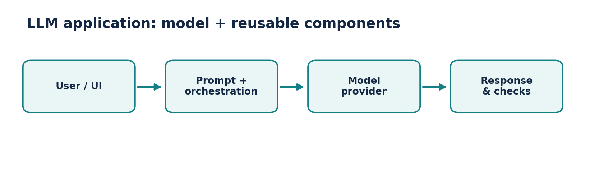
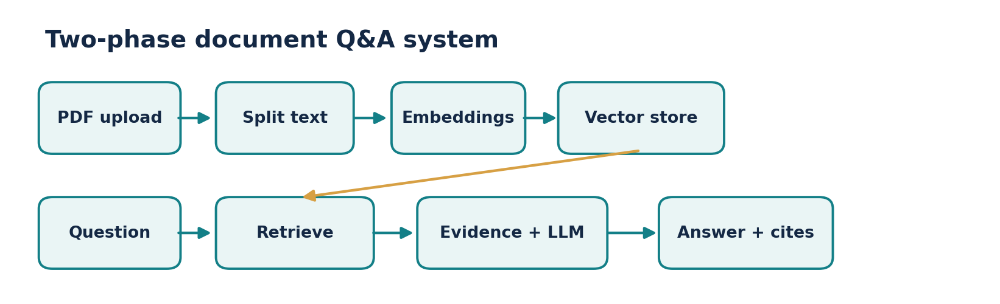
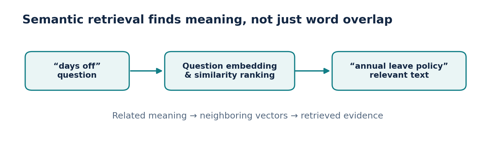

# Video 1 — Introduction to LangChain

**Course:** CampusX — Generative AI using LangChain  
**Duration:** 37:44  
**Lesson:** [Watch on YouTube](https://www.youtube.com/watch?v=nlz9j-r0U9U)  
**Playlist:** [Generative AI using LangChain](https://www.youtube.com/playlist?list=PLKnIA16_RmvaTbihpo4MtzVm4XOQa0ER0)

Understand why an LLM framework exists by designing a chat-with-PDF product from first principles.

## Learning objectives

- LangChain is an application framework, not an LLM or a vector database.
- Chat-with-PDF systems often use retrieval to reduce irrelevant context.
- Keep ingestion and question answering as separate stages.
- Choose abstractions when they simplify real integration or maintenance.

## Chapter timestamps

| Time (click to watch) | Topic |
|:---|:---|
| [▶ 00:00](https://www.youtube.com/watch?v=nlz9j-r0U9U&t=0s) | Intro |
| [▶ 00:57](https://www.youtube.com/watch?v=nlz9j-r0U9U&t=57s) | What is LangChain? |
| [▶ 01:58](https://www.youtube.com/watch?v=nlz9j-r0U9U&t=118s) | Why do we need LangChain? |
| [▶ 04:42](https://www.youtube.com/watch?v=nlz9j-r0U9U&t=282s) | High Level Discussion of App |
| [▶ 26:35](https://www.youtube.com/watch?v=nlz9j-r0U9U&t=1595s) | Benefits of LangChain |
| [▶ 30:33](https://www.youtube.com/watch?v=nlz9j-r0U9U&t=1833s) | What can you build with LangChain? |
| [▶ 35:50](https://www.youtube.com/watch?v=nlz9j-r0U9U&t=2150s) | Alternatives to LangChain |

## Detailed notes

### 1. LangChain in one mental model

**[▶ Watch at 00:57](https://www.youtube.com/watch?v=nlz9j-r0U9U&t=57s)**

A **large language model (LLM)** predicts or generates content given input. **LangChain** supplies building blocks for connecting a model to prompts, data, retrieval, tools and application code. It does not train the model or automatically make every answer correct.

Think of an LLM as an engine and LangChain as some of the plumbing around the engine. A complete application also needs storage, a user interface, logging, security and testing. LangChain is useful because its common interfaces reduce repetitive integration work.

- Model = generates an answer; framework = coordinates how the application uses that model.
- The same architecture can contain deterministic Python, a vector store, and LLM steps.



*Figure: Model and application plumbing*

### 2. Why simple LLM API calls are not enough

**[▶ Watch at 01:58](https://www.youtube.com/watch?v=nlz9j-r0U9U&t=118s)**

A single request such as “Explain recursion” can be solved by invoking a model. A production document assistant is harder: it must accept uploaded files, extract their text, search the right passages, preserve source references and handle failures.

Without reusable interfaces, every new model provider, storage backend or tool often adds custom glue code. Frameworks help organize those interactions, although they also introduce abstractions and dependencies.

- Problem: the model is not automatically aware of a private PDF.
- Problem: sending thousands of pages in every question is slow, expensive and may exceed context limits.
- Solution idea: retrieve a small relevant subset before generating an answer.

### 3. Walkthrough: build a chat-with-PDF app

**[▶ Watch at 04:42](https://www.youtube.com/watch?v=nlz9j-r0U9U&t=282s)**

Separate the system into **indexing (offline or at upload time)** and **question answering (for every user question)**. Indexing loads the PDF, extracts text, splits text into chunks, converts chunks into numerical embeddings and stores them with useful metadata.

At question time, embed the user query using a compatible model, retrieve the most relevant chunks, assemble those chunks into the prompt and ask the LLM to answer. Cite the retrieved pages and avoid pretending the retrieved context proves everything.

- Upload: PDF → loader → chunks → embedding model → vector store.
- Ask: question → query embedding → similarity search → context + question → chat model → answer.
- Store page numbers and source filenames with each chunk so that the UI can display evidence.



*Figure: Two-stage RAG flow*

### 4. What “semantic search” really means

**[▶ Watch at 04:42](https://www.youtube.com/watch?v=nlz9j-r0U9U&t=282s)**

**Keyword search** looks for overlapping words or tokens. **Semantic search** represents text and questions as vectors so conceptually related passages can be nearby even with different words. Example: “How many days off can I take?” can match “annual leave entitlement” without matching exact terms.

Similarity is a ranking signal, not a truth guarantee: semantically similar passages can still be wrong, outdated or unrelated in crucial details. Evaluate retrieval, apply permissions and give the model enough context to answer accurately.

- Typical similarity metric: cosine similarity between query and chunk embeddings.
- Chunks that are too large dilute focus; chunks that are too small lose context.
- A retrieval-augmented generation (RAG) system still needs grounding and answer quality checks.



*Figure: Meaning-based retrieval*

### 5. Practical benefits—and the trade-offs

**[▶ Watch at 26:35](https://www.youtube.com/watch?v=nlz9j-r0U9U&t=1595s)**

LangChain makes common patterns reusable: switch model integrations with fewer changes, express prompts as templates, compose multi-stage operations and connect to document-processing and retrieval systems.

These benefits come with costs: abstraction layers can hide what a model request actually sends, version changes can require code updates, and poorly composed chains may have unnecessary latency. Start with a simple design and measure before adding complexity.

- Reuse: prompts and model interfaces across features.
- Composition: connect prompt → model → output processing.
- Observability: add logs and traces to see inputs, outputs and cost.
- Trade-off: extra dependencies, provider-specific differences and migration risk.

### 6. What can you build?

**[▶ Watch at 30:33](https://www.youtube.com/watch?v=nlz9j-r0U9U&t=1833s)**

Document Q&A assistants, customer-support bots, structured extraction services, summarizers, search-driven assistants and applications that can call external tools are natural examples. Most combine ordinary code with a model instead of relying on prompting alone.

For a first project, a document Q&A app is especially useful because it forces you to understand ingestion, chunking, embeddings, retrieval, prompting and evaluation—the building blocks reused in larger products.

- Beginner: summarize a passage with a reusable prompt.
- Intermediate: cite sources while answering from PDFs.
- Advanced: route requests, call tools, validate responses and monitor quality.

### 7. Alternatives and choosing deliberately

**[▶ Watch at 35:50](https://www.youtube.com/watch?v=nlz9j-r0U9U&t=2150s)**

LangChain is one of several ecosystems. **LlamaIndex** has strong data-indexing and retrieval patterns; **Haystack** is another option for retrieval and search pipelines. Direct provider SDKs are often enough for a small app.

Ask what your system actually needs: document-centric retrieval, multiple providers, agent orchestration, a low-dependency API, or deployment constraints. Choose after prototyping the simplest workable version.

- Prefer direct SDKs for one model call and very little orchestration.
- Prefer an orchestration framework when the repeated patterns justify it.
- Remember: a framework choice does not replace tests for accuracy or security.

## Mini design exercise: PDF policy assistant

- Input: “How many casual leave days do employees have?” Build an indexing job that stores (chunk_text, page, document_id, embedding).
- At query time retrieve the best five chunks, ask the model to answer only from those chunks, and show the page citations. If the evidence is insufficient, return “Not found in the uploaded documents.”
- Evaluate with ten known questions: inspect whether the right passages were retrieved before judging the final LLM answer.

### Practice scaffold

```python
# Conceptual pseudocode: replace helpers with your chosen integrations.
chunks = load_and_split_pdf("employee_handbook.pdf")
vector_store.add_documents(chunks)  # Store texts + page metadata

question = "How many casual leave days are allowed?"
hits = vector_store.similarity_search(question, k=5)
context = "\n\n".join(doc.page_content for doc in hits)
answer = chat_model.invoke(
    f"Answer using only this context:\n{context}\nQuestion: {question}"
)
print(answer.content)
```

## Common mistakes to avoid

- The model is not a database: it cannot reliably know private documents unless you supply them.
- Retrieval relevance and answer faithfulness are different metrics.
- Embedding a document does not guarantee it is searchable by authorized users only.

## Quick revision / self-test

1. Explain what LangChain adds beyond an API request.
2. Draw the indexing pipeline and the query-time pipeline.
3. Why can semantic search outperform literal keyword matching?
4. What is one reason not to use LangChain in a tiny project?

## Related documentation

- [LangChain Python documentation](https://docs.langchain.com/oss/python/langchain/overview)
- [LangChain Core API reference](https://reference.langchain.com/python/langchain-core)
- [CampusX playlist](https://www.youtube.com/playlist?list=PLKnIA16_RmvaTbihpo4MtzVm4XOQa0ER0)
