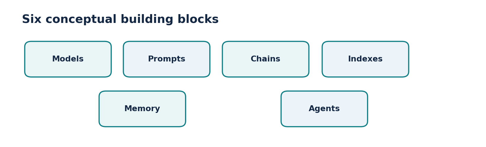
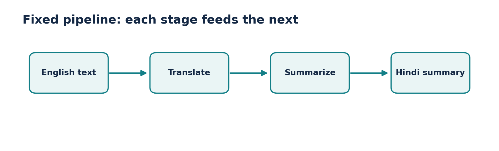
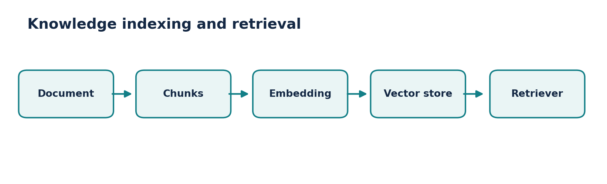
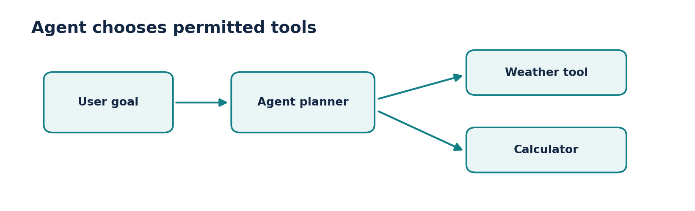

# Video 2 — LangChain Components

**Course:** CampusX — Generative AI using LangChain  
**Duration:** 53:24  
**Lesson:** [Watch on YouTube](https://www.youtube.com/watch?v=-xSJA8-o6Eg)  
**Playlist:** [Generative AI using LangChain](https://www.youtube.com/playlist?list=PLKnIA16_RmvaTbihpo4MtzVm4XOQa0ER0)

Map the six building blocks from the lesson onto a real LLM application.

## Learning objectives

- Models, prompts, chains, indexes, memory and agents solve different problems.
- A RAG pipeline is primarily a retrieval + prompting pattern.
- Conversation memory must be managed by the application.
- An agent selects tools/actions; an ordinary chain follows a known sequence.

## Chapter timestamps

| Time (click to watch) | Topic |
|:---|:---|
| [▶ 00:00](https://www.youtube.com/watch?v=-xSJA8-o6Eg&t=0s) | Intro |
| [▶ 02:15](https://www.youtube.com/watch?v=-xSJA8-o6Eg&t=135s) | Recap |
| [▶ 04:48](https://www.youtube.com/watch?v=-xSJA8-o6Eg&t=288s) | LangChain Components |
| [▶ 05:46](https://www.youtube.com/watch?v=-xSJA8-o6Eg&t=346s) | Models |
| [▶ 16:47](https://www.youtube.com/watch?v=-xSJA8-o6Eg&t=1007s) | Prompts |
| [▶ 24:20](https://www.youtube.com/watch?v=-xSJA8-o6Eg&t=1460s) | Chains |
| [▶ 31:55](https://www.youtube.com/watch?v=-xSJA8-o6Eg&t=1915s) | Indexes |
| [▶ 39:10](https://www.youtube.com/watch?v=-xSJA8-o6Eg&t=2350s) | Memory |
| [▶ 44:04](https://www.youtube.com/watch?v=-xSJA8-o6Eg&t=2644s) | Agents |

## Detailed notes

### 1. The six-piece map

**[▶ Watch at 04:48](https://www.youtube.com/watch?v=-xSJA8-o6Eg&t=288s)**

The lecture presents six conceptual families: **models, prompts, chains, indexes, memory and agents**. These are roles in an application, not necessarily six packages you must install. The simplest useful system may need only a prompt and a model.

The boundaries also evolve with the LangChain API. Modern code often expresses chains using composable **Runnables**, handles message history explicitly, and uses dedicated retrieval and vector-store integrations. The mental model remains useful.

- Model generates or embeds; prompt prepares the request.
- Chain composes steps; indexes make external knowledge searchable.
- Memory keeps relevant history; agent chooses actions or tools.



*Figure: Six conceptual components*

### 2. Models: a consistent interface

**[▶ Watch at 05:46](https://www.youtube.com/watch?v=-xSJA8-o6Eg&t=346s)**

Model providers expose different endpoints, credentials and parameters. LangChain provides a shared way to **invoke**, **stream**, or **batch** many compatible models while preserving provider-specific options when needed.

Distinguish **chat models** that return an AI message from **embedding models** that return vectors. An embedding model does not draft your answer; it helps measure meaning-based similarity and power retrieval.

- Chat input: list of messages (system, user and previous assistant turns).
- Chat output: usually AIMessage with content and often usage metadata.
- Embedding input: text; output: numerical vector.
- Model support differs: tool calls, structured output and multimodal content are not universal.

### 3. Prompts: consistent, dynamic requests

**[▶ Watch at 16:47](https://www.youtube.com/watch?v=-xSJA8-o6Eg&t=1007s)**

A prompt carries instructions and the information needed for a task. A template changes specific variables, such as topic and tone, without rewriting the entire instruction string. Chat templates preserve roles explicitly.

Prompt quality matters, but templates alone do not guarantee factuality. For grounded answers, supply relevant evidence; for sensitive tasks, validate output and avoid exposing secrets in prompt strings.

- Static: “Summarize the following paragraph …” with fixed content.
- Dynamic: “Summarize {text} in {length} words.”
- Role-based: a system message defines behavior; a human message holds the request.

### 4. Chains: composing predictable steps

**[▶ Watch at 24:20](https://www.youtube.com/watch?v=-xSJA8-o6Eg&t=1460s)**

A chain passes information through a known sequence, for example **input → translation → summary**. Each stage has a defined job, and each stage’s output becomes part of the next stage’s input.

Today, the pipe operator (`|`) composes many LangChain Runnables. Chains are usually easier to test than dynamic agents when all required steps are known in advance.

- Fixed order = predictable, observable, easy to unit test.
- Errors can propagate, so validate important intermediate outputs.
- A chain can include deterministic Python transforms as well as model calls.



*Figure: A fixed chain*

### 5. Indexes: preparing knowledge for retrieval

**[▶ Watch at 31:55](https://www.youtube.com/watch?v=-xSJA8-o6Eg&t=1915s)**

The lecture groups knowledge components under “indexes.” A common modern RAG architecture separates **document loaders**, **text splitters**, **embeddings**, **vector stores** and **retrievers**.

Loading and indexing can run at upload time, while retrieval runs per question. Keep document text, metadata and access permissions attached to results; retrieval without authorization can leak private documents.

- Loader: reads files or sources.
- Splitter: breaks text into searchable units.
- Embedder + vector store: encode and store chunks.
- Retriever: finds relevant chunks for a query.



*Figure: Index and retrieval components*

### 6. Memory: preserving conversational context

**[▶ Watch at 39:10](https://www.youtube.com/watch?v=-xSJA8-o6Eg&t=2350s)**

Many chat model API calls are **stateless** unless your application includes previous messages. To answer follow-up questions (“What about the second option?”), the app must supply relevant history or a stored summary.

Simple strategies include a recent-message window, a running conversation summary, and saved user preferences. Store only what is appropriate, restrict access, and control token growth. The lesson’s “memory” concept should not be confused with an LLM learning new weights.

- Without context: the phrase “that one” is ambiguous.
- With context: the model sees the earlier options and resolves the reference.
- Trade-off: more history improves context but increases cost and privacy exposure.

### 7. Agents: selecting tools and next actions

**[▶ Watch at 44:04](https://www.youtube.com/watch?v=-xSJA8-o6Eg&t=2644s)**

A typical agent receives a goal, chooses whether a tool is needed, calls it, reads the result and continues until it can answer or a stop condition applies. The tool call is a structured action, not just text saying it used a tool.

Example: to calculate “three times the current temperature,” a system needs a weather data source, then arithmetic. The agent may choose those tools; the application must still enforce tool permissions, budgets and approval steps.

- Workflow: developer specifies step A → B → C.
- Agent: model chooses between permitted actions within limits.
- Risk: tool results can be wrong or adversarial; validate tool inputs and outputs.



*Figure: Agent with tool choices*

## Worked architecture: employee help desk

- Employee asks a policy question → prompt clarifies the task → retriever finds authorized handbook passages → chat model answers with citations.
- Conversation context tracks follow-up questions; an optional tool can submit a leave request only after the user confirms.
- The data access and leave-submission actions are deterministic, security-sensitive application logic; the model should not override them.

### Practice scaffold

```python
# Runnable composition uses the same interface across steps.
from langchain_core.prompts import ChatPromptTemplate
from langchain_core.language_models.fake_chat_models import FakeListChatModel

prompt = ChatPromptTemplate.from_messages([
    ("system", "Explain concepts clearly in one short paragraph."),
    ("human", "Explain {topic}.")
])
model = FakeListChatModel(responses=["Embeddings map text to vectors."])
chain = prompt | model
print(chain.invoke({"topic": "embeddings"}).content)
# Fake model: this exercise runs without an API key.
```

## Common mistakes to avoid

- “Indexes” is a broad conceptual category; modern implementations use separate retrieval components.
- Memory is supplied or retrieved by your application, not automatically preserved across unrelated model calls.
- An agent should not be used where a short, deterministic chain is adequate.

## Quick revision / self-test

1. List the six components and give one example of each.
2. How do chat models and embedding models differ?
3. What changes when you add memory to a chatbot?
4. Why does an agent need limits around tools?

## Related documentation

- [LangChain Python documentation](https://docs.langchain.com/oss/python/langchain/overview)
- [LangChain Core API reference](https://reference.langchain.com/python/langchain-core)
- [CampusX playlist](https://www.youtube.com/playlist?list=PLKnIA16_RmvaTbihpo4MtzVm4XOQa0ER0)
