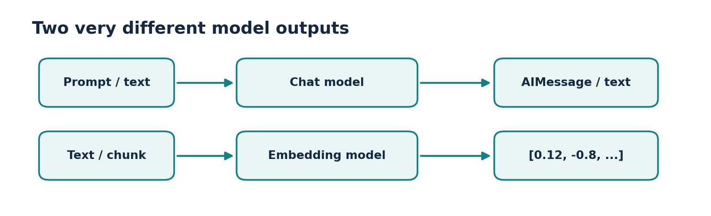
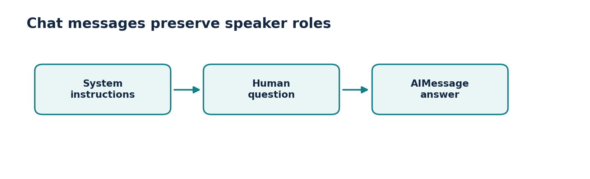
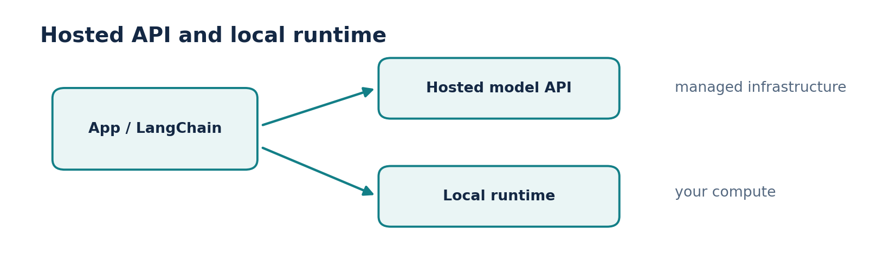
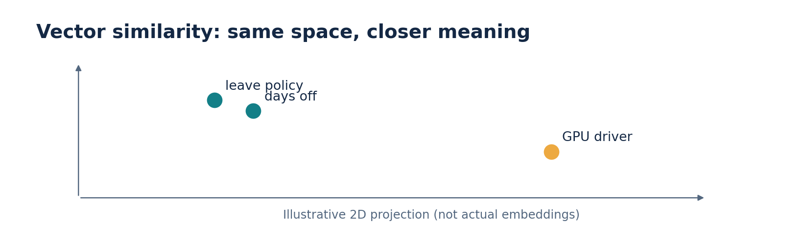

# Video 3 — LangChain Models

**Course:** CampusX — Generative AI using LangChain  
**Duration:** 1:42:03  
**Lesson:** [Watch on YouTube](https://www.youtube.com/watch?v=HdcLE8JuMrA)  
**Playlist:** [Generative AI using LangChain](https://www.youtube.com/playlist?list=PLKnIA16_RmvaTbihpo4MtzVm4XOQa0ER0)

Understand language-model wrappers, provider setup, local/open-source models, and embeddings.

## Learning objectives

- Chat models and embedding models produce different outputs.
- LangChain standardizes invoke/stream/batch, not providers’ capabilities or prices.
- Model configuration should depend on latency, cost, accuracy and deployment constraints.
- Similarities are meaningful only when vectors use a compatible embedding space.

## Chapter timestamps

| Time (click to watch) | Topic |
|:---|:---|
| [▶ 00:00](https://www.youtube.com/watch?v=HdcLE8JuMrA&t=0s) | Intro |
| [▶ 00:55](https://www.youtube.com/watch?v=HdcLE8JuMrA&t=55s) | Recap |
| [▶ 02:18](https://www.youtube.com/watch?v=HdcLE8JuMrA&t=138s) | What are Models? |
| [▶ 06:56](https://www.youtube.com/watch?v=HdcLE8JuMrA&t=416s) | Plan of Action |
| [▶ 09:01](https://www.youtube.com/watch?v=HdcLE8JuMrA&t=541s) | Language Models |
| [▶ 16:20](https://www.youtube.com/watch?v=HdcLE8JuMrA&t=980s) | Setup |
| [▶ 20:37](https://www.youtube.com/watch?v=HdcLE8JuMrA&t=1237s) | Code Demo |
| [▶ 53:26](https://www.youtube.com/watch?v=HdcLE8JuMrA&t=3206s) | Open Source Models |
| [▶ 01:29:52](https://www.youtube.com/watch?v=HdcLE8JuMrA&t=5392s) | Embedding Models |

## Detailed notes

### 1. What is a “model” in LangChain?

**[▶ Watch at 02:18](https://www.youtube.com/watch?v=HdcLE8JuMrA&t=138s)**

A model integration is an object that connects your Python code to a model runtime or hosted API. It handles a consistent request/response contract while preserving specialized functionality where available.

There are two especially important classes for beginners: **language/chat models** generate content and **embedding models** convert text into vectors for searching, clustering or comparing. Don’t expect an embedding vector to be a human-readable answer.

- Generate: prompt/messages → AI response.
- Embed: text → vector of floating-point values.
- Provider wrapper ≠ model weights; a wrapper can call a remote hosted service.



*Figure: Chat vs embedding models*

### 2. Plan a model integration before coding

**[▶ Watch at 06:56](https://www.youtube.com/watch?v=HdcLE8JuMrA&t=416s)**

Decide whether you need to draft text, classify data, perform tool calling, extract JSON or retrieve documents. A general chat model may support several of these, but specific capabilities depend on provider and model.

Then choose between a hosted API and local inference, set a spending limit, decide how to store credentials and create a small evaluation set before optimizing for performance.

- Ask: quality, latency, token limits, privacy and cost?
- Ask: do I need structured output or tool calling?
- Ask: is model availability guaranteed in my environment?

### 3. Language models vs chat models

**[▶ Watch at 09:01](https://www.youtube.com/watch?v=HdcLE8JuMrA&t=541s)**

Traditional text-completion models are usually conceptualized as **string → string**. Modern chat models accept messages with roles such as system, user and assistant and return structured message objects. LangChain’s chat-model interfaces are the common starting point.

A chat response typically has `.content` and may carry token-usage and tool-call metadata. Do not assume the content is always a plain string: multimodal responses can include content blocks.

- System message: behavior and constraints.
- Human message: user request.
- AI message: model response, optionally with structured metadata.



*Figure: Role-based chat interface*

### 4. Setup and credentials

**[▶ Watch at 16:20](https://www.youtube.com/watch?v=HdcLE8JuMrA&t=980s)**

A minimal installation typically includes **langchain-core** and a provider integration such as `langchain-openai`. Provider packages are kept separate so that an application does not install every vendor SDK.

Use environment variables for API keys; never paste them into a public Git repository or print them in debugging output. For a local provider, install the local runtime and its integration package, then verify the model is actually downloaded.

- Example install: `pip install -U langchain-core langchain-openai`.
- Set the key in the terminal: `export OPENAI_API_KEY=...` (or the equivalent for your shell).
- Check timeouts and retry behavior for production calls.

### 5. Code demo: invoke, stream, batch

**[▶ Watch at 20:37](https://www.youtube.com/watch?v=HdcLE8JuMrA&t=1237s)**

**`invoke`** handles a single input, **`batch`** handles multiple inputs, **`stream`** emits pieces as they become available, and asynchronous methods such as `ainvoke` support nonblocking applications.

For an accurate comparison, run the same evaluation questions against candidate models and record answer correctness, response time, and token use. Low temperature reduces random sampling but does not guarantee identical answers across providers or versions.

- Streaming improves perceived responsiveness but does not necessarily reduce total compute.
- Batch may execute requests concurrently; watch quotas.
- Token counts are provider-specific and depend on message formatting.

**Practical code**

```python
# pip install -U langchain-core
from langchain_core.language_models.fake_chat_models import FakeListChatModel

model = FakeListChatModel(responses=["Hello!", "Goodbye!"])
print(model.invoke("Say hello").content)  # Hello!
print(model.invoke("Say bye").content)    # Goodbye!
# For a real hosted model, replace the fake with a provider wrapper.
```

### 6. Open-source and local models

**[▶ Watch at 53:26](https://www.youtube.com/watch?v=HdcLE8JuMrA&t=3206s)**

“Open source” and “local” answer different questions. Some models publish weights or a permissive license; local inference means the model runs on hardware you control. Not every open-weight model can be run comfortably on a typical laptop.

Local inference can help with data governance and recurring costs but introduces hardware requirements, setup, model updates and possible performance differences. Integrations such as Ollama connect local model runtimes to LangChain.

- Hosted API: managed hardware and scaling, but external data transfer and usage charges.
- Local: more deployment control, but memory, GPU and maintenance constraints.
- Model capability, speed and license must be evaluated separately.



*Figure: Hosted versus local execution*

### 7. Embedding models and the vector space

**[▶ Watch at 01:29:52](https://www.youtube.com/watch?v=HdcLE8JuMrA&t=5392s)**

An embedding model maps text to a vector such as `[0.14, -0.22, ...]`. Similar text tends to occupy nearby regions of the model’s semantic space. Similarity search then ranks vectors, commonly using cosine similarity.

Use the **same embedding model or a compatible embedding space** to embed documents and queries. If you change the embedding model in production, existing stored vectors commonly need to be rebuilt; different models may have different dimensions and geometry.

- Embedding vector size is model-dependent.
- Similarity scores are not calibrated probabilities of correctness.
- Preserve source metadata to turn vector hits into trusted, attributable answers.



*Figure: Embedding similarity*

### 8. Put both model families together

**[▶ Watch at 01:29:52](https://www.youtube.com/watch?v=HdcLE8JuMrA&t=5392s)**

A PDF assistant uses an embedding model to locate passages relevant to a question, then a chat model to synthesize an answer. The embedding model selects context; the chat model generates language.

This separation allows you to change a chat model without rebuilding vectors. Changing the embedding model, by contrast, usually requires re-indexing the knowledge base.

- Query-time retrieval is different from response generation.
- Evaluate retrieval recall before prompt polishing.
- Add sources, abstention and access-control checks for responsible behavior.

## Practice lab: switch between test and real models

- First compose a prompt with `FakeListChatModel` to verify the application wiring offline. Then replace it with your chosen compatible hosted or local chat model.
- Observe return type, time to first token, final latency and errors. Compare the same input in `invoke` and `stream` modes.
- For embedding practice, encode three related sentences and one unrelated sentence; rank them by cosine similarity and inspect the result.

### Practice scaffold

```python
# Hosted example: needs credentials and a valid available model.
# pip install -U langchain-openai
from langchain_openai import ChatOpenAI

model = ChatOpenAI(model="gpt-4o-mini", temperature=0)
reply = model.invoke("Define an embedding in one sentence.")
print(reply.content)

# Local alternative (after configuring Ollama):
# from langchain_ollama import ChatOllama
# model = ChatOllama(model="llama3.2")
```

## Common mistakes to avoid

- Do not store private API keys in notebooks committed to GitHub.
- Do not compare embeddings from different incompatible models as if they share a coordinate system.
- Do not assume every model supports images, tools, strict schemas or identical temperature settings.

## Quick revision / self-test

1. What object type does a typical chat-model invoke return?
2. When can you swap the generation model without rebuilding an index?
3. How does a local model differ operationally from a hosted API?
4. Why is a cosine similarity of 0.9 not the same as “90% correct”?

## Related documentation

- [LangChain Python documentation](https://docs.langchain.com/oss/python/langchain/overview)
- [LangChain Core API reference](https://reference.langchain.com/python/langchain-core)
- [CampusX playlist](https://www.youtube.com/playlist?list=PLKnIA16_RmvaTbihpo4MtzVm4XOQa0ER0)
