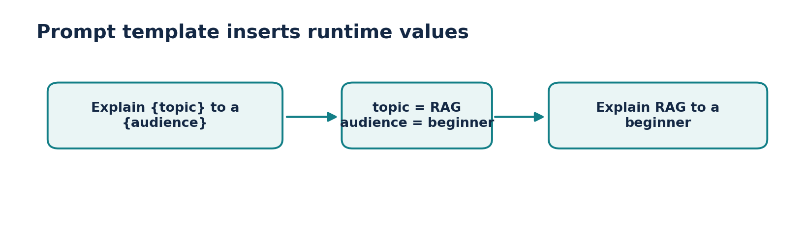
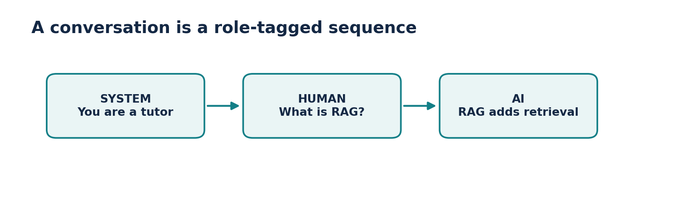
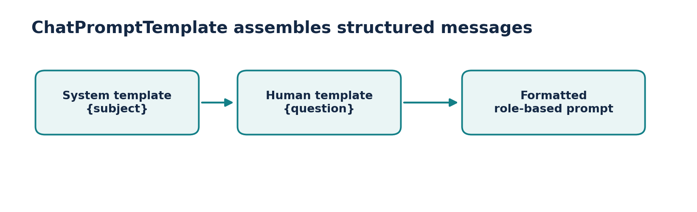
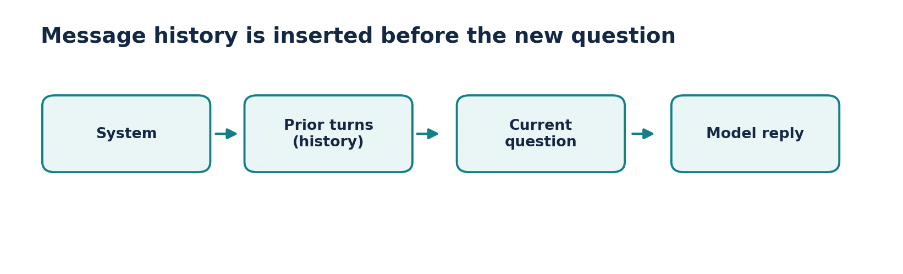

# Video 4 — Prompts in LangChain

**Course:** CampusX — Generative AI using LangChain  
**Duration:** 1:18:33  
**Lesson:** [Watch on YouTube](https://www.youtube.com/watch?v=3TGqlQxpuU0)  
**Playlist:** [Generative AI using LangChain](https://www.youtube.com/playlist?list=PLKnIA16_RmvaTbihpo4MtzVm4XOQa0ER0)

Master prompt templates, roles, message history, and message placeholders for reusable chat applications.

## Learning objectives

- Prompt templates separate reusable instructions from runtime variables.
- Chat messages distinguish system, user and assistant roles.
- ChatPromptTemplate creates role-aware prompts.
- MessagesPlaceholder inserts a list of previous messages, enabling conversational continuity.

## Chapter timestamps

| Time (click to watch) | Topic |
|:---|:---|
| [▶ 00:00](https://www.youtube.com/watch?v=3TGqlQxpuU0&t=0s) | Intro |
| [▶ 01:00](https://www.youtube.com/watch?v=3TGqlQxpuU0&t=60s) | Recap |
| [▶ 02:17](https://www.youtube.com/watch?v=3TGqlQxpuU0&t=137s) | Error Correction |
| [▶ 06:17](https://www.youtube.com/watch?v=3TGqlQxpuU0&t=377s) | Prompts |
| [▶ 10:30](https://www.youtube.com/watch?v=3TGqlQxpuU0&t=630s) | Static vs Dynamic Prompt |
| [▶ 27:05](https://www.youtube.com/watch?v=3TGqlQxpuU0&t=1625s) | Prompt Template |
| [▶ 36:49](https://www.youtube.com/watch?v=3TGqlQxpuU0&t=2209s) | Messages |
| [▶ 56:31](https://www.youtube.com/watch?v=3TGqlQxpuU0&t=3391s) | Chat Prompt Templates |
| [▶ 01:06:37](https://www.youtube.com/watch?v=3TGqlQxpuU0&t=3997s) | Message Placeholder |

## Detailed notes

### 1. A note on temperature

**[▶ Watch at 02:17](https://www.youtube.com/watch?v=3TGqlQxpuU0&t=137s)**

Temperature controls sampling randomness for many probabilistic models. Lower values often make outputs more consistent; higher values often make outputs more varied. But the exact allowed range, defaults and semantics are **provider-dependent**.

Even `temperature=0` is not a universal guarantee of bit-for-bit reproducibility. Model updates, routing and nondeterministic infrastructure can change outputs; test end-to-end behavior when consistency matters.

- Use low randomness for data extraction or classification.
- Allow more variation for creative ideation when appropriate.
- Do not copy one provider’s accepted temperature range to every model.

### 2. What exactly is a prompt?

**[▶ Watch at 06:17](https://www.youtube.com/watch?v=3TGqlQxpuU0&t=377s)**

A **prompt** is the request context supplied to the model: instructions, user input, examples, conversation history and optionally retrieved evidence. The model sees the assembled prompt, not your Python variable names.

Good prompts say what the output should contain, what evidence is allowed and what to do when the information is missing. Critical validations should still be enforced in application code instead of depending only on natural-language instructions.

- Task + constraints + relevant context + output format.
- Prompt injection risk: treat retrieved documents and user content as untrusted data.
- Role and precedence conventions can differ across model APIs.

### 3. Static vs dynamic prompts

**[▶ Watch at 10:30](https://www.youtube.com/watch?v=3TGqlQxpuU0&t=630s)**

A **static prompt** contains mostly fixed text. A **dynamic prompt** contains placeholders filled when the program runs: one template can handle many topics, tones, languages or customer requests.

Dynamic templates help prevent accidental variation and make testing easier. However, substituting arbitrary user-provided strings is not security isolation: a malicious input can still try to override an instruction.

- Static: “Explain LangChain to a beginner.”
- Dynamic: “Explain {topic} to a {audience} in {length} sentences.”
- Keep each placeholder meaningful; default values should be explicit.



*Figure: Prompt substitution*

### 4. PromptTemplate: reusable variables

**[▶ Watch at 27:05](https://www.youtube.com/watch?v=3TGqlQxpuU0&t=1625s)**

`PromptTemplate` is suited to text-oriented templates. Its input variables are filled by `.invoke()` or `.format()`. The returned prompt value can be sent to a compatible model or included in a Runnable sequence.

Prefer readable variable names; test missing variables and ensure any literal braces are escaped when using brace-based formatting. For role-based chat, `ChatPromptTemplate` is usually clearer.

- Template is reusable; runtime data is supplied separately.
- Validation can catch missing template variables.
- Prefer a chat template when the conversation has multiple roles.

**Practical code**

```python
from langchain_core.prompts import PromptTemplate

prompt = PromptTemplate.from_template(
    "Explain {topic} to a {audience} in 3 bullet points."
)
value = prompt.invoke({"topic": "embeddings", "audience": "beginner"})
print(value.to_string())
```

### 5. Messages: system, human and AI

**[▶ Watch at 36:49](https://www.youtube.com/watch?v=3TGqlQxpuU0&t=2209s)**

A chat conversation is not merely one large undifferentiated string. LangChain exposes message classes—commonly **SystemMessage**, **HumanMessage**, and **AIMessage**—that keep speaker roles attached to content.

This lets a model see earlier responses and follow-up questions in their proper order. You must explicitly store and supply relevant history unless an application-level memory feature manages it for you.

- System: broad instructions, e.g., “You teach Python.”
- Human: request, e.g., “What is a vector?”
- AI: earlier answer, useful for resolving references.



*Figure: Role-labeled messages*

### 6. ChatPromptTemplate: role-aware prompting

**[▶ Watch at 56:31](https://www.youtube.com/watch?v=3TGqlQxpuU0&t=3391s)**

`ChatPromptTemplate.from_messages` builds a chat prompt as an ordered sequence of role-labeled messages. Variables can appear in any message, and the assembled prompt can be piped into a chat model.

Keep the system message stable while placing dynamic user content in human messages. Split model-generated content and retrieved passages from trusted instructions so your app can treat them appropriately.

- Use `from_messages` with role tuples or message templates.
- Call `.invoke({ ... })` to fill placeholders.
- Compose with a model using `prompt | model`.



*Figure: Chat template composition*

**Practical code**

```python
from langchain_core.prompts import ChatPromptTemplate
from langchain_core.language_models.fake_chat_models import FakeListChatModel

prompt = ChatPromptTemplate.from_messages([
    ("system", "You explain {subject} clearly."),
    ("human", "Question: {question}")
])
model = FakeListChatModel(responses=["A vector is an ordered list of numbers."])
chain = prompt | model
print(chain.invoke({"subject": "math", "question": "What is a vector?"}).content)
```

### 7. MessagesPlaceholder and conversation history

**[▶ Watch at 01:06:37](https://www.youtube.com/watch?v=3TGqlQxpuU0&t=3997s)**

`MessagesPlaceholder(variable_name="history")` inserts zero or more message objects at a specific position in the template. Put history **between** the system instructions and the new user question to preserve chronology.

Your app still needs to keep the messages somewhere (memory, database or session storage). Long history should be pruned or summarized carefully to control context length and avoid dropping important details.

- Previous turns go into `history` as message objects.
- The latest query goes into its own human message.
- Check whether old context remains relevant and authorized.



*Figure: Message history insertion*

**Practical code**

```python
from langchain_core.prompts import ChatPromptTemplate, MessagesPlaceholder
from langchain_core.messages import HumanMessage, AIMessage

chat_prompt = ChatPromptTemplate.from_messages([
    ("system", "You are a helpful study assistant."),
    MessagesPlaceholder("history"),
    ("human", "{question}")
])
history = [
    HumanMessage(content="My favorite language is Python."),
    AIMessage(content="Python is great for ML projects.")
]
filled = chat_prompt.invoke({"history": history, "question": "Which language?"})
print(filled.to_messages())
```

## Build a chatbot that remembers one follow-up

- Start with an empty list of messages. For every user request, format the chat prompt with the existing history, invoke the model, then append both the new HumanMessage and the returned AIMessage to history.
- Test with “My favorite language is Python.” followed by “What language did I mention?” The second request only works if the first turn is included.
- For a real app, make session history persistent, enforce per-user isolation and trim history by relevance or token count.

### Practice scaffold

```python
# Sketch: add this loop around your configured model.
from langchain_core.messages import HumanMessage
history = []
question = "What should I learn after Python?"
response = (chat_prompt | model).invoke({"history": history, "question": question})
history.extend([HumanMessage(content=question), response])
```

## Common mistakes to avoid

- A PromptTemplate does not store conversation history by itself.
- A message placeholder expects a list of compatible messages, not an arbitrary text blob.
- Never rely on a system prompt alone to secure tool execution or protect secrets.

## Quick revision / self-test

1. When is a dynamic prompt preferable to a static string?
2. How do system, human and AI messages differ?
3. Where should a MessagesPlaceholder appear in the chat sequence?
4. What are two risks of keeping every prior message forever?

## Related documentation

- [LangChain Python documentation](https://docs.langchain.com/oss/python/langchain/overview)
- [LangChain Core API reference](https://reference.langchain.com/python/langchain-core)
- [CampusX playlist](https://www.youtube.com/playlist?list=PLKnIA16_RmvaTbihpo4MtzVm4XOQa0ER0)
