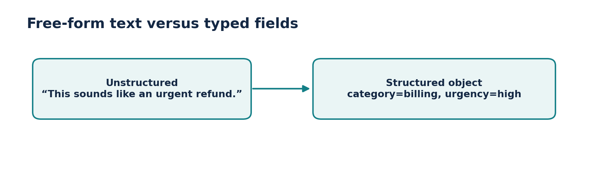
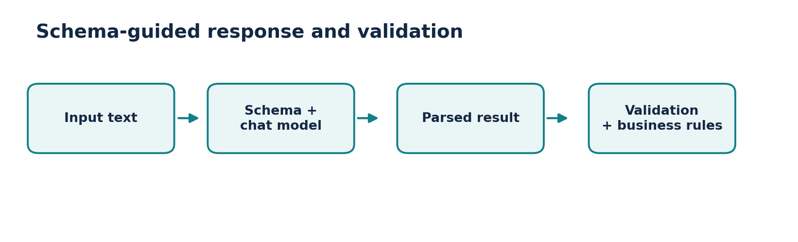
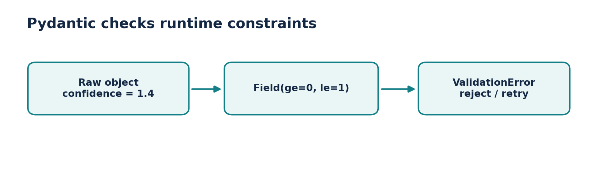
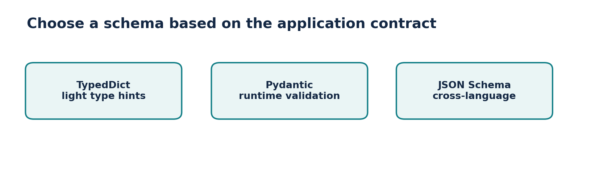

# Video 5 — Structured Output in LangChain

**Course:** CampusX — Generative AI using LangChain  
**Duration:** 1:08:13  
**Lesson:** [Watch on YouTube](https://www.youtube.com/watch?v=y5EmRr1O1h4)  
**Playlist:** [Generative AI using LangChain](https://www.youtube.com/playlist?list=PLKnIA16_RmvaTbihpo4MtzVm4XOQa0ER0)

Turn open-ended model text into typed, validated objects suitable for APIs, databases and automation.

## Learning objectives

- Unstructured prose is hard for software to consume reliably.
- with_structured_output lets supported chat models target a schema.
- TypedDict provides structural type hints; Pydantic performs runtime validation.
- JSON schema is flexible but must be combined with validation and error handling.

## Chapter timestamps

| Time (click to watch) | Topic |
|:---|:---|
| [▶ 00:00](https://www.youtube.com/watch?v=y5EmRr1O1h4&t=0s) | Intro |
| [▶ 01:13](https://www.youtube.com/watch?v=y5EmRr1O1h4&t=73s) | Recap |
| [▶ 02:09](https://www.youtube.com/watch?v=y5EmRr1O1h4&t=129s) | What is Structured Output? |
| [▶ 05:17](https://www.youtube.com/watch?v=y5EmRr1O1h4&t=317s) | Why do we need structured output? |
| [▶ 11:40](https://www.youtube.com/watch?v=y5EmRr1O1h4&t=700s) | Ways to get structured output |
| [▶ 14:08](https://www.youtube.com/watch?v=y5EmRr1O1h4&t=848s) | with_structured_output function |
| [▶ 15:33](https://www.youtube.com/watch?v=y5EmRr1O1h4&t=933s) | TypedDict |
| [▶ 36:07](https://www.youtube.com/watch?v=y5EmRr1O1h4&t=2167s) | Pydantic |
| [▶ 01:02:32](https://www.youtube.com/watch?v=y5EmRr1O1h4&t=3752s) | JSON |
| [▶ 01:02:58](https://www.youtube.com/watch?v=y5EmRr1O1h4&t=3778s) | When to use? |
| [▶ 01:04:53](https://www.youtube.com/watch?v=y5EmRr1O1h4&t=3893s) | Important Points |
| [▶ 01:07:47](https://www.youtube.com/watch?v=y5EmRr1O1h4&t=4067s) | Outro |

## Detailed notes

### 1. What does “structured output” mean?

**[▶ Watch at 02:09](https://www.youtube.com/watch?v=y5EmRr1O1h4&t=129s)**

Unstructured model output is ordinary prose: “The customer is upset and needs a refund.” **Structured output** follows a machine-readable shape such as `{"sentiment":"negative","intent":"refund"}`.

A schema specifies expected field names, types and sometimes allowed values. This is how you turn an LLM into a component that other software can consume—while retaining normal validation and error handling.

- Unstructured: free-form natural-language paragraph.
- Structured: predictable field names and data types.
- Schema compliance is necessary for automation, but it does not prove semantic correctness.



*Figure: Unstructured versus structured output*

### 2. Why software systems need a schema

**[▶ Watch at 05:17](https://www.youtube.com/watch?v=y5EmRr1O1h4&t=317s)**

APIs and databases cannot safely depend on text like “probably medium priority.” They require a stable contract: perhaps `priority` must be one of `low`, `medium`, `high`, and `confidence` must be a number.

Schema-first design makes downstream filters, dashboards and validators possible. A business rule can reject an unsupported category before sending a record to a database or triggering an action.

- Customer support ticket classification.
- Resume or invoice field extraction.
- Product categorization and routing.
- Function/tool arguments returned by an LLM.

### 3. Three practical approaches

**[▶ Watch at 11:40](https://www.youtube.com/watch?v=y5EmRr1O1h4&t=700s)**

You can ask for JSON in the prompt, use a compatible model’s **native structured output or tool calling**, or parse generated text after the call. These vary in reliability and in how much validation they provide.

Use provider-native structured output with an explicit schema when supported, then validate the result in Python. A “reply with JSON” instruction alone may produce code fences, missing fields or inconsistent types.

- Prompt-only JSON: easy but brittle.
- Schema-bound generation: provider capability dependent, usually more reliable.
- Post-processing: parse and validate; be prepared to retry or fail safely.

### 4. Understanding with_structured_output

**[▶ Watch at 14:08](https://www.youtube.com/watch?v=y5EmRr1O1h4&t=848s)**

A supported LangChain chat model exposes `.with_structured_output(schema)`, which returns a model wrapper targeting the requested response shape. Under the hood, providers may use JSON-schema constrained output or tool calling.

The returned type depends on the schema and integration. A Pydantic schema commonly returns a validated Pydantic object, while dictionary/JSON-schema targets often return dictionaries. Check your selected provider’s documented behavior and supported methods.

- Define the data contract before prompting.
- Use descriptions to reduce ambiguity.
- Catch parsing and validation failures instead of trusting every response.



*Figure: Schema-bound generation*

### 5. TypedDict: a lightweight field specification

**[▶ Watch at 15:33](https://www.youtube.com/watch?v=y5EmRr1O1h4&t=933s)**

`TypedDict` specifies which keys and types are expected in a dictionary and is particularly useful for static type checking and concise schemas. It does **not** automatically validate arbitrary Python dictionaries at runtime.

When passed to an integration that supports schema-based output, its type annotations help build a requested schema. If strict runtime checks matter, validate the result separately or use Pydantic.

- Good for quick dict-shaped responses and simple contracts.
- `NotRequired` can express optional fields in supported schemas.
- Do not mistake Python typing annotations for runtime enforcement.

**Practical code**

```python
from typing import TypedDict, Literal

class Ticket(TypedDict):
    category: Literal["billing", "technical", "other"]
    urgency: Literal["low", "medium", "high"]
    summary: str

# With a compatible model:
# typed_model = model.with_structured_output(Ticket)
# result = typed_model.invoke("I was charged twice.")
# print(result["category"])
```

### 6. Pydantic: enforce data rules

**[▶ Watch at 36:07](https://www.youtube.com/watch?v=y5EmRr1O1h4&t=2167s)**

**Pydantic** defines fields using `BaseModel` and validates data at runtime. `Field` descriptions and constraints can document intent, and `ValidationError` explains what failed. It is a strong choice when model output feeds databases, APIs or other sensitive workflows.

An important nuance: Pydantic validation confirms structure and constraints, not whether the LLM extracted the right facts. You still need domain checks, source verification and safe failure behavior.

- Set required types and restricted categories.
- Apply constraints (for example, score between 0 and 1).
- Catch errors and decide whether to ask for clarification, retry or reject.



*Figure: Runtime validation*

**Practical code**

```python
from pydantic import BaseModel, Field, ValidationError
from typing import Literal

class Ticket(BaseModel):
    category: Literal["billing", "technical", "other"]
    urgency: Literal["low", "medium", "high"]
    confidence: float = Field(ge=0, le=1)
    summary: str

raw = {"category": "billing", "urgency": "high",
       "confidence": 0.93, "summary": "Duplicate payment"}
try:
    result = Ticket.model_validate(raw)
    print(result.model_dump())
except ValidationError as exc:
    print(exc.errors())
```

### 7. JSON Schema: portable structure

**[▶ Watch at 01:02:32](https://www.youtube.com/watch?v=y5EmRr1O1h4&t=3752s)**

**JSON Schema** is a language-independent way of describing JSON objects, arrays and constraints. It is useful when a Python application must exchange schema contracts with TypeScript, Java or an HTTP API.

A schema can declare `type`, `properties`, `required`, enums and additional-property behavior. Correctly generated JSON is only the first step: parse it and validate it before trusting it.

- Useful when schemas are shared across programming languages.
- Can be more verbose than a Python Pydantic model.
- JSON is a data format; a schema describes which JSON values are allowed.

**Practical code**

```python
ticket_schema = {
    "title": "Ticket",
    "type": "object",
    "properties": {
        "category": {"type": "string", "enum": ["billing", "technical", "other"]},
        "summary": {"type": "string"}
    },
    "required": ["category", "summary"],
    "additionalProperties": False
}
# structured = model.with_structured_output(ticket_schema)
```

### 8. When to use which schema

**[▶ Watch at 01:02:58](https://www.youtube.com/watch?v=y5EmRr1O1h4&t=3778s)**

Choose **TypedDict** for light, Python-centric dictionary contracts when you will manage validation independently. Choose **Pydantic** when runtime type and value checks are useful. Choose **JSON Schema** for cross-language interoperability or for matching an external API schema.

If the model lacks the structured-output capability you expect, test alternatives such as a parser plus retry, or switch model/integration. Capability and strictness may differ by provider.

- TypedDict → simple type hints.
- Pydantic → Python validation and developer ergonomics.
- JSON Schema → portable contract that interoperates across systems.



*Figure: Schema options*

### 9. Important production checks

**[▶ Watch at 01:04:53](https://www.youtube.com/watch?v=y5EmRr1O1h4&t=3893s)**

Structured does not mean **safe**, **truthful** or **complete**. A model can return valid JSON with a fabricated amount, a wrong person, or a misleading confidence score. Store source evidence and route high-stakes actions through explicit confirmation.

Protect against missing fields, refusal responses, unexpected data, model-version changes, invalid enum values and partial results. Log safely and build a fallback route instead of trying to silently coerce every output.

- Validate schema + business constraints + evidence.
- Test adversarial and ambiguous inputs.
- Avoid executing actions solely on a generated field without appropriate checks.
- Use human review before irreversible changes.

## Mini-project: customer-support ticket classifier

- Input: “I paid for my order twice and need the extra charge refunded.” Output: a typed object with `category`, `urgency`, `summary` and optional `confidence`.
- Write at least 10 test tickets, including mixed topics and unclear requests. Check both schema validity and classification accuracy.
- Route billing tickets to a separate queue—but only after business rules authorize the requested action.

### Practice scaffold

```python
# Complete offline contract demonstration (does not call an LLM).
from pydantic import BaseModel, Field
from typing import Literal

class Triage(BaseModel):
    category: Literal["billing", "technical", "other"]
    urgency: Literal["low", "medium", "high"]
    summary: str = Field(min_length=5, max_length=200)

candidate = {"category": "billing", "urgency": "high",
             "summary": "Customer reports duplicate payment"}
validated = Triage.model_validate(candidate)
assert validated.category == "billing"
print(validated.model_dump_json(indent=2))
```

## Common mistakes to avoid

- TypedDict annotations alone do not validate arbitrary dictionaries.
- Valid JSON can contain factually incorrect extracted values.
- Provider support for strict output varies: check capabilities before relying on them.

## Quick revision / self-test

1. What is the difference between JSON and JSON Schema?
2. Why is Pydantic useful even when the model already returns a dictionary?
3. How would you handle invalid output in a payment-related workflow?
4. Can a schema guarantee that an extracted number is true? Why not?

## Related documentation

- [LangChain Python documentation](https://docs.langchain.com/oss/python/langchain/overview)
- [LangChain Core API reference](https://reference.langchain.com/python/langchain-core)
- [CampusX playlist](https://www.youtube.com/playlist?list=PLKnIA16_RmvaTbihpo4MtzVm4XOQa0ER0)
